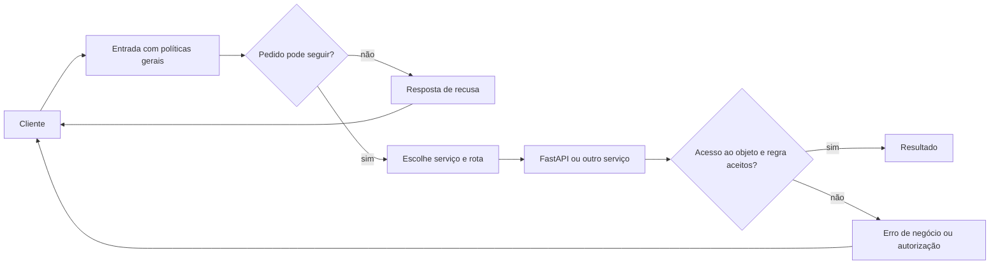
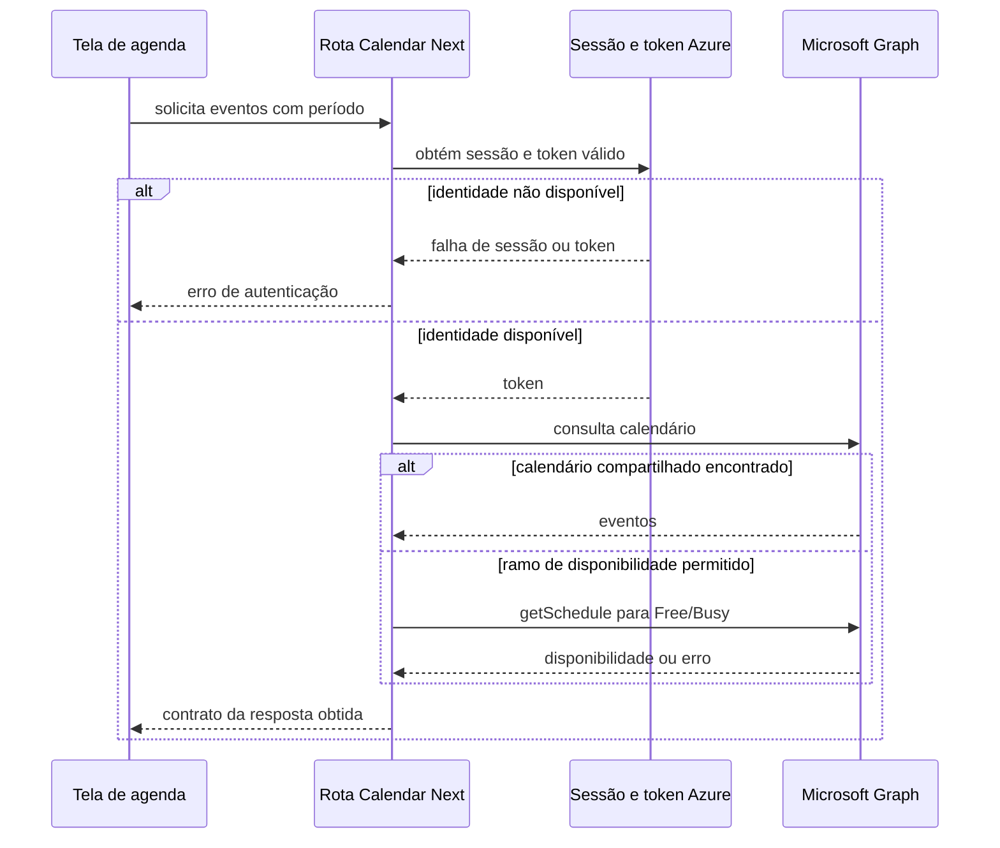
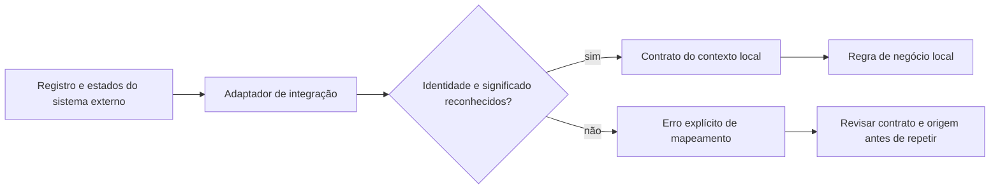

# Integrar sistemas sem espalhar seus contratos pelo produto

Uma operadora abre a agenda e precisa de dados que vêm de outro sistema. Ela quer uma resposta compreensível, com a identidade e a permissão certas. A integração precisa localizar o destino, tratar sua representação e devolver um contrato útil para a tela. Quando cada componente passa a conhecer todos esses detalhes, mudar o sistema externo pode espalhar alterações pelo produto.

As leituras MakersHub deste capítulo pertencem ao checkout `main@e233fb046ec333982cd1547171b0f0bd8d8d92ee`, em **14/10/2026 às 16:16 UTC**. O rewrite Next, a rota Calendar, SSE e WebSocket são código observado. Gateway de produção, BFF agregado de Call Sprint e tradução ampla de modelos são discutidos somente no escopo comprovado ou como proposta.

## 21. API Gateway: uma entrada com políticas explícitas

Um API Gateway organiza a entrada para APIs e pode aplicar roteamento, autenticação geral, limite de taxa e outras políticas. O cliente ganha um ponto de acesso; a equipe ganha uma fronteira para manter essas políticas. As decisões de acesso ao objeto e as regras do agendamento continuam exigindo seu dono no serviço de negócio.

No arquivo observado `frontend/next.config.ts:102`, um rewrite encaminha `/api/v1/*` para `localhost:8000`. Isso comprova um reverse proxy declarado no arquivo local. A entrada efetiva de produção precisa de configuração e caminho próprios; o arquivo não identifica por si só o gateway do cluster. A infraestrutura medida é tratada em [disponibilidade](/explicacoes/availability/).

O desenho abaixo é uma **proposta de responsabilidades**, sem atribuir APISIX ao ambiente.

O benefício é manter entrada e políticas gerais de forma consistente. O custo inclui um componente operacional, capacidade, configuração e observação da nova fronteira. O limite é sua responsabilidade: validar uma identidade no gateway não confirma que ela pode reservar aquele horário ou acessar aquela conta.

A base OSS [Apache APISIX](https://apisix.apache.org/docs/apisix/getting-started/) oferece rotas e plugins. O [exemplo limit-count com HTTPBin](https://github.com/apache/apisix/blob/master/docs/en/latest/plugins/limit-count.md) é **REF didática** de configuração; não prova implantação local. A skill de apoio é `api-and-interface-design`, localizada na [curadoria](/referencia/skills-e-projetos/).

## Roteamento, agregação e políticas na entrada

**Gateway Routing** escolhe o serviço conforme o pedido. **Gateway Offloading** retira do serviço responsabilidades gerais definidas, como terminar TLS ou impor uma quota de entrada. **Gateway Aggregation** reúne respostas para devolver um resultado. Essas decisões podem coexistir, mas a agregação exige decidir o que ocorre quando um participante falha.

Um **Reverse Proxy** encaminha pedidos para serviços do lado servidor. **Proxy** é a ideia mais ampla de intermediar o acesso mantendo uma interface; **Facade** oferece uma interface mais simples para um conjunto de operações. Uma rota que só encaminha bytes e uma operação que compõe resultado têm responsabilidades diferentes. O capítulo de [padrões de código](/explicacoes/code-patterns/) aprofunda essas formas.

Na composição **proposta** de uma tela com lead, histórico e disponibilidade, se cada serviço responder separadamente, a tela coordena três conclusões e erros. Um agregador pode entregar um contrato único, mas precisa declarar se dados incompletos são aceitáveis. Isso é **API Composition**; a escolha de colocá-la no gateway ou num serviço próprio depende da complexidade e da regra. A [fonte Gateway Aggregation](https://learn.microsoft.com/en-us/azure/architecture/patterns/gateway-aggregation) discute essa fronteira.

## 22. BFF: adaptar a resposta à necessidade de um frontend

Um Backend for Frontend tem um contrato pensado para um tipo de cliente. Pode compor dados e adaptar representação para a tela, conservando a regra de negócio no serviço responsável. O benefício é reduzir coordenação e transformação repetidas no frontend; o custo é manter mais um contrato e lidar com falhas das suas dependências.

No caso observado Calendar, `frontend/app/api/calendar/events/route.ts:62–108` obtém sessão e token Azure antes de consultar Microsoft Graph. Em `:198–218`, há o ramo de consulta Free/Busy. É uma adaptação de agenda feita no lado servidor do frontend. Esse recorte não prova um BFF agregado para toda a aplicação, e a classe chamada DataManager não estabelece esse papel sozinha.

O diagrama resume os ramos lidos; não afirma que uma sessão real possui todas as permissões. Um BFF de Call Sprint que reúna lead, histórico e informações da tela é um **blueprint** do curso. Se ele introduzir uma segunda regra de elegibilidade, duas decisões de negócio poderão divergir. O BFF deve chamar a operação responsável pelo negócio.

A base de comparação é YARP. Na aplicação **REF** [dotnet/eShop, ConfigureMobileBffRoutes](https://github.com/dotnet/eShop/blob/main/src/eShop.AppHost/Extensions.cs), o código configura clusters e rotas para o Mobile BFF. Roteamento demonstrado não prova todo contrato de agregação ou segurança. A skill é `backend-bff-pattern`.

## 37. Anti-Corruption Layer: traduzir o significado na fronteira

Uma camada de proteção semântica traduz um modelo externo para o vocabulário do contexto que o consome. Ela ajuda a manter decisões locais claras quando o outro sistema tem nomes, identidades ou estados diferentes. Aqui **ACL** significa Anti-Corruption Layer; a mesma sigla também pode significar lista de controle de acesso em segurança.

O Super R1 estudado manipula registros Salesforce. Lead, Account e Opportunity não devem virar a mesma entidade porque chegam ao mesmo fluxo HTTP. Uma **proposta** de fronteira de domínio explicita qual entidade chegou e traduz os campos necessários antes da regra de qualificação. A [modelagem de negócio](/explicacoes/business-rules/) já desenvolve esses significados; este capítulo acrescenta a fronteira de integração.

O benefício é concentrar tradução e proteger o vocabulário local. O custo é manter mapeamentos, versões e erros dessa fronteira. O limite é a semântica: mudar o nome de um campo não demonstra que os estados dos dois sistemas equivalem.

No exemplo OSS **REF** [Wild Workouts TrainerGrpc](https://github.com/ThreeDotsLabs/wild-workouts-go-ddd-example/blob/master/internal/trainings/adapters/trainer_grpc.go), o adaptador converte `time.Time` em timestamp Protobuf e chama o cliente gRPC. A [montagem do serviço](https://github.com/ThreeDotsLabs/wild-workouts-go-ddd-example/blob/master/internal/trainings/service/service.go) injeta essa fronteira. Isso comprova um **Adapter** e conversão de representação; uma tradução semântica ampla requer um mapeamento adicional demonstrado. A base conceitual é o [contrato de Anti-Corruption Layer](https://learn.microsoft.com/en-us/azure/architecture/patterns/anti-corruption-layer); mappers podem ajudar, mas MapStruct ou Camel não foram comprovados nesse exemplo. As skills são `domain-driven-design` e `backend-api-design`.

## Qual protocolo atende a necessidade

**RPC** chama uma operação remota com contrato de argumentos e resultado. **REST** usa um estilo de restrições para recursos e interação; ter HTTP e JSON não prova todas essas restrições. **HATEOAS** inclui controles de navegação na representação. O [exemplo Spring HATEOAS](https://spring.io/guides/gs/rest-hateoas/) mostra o vínculo self como **REF didática**, sem classificar todo MakersHub como hipermídia.

**GraphQL Federation** compõe schemas de subgraphs sob um contrato compartilhado de consulta e planejamento. Aumenta a necessidade de governar campos, entidades e desempenho. É uma alternativa de estudo; não houve federação GraphQL comprovada nos caminhos lidos.

**Webhook** faz o produtor chamar um receptor HTTP quando algo acontece. **Polling** faz o consumidor perguntar periodicamente, como o feed online do Call Sprint. **Long Polling** mantém o pedido aguardando um resultado até responder ou vencer um prazo. Em todos os casos, identidade, repetição e reconexão exigem decisões; a direção da chamada não define durabilidade.

**Server-Sent Events**, ou SSE, envia eventos do servidor ao browser pelo stream HTTP. Em `opportunities.py:1128`, a rota resolve escopo do ator, assina o broker e libera a assinatura ao sair. O broker tem fila de 200 por assinante e descarta quando cheia; a rota envia ping depois de uma espera de 25 segundos. `useOpportunityEventStream` usa EventSource, e `useOpportunities` aplica patches ou reconcilia a lista ao sair de uma pausa com eventos recebidos. Essas conexões mostram atualização de tela, sem replay durável comprovado.

**WebSocket** abre um canal bidirecional. O código WhatsApp em `whatsapp.py:2804–2859` envia JSON e recebe ping, respondendo pong. Isso prova a direção bidirecional do transporte; não comprova comandos de negócio nos dois sentidos. A [aplicação exemplo FastAPI](https://fastapi.tiangolo.com/advanced/websockets/) é **REF didática** de envio e recepção.

| Necessidade | Alternativa de estudo | Custo e limite |
|---|---|---|
| Perguntar uma informação em intervalos conhecidos | Polling | Repetição mesmo sem mudança; precisa definir intervalo e falha. |
| Esperar uma mudança sem abrir um canal bidirecional completo | Long Polling ou SSE | Mantém conexão; reconexão, proxy e repetição precisam de contrato. |
| Trocar mensagens nos dois sentidos | WebSocket | Sessão, capacidade e protocolo de mensagens ficam explícitos. |
| Avisar outro serviço de um fato | Webhook | Receptor pode estar fora do ar; evento crítico precisa de recuperação. |

## Onde colocar a ajuda de rede

Um **Service Mesh** administra comunicação entre serviços conforme as capacidades configuradas. Um **Sidecar** acompanha o processo numa fronteira de implantação definida. Um **Ambassador** é um proxy próximo ao chamador para acessar dependências. São arranjos de operação, com custo de recursos e configuração; não são garantidos por usar Kubernetes ou uma biblioteca HTTP.

A [documentação Istio](https://istio.io/latest/docs/concepts/traffic-management/) fornece comparação OSS de gestão de tráfego. A implantação efetiva e a superfície de confiança são tratadas em [disponibilidade](/explicacoes/availability/) e [segurança](/explicacoes/security/). O leitor encontra os 23 conceitos, fontes e lacunas delimitadas na [referência de APIs e integração](/referencia/catalogo/09-apis-e-integracao/).
