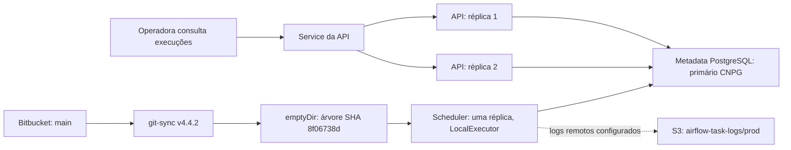
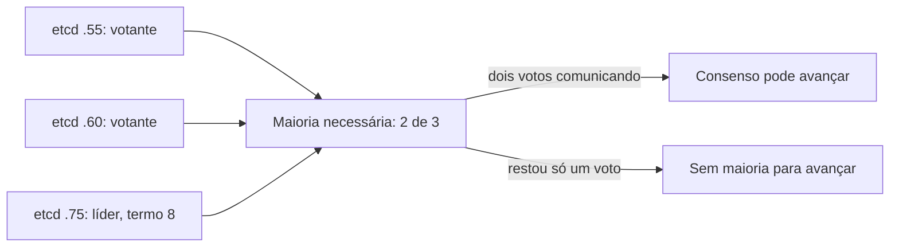
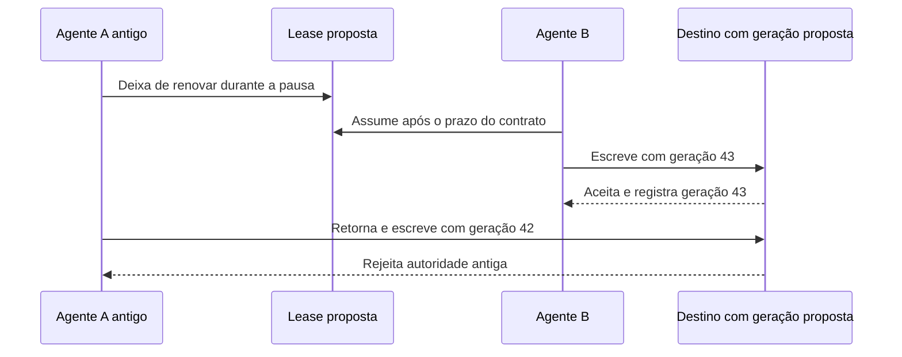
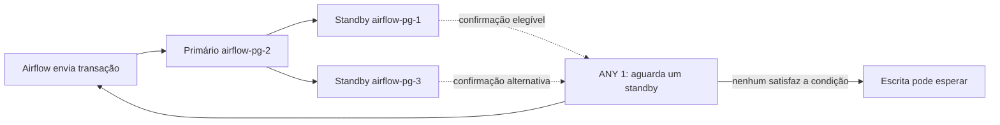
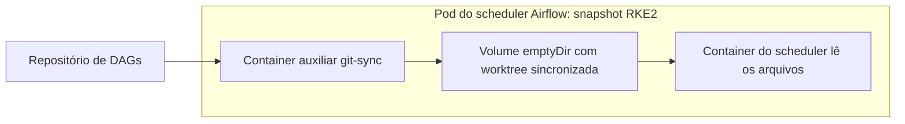
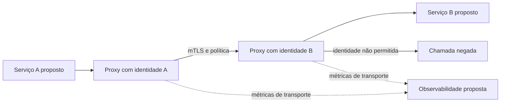

# Por que duas réplicas não resolvem toda queda

Uma operadora precisa consultar as execuções de um relatório enquanto a equipe troca uma versão do sistema. Ter duas cópias da API pode manter a consulta disponível. O relatório também depende de quem agenda as tarefas, de onde o progresso fica guardado e de como os arquivos chegam aos processos. A disponibilidade do caminho completo depende dessas partes juntas.

O caso real deste capítulo é uma **captura de produção**, feita no namespace `airflow` do Rancher/RKE2 em **14/10/2026, entre 16:10 e 16:16 UTC**. Havia três nós Ready, duas réplicas de API, dag-processor e triggerer, e uma de scheduler. A API tinha dois endpoints Ready. Isso demonstra o estado naquele intervalo; não mede tempo de recuperação sob uma falha. Os [recibos do curso](/referencia/evidencias/) preservam a identificação das fontes.

## O caminho inteiro tem partes compartilhadas

O scheduler estava em Airflow 3.2.2, com `LocalExecutor` e paralelismo 32. O Docker do host `.70`, lido em outra captura, também tinha `LocalExecutor`, mas paralelismo 5. A configuração de um deles não descreve o outro. O limite 32 controla concorrência configurada; ele não conta máquinas de execução nem garante que 32 tarefas caibam na memória.

No cluster, o scheduler apontava para o banco de metadados `airflow-pg-rw.airflow.svc:5432/airflow`. O banco guarda o progresso do coordenador. Ele é uma instância diferente do banco de negócio `192.168.254.137:5432/faz_capital`, usado nas medições analíticas do curso.

O desenho abaixo representa as ligações de configuração medidas. O caminho dos logs remotos é configuração, sem uma task acompanhada até a gravação do objeto nesta frente.

A API, o dag-processor e o triggerer usavam `RollingUpdate`, com `maxSurge=0` e `maxUnavailable=1`. Para duas réplicas saudáveis, a regra permite uma indisponível durante a troca, sem criar uma terceira. Pode restar uma atendendo, desde que ela e suas dependências permaneçam saudáveis. O scheduler usava `Recreate`, que encerra os pods antigos antes de criar os novos. Com a única réplica medida, pode existir um intervalo sem esse processo de agendamento. Não foi executado um rollout para medir a duração ou o impacto real. [Contrato de Deployment](https://kubernetes.io/docs/concepts/workloads/controllers/deployment/).

## 28. Leader Election: quem exerce o papel de coordenador

Uma eleição escolhe quem exerce uma função compartilhada. No controle do cluster, o banco distribuído etcd usa consenso Raft para manter seu estado. Às **16:15 UTC**, seus três membros votantes `.55`, `.60` e `.75` respondiam, com `.75` como líder e termo Raft 8. O termo identifica uma fase do protocolo; ele não é a quantidade de máquinas nem a quantidade de gravações.

Com três membros votantes, a maioria necessária é `floor(3/2)+1=2`. Se um membro falhar e os dois restantes ainda se comunicarem, há dois votos. Se dois falharem, resta um voto e não há maioria. O benefício é permitir que a parte com maioria preserve o acordo; o custo é rede, persistência e espera pelo consenso. A conta não protege contra uma falha que atinja todos os sobreviventes. [FAQ do etcd](https://etcd.io/docs/v3.6/faq/), [artigo Raft](https://raft.github.io/raft.pdf).

O Kubernetes também usa permissões temporárias de liderança (**Leases**). Uma delas, `plndr-cp-lock`, tinha `rke2-55` como holder na captura, enquanto `.75` liderava o etcd. Elas pertencem a funções distintas. Uma Lease registra quem deve agir por um prazo; sua renovação ajuda a detectar que o holder continua participando. Um atraso de rede pode parecer uma falha, portanto o prazo equilibra retomada rápida e trocas desnecessárias. [Leases Kubernetes](https://kubernetes.io/docs/concepts/architecture/leases/).

Considere um **exercício proposto**: A perde a Lease, B assume, e A volta depois de uma pausa longa. O sistema que recebe a escrita precisa rejeitar a autoridade antiga. Uma geração crescente pode cumprir esse papel quando o destino a verifica; esse bloqueio é **fencing**. A [implementação client-go](https://raw.githubusercontent.com/kubernetes/client-go/master/tools/leaderelection/leaderelection.go) declara que a eleição não garante fencing. Não foi medido um destino com esse contrato no ambiente.

As bases são etcd, Raft e client-go; Kubernetes é o produto OSS **PROD** medido neste caso. A skill local `backend-distributed-locking`, em `~/.codex/skills/backend-distributed-locking/SKILL.md`, ajuda a distinguir eleição, prazo e recurso protegido. A [curadoria](/referencia/skills-e-projetos/) explica o papel dessas referências. O [capítulo de concorrência](/explicacoes/concurrency/) aprofunda a proteção da escrita.

O scheduler Airflow tem outro mecanismo de coordenação. A documentação oficial consultada em `stable`, versão 3.3.2, descreve múltiplos schedulers coordenados por locks de linha no metadata. Essa capacidade documentada não comprova múltiplos schedulers no runtime 3.2.2 medido, que tinha uma réplica, nem autoriza acrescentar uma eleição etcd própria. [Scheduler Airflow](https://airflow.apache.org/docs/apache-airflow/stable/administration-and-deployment/scheduler.html).

## 30. Replication: o que a confirmação espera

Replicação propaga os dados para outras cópias operacionais. No metadata Airflow, CloudNativePG tinha o primário `airflow-pg-2` e dois standbys. Às **16:12:47 UTC**, ambos apareciam em streaming, estado `quorum`, com atraso de replay de zero bytes. Às **16:14 UTC**, a configuração efetiva era `synchronous_commit=on`, `ANY 1`, `number=1` e `dataDurability=required`.

Nesse contrato, a confirmação espera a persistência exigida em um dos standbys elegíveis; ela não exige a confirmação dos dois. O benefício é acrescentar uma condição remota de durabilidade. O custo aparece na latência e na disponibilidade de escrita quando nenhum standby pode satisfazê-la. O atraso de zero bytes é uma medição daquele instante. Ele não define o RPO de qualquer falha futura. [Replicação CNPG](https://raw.githubusercontent.com/cloudnative-pg/cloudnative-pg/main/docs/src/replication.md), [standbys PostgreSQL](https://www.postgresql.org/docs/17/warm-standby.html).

Este CNPG pertence ao metadata Airflow. A medição `wal_level=minimal` de S4 pertence ao banco de negócio `.137`, e não descreve estes streams. A [explicação de durabilidade](/explicacoes/data-durability/#pattern-30) desenvolve os contratos de leitura, atraso e cópias. PostgreSQL e o operador CloudNativePG são bases OSS, aplicadas no runtime **PROD** desta captura. As skills `airflow-rke2-api` e `k8s-observability-api`, em `~/.agents/skills/`, apoiam a leitura operacional; não substituem um ensaio de recuperação.

Uma exclusão incorreta pode chegar às réplicas. O backup guarda uma versão recuperável sob outra política; o restore demonstra que essa versão pode voltar a ser usada. O CronJob de backup registrou sucesso às **07:14:42Z de 14/10/2026**, mas o curso não leu o objeto nem executou restore. A recuperação permanece sem prova nesta captura. Também não foi ensaiada a promoção de um standby. A configuração `failoverQuorum=false` não resume todas as proteções do operador contra dois primários.

Três nós Ready não provam três zonas ou três hosts físicos independentes. Os nós lidos não tinham labels de zona/região. Para discutir Multi-AZ ou Multi-Region, é necessário identificar os domínios de falha e a conectividade entre eles. O [catálogo de disponibilidade](/referencia/catalogo/13-alta-disponibilidade/) detalha essas alternativas.

## 35. Sidecar: um auxiliar com responsabilidade própria

Um processo auxiliar acompanha a aplicação no mesmo pod para oferecer uma função específica (**sidecar**). No caso medido, git-sync busca o repositório e materializa o código; o Airflow lê a árvore. O volume compartilhado liga as duas responsabilidades, como mostra o primeiro diagrama. O ganho é reutilizar um sincronizador conhecido; o custo é outro processo, credenciais, consumo de recursos e tratamento de falhas. [git-sync](https://github.com/kubernetes/git-sync).

O diretório de DAGs resolvia `/opt/airflow/dags/.worktrees/8f06738d7d3bc735c48c5c5450d5297b4dedc398`. Cinco arquivos dos casos Salesforce, XP e áudio tinham os mesmos hashes no pod e no disco `.70`. Isso prova a igualdade desses cinco conteúdos, sem provar igualdade do repositório inteiro ou execução recente das DAGs. O [capítulo de workflows](/explicacoes/workflow/) reutiliza seus caminhos.

A imagem Airflow tinha um digest identificável, mas `main` podia avançar e mudar as DAGs sem mudar a imagem. Identificar uma release exige registrar ambas as entradas. Git-sync, como aplicação OSS **PROD** no pod, mostra um sidecar real; sua presença não demonstra GitOps completo. A skill `devops-gitops-advanced`, em `~/.codex/skills/devops-gitops-advanced/SKILL.md`, é apoio para avaliar reconciliação de estado desejado, e não prova de sua implantação.

O desenho abaixo representa os papéis lidos no scheduler Kubernetes em 14/10/2026. Ele descreve a configuração observada, sem afirmar que uma sincronização ou uma DAG acabou de executar.

## 36. Service Mesh: política e observação entre serviços

Uma malha de serviços administra funções comuns da comunicação, como identidade de transporte, política e telemetria (**service mesh**). Em um **blueprint didático**, um proxy Envoy recebe a identidade do serviço e aplica uma política antes de encaminhar a chamada. O benefício é aplicar contratos de comunicação de modo consistente; o custo inclui componentes, latência, certificados e diagnóstico de falhas adicionais.

[Istio Bookinfo](https://istio.io/latest/docs/examples/bookinfo/) é uma aplicação OSS **REF** para estudar essas interações; Istio e Linkerd são bases de comparação. Mesh não foi confirmado no ambiente da captura. Mesmo com mTLS, a API precisa verificar se a pessoa pode ler o relatório solicitado. A identidade do serviço não decide sozinha a autorização do negócio.

As skills locais `istio-traffic-management`, `mtls-configuration` e `service-mesh-observability`, em `~/.codex/skills/`, apoiam esses contratos. A [segurança](/explicacoes/security/) desenvolve identidade e autorização, e [mudanças seguras](/explicacoes/safe-change/) explica como decidir a exposição de uma versão.
