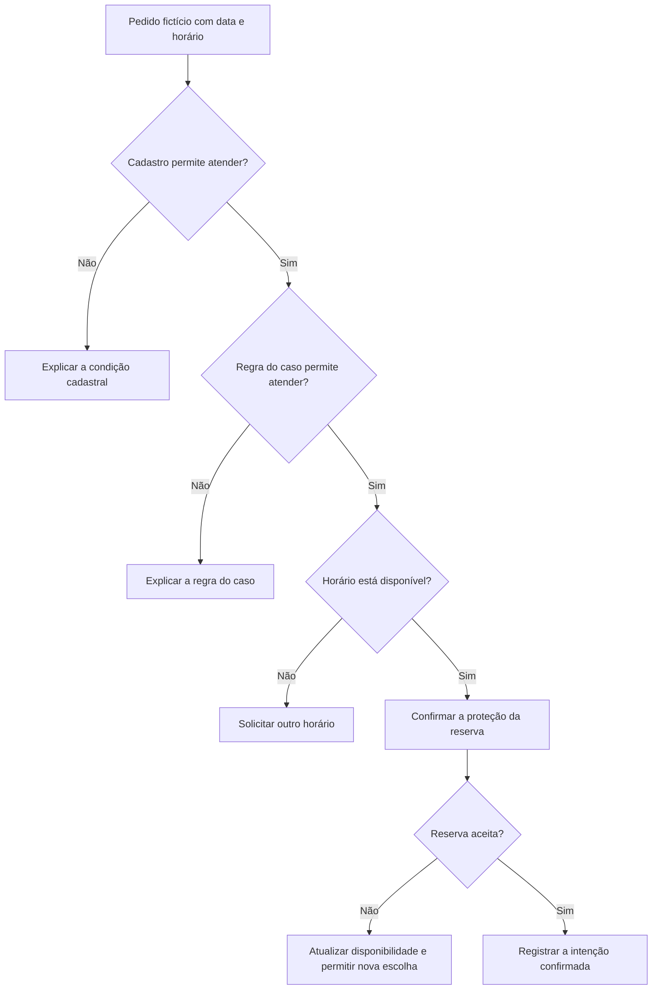
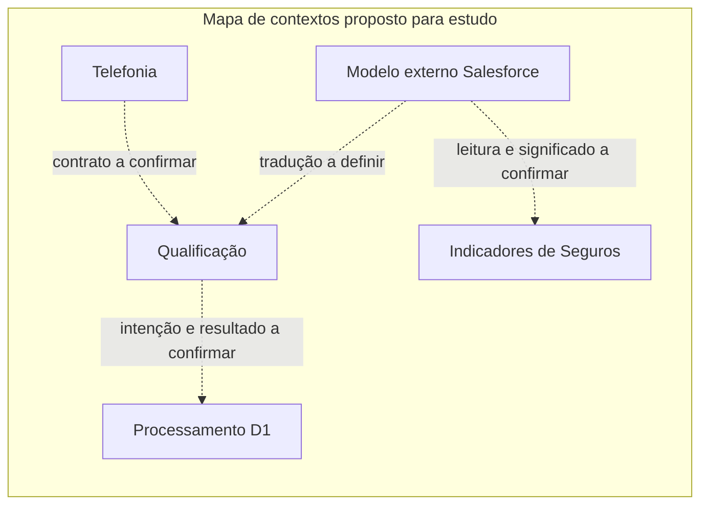
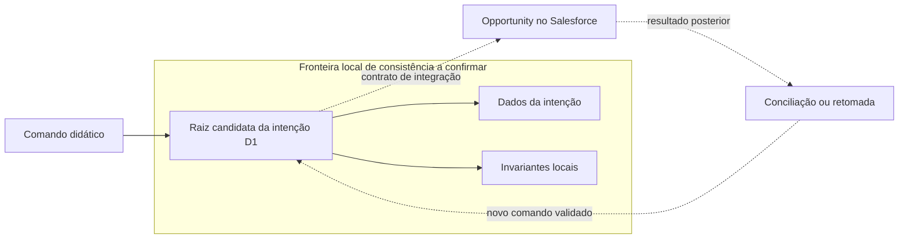
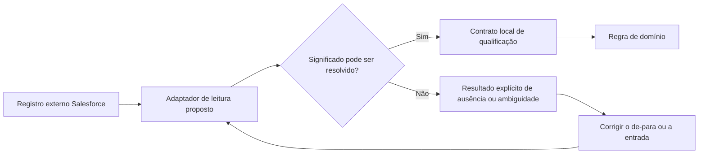

# Quando uma reserva correta no papel sai errada no sistema

Em um exercício fictício, o operador escolhe um assessor e um horário. O assessor está ativo no cadastro, mas sua agenda está ocupada. O sistema recebeu dois fatos verdadeiros e ainda assim poderia tomar uma decisão errada se usasse “ativo” como sinônimo de “disponível”. Aprender a dar significado preciso aos termos evita que uma condição substitua outra durante o caminho do formulário até a integração.

Este capítulo usa código lido no checkout local MakersHub `main@e233fb046ec333982cd1547171b0f0bd8d8d92ee`, em 14/10/2026, e três mudanças históricas identificadas. Os modelos e diagramas novos são **propostas didáticas**. Não foram consultados dados de clientes nem comprovados deploy, execução ou volume de incidentes em produção.

## Ativo, elegível e disponível respondem perguntas diferentes

Ativo descreve uma condição cadastral. Elegível descreve se uma regra permite que uma pessoa atenda aquele caso. Disponível descreve se um horário está livre. Para o exercício, as três perguntas precisam de respostas próprias e de uma data de referência. Uma pessoa pode continuar ativa e elegível mesmo quando está ocupada no horário solicitado.

No código observado, a rota `post_qualify` chama `run_qualify`, e o ramo `_qualify_regular_d1` verifica a disponibilidade antes de persistir a intenção de processamento. Essa leitura mostra que o fluxo possui decisões distintas. Ela não prova que todas as faixas, agendas ou combinações de dados estão corretas. Essa última afirmação exigiria acompanhar a linhagem e consultar os valores reais, trabalho diferente da leitura deste recorte.

O fluxo seguinte é uma proposta para explicar as perguntas. As recusas não constituem uma nova regra do produto; mostram por que a causa de uma recusa precisa corresponder à condição avaliada.

A linguagem compartilhada entre negócio e engenharia, chamada **Ubiquitous Language**, começa nessa distinção. Ela se torna útil quando as mesmas palavras aparecem nas conversas, contratos, documentos e decisões do código. Um nome de função em inglês pode ajudar a busca; sozinho, ele não demonstra que o negócio concordou com seu significado.

## DDD e Bounded Context

Domain-Driven Design começa por compreender as decisões de negócio e seus limites. Um contexto delimitado, chamado **Bounded Context**, define onde um modelo e suas palavras têm significado consistente. Ele permite preservar diferenças legítimas sem obrigar todo o sistema a usar uma única representação.

Na proposta de estudo, Qualificação decide como tratar uma intenção de agendamento. Telefonia organiza a experiência de uma chamada. Indicadores de Seguros reúne dados para leitura. “Estado” significa coisas distintas nessas três áreas: etapa comercial, estado da ligação e classificação de uma apólice. Renomear tudo para uma coluna genérica de status reduziria a precisão.

Esse mapa é candidato. As pastas encontradas no checkout não comprovam contextos de negócio, donos ou acordos entre equipes. Um contexto precisa de regras, linguagem e responsabilidade reconhecidas pelos participantes. A [definição de Bounded Context](https://martinfowler.com/bliki/BoundedContext.html) explica a importância desse limite do modelo.

O benefício é reduzir confusão quando um modelo muda. O custo é definir relações, traduções e responsabilidade pelas mudanças que atravessam a fronteira. Contextos pequenos demais podem multiplicar contratos; um contexto que incorpora todos os conceitos da empresa deixa de delimitar algo útil.

O [Spring Modulith](https://docs.spring.io/spring-modulith/reference/fundamentals.html) é uma base de estudo para fronteiras de módulos em Spring. Ele não decide os significados do negócio. A aplicação **REF** [DDD by Examples: Library](https://github.com/ddd-by-examples/library) apresenta descoberta do domínio, enquanto o [ADR do MyMeetings](https://github.com/kgrzybek/modular-monolith-with-ddd/blob/master/docs/architecture-decision-log/0004-divide-the-system-into-4-modules.md) registra a divisão em quatro módulos. São exemplos didáticos, sem alegação de adoção no MakersHub. As skills [domain-driven-design](/referencia/skills-e-projetos) e [domain-modeling](/referencia/skills-e-projetos) apoiam linguagem e fronteiras.

## A identidade que precisa sobreviver à operação

Uma **Entity** é reconhecida por sua identidade mesmo quando seus atributos mudam. Se uma Opportunity já existe, mudar o horário ou completar uma etapa não significa necessariamente criar outra Opportunity. A identidade determina sobre qual objeto a ação acontece.

No caso histórico FBI-4719, o commit `8206752f9b1bc8650d0a4572f4a0d64566260b83` alterou o dispatcher de Super R1. No pai `3958ac9ee407f6dc2fe1a6905c475befa69cf9cf`, o trecho distinguia Account de Lead e encaminhava os demais IDs para a busca de Lead. Depois, passou a classificar também Opportunity, autorizar a entrada por objeto e entregar a entidade existente ao fluxo de execução. A entrada por Opportunity também passou a ser recusada no ramo de lote D+1.

O arquivo focal teve 951 linhas acrescentadas e 139 removidas; o commit completo alterou 70 arquivos. Esses números medem o patch. Não medem quantas oportunidades foram duplicadas, nem provam um incidente ou a implantação da mudança. O commit **não é ancestral** do HEAD local `e233fb046ec333982cd1547171b0f0bd8d8d92ee` usado neste curso.

A história ensina uma pergunta simples: “Esta ação cria uma entidade ou modifica uma que já existe?” A resposta precisa continuar a mesma no formulário, no dispatcher, na autorização, na repetição e na integração. Acrescentar apenas mais um ramo ao primeiro `if` pode deixar as etapas seguintes com outra interpretação.

## Quando um valor precisa de significado próprio

Um **Value Object** é definido por seus valores e protege sua validade, sem identidade independente. Um horário de reunião proposto pode reunir data, hora e duração se essas partes precisarem ser verificadas juntas. Tornar o valor imutável evita que ele se transforme em outra combinação após a validação.

O caso histórico FBI-4840 oferece uma fronteira menor. O commit `7101d3a4babe95081b0b41d35ec305c08bf8a577` substituiu o formatador de emissão de Seguros que usava `new Date(dateStr)` por `formatBrDate`. O helper distingue uma string inteira `YYYY-MM-DD` de um timestamp. O relato do commit usa a emissão `2026-10-05`, que aparecia como dia 04 na apresentação em UTC−3. A correção registrada conserva a semântica da data de calendário.

Esse commit também **não é ancestral** do HEAD local do curso. O diff comprova a mudança de formatação, e o teste acrescentado não foi executado nesta autoria. O helper continua sendo uma função utilitária; ele não se torna um Value Object DDD apenas por tratar uma data. A lição é proteger o significado antes de escolher a estrutura de classes.

Uma **Factory** de domínio pode concentrar a criação de um objeto válido quando há regras ou associações relevantes. Ela difere de apenas dar outro nome a um construtor. Na aplicação **REF** MyMeetings, [MeetingLimits](https://github.com/kgrzybek/modular-monolith-with-ddd/blob/master/src/Modules/Meetings/Domain/Meetings/MeetingLimits.cs) demonstra um Value Object, e [MeetingGroup](https://github.com/kgrzybek/modular-monolith-with-ddd/blob/master/src/Modules/Meetings/Domain/MeetingGroups/MeetingGroup.cs) oferece criação associada às regras do modelo.

## Aggregate e Aggregate Root

Um **Aggregate** reúne um conjunto pequeno de objetos cujas regras precisam ser preservadas como uma unidade de consistência. Sua **Aggregate Root** é a entrada que protege essas regras. O grupo não é definido pelo número de tabelas, pela tela que apresenta os dados ou pela possibilidade de navegar entre IDs.

Na proposta D+1, uma intenção pendente poderia ter regras próprias de criação e conclusão. A hipótese precisa ser confirmada antes de chamar essa intenção de agregado. O fato de uma operação escrever no PostgreSQL e conversar com Salesforce não coloca os dois sistemas dentro de uma única transação local.

O benefício de uma fronteira pequena é conseguir explicar o que deve permanecer correto após cada alteração. O custo de uma fronteira grande é mais contenção e maior dificuldade de atualizar partes independentes. A aplicação **REF** [MyMeetings: Meeting](https://github.com/kgrzybek/modular-monolith-with-ddd/blob/master/src/Modules/Meetings/Domain/Meetings/Meeting.cs) permite estudar regras associadas à reunião e a seus participantes. A fronteira transacional de MakersHub depende de evidência específica de consistência; consulte [integração confiável](/explicacoes/reliable-integration).

## Domain Service, Application Service e Repository

Um **Domain Service** expressa uma regra que não pertence naturalmente a uma única entidade. Uma função que recebe critérios e decide elegibilidade pode cumprir esse papel se seu foco for a regra. Um **Application Service** coordena o caso de uso: busca os dados necessários, chama as regras, solicita persistência e entrega o resultado.

No recorte observado, `post_qualify` chama `run_qualify`; `_qualify_regular_d1` coordena serviços, repositórios e integração. Esse trabalho demonstra orquestração de aplicação. A presença da palavra negócio no objetivo da função não torna toda consulta externa uma regra de domínio.

Um **Repository** oferece operações de persistência no vocabulário do modelo. O `RoutingRepository.insert_pending_d1_routing` encontrado no checkout grava uma intenção. Sua construção concreta dentro do serviço não comprova que o domínio dependa de uma interface de repositório. Essa separação seria uma decisão adicional.

No MyMeetings **REF**, [CreateMeetingCommandHandler](https://github.com/kgrzybek/modular-monolith-with-ddd/blob/master/src/Modules/Meetings/Application/Meetings/CreateMeeting/CreateMeetingCommandHandler.cs) coordena o caso de uso e [IMeetingRepository](https://github.com/kgrzybek/modular-monolith-with-ddd/blob/master/src/Modules/Meetings/Domain/Meetings/IMeetingRepository.cs) declara o contrato de coleção persistente. A base pode ser uma linguagem comum com FastAPI ou EF Core na borda; nenhum framework cria a separação por si só.

## Domain Policy, Specification e Domain Event

Uma **Domain Policy** dá nome a uma decisão de negócio e ao contexto em que ela vale. Uma **Specification** expressa um critério reutilizável que pode ser combinado ou avaliado. O benefício é discutir e reaplicar a mesma condição com seu significado explícito. O limite é não transformar um predicado de consulta em regra universal sem confirmar seu alcance.

No exercício, “elegível para esta faixa e horário” seria um critério candidato. O nome `get_pool_spec` encontrado no fluxo descreve configuração de pool; esse nome não demonstra o padrão Specification. A aplicação **REF** [Ardalis.Sample.App1](https://github.com/ardalis/Specification/blob/main/samples/Ardalis.Sample.App1/Program.cs) mostra uma specification passada a um repositório. Essa base ajuda a estudar critérios de consulta, sem determinar as invariantes do negócio local.

Um **Domain Event** registra um fato relevante que ocorreu no contexto. “O agendamento foi confirmado” descreve um fato; “confirme o agendamento” descreve uma intenção. Uma linha pendente D+1 não prova, sozinha, que exista um evento de domínio. MyMeetings usa [MeetingCreatedDomainEvent](https://github.com/kgrzybek/modular-monolith-with-ddd/blob/master/src/Modules/Meetings/Domain/Meetings/Events/MeetingCreatedDomainEvent.cs) como **REF**. Persistência, publicação e recuperação de eventos possuem custos próprios, tratados em [mensagens](/explicacoes/messages).

## Anti-Corruption Layer

Uma camada de tradução protege o modelo local dos significados e peculiaridades de outro sistema. Essa proteção, chamada **Anti-Corruption Layer**, precisa ser semântica. Renomear um campo não basta quando a identidade, o estado, a unidade ou a data de referência continuam diferentes.

No estudo de Super R1, um `OwnerId` externo e uma identidade interna de assessor pertencem a contratos diferentes. A proposta é resolver essa tradução antes de aplicar uma regra local. Se o campo externo estiver ausente ou não puder ser associado com segurança, a tradução precisa expor essa condição; escolher um valor parecido mudaria a decisão do negócio.

O benefício é reduzir a propagação de mudanças externas. O custo é manter mapeamentos, tratar perdas de informação e definir quem resolve ambiguidades. Uma camada que copia todo o schema externo apenas desloca o acoplamento. Em **REF**, [Wild Workouts: users_grpc.go](https://github.com/ThreeDotsLabs/wild-workouts-go-ddd-example/blob/master/internal/trainings/adapters/users_grpc.go) e [UserAccessGateway do MyMeetings](https://github.com/kgrzybek/modular-monolith-with-ddd/blob/master/src/Modules/Registrations/Infrastructure/Users/UserAccessGateway.cs) oferecem adaptadores para contraste. Mapear interfaces é apenas parte da proteção semântica.

Uma implementação pode começar com funções ou adaptadores do próprio framework. Um mapper é opcional e não decide o significado dos campos. A skill [domain-driven-design](/referencia/skills-e-projetos) ajuda a preservar a fronteira; [backend-api-design](/referencia/skills-e-projetos) ajuda a definir o contrato. O aprofundamento de APIs e tradução pertence a [APIs e integração](/explicacoes/api-integration), onde essa proposta deve ser confrontada com produtores e consumidores reais.

## Context Map e os acordos que o código não comprova

Um **Context Map** mostra os contextos e suas relações. **Customer/Supplier** descreve um consumidor que negocia prioridades com seu fornecedor. **Conformist** descreve a aceitação do modelo externo, com suas consequências. **Separate Ways** descreve a decisão de manter modelos sem integração quando seu custo não compensa o benefício.

Essas relações envolvem responsabilidade e decisão humana. Um import ou endpoint não prova qual equipe negocia o quê, e a ausência de imports não prova que houve uma escolha consciente de independência. A lacuna nesta evidência é a falta de relações organizacionais verificadas. O [ADR de módulos do MyMeetings](https://github.com/kgrzybek/modular-monolith-with-ddd/blob/master/docs/architecture-decision-log/0004-divide-the-system-into-4-modules.md) oferece **REF para contraste**, sem demonstrar esses acordos no MakersHub.

Um **Shared Kernel** é um subconjunto do modelo compartilhado com responsabilidade e mudanças coordenadas. Uma classe utilitária genérica compartilhada não demonstra esse acordo. O benefício de preservar uma regra comum precisa compensar o custo de coordenação de suas mudanças.

**Open Host Service** oferece um protocolo estável a diferentes consumidores. **Published Language** fornece um formato compartilhado e documentado de mensagens. A presença de OpenAPI ou de um arquivo JSON ajuda a publicar contratos, mas não comprova quem os utiliza nem como sua evolução é acordada. O [NewUserRegisteredIntegrationEvent do MyMeetings](https://github.com/kgrzybek/modular-monolith-with-ddd/blob/master/src/Modules/Registrations/IntegrationEvents/NewUserRegisteredIntegrationEvent.cs) é **REF** de contrato nomeado; seu alcance organizacional não foi inferido.

A [referência completa de DDD](/referencia/catalogo/10-ddd-domain-driven-design) conserva os 21 conceitos, as bases de estudo e as lacunas. Ao analisar um caso, o estudante deve conseguir nomear sua decisão, a identidade que deve sobreviver, a fronteira que protege as invariantes e o contrato que traduz cada sistema externo.
