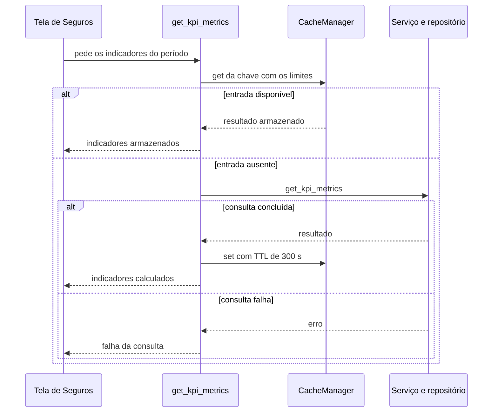
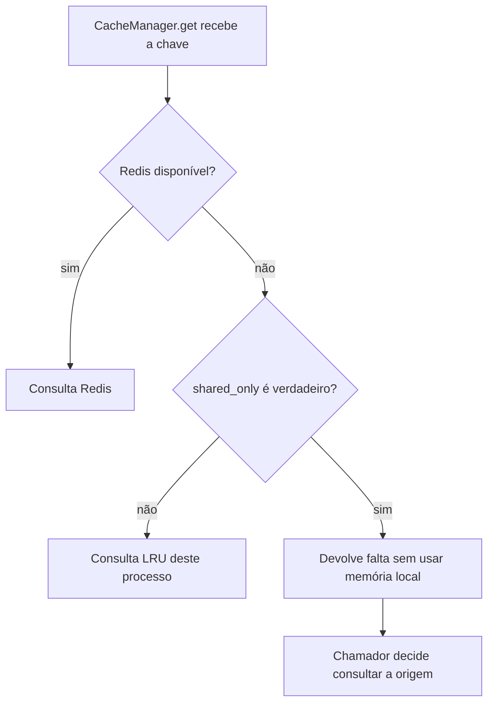
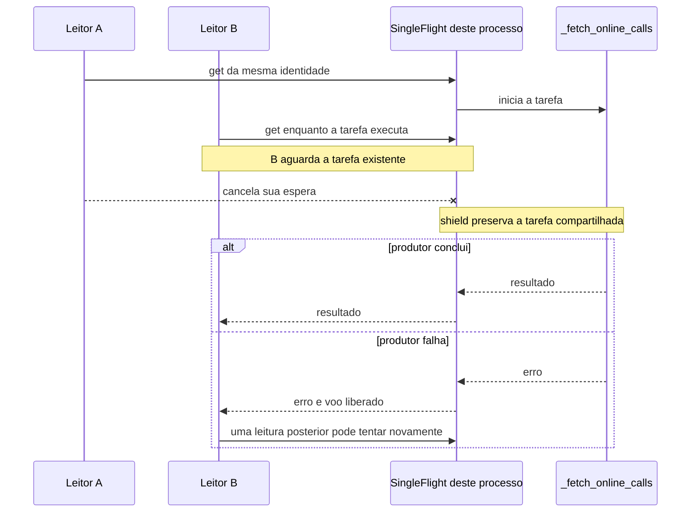
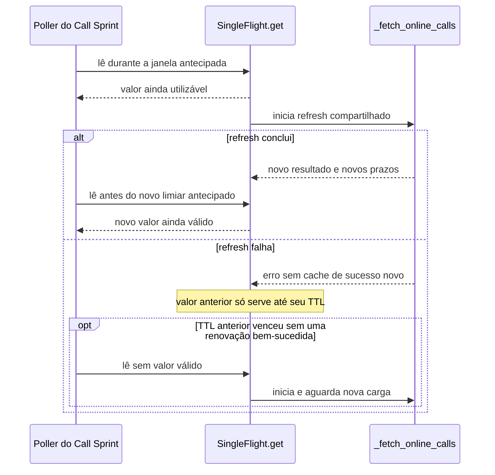

# Carregar indicadores sem repetir trabalho nem misturar recortes

O gestor abre os indicadores de Seguros para um período. Outra pessoa pede o mesmo período logo depois. Recalcular tudo pode repetir trabalho; reutilizar o resultado errado pode mostrar outro recorte. Um cache guarda uma resposta para reutilização, mas precisa identificar de que pergunta ela é resposta e por quanto tempo pode ser usada.

Os casos deste capítulo vêm do código MakersHub `main@e233fb046ec333982cd1547171b0f0bd8d8d92ee`, lido em **14/10/2026 às 16:16 UTC**. Os caminhos mostram mecanismos desse checkout. Não medem desempenho ou configuração efetiva de produção. A [referência de evidências](/referencia/evidencias/) conserva a fronteira entre código, runtime, histórico e proposta.

## 14. Cache Aside: procurar a resposta antes de calcular

No cache-aside, a aplicação consulta o cache. Se faltar a entrada, ela consulta a origem, grava a resposta e a devolve. A aplicação continua responsável por decidir a chave, a validade e a invalidação.

O caminho de Seguros passa pelo hook, pelo `InsuranceDataManager` e por `GET /api/v1/insurance/kpi-metrics`. Em `backend/app/api/v1/insurance.py:53–67`, a rota monta uma chave com início e fim do período, procura a entrada, chama `InsuranceService` e `InsuranceRepository` quando necessário e grava o resultado por **300 segundos, ou cinco minutos**. O repositório consulta `makershub.rpt_insurance__policy`. O capítulo de [fronteiras de código](/explicacoes/code-boundaries/) explica essas responsabilidades.

O benefício é reutilizar uma consulta concluída. O custo inclui memória, serialização, chaves e uma política para dados antigos. O limite aparece quando a chave não existe: a origem ainda precisa responder. Esse padrão, sozinho, não sustenta a página durante uma queda do PostgreSQL.

Uma chave precisa distinguir entradas que mudam o resultado, incluindo filtros e escopo de acesso quando forem pertinentes. Num exemplo proposto, uma consulta de outubro e outra de setembro devem ter identidades diferentes; o mesmo vale para duas pessoas com conjuntos visíveis diferentes. Este exemplo ensina o contrato, sem alegar vazamento no endpoint de Seguros. A data de gravação no cache também não comprova a data dos dados que uma DAG publicou.

A base de comparação é [Redis cache-aside](https://redis.io/docs/latest/develop/use-cases/cache-aside/). No produto OSS Apache Superset, o [processador de query](https://github.com/apache/superset/blob/master/superset/common/query_context_processor.py) e o [utilitário de cache](https://github.com/apache/superset/blob/master/superset/utils/cache.py) mostram leitura, gravação e timeout da abstração de cache. Isso não identifica o backend de uma instalação específica. A skill `backend-caching` apoia a escolha de chave, validade e invalidação; sua curadoria está em [skills e projetos](/referencia/skills-e-projetos/).

## Memória local, cache compartilhado e duas camadas

Um **Local Cache** pertence a um processo. Um **Distributed Cache** oferece uma camada compartilhada, como um Redis acessível por diferentes workers. Um **Two-Level Cache** consulta uma camada local e outra compartilhada segundo um contrato explícito. As três expressões descrevem arranjos distintos.

O `CacheManager` lido em `backend/app/utils/cache_manager.py:128` escolhe Redis quando disponível e um LRU local quando indisponível. Ele não consulta sempre L1 antes de L2. O fallback pode ajudar consultas que aceitam essa cópia, mas processos diferentes não compartilham sua memória. Para operações marcadas `shared_only=True`, o código não lê nem grava nesse fallback. A autorização precisa comprovar a atualidade de uma camada compartilhada ou voltar à origem conforme o contrato do chamador.

Um **TTL Cache** expira entradas depois de um intervalo. Expirar evita guardar indefinidamente a mesma resposta, mas não demonstra que ela era recente na origem. Um **Negative Caching** guarda uma ausência confirmada, como um recurso inexistente, por prazo próprio. Guardar uma falha de rede como se fosse ausência ocultaria um recurso que existe. No feed NextBilling, os resultados classificados como erro não entram no cache de sucesso.

## Quem carrega e quem grava

Em **Read Through**, um loader associado ao cache busca a origem na falta; o chamador usa a interface do cache. Em **Write Through**, a escrita passa por essa camada e grava a origem antes de concluir conforme o contrato escolhido. Em **Write Behind / Write Back**, a persistência fica para depois. Este último pode reduzir espera, mas exige fila de escrita, recuperação e definição do que ocorre se o processo cair antes de persistir.

Para uma reserva de horário proposta, confirmar ao usuário enquanto a única cópia está numa memória volátil seria uma garantia diferente de confirmar após commit. A [integração confiável](/explicacoes/reliable-integration/) desenvolve o problema de persistência e efeitos externos. Ter Redis não seleciona automaticamente uma dessas estratégias de escrita.

## Reunir leitores em uma chamada

Uma **Cache Stampede Protection** evita que a expiração faça muitos leitores recalcularem o mesmo resultado ao mesmo tempo. **Single Flight** é um dos mecanismos: os leitores da mesma identidade aguardam a mesma tarefa em andamento. Locks por chave, TTLs distribuídos no tempo e atualização antecipada podem complementar essa proteção.

No Call Sprint, `useOnlineCalls` configura polling de **1.500 ms**. O caminho passa pelo DataManager, por `get_online_calls` da rota e do serviço e chega a `nextbilling_integration.py:198–218`. A integração usa `SingleFlightCache`, cuja task pertence ao processo. Num exemplo didático, dois processos recebem a mesma chave ausente: cada um pode abrir uma chamada upstream. Coordenação local pode produzir duas chamadas; ela não garante uma única chamada global.

O commit histórico `a304a4e56480648bdc60be96c00532c38d18df9f`, de 03/06/2026, moveu a limpeza para a conclusão da task e acrescentou `asyncio.shield`. Se um de cinco leitores cancela sua espera, a tarefa compartilhada pode continuar para os outros quatro. O diff é ancestral do HEAD local citado; não é recibo de deploy ou reprodução do incidente.

A [documentação asyncio](https://docs.python.org/3/library/asyncio-task.html#shielding-from-cancellation) explica a proteção contra cancelamento do leitor. Ela não torna a chamada externa ilimitada nem elimina a necessidade de timeout. A biblioteca OSS [Cashews](https://github.com/Krukov/cashews) oferece comparação de cache assíncrono Python e coordenação por chave; o mecanismo local MakersHub tem sua própria implementação.

## 15. Refresh Ahead: renovar antes da falta

A renovação antecipada permite começar a carga de um novo valor enquanto o anterior ainda pode ser usado. O leitor ganha uma chance de receber resposta imediata; o serviço paga chamadas de renovação e precisa definir até quando aceita a versão anterior.

O commit histórico `a8bb7023f1ad080cb899cccfb73225231b28e235`, de 03/06/2026, acrescentou ao cache NextBilling um limiar antecipado. O arquivo de configuração declara TTL de **1 segundo** e limiar de **0,5 segundo**. Uma leitura durante essa janela inicia uma task de refresh e recebe o valor ainda válido. Sem leitura elegível, não há esse disparo. Depois do TTL, uma leitura sem valor válido espera a carga. Os valores efetivos do processo não foram medidos.

O [exemplo oficial Caffeine](https://github.com/ben-manes/caffeine/wiki/Refresh), classificado aqui como **REF didática**, também separa elegibilidade e início por consulta. Não foi verificada uma aplicação externa consumidora de Caffeine nesta frente. A skill pertinente continua sendo `backend-caching`.

**Cache Warming** é pré-carregar entradas escolhidas antes da demanda. Pode ser uma rotina agendada, mas o refresh de NextBilling não prova uma rotina assim. Aquecer todas as combinações de filtros pode custar mais que atender as combinações realmente usadas.

## Invalidar não é apagar uma vez e esquecer

**Cache Invalidation** remove ou torna inacessível uma representação que não deve mais ser reutilizada. Pode usar exclusão por chave, geração, tags ou eventos, desde que produtores e consumidores concordem sobre quais representações mudaram.

No código lido, `delete_pattern` do Redis percorre chaves com SCAN em lotes e faz duas passadas. Essa operação não é uma transação que exclui atomicamente todas as chaves frente a escritores.

A autorização tem uma proteção específica: a geração compartilhada (`epoch`) participa da chave de cada usuário. `authz_user_key`, em `cache_manager.py:506`, inclui essa geração; `delete` e `invalidate_pattern` tentam avançá-la antes de apagar entradas. Quando a geração avança, uma leitura que usa a geração nova deixa de alcançar as chaves antigas. Apagar as cópias também recupera espaço, mas a atualidade não precisa depender de um SCAN terminar sem corrida.

Se Redis estava indisponível, uma revogação pode não ter alcançado suas entradas. Na recuperação, `_drain_authz_on_reconnect`, em `:528`, avança a geração e depois remove as cópias de autorização. `RedisService` mantém a disponibilidade compartilhada fechada enquanto executa essa reconciliação. Isso evita reabrir esse caminho de cache antes de reconciliar a recuperação; o comportamento completo de cada chamador ainda depende de seu contrato. A proteção descrita pertence à autorização, não à invalidação de todos os indicadores. O SSE de oportunidades aplica eventos ao cache React Query da tela; isso não comprova que uma carga dbt invalida o Redis desses indicadores.

O leitor pode consultar cada estratégia na [referência do grupo 6](/referencia/catalogo/06-cache/). Para distinguir a idade do cache da idade da origem e localizar uma renovação que falhou, siga para [observabilidade](/explicacoes/observability/). Para experimentar leitores simultâneos com entradas fictícias, a trilha de [tutoriais](/tutoriais/) reúne os laboratórios locais.
