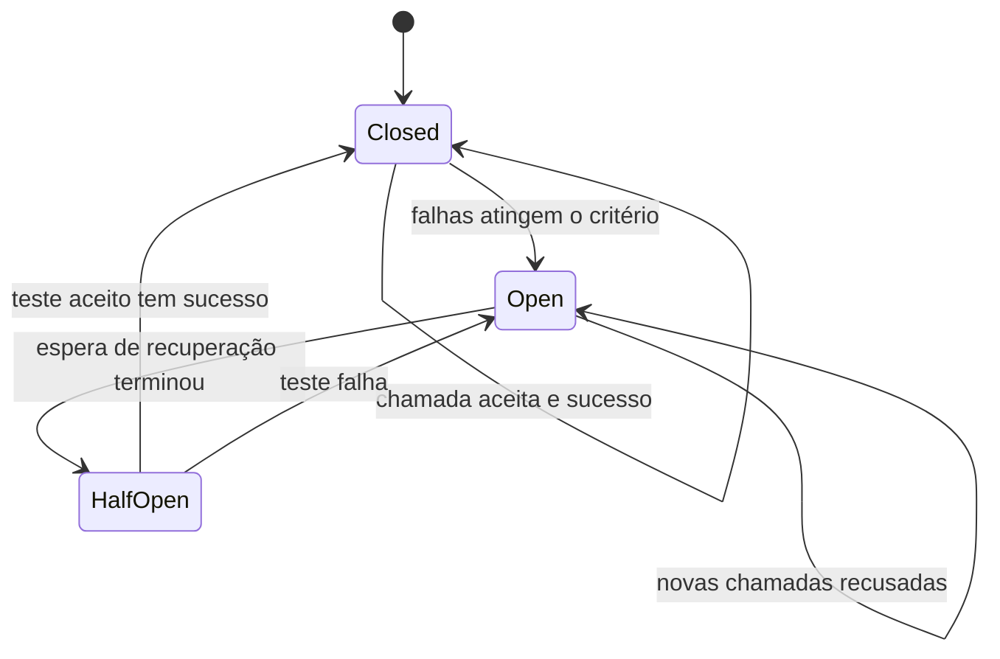
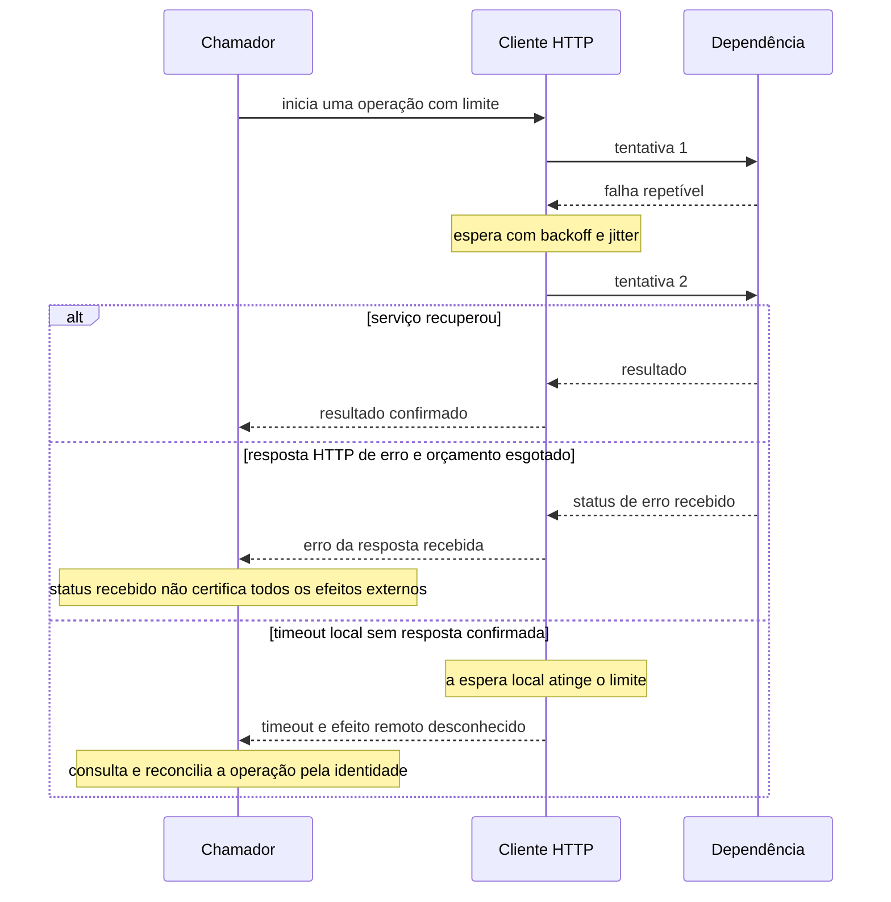
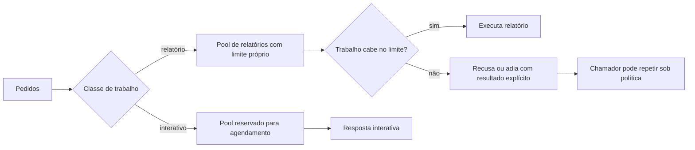
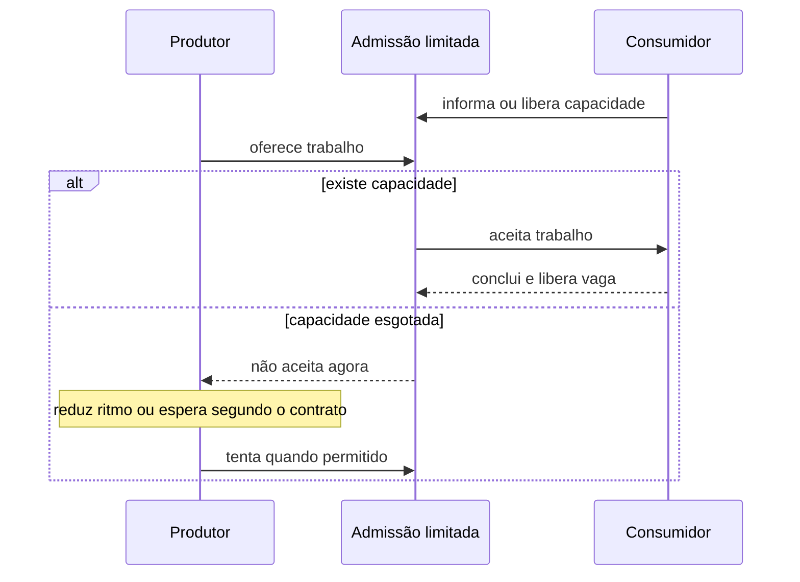
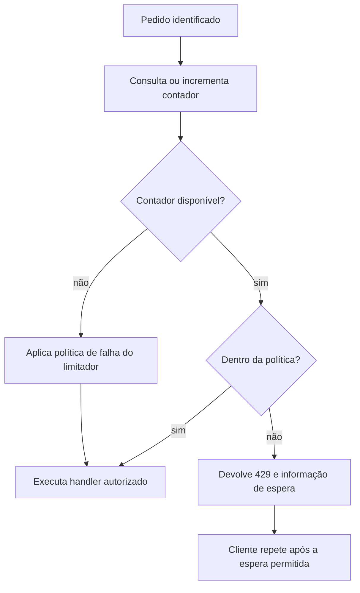

# Continuar atendendo quando a dependência ou a carga piora

Uma operadora envia um pedido e a integração externa demora. Enquanto ela espera, novos pedidos chegam. Repetir cada chamada pode ajudar numa falha transitória; repetir sem limites pode ocupar toda a capacidade e prolongar o problema. Aprender resiliência significa decidir quanto trabalho aceitar, quanto tempo esperar e como recuperar a operação sem inventar um sucesso.

Os caminhos MakersHub deste capítulo foram lidos em **14/10/2026 às 16:16 UTC**, no checkout `main@e233fb046ec333982cd1547171b0f0bd8d8d92ee`. Eles comprovam código e limites declarados, não a capacidade ou disponibilidade de produção. As medidas Airflow e Kubernetes têm escopos próprios nos capítulos de [workflow](/explicacoes/workflow/) e [disponibilidade](/explicacoes/availability/).

## 16. Circuit Breaker: suspender novas tentativas e testar recuperação

Um circuit breaker acompanha resultados e pode recusar chamadas quando a dependência apresenta o padrão de falha definido. Depois de uma espera, permite tentativas controladas para verificar recuperação. O usuário recebe uma falha explícita mais cedo e os recursos deixam de ficar ocupados por toda a espera de cada nova chamada.

No checkout, `backend/app/core/task_queue.py:127` define estados closed, open e half-open. `task_worker.py:227` consulta o breaker antes de executar, e `:262` registra sucesso; os ramos de erro registram falha. O estado está na memória desse objeto. Isso não comprova uma decisão global compartilhada entre todos os processos.

O desenho abaixo explica a política de estados; não certifica contagens de probes concorrentes do código ou um failover em produção.

O benefício é limitar insistência e espera. O custo é manter política, estados, métricas e uma reação útil para quem recebeu a recusa. Seu limite é a operação: interromper uma dependência não autoriza pular uma validação obrigatória ou confirmar um agendamento cujo resultado é desconhecido.

A base comparável é [Resilience4j CircuitBreaker](https://resilience4j.readme.io/docs/circuitbreaker); seu [teste de decoração de supplier](https://github.com/resilience4j/resilience4j/blob/master/resilience4j-circuitbreaker/src/test/java/io/github/resilience4j/circuitbreaker/CircuitBreakerTest.java) é **REF didática**. A skill `backend-resilience-patterns` ajuda a definir política. O [breaker Envoy](https://www.envoyproxy.io/docs/envoy/latest/intro/arch_overview/upstream/circuit_breaking) limita recursos por cluster e prioridade; não é automaticamente a mesma máquina de estados por falha do aplicativo.

## 17. Retry + Exponential Backoff + Jitter: repetir com orçamento

Um **Retry** repete uma tentativa que pode ter falhado temporariamente. **Exponential Backoff** aumenta a espera entre tentativas. **Jitter** varia essa espera para que vários clientes não retornem juntos no mesmo instante. Cada mecanismo precisa de um limite e de critérios sobre que erros justificam nova execução.

O cliente Airflow do checkout, em `backend/app/integrations/airflow_client.py:279`, permite até três tentativas. O breaker aberto pode recusar antes de entrar no laço. `_should_retry`, em `:270`, aceita os status 502, 503, 504 e 429 e as exceções `ConnectError`, `ReadTimeout`, `WriteTimeout` e `PoolTimeout`. Quando recebe uma resposta repetível, usa um `Retry-After` numérico positivo se houver; caso contrário, `_compute_backoff`, em `:383`, calcula a espera crescente e soma jitter. A configuração HTTPX separa connect, read, write e pool, mas essa lista de fases não significa que todo tipo de timeout será repetido. Já o worker em `task_worker.py:314` usa backoff sem jitter. Não foi encontrado Tenacity no recorte pesquisado; seu papel aqui é biblioteca de comparação.

No cálculo didático, duas camadas que envolvem a mesma operação e permitem três execuções cada podem produzir **3 × 3 = 9 chamadas**. Isso não comprova que os retries lidos se aninham dessa maneira em produção. Antes de escolher limites, é preciso saber quem possui o orçamento de tentativa na cadeia real.

O timeout é uma conclusão da espera local; ele pode ocorrer sem que a dependência devolva uma resposta. Uma escrita pode ter ocorrido antes de sua resposta se perder. `_request` também atende POST, inclusive o trigger de DAG; sua política de retry não comprova que todo POST seja idempotente. Antes de repetir um efeito incerto, o chamador precisa de identidade estável e consulta ou reconciliação do resultado, conforme o contrato da operação. O Click2Call lido em `nextbilling_integration.py:165–180` não repete cegamente o POST sem resposta, porque uma nova tentativa pode discar outra vez. O benefício do retry aparece quando a falha é recuperável; o custo é carga e espera adicionais. A repetição segura de efeitos está em [integração confiável](/explicacoes/reliable-integration/).

A base [Tenacity](https://tenacity.readthedocs.io/en/latest/) permite políticas de parada, espera e coroutine; usar um decorator sem limites explícitos pode produzir repetição ilimitada. O [teste de atividade Temporal](https://github.com/temporalio/temporal/blob/main/tests/activity_api_batch_unpause_test.go) configura `RetryPolicy` e é **REF didática**, não prova de uma aplicação Temporal Samples implantada. As skills pertinentes são `python-resilience` e `backend-idempotency`.

## Timeout e prazo total

Um **Timeout** limita uma espera definida, como aguardar conexão ou leitura. **Deadline Propagation** conserva um prazo da operação ao atravessar serviços. Dar a cada etapa vinte segundos pode exceder um orçamento total de vinte segundos; o tempo restante precisa acompanhar a cadeia.

No exemplo proposto, uma operação tem dez segundos e gastou três na primeira etapa. Restam **10 − 3 = 7 segundos**, incluindo a próxima chamada e as esperas de retry. O cliente Airflow lido tem timeouts por fase; sua existência não prova deadline propagado. A [documentação HTTPX](https://www.python-httpx.org/advanced/timeouts/) detalha as fases, e [gRPC deadlines](https://grpc.io/docs/guides/deadlines/) fornece a base de propagação. Cancelar a espera do chamador não desfaz automaticamente um efeito externo já realizado.

## 18. Bulkhead: limitar o alcance de uma carga ou falha

Um bulkhead reserva ou separa recursos para que uma classe de trabalho não consuma a capacidade de outra. O recurso protegido pode ser vagas, conexões, threads, processos ou memória. A força da separação depende de qual fronteira realmente existe.

O worker MakersHub declara quatro vagas e usa `asyncio.Semaphore` antes de executar a task. Isso limita chamadas concorrentes nesse worker. Não prova que cada task tenha memória isolada, que exportações tenham um pool reservado ou que o limite seja quatro para todas as réplicas somadas.

O desenho seguinte é uma **proposta** para comparar isolamento, não a topologia implantada. Um relatório pesado tem capacidade própria; sua falha não deve consumir todas as vagas reservadas ao agendamento.

O benefício é conter o alcance da saturação. O custo é capacidade reservada que pode ficar ociosa e administração de filas/pools. O limite é a fronteira: semáforo não impede uma task de gastar toda a RAM do processo. [Resilience4j Bulkhead](https://resilience4j.readme.io/docs/bulkhead) distingue semáforo de thread pool com fila limitada; seu [teste de supplier](https://github.com/resilience4j/resilience4j/blob/master/resilience4j-bulkhead/src/test/java/io/github/resilience4j/bulkhead/BulkheadTest.java) é **REF**. As skills são `backend-resilience-patterns` e `backend-concurrency-mechanics`.

## 19. Backpressure: capacidade do destino controla o fluxo

Backpressure faz a capacidade do consumidor influenciar o ritmo do produtor. Uma fila pode ajudar, mas guardar mais trabalho sem controlar entrada apenas desloca a espera. É preciso definir limite, sinal de capacidade e reação quando não há lugar.

No checkout, o produtor executa `RPUSH` em `task_queue.py:368`, enquanto o worker faz `BLPOP` e espera uma vaga local. Esse caminho não contém gate de tamanho na admissão. No SSE de oportunidades, cada assinante tem fila de 200; o broker registra e descarta um evento quando ela enche. Descarte é uma política de sobrecarga diferente de sinalizar ao produtor que diminua o ritmo.

Este desenho é uma **proposta de protocolo** de capacidade, não uma garantia da fila Redis observada.

O benefício é limitar acúmulo e espera. O custo é conectar produtor, fila e consumidor e definir o que fazer com recusa. Seu limite inclui perdas e durabilidade: reduzir ritmo não registra automaticamente uma operação crítica para recuperação.

A base [Reactive Streams](https://www.reactive-streams.org/) define backpressure assíncrona. A referência OSS [SolaceIO do Beam 2.77](https://beam.apache.org/releases/javadoc/2.77.0/org/apache/beam/sdk/io/solace/SolaceIO.html) discute modos de escrita e pressão de recursos; é uma comparação **REF didática** cujo efeito depende de conector e runner. O exemplo streaming de Beam não prova esse contrato sozinho. A skill de apoio é `backend-concurrency-mechanics`; o processamento por workers está em [trabalho distribuído](/explicacoes/distributed-work/).

## 20. Rate Limiting: limitar frequência por identidade

Rate limiting restringe quantos pedidos uma identidade pode fazer num intervalo. Essa identidade pode ser IP, usuário, chave de API ou integração. É diferente de concorrência: sessenta pedidos por minuto ainda podem chegar muito próximos e ocupar várias vagas ao mesmo tempo.

O código configura SlowAPI com Redis e janela fixa em `rate_limiter.py:122`; `main.py` instala a configuração, e rotas de autenticação usam decorators. `api_key_auth.py:99` tem outra política de contador por chave. O código declara fail-open quando o contador não está disponível. Isso deixa o teto temporariamente sem imposição nesse ramo; não substitui a autenticação por uma permissão irrestrita.

Numa política **hipotética** de sessenta pedidos por minuto, um cliente que já fez sessenta recebe recusa no pedido seguinte até a janela permitir. Um limite local de sessenta em cada uma de duas instâncias pode permitir até **2 × 60 = 120** no conjunto; quota compartilhada precisa de coordenação compartilhada.

O benefício é distribuir uso e proteger quotas. O custo é armazenamento, identidade e escolha de janela. O limite é que uma janela fixa pode permitir rajadas na troca de intervalo; ela não garante memória isolada ou fila vazia. A base [limits](https://limits.readthedocs.io/en/stable/strategies.html) compara estratégias. O [exemplo oficial APISIX limit-count](https://github.com/apache/apisix/blob/master/docs/en/latest/plugins/limit-count.md), com rota e HTTPBin, é **REF didática** de quota no gateway. A skill é `rate-limiting`.

## Outras respostas à falha e à sobrecarga

**Fallback** fornece uma alternativa explícita, como um valor anterior permitido. **Graceful Degradation** mantém parte do serviço disponível e informa o que está incompleto. Um cache com indicadores antigos pode servir à consulta sob política; uma confirmação de reserva não deve virar sucesso por conveniência. **Fail Fast** recusa cedo um trabalho impossível ou uma dependência já bloqueada.

**Load Shedding** descarta ou recusa carga excedente. **Throttling** reduz o ritmo, podendo atrasar pedidos. A escolha precisa dizer ao usuário se seu trabalho foi aceito, adiado ou perdido. A fila SSE cheia mostra um descarte no código; não demonstra perda recuperada por replay.

**Health Check** consulta uma condição de saúde. **Heartbeat** renova um sinal de atividade. **Watchdog** observa falta de progresso ou sinal e aciona uma reação. **Self-Healing** tenta recuperar automaticamente, como reconectar ou substituir uma instância. Uma resposta a uma probe não prova que a tarefa de negócio terminou; reiniciar repetidamente também não corrige toda causa. Os mecanismos de infraestrutura ficam em [disponibilidade](/explicacoes/availability/).

**Chaos Engineering** aplica uma falha controlada para investigar uma hipótese, com observação e recuperação definidas. O [contrato Chaos Toolkit](https://chaostoolkit.org/reference/api/experiment/) é **REF** para estudar experimentos e rollbacks. Nenhuma falha foi injetada no ambiente MakersHub para produzir esta aula.

A [referência do grupo 7](/referencia/catalogo/07-resiliencia/) permite consultar cada conceito. Os sinais para distinguir espera, erro e saturação estão em [observabilidade](/explicacoes/observability/); as regras para dois executores escreverem no mesmo recurso estão em [concorrência](/explicacoes/concurrency/).
