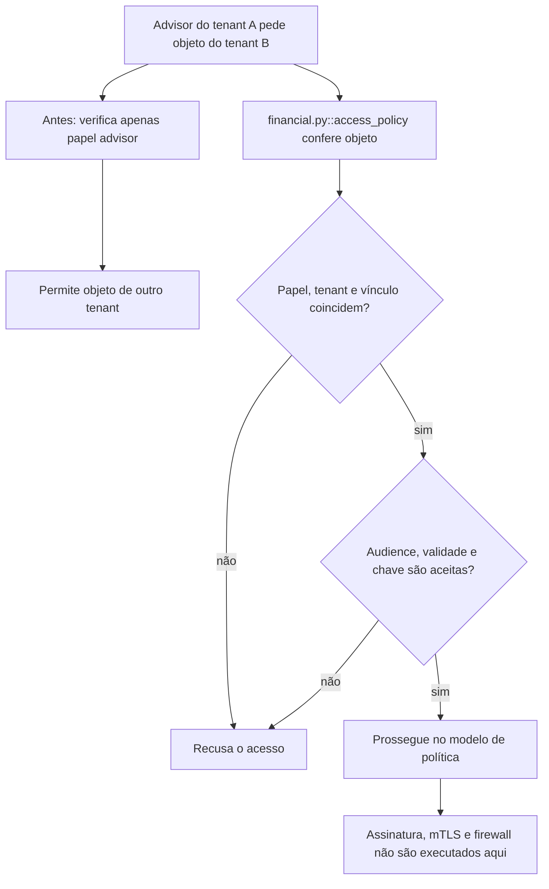

# Por que a permissão precisa alcançar o objeto certo

Continue o mesmo caso: [volte ao caso](/jornadas/access-policy/); [execute a experiência](/tutoriais/casos/access-policy/); [resolva a tarefa](/guias/casos/access-policy/); [consulte contratos e fontes](/referencia/casos/access-policy/).

Ana é uma assessora fictícia do tenant A, ligada à conta SYNTHETIC-1. Uma ordem pertence ao tenant B e à conta SYNTHETIC-2. Conferir apenas o papel advisor permite que Ana a abra. A prática acrescenta a relação com o objeto e ainda mostra como audience, vencimento e retirada de chave alteram uma decisão.

## A condição anterior

O papel sozinho permite acesso a outra conta. Um token vencido ou destinado a outra API também poderia ser aceito por um verificador incompleto.

## O mecanismo que muda a condição

A política confere papel, tenant e vínculo da conta. A decisão de credencial confere audience e expires. Uma chave retirada sai do conjunto aceito.

O fluxo abaixo descreve o modelo financeiro local proposto pelo curso. Ele não certifica um caminho de produção.

O localizador da operação é `access_policy / object-authorization / credential-boundary / least-network-path`. Este é um caso financeiro hipotético com participantes e dados fictícios. Uma corretora de maior porte, do setor em que atua a XP, é apenas o contexto de negócio. O texto não descreve um incidente nem uma arquitetura interna real da XP. A busca delimitada localizou candidatos da nossa stack, mas não estabeleceu um caso histórico completo para todos os conceitos desta família.

## O benefício, o custo e o limite

O acesso entre tenants é recusado. O token com validade 10 já expirou no instante 11. A rota direta entre browser e ledger não pertence às ligações permitidas. A proteção acrescenta uma responsabilidade: alguém precisa conservar a identidade, o estado ou o contrato que a decisão confere. Se essa responsabilidade ficar num participante que pode desistir ou num recorte incompleto, a garantia muda.

As claims não têm assinatura neste modelo. Ele não implementa OAuth2, OIDC, mTLS, bastion, firewall ou service mesh. Não se inferiram permissões reais do MakersHub nem regras regulatórias.

Uma alternativa só atende esta dor se proteger o mesmo recurso e a mesma condição observável. Acrescentar um cache, uma fila ou um serviço separado pode resolver outra parte do fluxo e ainda deixar este mecanismo exposto. A matriz indica as comparações que o exercício permite fazer.

Continue o mesmo caso: [volte ao caso](/jornadas/access-policy/); [execute a experiência](/tutoriais/casos/access-policy/); [resolva a tarefa](/guias/casos/access-policy/); [consulte contratos e fontes](/referencia/casos/access-policy/).

O [mapa de conceitos deste caso](/jornadas/access-policy/conceitos/) informa qual observação cada conceito compartilha com a prática e o que ela não comprova.
