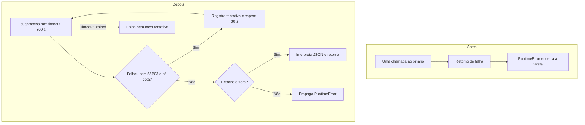

# Por que repetir somente a falha elegível

[Retorne ao caso](/jornadas/airflow-lock-retry/), [entenda o mecanismo](/explicacoes/casos/airflow-lock-retry/), [aprenda fazendo](/tutoriais/casos/airflow-lock-retry/), [resolva a tarefa](/guias/casos/airflow-lock-retry/) ou [consulte o contrato](/referencia/casos/airflow-lock-retry/).

Esperar por um lock pode falhar mesmo quando a mesma operação teria sucesso alguns instantes depois. Repetir automaticamente ajuda nessa situação (retry), desde que a operação possa ser repetida com segurança. A regra histórica não trata toda falha como transitória: ela exige retorno diferente de zero e 55P03 no stderr.

Este caso vem do [Bug FBI-4797](https://fazcapital.atlassian.net/browse/FBI-4797) e do [PR 161 do Airflow](https://bitbucket.org/fazcapital/airflow/pull-requests/161). A investigação leu o campo visível `customfield_10047`, o relato do PR e as [versões anterior](https://bitbucket.org/fazcapital/airflow/src/febaf1be978aad59c29f38d1bd74f357f8e942b5/dags/inflow__xp__stg_to_fct.py) e [selecionada](https://bitbucket.org/fazcapital/airflow/src/55dfe8acb362e6854d1af4e7dd7d17e6497af9bd/dags/inflow__xp__stg_to_fct.py). O relato registra um timeout de lock; o bloqueador original não foi identificado nessa fonte. O código selecionado é histórico. A prática não mede a versão atualmente implantada.

## O caminho real da função

A função `task_run_60_days_rule_hs`, em `dags/inflow__xp__stg_to_fct.py`, monta a conexão, chama `subprocess.run`, interpreta a resposta JSON e acrescenta uma medida de memória (RSS). O patch envolve a chamada externa em um loop. Ele permite duas novas tentativas, com espera fixa de trinta segundos. O código não implementa exponential backoff nem jitter.

O desenho descreve o Python histórico. Na prática, a borda do processo e a espera são substituídas por doubles. Um timeout do próprio `subprocess.run` também se propaga, pois não vira um retorno contendo 55P03.

## Por que a cota importa

Três tentativas com limite individual de 300 segundos e duas esperas de 30 segundos representam 3 × 300 + 2 × 30 = 960 segundos, ou 16 minutos, sem contar overhead. A estimativa de aproximadamente cinco minutos apresentada no PR usa durações observadas de cerca de oitenta segundos por tentativa. Ela não é um teto estático de dez minutos. Um prazo total precisa de um orçamento próprio (deadline), que esse loop não estabelece.

## O que a prática não resolve

O laboratório executa a função Python histórica com substitutos locais controlados (doubles). Ele não inicia uma DAG, não executa o binário Haskell, não conecta ao PostgreSQL e não faz esperas reais. A atomicidade e a idempotência do motor Haskell são premissas relatadas pelo PR e continuam fora desta prova. O código procura 55P03 no stderr; isso também não identifica qual consulta segurava o lock.

Repetir melhora a tolerância à condição transitória selecionada. Investigar quem segurou o lock é outra tarefa. Se a operação pudesse confirmar efeitos antes da falha, seria necessário tratar essa repetição no desenho de consistência; o retorno diferente de zero, sozinho, não provaria ausência de efeitos.

[Retorne ao caso](/jornadas/airflow-lock-retry/), [entenda o mecanismo](/explicacoes/casos/airflow-lock-retry/), [aprenda fazendo](/tutoriais/casos/airflow-lock-retry/), [resolva a tarefa](/guias/casos/airflow-lock-retry/) ou [consulte o contrato](/referencia/casos/airflow-lock-retry/).
