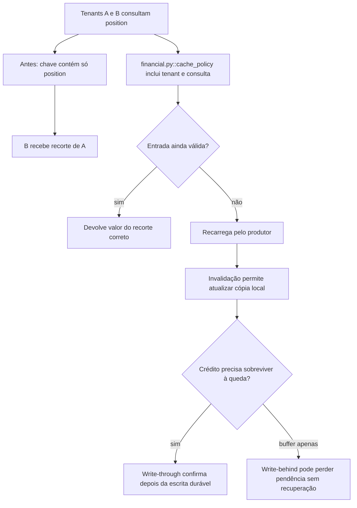

# Por que a posição rápida pertence ao outro recorte

Continue o mesmo caso: [volte ao caso](/jornadas/cache-policy/); [execute a experiência](/tutoriais/casos/cache-policy/); [resolva a tarefa](/guias/casos/cache-policy/); [consulte contratos e fontes](/referencia/casos/cache-policy/).

Ana consulta a posição fictícia do tenant A. Depois, Bruno consulta a posição do tenant B. Uma chave que contém apenas position entrega a Bruno o valor de Ana. O mesmo caso permite observar o que acontece quando um valor vence, quando o cache local envelhece e quando uma escrita em memória é perdida numa queda.

## A condição anterior

Uma chave incompleta mistura tenants. O cache pode devolver um valor após o TTL e perder um crédito que ficou apenas na memória.

## O mecanismo que muda a condição

A chave inclui tenant e consulta. O vencimento manda recarregar. A invalidação permite ao nível local reler seu dono; write-through grava antes de confirmar.

O fluxo abaixo descreve o modelo financeiro local proposto pelo curso. Ele não certifica um caminho de produção.

O localizador da operação é `cache_policy / cache-key / cache-expiry / write-policy`. Este é um caso financeiro hipotético com participantes e dados fictícios. Uma corretora de maior porte, do setor em que atua a XP, é apenas o contexto de negócio. O texto não descreve um incidente nem uma arquitetura interna real da XP. A busca delimitada localizou candidatos da nossa stack, mas não estabeleceu um caso histórico completo para todos os conceitos desta família.

## O benefício, o custo e o limite

O tenant B recebe seu próprio valor. O instante 11 já ultrapassou o vencimento 10. O crédito de R$ 100 permanece no armazenamento no modelo que confirmou a escrita durável. A proteção acrescenta uma responsabilidade: alguém precisa conservar a identidade, o estado ou o contrato que a decisão confere. Se essa responsabilidade ficar num participante que pode desistir ou num recorte incompleto, a garantia muda.

Os níveis são dicionários locais. Não se executou Redis, cache distribuído, política de eviction ou medição de desempenho. O caso histórico de single-flight oferece uma execução distinta do cancelamento e da renovação.

Uma alternativa só atende esta dor se proteger o mesmo recurso e a mesma condição observável. Acrescentar um cache, uma fila ou um serviço separado pode resolver outra parte do fluxo e ainda deixar este mecanismo exposto. A matriz indica as comparações que o exercício permite fazer.

Continue o mesmo caso: [volte ao caso](/jornadas/cache-policy/); [execute a experiência](/tutoriais/casos/cache-policy/); [resolva a tarefa](/guias/casos/cache-policy/); [consulte contratos e fontes](/referencia/casos/cache-policy/).

O [mapa de conceitos deste caso](/jornadas/cache-policy/conceitos/) informa qual observação cada conceito compartilha com a prática e o que ela não comprova.
