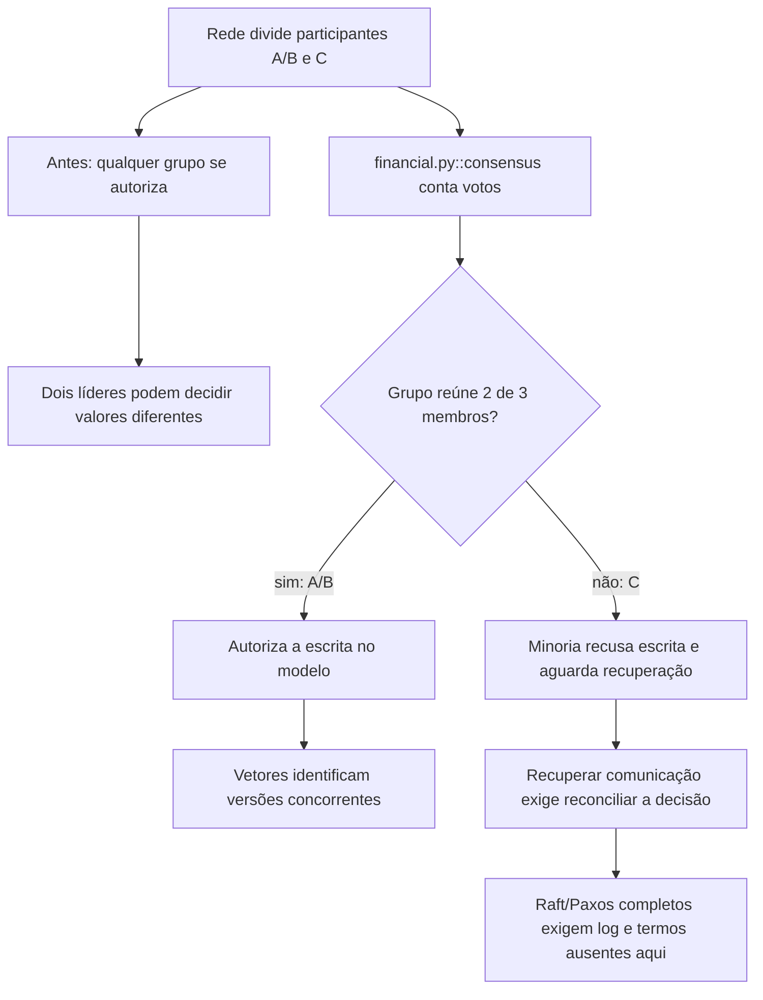

# Por que os escritórios deixam de conversar

Continue o mesmo caso: [volte ao caso](/jornadas/consensus/); [execute a experiência](/tutoriais/casos/consensus/); [resolva a tarefa](/guias/casos/consensus/); [consulte contratos e fontes](/referencia/casos/consensus/).

Uma corretora hipotética divide o serviço em três participantes: A, B e C. Uma falha de comunicação deixa A e B juntos e C sozinho. Se cada grupo se declarar autorizado a gravar, duas decisões incompatíveis podem aparecer. A prática permite somente ao grupo que reúne dois dos três participantes autorizar a escrita.

## A condição anterior

Dois grupos se autorizam a liderar. Uma escolha baseada somente na última versão pode esconder uma alteração concorrente.

## O mecanismo que muda a condição

A decisão exige maioria. Vetores registram as duas versões concorrentes; um relógio lógico avança além do evento recebido. Um participante preparado espera a decisão que não conhece.

O fluxo abaixo descreve o modelo financeiro local proposto pelo curso. Ele não certifica um caminho de produção.

O localizador da operação é `consensus / majority-partition / causal-versions / prepared-participant`. Este é um caso financeiro hipotético com participantes e dados fictícios. Uma corretora de maior porte, do setor em que atua a XP, é apenas o contexto de negócio. O texto não descreve um incidente nem uma arquitetura interna real da XP. A busca delimitada localizou candidatos da nossa stack, mas não estabeleceu um caso histórico completo para todos os conceitos desta família.

## O benefício, o custo e o limite

O modelo aceita um líder no grupo de dois e nenhuma escrita na minoria. Duas leituras e duas escritas em três membros têm pelo menos 2 + 2 − 3 = 1 participante comum. A proteção acrescenta uma responsabilidade: alguém precisa conservar a identidade, o estado ou o contrato que a decisão confere. Se essa responsabilidade ficar num participante que pode desistir ou num recorte incompleto, a garantia muda.

A prática mostra requisitos e contraexemplos, em um modelo finito. Ela não implementa Raft, Paxos, 2PC ou 3PC completos, não prova linearizabilidade e não cobre todas as falhas assíncronas.

Uma alternativa só atende esta dor se proteger o mesmo recurso e a mesma condição observável. Acrescentar um cache, uma fila ou um serviço separado pode resolver outra parte do fluxo e ainda deixar este mecanismo exposto. A matriz indica as comparações que o exercício permite fazer.

Continue o mesmo caso: [volte ao caso](/jornadas/consensus/); [execute a experiência](/tutoriais/casos/consensus/); [resolva a tarefa](/guias/casos/consensus/); [consulte contratos e fontes](/referencia/casos/consensus/).

O [mapa de conceitos deste caso](/jornadas/consensus/conceitos/) informa qual observação cada conceito compartilha com a prática e o que ela não comprova.
