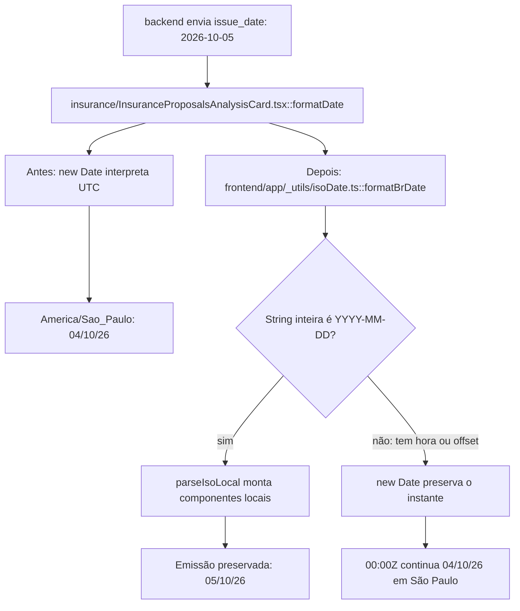

# Por que o dia da emissão muda no caminho

Continue o mesmo caso: [volte ao caso](/jornadas/date-only/); [execute a experiência](/tutoriais/casos/date-only/); [resolva a tarefa](/guias/casos/date-only/); [consulte contratos e fontes](/referencia/casos/date-only/).

A coluna Emissão recebe a string 2026-10-05. O commit FBI-4840 documenta que a interface mostrava o dia 04 em São Paulo. O valor representa um dia do calendário; o construtor anterior o interpretava como meia-noite UTC, que ainda corresponde ao dia 04 no fuso UTC−3.

## A condição anterior

O formatter anterior converte 2026-10-05 para 04/10/26 em America/Sao_Paulo.

## O mecanismo que muda a condição

formatBrDate reconhece a string inteira YYYY-MM-DD e usa parseIsoLocal. Uma string com hora e Z continua sendo um instante.

O fluxo abaixo descreve o corpo de código histórico lido; os recursos externos do laboratório são doubles declarados. Ele não certifica um caminho de produção.

O localizador da operação é `InsuranceProposalsAnalysisCard.formatDate / formatBrDate / parseIsoLocal`. Este caso vem do [card FBI-4840](https://fazcapital.atlassian.net/browse/FBI-4840) e do [PR 585](https://bitbucket.org/fazcapital/makershub/pull-requests/585). A investigação leu o conteúdo visível do card, a descrição e os comentários pertinentes do PR. Você pode comparar a [versão anterior](https://bitbucket.org/fazcapital/makershub/src/eca3f89e0e703316b807018b7947fbbb2043c806/frontend/app/_utils/isoDate.ts) com a [versão alterada](https://bitbucket.org/fazcapital/makershub/src/7101d3a4babe95081b0b41d35ec305c08bf8a577/frontend/app/_utils/isoDate.ts). A prática abaixo executa esse recorte em isolamento; o estado de produção não foi medido por ela.

## O benefício, o custo e o limite

A data simples aparece como 05/10/26. O timestamp 2026-10-05T00:00:00Z continua aparecendo como 04/10/26, pois o instante não foi alterado. A proteção acrescenta uma responsabilidade: alguém precisa conservar a identidade, o estado ou o contrato que a decisão confere. Se essa responsabilidade ficar num participante que pode desistir ou num recorte incompleto, a garantia muda.

O roteiro executa o helper e o formatter extraído, com Node e Typescript. Ele não consulta Salesforce, não renderiza o card e não prova a versão frontend de produção.

Uma alternativa só atende esta dor se proteger o mesmo recurso e a mesma condição observável. Acrescentar um cache, uma fila ou um serviço separado pode resolver outra parte do fluxo e ainda deixar este mecanismo exposto. A matriz indica as comparações que o exercício permite fazer.

Continue o mesmo caso: [volte ao caso](/jornadas/date-only/); [execute a experiência](/tutoriais/casos/date-only/); [resolva a tarefa](/guias/casos/date-only/); [consulte contratos e fontes](/referencia/casos/date-only/).

O [mapa de conceitos deste caso](/jornadas/date-only/conceitos/) informa qual observação cada conceito compartilha com a prática e o que ela não comprova.
