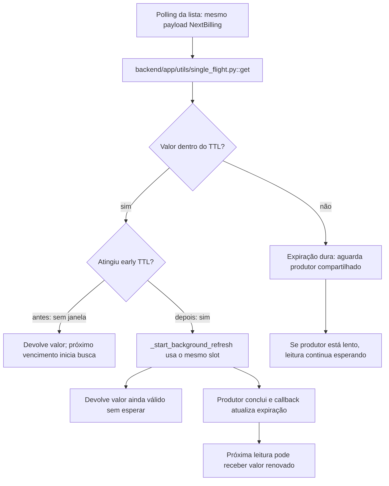

# Por que a lista precisa continuar disponível

Continue o mesmo caso: [volte ao caso](/jornadas/early-refresh/); [execute a experiência](/tutoriais/casos/early-refresh/); [resolva a tarefa](/guias/casos/early-refresh/); [consulte contratos e fontes](/referencia/casos/early-refresh/).

A lista de chamadas é consultada repetidamente. A versão anterior mantém o valor até o TTL, mas a primeira leitura após o vencimento espera a resposta do produtor. FBI-2331 acrescentou uma janela de renovação antecipada para que a consulta seguinte pudesse encontrar o valor novo. Esta história trata de uma evolução documentada.

## A condição anterior

Com relógio em 0,6 e TTL 1,0, a versão anterior não inicia a renovação. A leitura em 1,05 fica esperando o produtor.

## O mecanismo que muda a condição

A versão nova usa early_ttl_seconds=0.5. A leitura em 0,6 devolve calls-v1 e inicia a renovação compartilhada. O roteiro libera essa renovação antes de avançar para 1,05.

O fluxo abaixo descreve o corpo de código histórico lido; os recursos externos do laboratório são doubles declarados. Ele não certifica um caminho de produção.

O localizador da operação é `SingleFlightCache.get / _start_background_refresh`. Este caso vem do [card FBI-2331](https://fazcapital.atlassian.net/browse/FBI-2331) e do [PR 51](https://bitbucket.org/fazcapital/makershub/pull-requests/51). A investigação leu o conteúdo visível do card, a descrição e os comentários pertinentes do PR. Você pode comparar a [versão anterior](https://bitbucket.org/fazcapital/makershub/src/f34e4d3d22d9dcdb53074332dcbf7a48c254c221/backend/app/utils/single_flight.py) com a [versão alterada](https://bitbucket.org/fazcapital/makershub/src/a8bb7023f1ad080cb899cccfb73225231b28e235/backend/app/utils/single_flight.py). A prática abaixo executa esse recorte em isolamento; o estado de produção não foi medido por ela.

## O benefício, o custo e o limite

A leitura em 1,05 recebe calls-v2 sem esperar. As duas versões realizam duas buscas no cenário concluído. A proteção acrescenta uma responsabilidade: alguém precisa conservar a identidade, o estado ou o contrato que a decisão confere. Se essa responsabilidade ficar num participante que pode desistir ou num recorte incompleto, a garantia muda.

O relógio e o produtor são controlados. Se a renovação ainda estiver lenta quando houver expiração dura, a versão nova também pode precisar esperar. Não se provou uma redução de latência em produção.

Uma alternativa só atende esta dor se proteger o mesmo recurso e a mesma condição observável. Acrescentar um cache, uma fila ou um serviço separado pode resolver outra parte do fluxo e ainda deixar este mecanismo exposto. A matriz indica as comparações que o exercício permite fazer.

Continue o mesmo caso: [volte ao caso](/jornadas/early-refresh/); [execute a experiência](/tutoriais/casos/early-refresh/); [resolva a tarefa](/guias/casos/early-refresh/); [consulte contratos e fontes](/referencia/casos/early-refresh/).

O [mapa de conceitos deste caso](/jornadas/early-refresh/conceitos/) informa qual observação cada conceito compartilha com a prática e o que ela não comprova.
