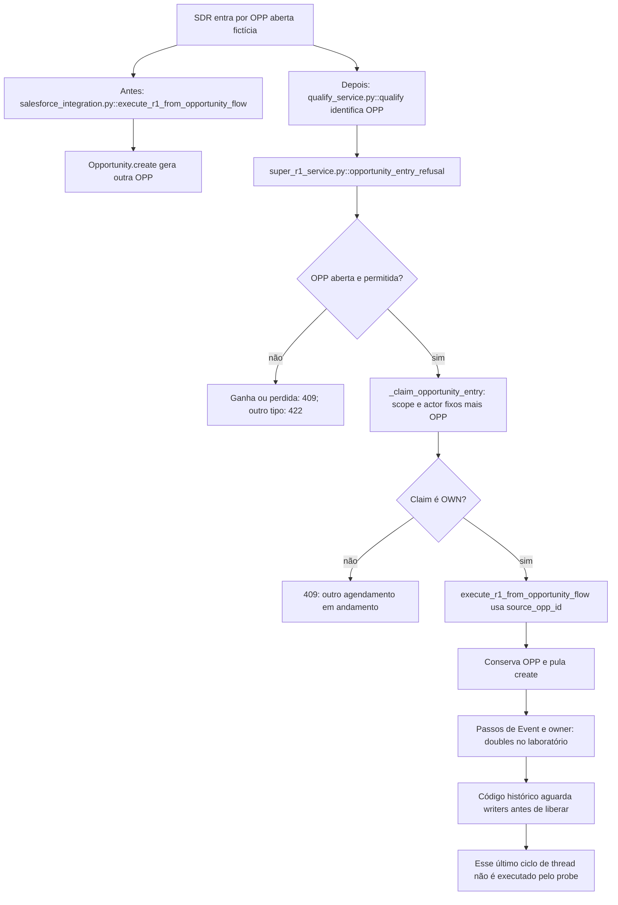

# Por que a oportunidade existente conserva sua identidade

Continue o mesmo caso: [volte ao caso](/jornadas/opportunity-entry/); [execute a experiência](/tutoriais/casos/opportunity-entry/); [resolva a tarefa](/guias/casos/opportunity-entry/); [consulte contratos e fontes](/referencia/casos/opportunity-entry/).

Um SDR entra pelo identificador de uma oportunidade aberta. A evolução FBI-4719 precisa executar o pacote de agendamento nessa mesma oportunidade. Ao chamar a função anterior com a mesma entrada, a reprodução observa uma criação de oportunidade nova; a função posterior conserva o identificador de entrada.

## A condição anterior

execute_r1_from_opportunity_flow da versão anterior cria outra oportunidade. Duas chaves de requisição de dois operadores também não identificam a disputa pela mesma oportunidade.

## O mecanismo que muda a condição

A função posterior pula Opportunity.create quando há source_opp_id. _claim_opportunity_entry usa um scope, um ator fixo e opportunity_id para reclamar o objeto em disputa.

O fluxo abaixo descreve o corpo de código histórico lido; os recursos externos do laboratório são doubles declarados. Ele não certifica um caminho de produção.

O localizador da operação é `execute_r1_from_opportunity_flow / _claim_opportunity_entry / opportunity_entry_refusal`. Este caso vem do [card FBI-4719](https://fazcapital.atlassian.net/browse/FBI-4719) e do [PR 594](https://bitbucket.org/fazcapital/makershub/pull-requests/594). A investigação leu o conteúdo visível do card, a descrição e os comentários pertinentes do PR. Você pode comparar a [versão anterior](https://bitbucket.org/fazcapital/makershub/src/3958ac9ee407f6dc2fe1a6905c475befa69cf9cf/backend/app/services/super_r1_service.py) com a [versão alterada](https://bitbucket.org/fazcapital/makershub/src/8206752f9b1bc8650d0a4572f4a0d64566260b83/backend/app/services/super_r1_service.py). A prática abaixo executa esse recorte em isolamento; o estado de produção não foi medido por ela.

## O benefício, o custo e o limite

A criação muda de uma chamada para zero. O identificador continua 006SYNTHETICOPEN. O segundo claim recebe 409. As funções históricas também recusam oportunidades ganhas ou perdidas. A proteção acrescenta uma responsabilidade: alguém precisa conservar a identidade, o estado ou o contrato que a decisão confere. Se essa responsabilidade ficar num participante que pode desistir ou num recorte incompleto, a garantia muda.

Os corpos das funções são históricos, mas Salesforce e o armazenamento de claims são doubles locais explícitos. Não se executaram agendamentos, leases PostgreSQL, heartbeat de rede ou liberação depois de writer threads. A regra aceita somente oportunidade aberta; oportunidade perdida segue pela Conta para abrir um ciclo novo.

Uma alternativa só atende esta dor se proteger o mesmo recurso e a mesma condição observável. Acrescentar um cache, uma fila ou um serviço separado pode resolver outra parte do fluxo e ainda deixar este mecanismo exposto. A matriz indica as comparações que o exercício permite fazer.

Continue o mesmo caso: [volte ao caso](/jornadas/opportunity-entry/); [execute a experiência](/tutoriais/casos/opportunity-entry/); [resolva a tarefa](/guias/casos/opportunity-entry/); [consulte contratos e fontes](/referencia/casos/opportunity-entry/).

O [mapa de conceitos deste caso](/jornadas/opportunity-entry/conceitos/) informa qual observação cada conceito compartilha com a prática e o que ela não comprova.
