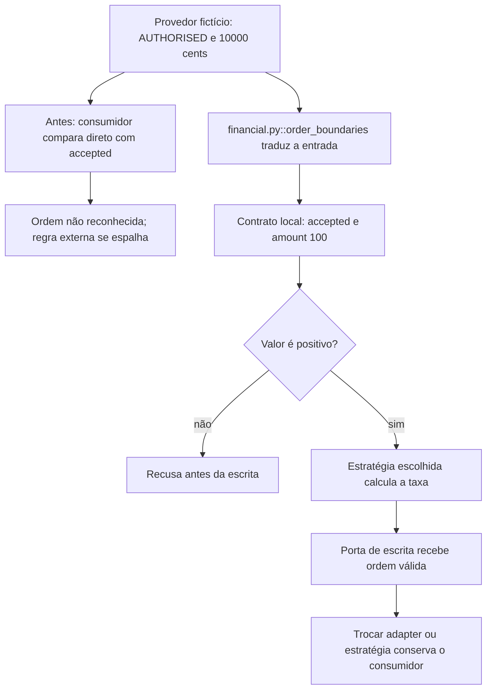

# Por que a regra se espalha pelo produto

Continue o mesmo caso: [volte ao caso](/jornadas/order-boundaries/); [execute a experiência](/tutoriais/casos/order-boundaries/); [resolva a tarefa](/guias/casos/order-boundaries/); [consulte contratos e fontes](/referencia/casos/order-boundaries/).

Ana é uma operadora fictícia de uma corretora. O provedor envia uma autorização como AUTHORISED e o produto espera accepted. Se cada tela interpretar o contrato sozinha, a mesma ordem pode parecer recusada em um lugar e aceita em outro. O exemplo concentra a tradução e deixa a regra financeira dentro da operação.

## A condição anterior

O código que compara o status externo diretamente com accepted não reconhece a autorização. Uma regra fixa também cobra a mesma taxa de dois produtos com políticas diferentes.

## O mecanismo que muda a condição

Um adaptador traduz o status e os centavos. A operação recebe a estratégia de taxa. A validação acontece antes da escrita.

O fluxo abaixo descreve o modelo financeiro local proposto pelo curso. Ele não certifica um caminho de produção.

O localizador da operação é `order_boundaries / OrderFactory / EventBus / mechanisms`. Este é um caso financeiro hipotético com participantes e dados fictícios. Uma corretora de maior porte, do setor em que atua a XP, é apenas o contexto de negócio. O texto não descreve um incidente nem uma arquitetura interna real da XP. A busca delimitada localizou candidatos da nossa stack, mas não estabeleceu um caso histórico completo para todos os conceitos desta família.

## O benefício, o custo e o limite

A ordem passa a ser reconhecida, R$ 100,00 vêm de 10.000 centavos, as políticas retornam taxas diferentes e a ordem negativa não gera escrita. A proteção acrescenta uma responsabilidade: alguém precisa conservar a identidade, o estado ou o contrato que a decisão confere. Se essa responsabilidade ficar num participante que pode desistir ou num recorte incompleto, a garantia muda.

O caso é financeiro e hipotético. Os exemplos de objetos mostram mecanismos pequenos. Eles não provam que todo padrão seja adequado à mesma ordem nem implementam microserviços, Kubernetes ou uma arquitetura interna da XP.

Uma alternativa só atende esta dor se proteger o mesmo recurso e a mesma condição observável. Acrescentar um cache, uma fila ou um serviço separado pode resolver outra parte do fluxo e ainda deixar este mecanismo exposto. A matriz indica as comparações que o exercício permite fazer.

Continue o mesmo caso: [volte ao caso](/jornadas/order-boundaries/); [execute a experiência](/tutoriais/casos/order-boundaries/); [resolva a tarefa](/guias/casos/order-boundaries/); [consulte contratos e fontes](/referencia/casos/order-boundaries/).

O [mapa de conceitos deste caso](/jornadas/order-boundaries/conceitos/) informa qual observação cada conceito compartilha com a prática e o que ela não comprova.
