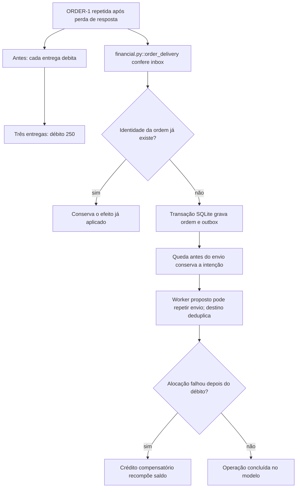

# Por que uma ordem repetida cobra de novo

Continue o mesmo caso: [volte ao caso](/jornadas/order-delivery/); [execute a experiência](/tutoriais/casos/order-delivery/); [resolva a tarefa](/guias/casos/order-delivery/); [consulte contratos e fontes](/referencia/casos/order-delivery/).

Ana envia a ordem fictícia ORDER-1 de R$ 100. A resposta se perde e o cliente a repete. ORDER-2 acrescenta R$ 50. O desenho anterior registra R$ 100 + R$ 100 + R$ 50 = R$ 250. A ordem repetida deveria conservar o mesmo efeito, totalizando R$ 150.

## A condição anterior

Uma entrega repetida debita de novo. Uma queda entre salvar a ordem e publicar o evento deixa a ordem sem intenção recuperável de entrega.

## O mecanismo que muda a condição

A identidade semântica da ordem elimina a repetição no inbox. Uma transação SQLite grava a ordem e a intenção na outbox. Uma falha posterior de alocação produz um crédito compensatório.

O fluxo abaixo descreve o modelo financeiro local proposto pelo curso. Ele não certifica um caminho de produção.

O localizador da operação é `order_delivery / deduplicate / commit-intention / compensate`. Este é um caso financeiro hipotético com participantes e dados fictícios. Uma corretora de maior porte, do setor em que atua a XP, é apenas o contexto de negócio. O texto não descreve um incidente nem uma arquitetura interna real da XP. A busca delimitada localizou candidatos da nossa stack, mas não estabeleceu um caso histórico completo para todos os conceitos desta família.

## O benefício, o custo e o limite

As três entregas produzem dois efeitos de R$ 150 no total. A queda deixa uma ordem e uma intenção recuperável. A compensação devolve o saldo fictício de R$ 900 para R$ 1.000. A proteção acrescenta uma responsabilidade: alguém precisa conservar a identidade, o estado ou o contrato que a decisão confere. Se essa responsabilidade ficar num participante que pode desistir ou num recorte incompleto, a garantia muda.

A atomicidade demonstrada é local ao SQLite. O envio externo ainda pode repetir, e o destino também precisa deduplicar. Compensar cria uma nova ação e não apaga o histórico.

Uma alternativa só atende esta dor se proteger o mesmo recurso e a mesma condição observável. Acrescentar um cache, uma fila ou um serviço separado pode resolver outra parte do fluxo e ainda deixar este mecanismo exposto. A matriz indica as comparações que o exercício permite fazer.

Continue o mesmo caso: [volte ao caso](/jornadas/order-delivery/); [execute a experiência](/tutoriais/casos/order-delivery/); [resolva a tarefa](/guias/casos/order-delivery/); [consulte contratos e fontes](/referencia/casos/order-delivery/).

O [mapa de conceitos deste caso](/jornadas/order-delivery/conceitos/) informa qual observação cada conceito compartilha com a prática e o que ela não comprova.
