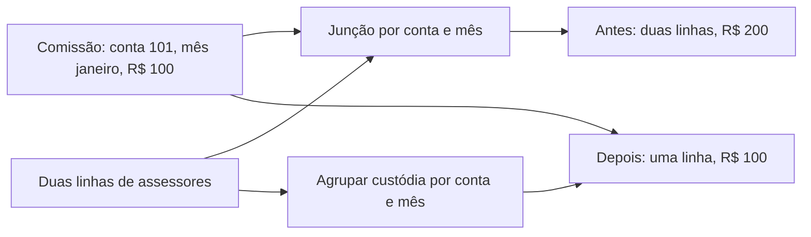

# Por que acontece: A comissão de R$ 100 aparece como R$ 200

[Retorne ao caso](/jornadas/query-grain-postgres/), [entenda o mecanismo](/explicacoes/casos/query-grain-postgres/), [aprenda fazendo](/tutoriais/casos/query-grain-postgres/), [resolva a tarefa](/guias/casos/query-grain-postgres/) ou [consulte o contrato](/referencia/casos/query-grain-postgres/).

Um gestor consulta a receita de uma família. A consulta anterior associa uma comissão por conta e mês a duas linhas de assessores. A comissão de R$ 100 aparece duas vezes. O exercício usa uma conta fictícia e repete a consulta histórica no PostgreSQL para tornar essa multiplicação visível.

A informação precisa ter uma unidade bem definida antes da junção (granularidade). O lado de comissão contém uma linha por conta e mês. O lado anterior de ROA pode conter uma linha por conta, mês e assessor. Associar os dois lados replica a comissão para cada assessor. A versão selecionada agrupa a custódia por conta e mês antes da junção.

## O que muda no código

A função estudada é `get_family_revenue_by_period`, em `backend/app/repositories/account.py`. Localize `roa_per` no arquivo anterior. No patch, acompanhe sua substituição por `custody_per`, a leitura de `rpt_advisor__roa_pj1`, o agrupamento por mês e conta e a seleção de `MAX(r.net_assets_amount)`. A prática executa esse SQL; ela não deduplica a resposta no Python.

A versão anterior retorna duas linhas e soma R$ 200. A versão alterada retorna uma linha e soma R$ 100. A custódia do exemplo continua em R$ 1.000.000.

## Até onde essa conclusão vale

O uso de MAX depende do contrato deste recorte: a custódia da conta está repetida por assessor. MAX não é uma receita geral para somar patrimônios distintos. O exercício isola a cardinalidade da junção e não valida a fórmula financeira de ROA nem o caminho completo da tela.

Este recorte está ligado ao [card FBI-4604](https://fazcapital.atlassian.net/browse/FBI-4604) e ao [PR 507](https://bitbucket.org/fazcapital/makershub/pull-requests/507). A leitura histórica registrou o PR como **MERGED**. Compare a [fonte anterior](https://bitbucket.org/fazcapital/makershub/src/b1df42295ce42d593ae14f0a8a9092c28d1b410d/backend/app/repositories/account.py) com a [fonte alterada](https://bitbucket.org/fazcapital/makershub/src/05b2cacdddd59b968641b12d8d124bad1888392f/backend/app/repositories/account.py). A investigação conserva as descrições de PR e do campo visível do Jira em `execution/history`; o laboratório verifica somente o kernel SQL selecionado.

[Retorne ao caso](/jornadas/query-grain-postgres/), [entenda o mecanismo](/explicacoes/casos/query-grain-postgres/), [aprenda fazendo](/tutoriais/casos/query-grain-postgres/), [resolva a tarefa](/guias/casos/query-grain-postgres/) ou [consulte o contrato](/referencia/casos/query-grain-postgres/).
