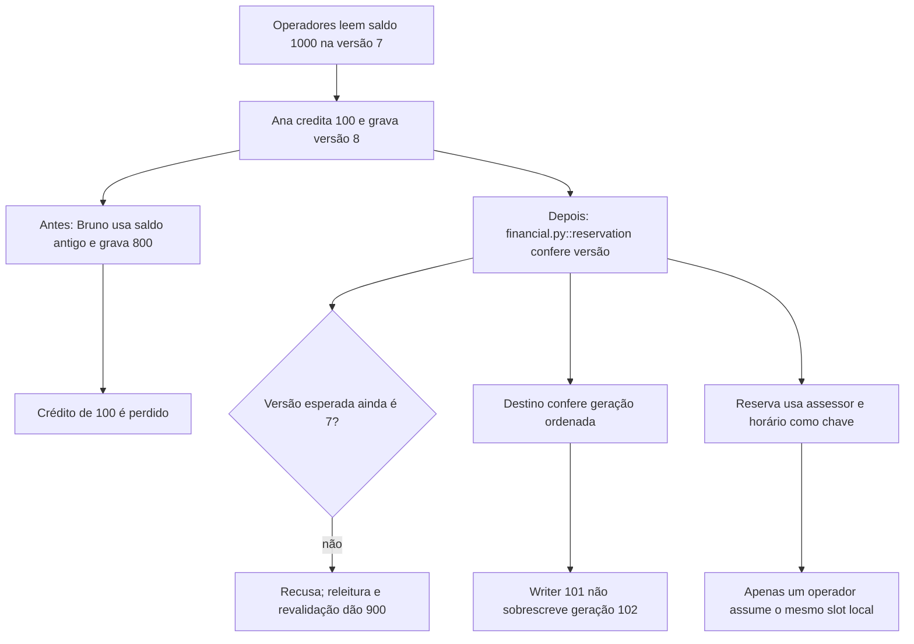

# Por que dois operadores disputam o mesmo recurso

Continue o mesmo caso: [volte ao caso](/jornadas/reservation/); [execute a experiência](/tutoriais/casos/reservation/); [resolva a tarefa](/guias/casos/reservation/); [consulte contratos e fontes](/referencia/casos/reservation/).

Ana e Bruno são operadores fictícios que leem R$ 1.000 na versão 7. Ana registra um crédito de R$ 100 e chega à versão 8. Bruno ainda calcula seu débito de R$ 200 sobre a versão 7. Sem conferir a versão, ele grava R$ 800 e perde o crédito de Ana; ao reler o saldo, o resultado correto da intenção permitida é R$ 900.

## A condição anterior

Uma escrita antiga perde o crédito de R$ 100. Um executor com geração 101 também pode sobrescrever o resultado já aceito da geração 102.

## O mecanismo que muda a condição

A gravação confere a versão esperada; o destino recusa uma geração menor; a identidade da reserva usa o assessor e o horário, independentemente do operador.

O fluxo abaixo descreve o modelo financeiro local proposto pelo curso. Ele não certifica um caminho de produção.

O localizador da operação é `reservation / version-conflict / fence / resource-key`. Este é um caso financeiro hipotético com participantes e dados fictícios. Uma corretora de maior porte, do setor em que atua a XP, é apenas o contexto de negócio. O texto não descreve um incidente nem uma arquitetura interna real da XP. A busca delimitada localizou candidatos da nossa stack, mas não estabeleceu um caso histórico completo para todos os conceitos desta família.

## O benefício, o custo e o limite

A escrita antiga é detectada. Depois de reler e revalidar a intenção, o saldo fica em R$ 900. A geração 101 é recusada, e apenas uma reserva do mesmo horário é aceita. A proteção acrescenta uma responsabilidade: alguém precisa conservar a identidade, o estado ou o contrato que a decisão confere. Se essa responsabilidade ficar num participante que pode desistir ou num recorte incompleto, a garantia muda.

A conferência é um modelo determinístico local. Ela não prova um lock distribuído, um algoritmo lock-free ou wait-free, justiça de um RWLock ou atomicidade entre processos.

Uma alternativa só atende esta dor se proteger o mesmo recurso e a mesma condição observável. Acrescentar um cache, uma fila ou um serviço separado pode resolver outra parte do fluxo e ainda deixar este mecanismo exposto. A matriz indica as comparações que o exercício permite fazer.

Continue o mesmo caso: [volte ao caso](/jornadas/reservation/); [execute a experiência](/tutoriais/casos/reservation/); [resolva a tarefa](/guias/casos/reservation/); [consulte contratos e fontes](/referencia/casos/reservation/).

O [mapa de conceitos deste caso](/jornadas/reservation/conceitos/) informa qual observação cada conceito compartilha com a prática e o que ela não comprova.
