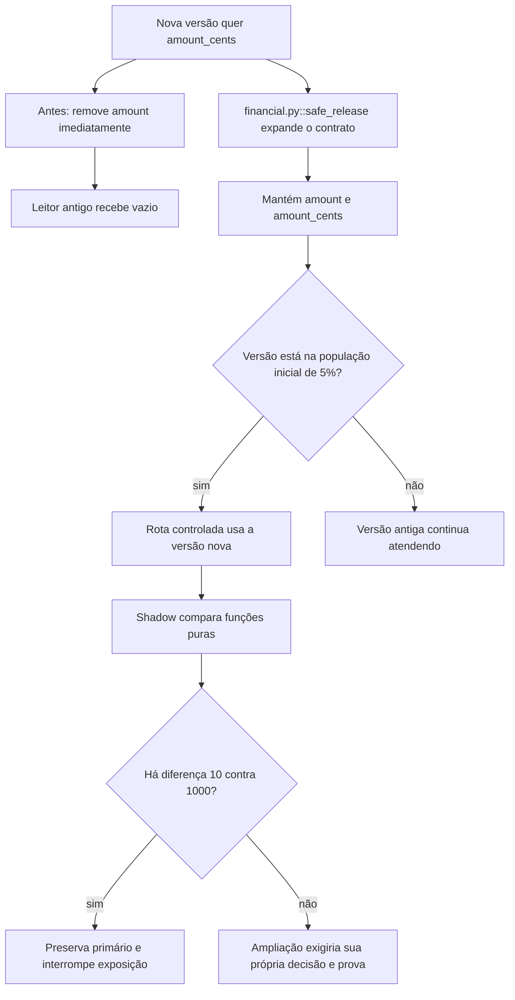

# Por que a versão nova chega a quem ainda usa a antiga

Continue o mesmo caso: [volte ao caso](/jornadas/safe-release/); [execute a experiência](/tutoriais/casos/safe-release/); [resolva a tarefa](/guias/casos/safe-release/); [consulte contratos e fontes](/referencia/casos/safe-release/).

A corretora hipotética troca amount por amount_cents. A interface antiga ainda lê amount. Remover o campo antigo na primeira implantação faz a consulta retornar vazio. A prática conserva os dois campos durante a transição e expõe a versão nova a cinco das cem requisições fictícias.

## A condição anterior

O leitor antigo não encontra amount. Expor a versão nova a cem requisições de uma vez amplia a população de qualquer erro.

## O mecanismo que muda a condição

A expansão mantém amount e amount_cents. O roteamento começa em cinco requisições. Uma execução shadow compara resultados sem ser dona do efeito visível.

O fluxo abaixo descreve o modelo financeiro local proposto pelo curso. Ele não certifica um caminho de produção.

O localizador da operação é `safe_release / expand-contract / progressive-route / shadow-parity`. Este é um caso financeiro hipotético com participantes e dados fictícios. Uma corretora de maior porte, do setor em que atua a XP, é apenas o contexto de negócio. O texto não descreve um incidente nem uma arquitetura interna real da XP. A busca delimitada localizou candidatos da nossa stack, mas não estabeleceu um caso histórico completo para todos os conceitos desta família.

## O benefício, o custo e o limite

Ambos os leitores encontram o campo que conhecem. A exposição inicial fica em 5/100 = 5%. A comparação shadow detecta a diferença entre 10 e 1.000 antes de trocar a saída. A proteção acrescenta uma responsabilidade: alguém precisa conservar a identidade, o estado ou o contrato que a decisão confere. Se essa responsabilidade ficar num participante que pode desistir ou num recorte incompleto, a garantia muda.

Esta é uma simulação de contratos e rotas em memória. Não houve deploy, Kubernetes, GitOps ou Terraform. Desviar tráfego não desfaz dados incompatíveis já gravados.

Uma alternativa só atende esta dor se proteger o mesmo recurso e a mesma condição observável. Acrescentar um cache, uma fila ou um serviço separado pode resolver outra parte do fluxo e ainda deixar este mecanismo exposto. A matriz indica as comparações que o exercício permite fazer.

Continue o mesmo caso: [volte ao caso](/jornadas/safe-release/); [execute a experiência](/tutoriais/casos/safe-release/); [resolva a tarefa](/guias/casos/safe-release/); [consulte contratos e fontes](/referencia/casos/safe-release/).

O [mapa de conceitos deste caso](/jornadas/safe-release/conceitos/) informa qual observação cada conceito compartilha com a prática e o que ela não comprova.
