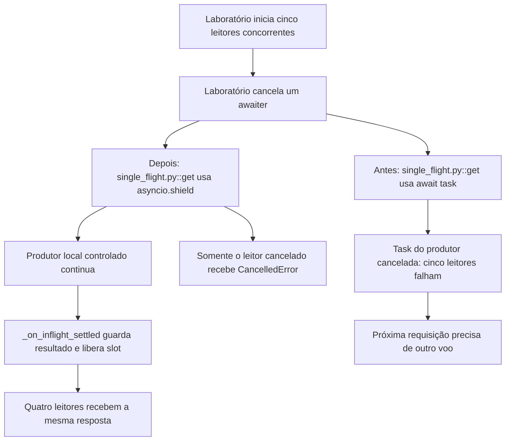

# Por que um leitor cancela a busca

Continue o mesmo caso: [volte ao caso](/jornadas/single-flight-cancel/); [execute a experiência](/tutoriais/casos/single-flight-cancel/); [resolva a tarefa](/guias/casos/single-flight-cancel/); [consulte contratos e fontes](/referencia/casos/single-flight-cancel/).

Um assessor deixa de aguardar a lista de chamadas enquanto outros quatro continuam esperando. O commit de FBI-2331 relata que cancelar um participante cancelava a tarefa compartilhada e derrubava os cinco leitores. A reprodução usa cinco participantes fictícios e a mesma classe das duas versões.

## A condição anterior

O cancelamento de um leitor é propagado para o produtor, e os cinco recebem CancelledError.

## O mecanismo que muda a condição

A espera passa por asyncio.shield. A liberação do slot e o cache do resultado passam para o callback da própria tarefa.

O fluxo abaixo liga o cancelamento injetado pelo laboratório ao corpo de código histórico lido. Os recursos externos são substitutos locais controlados. Ele não certifica um caminho de produção.

O localizador da operação é `SingleFlightCache.get / _on_inflight_settled`. Este caso vem do [card FBI-2331](https://fazcapital.atlassian.net/browse/FBI-2331) e do [PR 51](https://bitbucket.org/fazcapital/makershub/pull-requests/51). A investigação leu o conteúdo visível do card, a descrição e os comentários pertinentes do PR. Você pode comparar a [versão anterior](https://bitbucket.org/fazcapital/makershub/src/342de122cdbfccbe7659adec0e1fcb842b38fc83/backend/app/utils/single_flight.py) com a [versão alterada](https://bitbucket.org/fazcapital/makershub/src/a304a4e56480648bdc60be96c00532c38d18df9f/backend/app/utils/single_flight.py). A prática abaixo executa esse recorte em isolamento; o estado de produção não foi medido por ela.

## O benefício, o custo e o limite

O leitor que desistiu recebe o cancelamento; quatro leitores recebem a resposta. A quantidade de chamadas ao produtor continua sendo uma. A proteção acrescenta uma responsabilidade: alguém precisa conservar a identidade, o estado ou o contrato que a decisão confere. Se essa responsabilidade ficar num participante que pode desistir ou num recorte incompleto, a garantia muda.

A garantia vale para a instância local de SingleFlightCache. Ela não reúne workers diferentes, não mede a NextBilling e não demonstra o código que está em produção.

Uma alternativa só atende esta dor se proteger o mesmo recurso e a mesma condição observável. Acrescentar um cache, uma fila ou um serviço separado pode resolver outra parte do fluxo e ainda deixar este mecanismo exposto. A matriz indica as comparações que o exercício permite fazer.

Continue o mesmo caso: [volte ao caso](/jornadas/single-flight-cancel/); [execute a experiência](/tutoriais/casos/single-flight-cancel/); [resolva a tarefa](/guias/casos/single-flight-cancel/); [consulte contratos e fontes](/referencia/casos/single-flight-cancel/).

O [mapa de conceitos deste caso](/jornadas/single-flight-cancel/conceitos/) informa qual observação cada conceito compartilha com a prática e o que ela não comprova.
