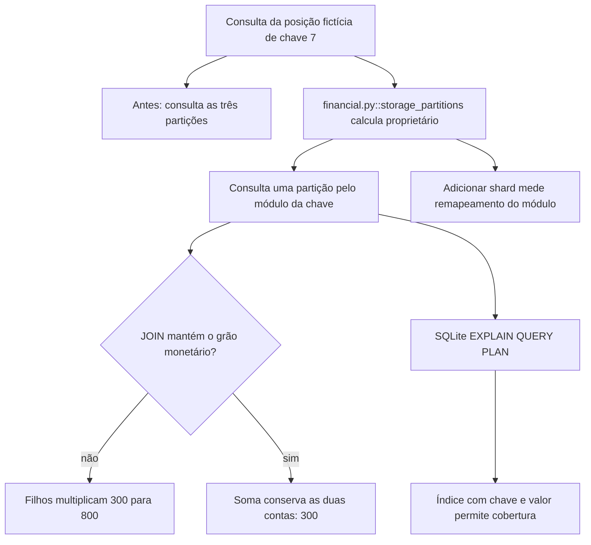

# Por que a consulta cresce e a soma muda de significado

Continue o mesmo caso: [volte ao caso](/jornadas/storage-partitions/); [execute a experiência](/tutoriais/casos/storage-partitions/); [resolva a tarefa](/guias/casos/storage-partitions/); [consulte contratos e fontes](/referencia/casos/storage-partitions/).

A corretora hipotética cresce e divide as posições por chave. Ana procura a posição 7. Uma regra de roteamento permite buscar uma das três partições, enquanto uma junção com registros filhos pode multiplicar os valores financeiros. A prática usa doze posições e duas contas para tornar esses efeitos visíveis.

## A condição anterior

A consulta procura três partições. Uma junção multiplica R$ 100 duas vezes e R$ 200 três vezes, chegando a R$ 800 quando as duas contas somam R$ 300.

## O mecanismo que muda a condição

A chave orienta o destino. A soma usa o grão de conta. Um índice SQLite inclui a chave e o valor; a consulta passa a usar um índice de cobertura.

O fluxo abaixo descreve o modelo financeiro local proposto pelo curso. Ele não certifica um caminho de produção.

O localizador da operação é `storage_partitions / shard-route / grain-join / covering-index`. Este é um caso financeiro hipotético com participantes e dados fictícios. Uma corretora de maior porte, do setor em que atua a XP, é apenas o contexto de negócio. O texto não descreve um incidente nem uma arquitetura interna real da XP. A busca delimitada localizou candidatos da nossa stack, mas não estabeleceu um caso histórico completo para todos os conceitos desta família.

## O benefício, o custo e o limite

A posição 7 é encontrada em uma partição. A soma no grão correto fica em R$ 300. O plano SQLite muda de SCAN para SEARCH com COVERING INDEX. A proteção acrescenta uma responsabilidade: alguém precisa conservar a identidade, o estado ou o contrato que a decisão confere. Se essa responsabilidade ficar num participante que pode desistir ou num recorte incompleto, a garantia muda.

O roteamento usa módulo, não consistent hashing. O remapeamento quantifica sua fragilidade ao acrescentar um shard. O laboratório não implementa replicação geográfica, consenso de réplicas ou uma topologia PostgreSQL.

Uma alternativa só atende esta dor se proteger o mesmo recurso e a mesma condição observável. Acrescentar um cache, uma fila ou um serviço separado pode resolver outra parte do fluxo e ainda deixar este mecanismo exposto. A matriz indica as comparações que o exercício permite fazer.

Continue o mesmo caso: [volte ao caso](/jornadas/storage-partitions/); [execute a experiência](/tutoriais/casos/storage-partitions/); [resolva a tarefa](/guias/casos/storage-partitions/); [consulte contratos e fontes](/referencia/casos/storage-partitions/).

O [mapa de conceitos deste caso](/jornadas/storage-partitions/conceitos/) informa qual observação cada conceito compartilha com a prática e o que ela não comprova.
