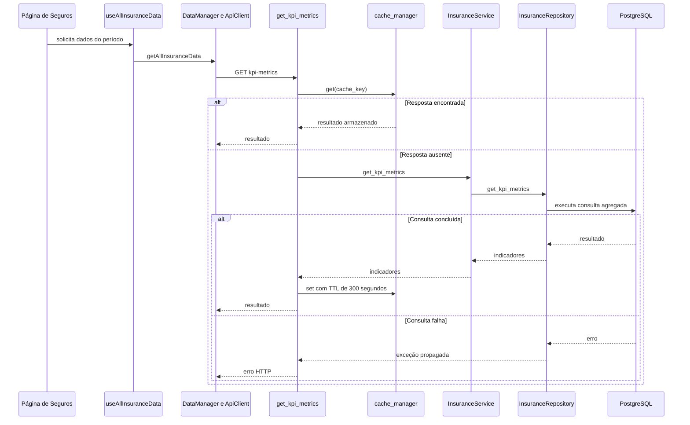
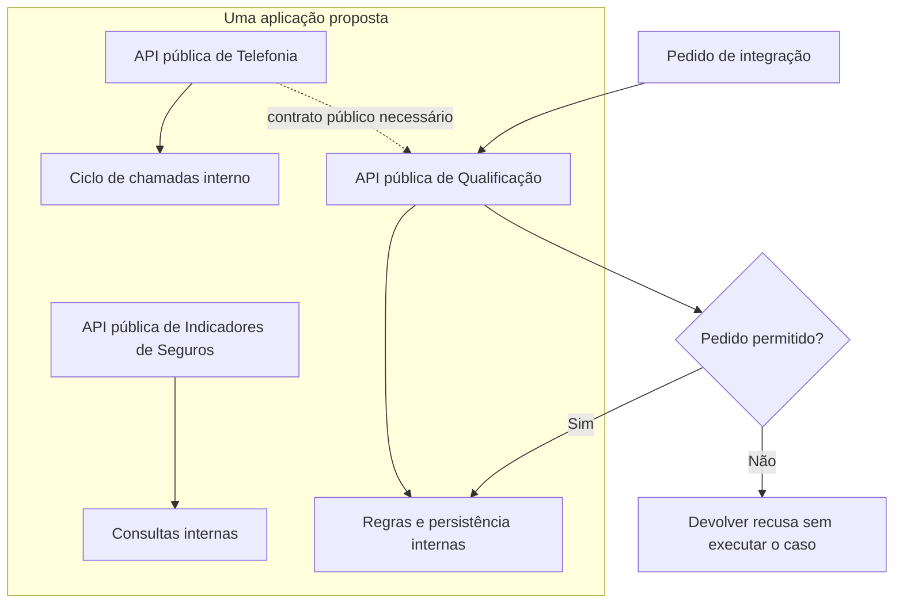
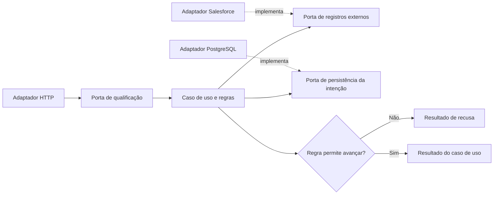
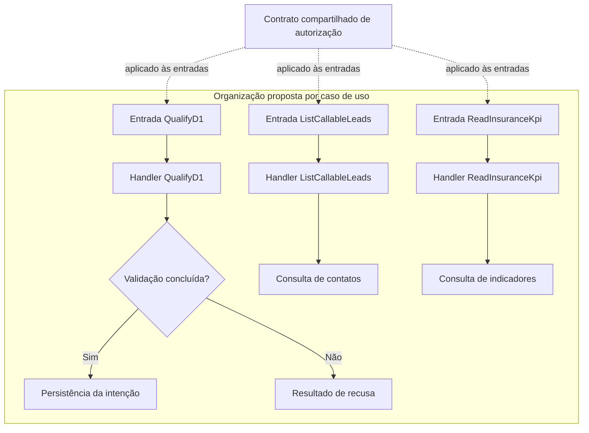
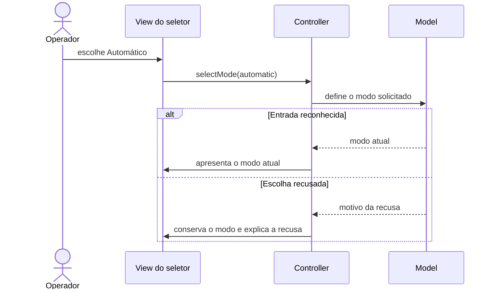
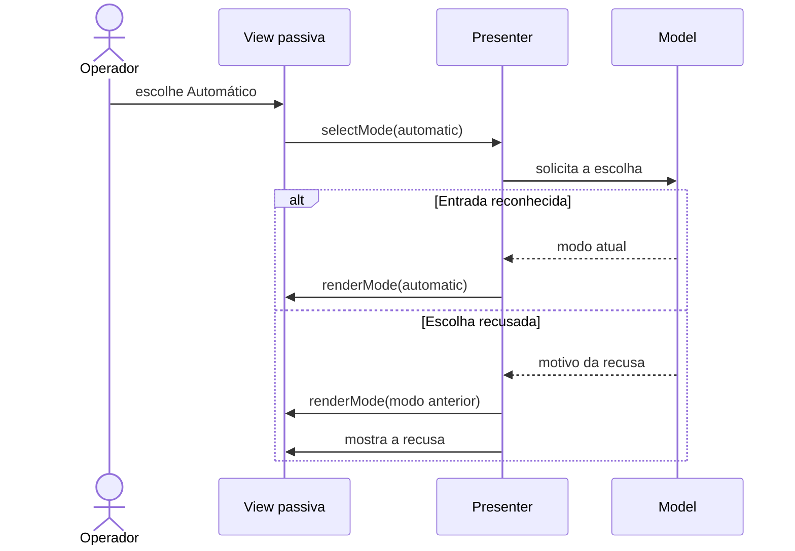
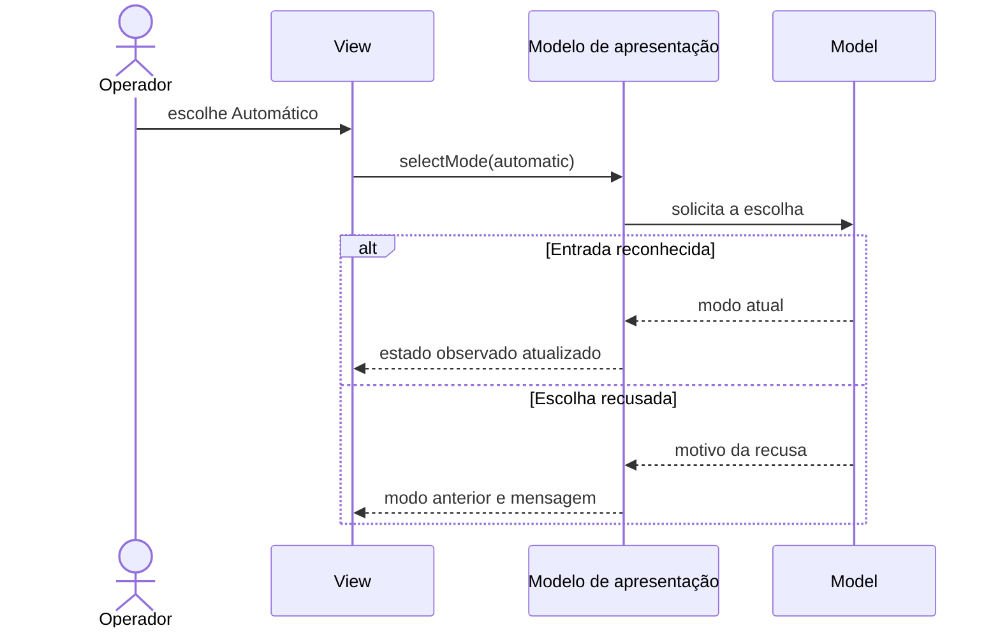

# Mudar uma função sem precisar entender o backend inteiro

Uma pessoa pede uma mudança pequena no indicador de Seguros. Para realizá-la, o desenvolvedor precisa encontrar a tela, o filtro, a chamada HTTP e a consulta que calcula o número. Se cada passagem também esconde uma regra diferente, a mudança deixa de ser pequena. Organizar o código ajuda quando torna visível onde a decisão pertence e quais contratos ela pode afetar.

Este capítulo usa três recortes lidos no checkout local MakersHub `main@e233fb046ec333982cd1547171b0f0bd8d8d92ee` em 14/10/2026. O desenho de uma nova organização é uma **proposta de estudo**. A leitura de arquivos não comprova implantação ou comportamento em produção, e nomes de pastas não classificam toda a aplicação.

## Começar pelo caminho que já existe

Na página de Seguros, `useAllInsuranceData` chama um DataManager que reúne 11 consultas em `Promise.all`. No recorte KPI, a rota procura uma resposta em cache. Quando não a encontra, instancia `InsuranceService` e `InsuranceRepository`; o repositório executa SQL contra `makershub.rpt_insurance__policy`. Esse caminho mostra camadas com responsabilidades distintas. O método KPI do serviço delega diretamente ao repositório, o que também ajuda a discutir quando uma camada tem pouca responsabilidade própria.

O desenho abaixo representa as chamadas observadas desse recorte. O ramo de erro resume a propagação da falha da requisição, sem afirmar que toda a interface possui uma recuperação específica.

As fontes são `frontend/app/(pages)/insurance/page.tsx:46`, `_hooks/useInsurance.ts:248`, `_data/InsuranceDataManager.tsx:406`, `backend/app/api/v1/insurance.py:46`, `backend/app/services/insurance_service.py:19` e `backend/app/repositories/insurance_repo.py:74`. O TTL de 300 segundos é um argumento encontrado no código, e não uma medição da idade dos dados ou da configuração de produção.

Uma camada agrupa código por responsabilidade. Um nível físico de execução, chamado tier, separa processos ou servidores. É possível ter várias camadas em um processo. A distinção evita transformar uma reorganização de arquivos em uma divisão desnecessária de infraestrutura. A [referência de arquiteturas de aplicação](/referencia/catalogo/01-arquiteturas-de-aplicacao) conserva os 22 estilos e seus limites.

## Modular Monolith

Um monólito modular mantém uma implantação e organiza capacidades de negócio em módulos com interfaces públicas e partes internas protegidas. O benefício é limitar o conhecimento necessário para mudar uma capacidade, sem introduzir rede entre todos os seus componentes.

No exercício proposto, Qualificação recebe pedidos de agendamento; Telefonia conduz Call Sprint; Indicadores de Seguros oferece consultas. Uma alteração em uma consulta de Seguros deveria passar por seu contrato público, sem permitir que Telefonia altere diretamente suas estruturas internas. Esta é uma fronteira proposta. O checkout observado contém serviços e repositórios, mas o recorte não comprova que esses módulos e restrições existam.

O custo está em definir interfaces, propriedade dos dados e dependências permitidas. Se todos os módulos continuarem acessando qualquer tabela e classe, a nova árvore de diretórios muda pouco. Se uma mesma regra for copiada em todos eles para evitar imports, a aparente independência produz divergência.

O [Spring Modulith](https://docs.spring.io/spring-modulith/reference/fundamentals.html) oferece mecanismos de validação e observação de módulos para aplicações Spring. É uma base madura para estudar fronteiras, sem exigir que o MakersHub migre para Java. A aplicação **REF** [MyMeetings](https://github.com/kgrzybek/modular-monolith-with-ddd) mostra módulos com DDD em .NET. A skill [domain-driven-design](/referencia/skills-e-projetos) ajuda a analisar a fronteira de negócio; a instalação da skill não prova modularidade.

## Hexagonal Architecture

A arquitetura hexagonal protege o caso de uso de detalhes de HTTP, banco e fornecedores. O núcleo define contratos, chamados portas. Adaptadores implementam esses contratos nas bordas. O ponto decisivo é a direção da dependência: o núcleo conhece o que precisa fazer, sem precisar conhecer o SDK que realizará a operação.

Super R1 fornece uma comparação concreta. O dispatcher observado importa FastAPI, SQLAlchemy, repositórios concretos e integração Salesforce. No exercício, a decisão de qualificação passa a receber uma porta para consultar o registro e outra para guardar a intenção. A adaptação preserva o significado e as recusas existentes; apenas mover imports de arquivo não completa a transformação.

O desenho seguinte é proposto. As setas pontilhadas indicam implementação de contratos, não um caminho observado no checkout.

O benefício aparece quando a regra pode ser exercitada com entradas controladas e quando um fornecedor muda seu contrato. O custo é manter interfaces, mapeamentos e composição dos adaptadores. Uma interface por função, sem variação ou fronteira relevante, pode apenas dificultar a leitura.

A [aplicação hexagonal de referência](https://github.com/talehkarimov/hexagonal-architecture) separa núcleo e adaptadores web e de banco. Spring Boot fornece a base dessa demonstração. [ArchUnit](https://www.archunit.org/userguide/html/000_Index.html) permite verificar regras de dependência no ecossistema Java. A skill [clean-architecture](/referencia/skills-e-projetos) orienta essa separação. Clean e Onion compartilham a preocupação com dependências voltadas ao centro; seus nomes, isoladamente, não demonstram que o núcleo permaneceu independente.

## Vertical Slice

Uma fatia vertical agrupa o código que muda para executar um caso de uso. Em vez de começar a busca por uma pasta enorme de serviços, o desenvolvedor encontra perto a entrada, a validação, a operação e o contrato da funcionalidade.

No estudo, três fatias seriam qualificar para D+1, consultar leads de Call Sprint e calcular KPI de Seguros. Elas podem coexistir com módulos e camadas. A fatia descreve proximidade do código que muda junto; o módulo define quais responsabilidades e dados ficam protegidos.

O benefício é reduzir a distância entre os arquivos de uma mudança. O custo aparece quando cada fatia copia autorização, tratamento de erro ou vocabulário. A composição começa pelo que já existe e merece reuso; a ausência de imports entre fatias não é uma meta suficiente.

[MediatR](https://github.com/LuckyPennySoftware/MediatR) oferece mensagens e handlers em .NET; sua presença não cria automaticamente fatias verticais. O [Vertical Slice API Template](https://github.com/mehdihadeli/vertical-slice-api-template) é uma aplicação **REF** com organização por funcionalidade. A skill [codebase-architecture](/referencia/skills-e-projetos) apoia a análise da estrutura. No MakersHub, o layout dessas três fatias continua sendo proposta.

## MVC, MVP e MVVM com o mesmo seletor

O operador quer escolher Automático na janela do Call Sprint. Se esse modo já está ativo, clicar nele deve preservar a escolha. O caso histórico `a55d4d4a004511106ecc23354de0abf23f7d6ddb`, FBI-4714, mudou um botão que sempre alternava o modo para dois botões que verificam a escolha atual. Foram quatro linhas acrescentadas e quatro removidas no componente focal. Esse commit **não é ancestral** do HEAD local usado neste capítulo e não demonstra a arquitetura do frontend inteiro.

As três alternativas abaixo são propostas para ensinar a distribuição de responsabilidades. Todas usam a mesma ação explícita, `selectMode(automatic)`, em vez de transformar cada clique em uma inversão.

### MVC

O controller recebe a ação, pede ao model para conservar o modo escolhido e encaminha a apresentação. O desenho torna visível a coordenação; uma entrada fora dos dois modos reconhecidos é recusada. O controller pode crescer se também concentrar toda a regra e todos os estados da tela.

O [Spring Petclinic](https://github.com/spring-projects/spring-petclinic/blob/main/src/main/java/org/springframework/samples/petclinic/owner/OwnerController.java) fornece um exemplo **REF** de controllers MVC com Spring MVC. O desenho do seletor não implica converter React para renderização por esse framework.

### MVP

A view passiva encaminha a ação ao presenter. O presenter consulta ou altera o model e manda a view mostrar o resultado. Essa escolha facilita verificar decisões de apresentação sem depender da tela concreta, ao custo de uma interface de view e mais código de ligação.

### MVVM

A view observa um modelo de apresentação que oferece estado e ações. O modelo conserva `mode` e expõe `selectMode`. Quando a entrada é reconhecida, o estado observado muda e a view acompanha. A sincronização deve ser explícita quando duas apresentações usam a mesma experiência.

Os [Android architecture samples](https://github.com/esiek/android-architecture) são **REF LEGADO** para comparar variantes MVP e MVVM do mesmo aplicativo Todo. A base AndroidX e seu mecanismo de observação diferem de React. No checkout local, `useCallLifecycle` é instanciado pela página principal e pela janela e oferece estado e ações. Isso fornece uma aproximação útil para propor um modelo de apresentação, sem provar MVVM integral. [Custom hooks](https://react.dev/learn/reusing-logic-with-custom-hooks) reutilizam lógica com estado; uma chamada do mesmo hook não torna todas as instâncias uma única memória compartilhada.

Recomendo MVVM como comparação didática para essa interação React porque o contrato de estado e ações acompanha a forma encontrada no recorte. Para um seletor isolado, o estado local pode bastar. A skill [react-state-management](/referencia/skills-e-projetos) ajuda a decidir o alcance do estado; a [referência de interfaces de Fowler](https://martinfowler.com/eaaDev/uiArchs.html) ajuda a distinguir os padrões.

## Outras fronteiras resolvem outras necessidades

Microservices acrescentam implantação e operação independentes, com custo de rede e consistência. SOA trata serviços compartilhados por consumidores diferentes. Serverless muda quanto da execução é administrado pela plataforma. Nenhum desses três estilos é necessário para explicar a separação de arquivos vista no KPI de Seguros.

Microkernel oferece um núcleo com extensões. Component-Based organiza a composição de partes com contratos. PAC coordena agentes de apresentação, abstração e controle em uma hierarquia. O benefício de uma extensão ou hierarquia precisa compensar o custo de compatibilidade e coordenação; uma variação simples não exige um sistema de plugins.

Space-Based aproxima computação e dados particionados em memória. Cell-Based replica capacidades em células com isolamento de recursos e populações. Actor Model organiza estado por identidade e mensagens. Peer-to-Peer permite troca entre pares; Blackboard coordena contribuições em um estado compartilhado. Essas formas mudam a coordenação ou o isolamento e precisam de uma dor medida, além de uma nova pasta.

Pipe and Filter compõe transformações por etapas. Event-Driven organiza reações a fatos publicados. O `Promise.all` de Seguros executa consultas em paralelo; esse trecho sozinho não comprova nenhum desses dois estilos. A discussão sobre entrega e recuperação continua em [integração confiável](/explicacoes/reliable-integration) e sobre identidade concorrente em [concorrência](/explicacoes/concurrency).

Uma organização útil permite recontar quem decide, quem fornece dados e quem pode falhar. O próximo capítulo, [regras de negócio](/explicacoes/business-rules), mostra por que essas fronteiras precisam preservar o significado dos conceitos que atravessam o código.
