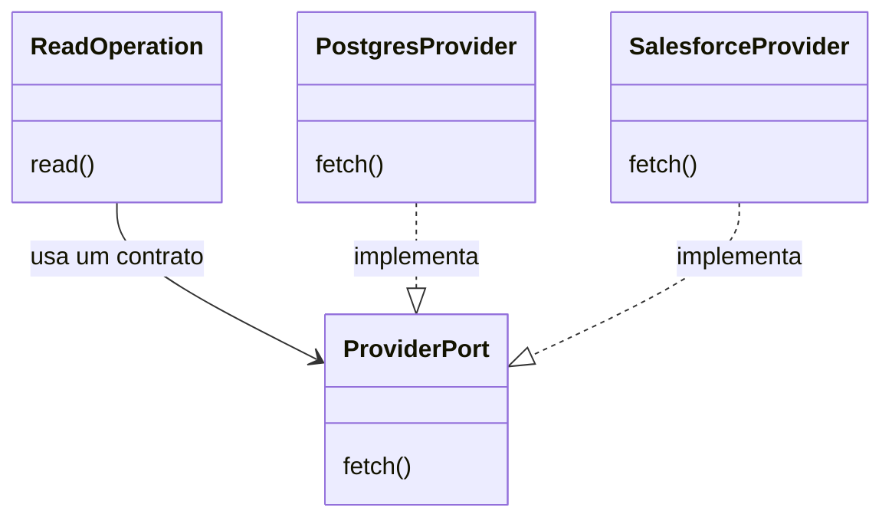
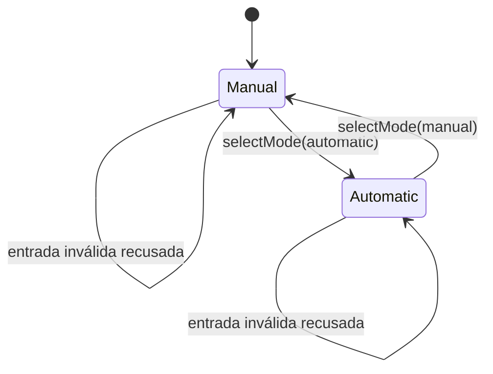
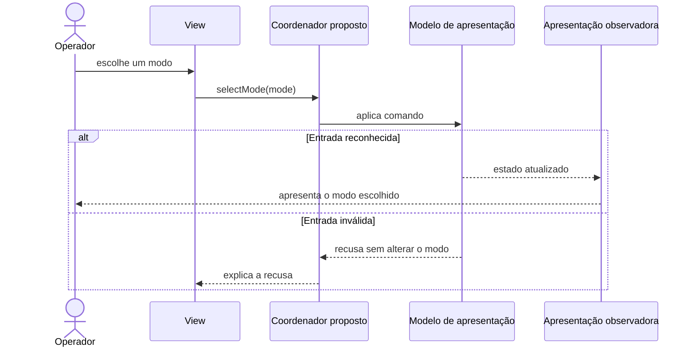

# Mudar o comportamento do código sem multiplicar condicionais

O operador clica em Automático porque quer usar esse modo. Se o botão simplesmente inverte um booleano, clicar de novo pode colocar a tela em Manual. A diferença entre escolher e inverter é pequena no código e grande para quem usa a interface. Um padrão de código ajuda quando torna essa intenção e suas variações mais fáceis de compreender.

Os padrões GoF tratam relações entre objetos e responsabilidades locais. Eles não criam, por si só, atomicidade entre bancos, entrega de mensagens ou recuperação durável de um processo. Este capítulo usa recortes do checkout local MakersHub `main@e233fb046ec333982cd1547171b0f0bd8d8d92ee`, lidos em 14/10/2026. Os exemplos novos são propostas didáticas; os commits históricos citados não são ancestrais desse HEAD.

## O caso que mostra a intenção

O commit histórico `a55d4d4a004511106ecc23354de0abf23f7d6ddb`, FBI-4714, mudou o seletor da janela de Call Sprint. Antes, um botão chamava `toggleAutoMode` independentemente do lado escolhido. Depois, Manual chama o toggle quando Automático está ativo, e Automático chama o toggle quando Manual está ativo. O componente também passa a expor a escolha com `aria-pressed`.

O diff focal contém quatro linhas acrescentadas e quatro removidas. O comportamento registrado no patch pode ser contado assim: quando o operador escolhe o modo que já está ativo, a escolha permanece igual. O patch comprova essa alteração no código histórico; ele não comprova paridade visual, execução em produção, State GoF ou MVVM.

Uma ação explícita pode ser representada por um **Command**, que reúne a intenção e seus dados. No exemplo didático completo abaixo, selecionar o mesmo modo é uma operação sem mudança. Esse código é local e ilustrativo; ele não integra o MakersHub nem representa sua implementação atual.

```typescript
type DialMode = 'manual' | 'automatic';

type SelectModeCommand = {
  type: 'selectMode';
  mode: DialMode;
};

type DialState = {
  mode: DialMode;
};

function applyModeCommand(
  state: DialState,
  command: SelectModeCommand,
): DialState {
  if (state.mode === command.mode) return state;
  return { ...state, mode: command.mode };
}

const initialState: DialState = { mode: 'manual' };
const command: SelectModeCommand = {
  type: 'selectMode',
  mode: 'automatic',
};

const selectedState = applyModeCommand(initialState, command);
const repeatedState = applyModeCommand(selectedState, command);

console.log(selectedState.mode);
console.log(repeatedState.mode);
```

As duas saídas esperadas são `automatic`. A função dá nome à escolha e conserva seu significado. Isso não resolve a repetição de uma escrita no Salesforce, porque aquela ação tem efeitos e concorrência externos. A proteção de uma integração precisa ser discutida em [integração confiável](/explicacoes/reliable-integration), com evidência no recurso que recebe a escrita.

## Cinco formas de construir objetos

Uma fábrica simples escolhe ou instancia um objeto em uma função comum. **Factory Method** define um método de criação cujo produto é decidido por implementações concretas. **Abstract Factory** cria uma família de produtos compatíveis. Os três podem ter uma função chamada criar, mas essa semelhança de nome não demonstra a mesma estrutura.

No checkout observado, `get_call_list_service`, em `backend/app/api/v1/call_list.py:43`, instancia `CallListService` para a injeção de dependência. Isso demonstra uma fábrica simples. O recorte não possui prova de criadores por subclasses, então não autoriza rotulá-lo como Factory Method GoF. A referência **REF** [ElfBlacksmith](https://github.com/iluwatar/java-design-patterns/blob/4cabb204f240240bea319605a5ffa46ded728001/factory-method/src/main/java/com/iluwatar/factory/method/ElfBlacksmith.java) oferece um criador concreto para comparação.

No exercício hipotético de Abstract Factory, uma família compatível poderia fornecer formulário, validador e documento de um mesmo produto e canal. Essa família precisa existir como decisão de negócio antes de ser codificada. O benefício é evitar combinações incompatíveis; o custo é manter os contratos de todos os produtos da família. [KingdomFactory](https://github.com/iluwatar/java-design-patterns/blob/4cabb204f240240bea319605a5ffa46ded728001/abstract-factory/src/main/java/com/iluwatar/abstractfactory/KingdomFactory.java) é **REF** didática dessa estrutura.

**Builder** monta uma construção complexa em etapas nomeadas. Ele ajuda quando o objeto precisa de várias partes válidas antes de ser entregue, mas pode esconder defaults que o chamador deveria perceber. No exercício, filtros de leitura podem ser montados antes de executar a consulta. Um dicionário montado por vários `if`s não demonstra automaticamente Builder GoF.

**Prototype** copia uma configuração já construída. Um modelo vazio de filtros pode servir como proposta segura de aprendizagem. Cópia rasa e cópia profunda têm consequências diferentes para listas e objetos mutáveis; copiar uma identidade ou credencial sem pensar pode mudar o significado do objeto.

**Singleton** limita uma instância a um escopo. Uma configuração imutável de processo pode justificar esse alcance. Uma instância única no processo não coordena réplicas da aplicação e não deve ser usada como proteção distribuída de saldo, autorização ou reserva. O problema precisa definir “único onde?” antes da escolha do padrão.

As bases de estudo incluem [HttpRequest.Builder](https://docs.oracle.com/en/java/javase/21/docs/api/java.net.http/java/net/http/HttpRequest.Builder.html), [Cloneable](https://docs.oracle.com/en/java/javase/21/docs/api/java.base/java/lang/Cloneable.html) e [escopos de beans do Spring](https://docs.spring.io/spring-framework/reference/core/beans/factory-scopes.html). A skill [design-code-architecture](/referencia/skills-e-projetos) ajuda a escolher uma construção proporcional. A [referência GoF](/referencia/catalogo/17-padroes-classicos-gof) fornece fonte de implementação para cada um dos cinco padrões.

## Adaptar uma interface ou separar duas variações

**Adapter** aproxima uma interface externa do contrato esperado pelo consumidor. **Bridge** separa duas dimensões que variam independentemente. No exercício, adaptar uma resposta Salesforce para o modelo local trata uma interface incompatível. Separar uma operação de leitura de seus diferentes provedores trata duas dimensões que podem mudar.



Esse diagrama é **proposto** e não descreve classes encontradas no checkout. Seu benefício só aparece quando as duas dimensões realmente variam. Se houver uma operação e um único provedor estável, duas novas interfaces podem aumentar a distância entre o leitor e a função sem proteger uma fronteira útil.

A tradução de significado exige mais que Adapter. Identidade, unidade, data ou estado externos podem demandar a [camada de proteção semântica](/explicacoes/business-rules#anti-corruption-layer), aprofundada em [APIs e integração](/explicacoes/api-integration). A [interface XmlAdapter](https://jakarta.ee/specifications/xml-binding/4.0/apidocs/jakarta.xml.bind/jakarta/xml/bind/annotation/adapters/xmladapter) fornece uma base de mecanismo; [FishingBoatAdapter](https://github.com/iluwatar/java-design-patterns/blob/4cabb204f240240bea319605a5ffa46ded728001/adapter/src/main/java/com/iluwatar/adapter/FishingBoatAdapter.java) e [Sword](https://github.com/iluwatar/java-design-patterns/blob/4cabb204f240240bea319605a5ffa46ded728001/bridge/src/main/java/com/iluwatar/bridge/Sword.java) são **REF** de Adapter e Bridge.

## Envolver uma operação sem mudar seu contrato

**Decorator** acrescenta comportamento envolvendo um componente e conservando seu contrato. No recorte local, `backend/app/utils/performance.py:62` cria wrappers para funções síncronas e assíncronas. O wrapper mede tempo, encaminha a chamada e preserva metadados com `wraps`.

Esse trecho é um decorator funcional Python comparável à intenção do padrão. A sintaxe `@`, sozinha, não comprova Decorator GoF com objetos que compartilham uma interface. Uma anotação pode registrar, substituir ou até executar outro comportamento. A classificação exige olhar o que o wrapper faz.

No estudo, a medição deve continuar devolvendo o resultado e propagando a falha que o chamador precisa receber. Mudar a forma de erro dentro de um wrapper compartilhado pode afetar consumidores que não estavam visíveis no diff. A referência **REF** [ClubbedTroll](https://github.com/iluwatar/java-design-patterns/blob/4cabb204f240240bea319605a5ffa46ded728001/decorator/src/main/java/com/iluwatar/decorator/ClubbedTroll.java) permite comparar o Decorator por objetos. [FilterInputStream](https://docs.oracle.com/en/java/javase/21/docs/api/java.base/java/io/FilterInputStream.html) oferece uma base oficial de composição de streams.

## Simplificar a entrada sem esconder o custo

**Facade** oferece uma entrada menor para coordenar partes internas. Em Seguros, `getAllInsuranceData`, em `frontend/app/(pages)/insurance/_data/InsuranceDataManager.tsx:406`, reúne 11 chamadas. O consumidor pode pedir o conjunto por uma função. Essa é uma forma de fachada de consultas, sem classificar toda a aplicação como GoF Facade.

O número 11 é uma contagem de chamadas encontradas no fonte, sem medição de latência. No exercício de falha, se uma delas rejeitar a promessa, o conjunto `Promise.all` rejeita. Uma entrada simples não elimina a necessidade de decidir como mostrar um resultado parcial, de onde veio cada indicador e quando será permitido tentar novamente.

**Proxy** conserva o contrato de uma operação e controla seu acesso, carregamento ou encaminhamento. A rota KPI observada consulta cache e grava TTL de 300 segundos. Isso demonstra cache no caminho da rota; não demonstra um objeto Proxy GoF. A autorização e o escopo continuam pertencendo ao contrato da leitura.

**Composite** permite tratar um item e um grupo pelo mesmo contrato. Um exercício de filtros pode combinar grupos e folhas, preservando o significado de `AND` e `OR`. A árvore genérica não deve substituir uma regra de elegibilidade sem confirmação. **Flyweight** compartilha dados imutáveis repetidos para reduzir cópias. Descrições estáticas de status são um candidato didático; o recorte não mede repetição ou economia de memória e não autoriza compartilhar valores mutáveis de clientes.

[DwarvenGoldmineFacade](https://github.com/iluwatar/java-design-patterns/blob/4cabb204f240240bea319605a5ffa46ded728001/facade/src/main/java/com/iluwatar/facade/DwarvenGoldmineFacade.java), [WizardTowerProxy](https://github.com/iluwatar/java-design-patterns/blob/4cabb204f240240bea319605a5ffa46ded728001/proxy/src/main/java/com/iluwatar/proxy/WizardTowerProxy.java), [LetterComposite](https://github.com/iluwatar/java-design-patterns/blob/4cabb204f240240bea319605a5ffa46ded728001/composite/src/main/java/com/iluwatar/composite/LetterComposite.java) e [PotionFactory](https://github.com/iluwatar/java-design-patterns/blob/4cabb204f240240bea319605a5ffa46ded728001/flyweight/src/main/java/com/iluwatar/flyweight/PotionFactory.java) fornecem **REF** didáticas. A skill [code-simplification](/referencia/skills-e-projetos) ajuda a avaliar se a nova composição reduz a carga de leitura.

## State e Strategy respondem a variações diferentes

**State** muda comportamento em função de um estado explícito. **Strategy** troca um algoritmo por outro sob um mesmo contrato. O estado descreve a condição do objeto; a estratégia descreve uma política escolhida. Ter um `if` com dois caminhos não comprova nenhum dos dois.

`useCallLifecycle` oferece estado e ações e é instanciado pela página principal em `page.tsx:111` e pela janela em `window/page.tsx:86`. O recorte possui hooks, refs e efeitos; não fornece prova de classes de estado GoF. No Super R1, o dispatcher seleciona funções D+0 e D+1; esse ramo não comprova um contrato de estratégias intercambiáveis.

O diagrama seguinte é um modelo **proposto** para o seletor. Ele limita as transições às duas escolhas reconhecidas e conserva o estado quando a escolha é repetida. Uma entrada inválida é recusada, sem introduzir uma nova política comercial.



Se os dois modos exigirem algoritmos de discagem diferentes e um contrato comum, Strategy pode organizar essa variação. Se apenas o rótulo mudar, criar uma classe por modo pode ser desnecessário. [Mammoth](https://github.com/iluwatar/java-design-patterns/blob/4cabb204f240240bea319605a5ffa46ded728001/state/src/main/java/com/iluwatar/state/Mammoth.java) e [DragonSlayer](https://github.com/iluwatar/java-design-patterns/blob/4cabb204f240240bea319605a5ffa46ded728001/strategy/src/main/java/com/iluwatar/strategy/DragonSlayer.java) são **REF** dessas duas estruturas. Uma máquina local de estados não substitui a persistência e a recuperação discutidas em [workflow](/explicacoes/workflow).

## Observer, Mediator e as relações entre participantes

**Observer** permite notificar interessados em uma mudança sem o produtor conhecer cada consumidor concreto. No recorte Super R1, `useQualify` invalida cinco famílias de consulta após sucesso. É comportamento reativo relacionado à atualização de leitura; não prova um objeto Observer GoF, broker ou evento de domínio.

**Mediator** concentra a coordenação entre participantes que não precisam se conhecer diretamente. O hook compartilhado de Call Sprint oferece uma comparação, mas dois consumidores do mesmo hook não comprovam um Mediator. Um coordenador que reúne todas as responsabilidades pode voltar a ser difícil de compreender.

Em um desenho **proposto**, a escolha inválida mantém o modo anterior; a escolha válida atualiza o modelo observado. O desenho não descreve a sincronização implementada entre as janelas do MakersHub.



[Weather](https://github.com/iluwatar/java-design-patterns/blob/4cabb204f240240bea319605a5ffa46ded728001/observer/src/main/java/com/iluwatar/observer/Weather.java) e [PartyImpl](https://github.com/iluwatar/java-design-patterns/blob/4cabb204f240240bea319605a5ffa46ded728001/mediator/src/main/java/com/iluwatar/mediator/PartyImpl.java) são **REF**. [React Context](https://react.dev/learn/passing-data-deeply-with-context) fornece uma base para distribuir dados, mas não define essas arquiteturas por sua presença. A skill [frontend-ui-engineering](/referencia/skills-e-projetos) ajuda a trabalhar com os consumidores reais.

## Os demais padrões comportamentais completam o catálogo

**Chain of Responsibility** organiza uma solicitação entre verificações independentes. A ordem precisa ficar visível: uma gravação não pode ser antecipada a uma validação obrigatória. Um dispatcher que escolhe um ramo não demonstra automaticamente uma cadeia de handlers.

**Interpreter** representa uma gramática pequena e sua avaliação. Um exercício com filtros de leitura pode ser adequado; inventar uma linguagem de regras financeiras acrescenta outra fonte de verdade e precisa de contrato. **Iterator** percorre uma coleção sem expor seu armazenamento. Uma leitura paginada precisa conservar ordenação e reconhecer que o conjunto pode mudar entre páginas.

**Memento** preserva um retrato privado para restaurar um estado. Recuperar filtros da interface é uma aplicação didática possível. Esse retrato não cria auditoria financeira, e seu alcance e expiração precisam ser definidos.

**Template Method** preserva uma sequência de passos e permite variar etapas por subclasses. **Visitor** acrescenta operações a uma família estável de tipos. O primeiro perde adequação quando as sequências realmente diferem; o segundo fica mais caro quando surgem tipos novos com frequência. Classificar Lead, Account e Opportunity em um ramo do dispatcher não demonstra Visitor.

O caso histórico de Seguros `7101d3a4babe95081b0b41d35ec305c08bf8a577` reforça o limite desses rótulos: tratar uma data de calendário corretamente solucionou uma diferença de significado sem exigir que o helper recebesse um nome GoF. O caso Super R1 `8206752f9b1bc8650d0a4572f4a0d64566260b83` preservou a identidade da Opportunity em mais etapas. Ambos pertencem a outros commits locais, sem prova de resultado em produção nesta autoria.

A [referência dos 23 padrões](/referencia/catalogo/17-padroes-classicos-gof) oferece definição, benefício, caso, custo e código OSS para cada conceito. Todos os exemplos `java-design-patterns` usam o commit fixado `4cabb204f240240bea319605a5ffa46ded728001` e têm o rótulo **REF**. O critério para adotar uma composição é conseguir explicar a variação que ela protege e o contrato que permanece válido quando o comportamento muda.
