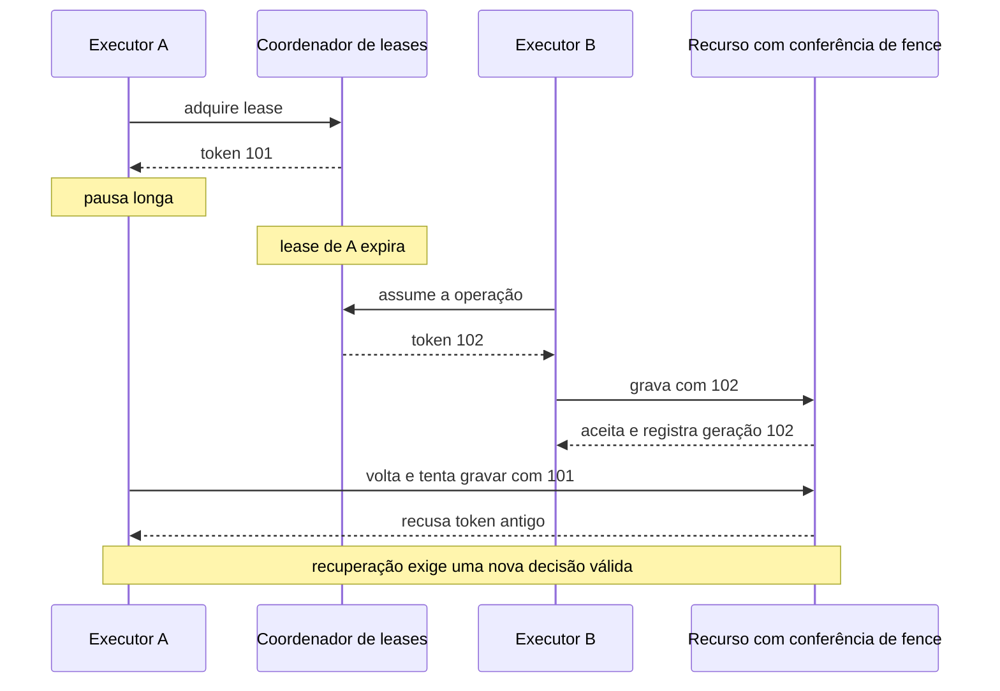
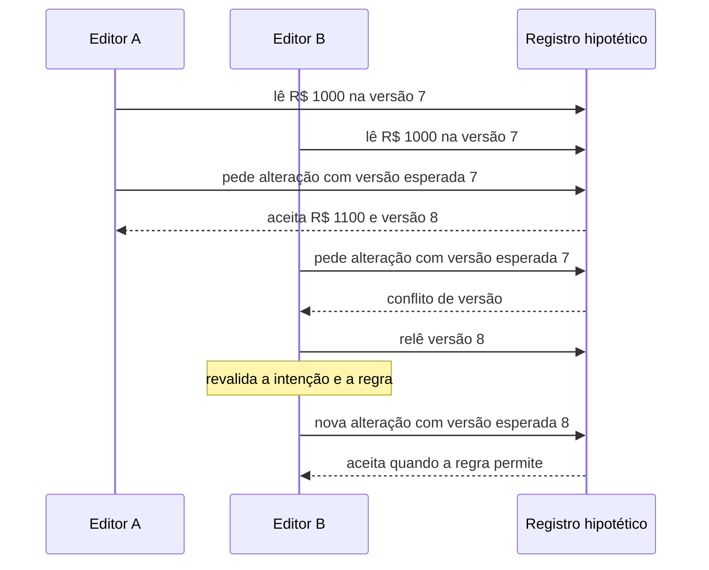

# Impedir que pedidos concorrentes sobrescrevam o trabalho um do outro

Dois pedidos podem chegar quase juntos. Dois gestores também podem editar uma informação que leram minutos antes. A primeira disputa é sobre quem pode usar um recurso agora; a segunda é sobre qual versão cada pessoa usou para decidir. Escolher a proteção exige identificar essa disputa antes de escolher uma ferramenta.

O código MakersHub citado foi lido em **14/10/2026 às 16:16 UTC**, no checkout `main@e233fb046ec333982cd1547171b0f0bd8d8d92ee`. O dispatch usa uma lease Redis e a confirmação de reserva confere a propriedade da tentativa no PostgreSQL. A edição financeira por versão abaixo é **hipotética**; não descreve um contrato implantado na Faz ou uma operação interna da XP.

## Uma proteção precisa nomear seu recurso e seu alcance

Um **Mutex** permite um executante por vez na seção protegida. Um **Semaphore** permite até certo número de executantes. O worker lido declara quatro vagas locais; com dois processos iguais, podem existir até **2 × 4 = 8 vagas** no conjunto desse exemplo, sem que isso demonstre a configuração de produção.

Um **Reader/Writer Lock** distingue leitores simultâneos de um escritor exclusivo. É útil quando ler não modifica a estrutura protegida, mas política de justiça e duração afetam espera. Um **Spinlock** tenta obter uma proteção repetidamente antes de desistir ou dormir conforme a implementação. Isso pode servir a trechos muito curtos de código de sistemas; repetir ativamente enquanto se espera uma chamada de rede desperdiçaria CPU. O [código de spinlocks PostgreSQL](https://github.com/postgres/postgres/blob/master/src/backend/storage/lmgr/s_lock.c) tem tentativas e esperas, e não deve virar uma receita de aplicação FastAPI.

Locks de memória protegem o objeto que as threads ou tasks compartilham. Um lock criado num worker não coordena outro worker por existir uma classe com o mesmo nome. Em banco, a **Pessimistic Locking** obtém proteção antes de modificar e pode manter concorrentes esperando até a transação terminar. A fonte e as fronteiras transacionais estão em [integração confiável](/explicacoes/reliable-integration/) e na [referência de consistência](/referencia/catalogo/02-sistemas-distribuidos-e-consistencia/).

## 29. Distributed Lock + Lease + Fencing: exclusividade que expira e escritor atrasado

Um **Distributed Lock** coordena participantes que não compartilham a mesma memória. Uma **Lease** dá validade temporal a essa autorização. Um **Fencing Token** permite que o recurso rejeite um executante antigo mediante um token ordenado conforme o contrato. A expiração ajuda a recuperar trabalho abandonado; a rejeição no recurso protege contra quem estava apenas lento e voltou depois.

No dispatch Airflow lido em `backend/app/services/airflow_dispatch.py:186`, o código usa `SET NX EX` por `dag_run_id`. Na confirmação da reserva, `routing_repo.py:926`, o UPDATE exige estado pending, `attempt_id` e `owner_token`. Isso demonstra comparação da propriedade local da tentativa. Um UUID de proprietário identifica a tentativa, mas não fornece uma sequência crescente conferida por um serviço externo.

Imagine uma operação **proposta** em que A recebe o token 101 e para durante uma espera. Sua lease vence. B recebe 102 e termina. Quando A volta, o destino precisa comparar 101 com a geração já aceita, 102, e recusar o trabalho antigo. Sem essa conferência, a validade expirada no coordenador não impede a chamada atrasada ao destino.

O benefício é recuperar exclusividade sem aceitar qualquer retorno atrasado. O custo é manter leases, tokens e validação no recurso protegido. O limite é o destino: se ele não conhece a regra de fence, o coordenador sozinho não oferece a proteção. Também é preciso decidir duração, renovação, perda de lease e comportamento da operação parcialmente executada.

A base [Hazelcast FencedLock](https://docs.hazelcast.com/hazelcast/5.7/data-structures/fencedlock) e o [exemplo FencingOffStaleLockHolders](https://github.com/hazelcast/hazelcast-code-samples/blob/master/cp-subsystem/fenced-lock-using-fencing-tokens/src/main/java/com/hazelcast/codesamples/cp/fencedlock/FencingOffStaleLockHolders.java) são **REF didática**: o recurso compara o token. O exemplo consultado requer configuração CP e licença Enterprise; a disponibilidade de uma API não dispensa revisar a edição. A skill pertinente é `backend-distributed-locking`, localizada pela [curadoria](/referencia/skills-e-projetos/).

## 33. Optimistic Concurrency: conferir a versão que a pessoa leu

A concorrência otimista permite decidir a alteração sem manter uma trava durante toda a interação, mas aceita a gravação somente se a versão esperada ainda for válida. Quando alguém alterou antes, a operação recebe conflito e precisa rever sua decisão.

Considere um saldo **hipotético** de R$ 1.000 na versão 7. A registra um aporte de R$ 100: **1.000 + 100 = R$ 1.100**, na versão 8. B ainda usa a versão 7 para um estorno de R$ 200 e tenta substituir o saldo por R$ 800. Essa substituição perderia o aporte de A. Conferir a versão rejeita a escrita antiga; após reler e revalidar a intenção, **1.100 − 200 = R$ 900**, se as regras do exemplo permitirem o estorno.

O benefício é detectar uma decisão baseada em estado antigo. O custo é tratar conflitos, preservar a intenção do usuário e escolher quando repetir. O limite aparece quando o recurso é outro: versionar um lead não impede dois leads diferentes de disputarem o mesmo horário. A exclusividade precisa estar no horário ou no recurso compartilhado. A [modelagem de negócio](/explicacoes/business-rules/) ajuda a identificar essa fronteira.

Uma operação **Compare-and-Swap**, ou CAS, compara um valor esperado e só altera se ele coincidir. Ela fornece uma ferramenta de atualização condicional, mas precisa de identidade e política de repetição adequadas; comparar uma variável isolada não garante todos os invariantes de uma transação.

A base [Marten para documentos](https://martendb.io/documents/concurrency.html) exige configuração explícita de proteção por tipo. A aplicação **REF** [Tickets do EventSourcing.NetCore](https://github.com/oskardudycz/EventSourcing.NetCore/tree/main/Sample/Tickets) usa `If-Match`, middleware e conflito HTTP 412 para versão de event stream. No corpus lido, ela fixa **Marten 8.22.0** e o repositório calcula a versão final após adicionar eventos. O [contrato de Append](https://martendb.io/events/appending.html) registra que o overload com versão requer Rich mode; a documentação distingue o padrão da v8 da mudança na v9. Não foi encontrado `AppendMode` explícito no recorte Tickets. Portar esse exemplo exige adjudicar modo e versão; conferir documentos e conferir event streams são contratos distintos. A skill de apoio é `backend-concurrency-mechanics`.

## Progresso, espera e propriedade do estado

**Lock-Free** garante progresso do conjunto sob suas premissas; um participante específico ainda pode repetir. **Wait-Free** oferece um limite de passos para cada operação de participante sob o modelo assumido. Nenhum desses nomes significa duração de rede garantida. A [ConcurrentLinkedQueue Java](https://docs.oracle.com/en/java/javase/25/docs/api/java.base/java/util/concurrent/ConcurrentLinkedQueue.html) oferece uma base não bloqueante; isso não prova wait-freedom de uma operação completa MakersHub.

O **Actor Model** entrega mensagens a participantes que encapsulam estado e comportamento. O **Single Writer Principle** reserva a escrita de um estado a um responsável. Isso pode reduzir disputas locais, ao custo de fila e concentração de capacidade. A propriedade entre réplicas ainda precisa de coordenação. **Immutable Data** mantém uma representação sem alteração depois de criada, e **Copy-on-Write** publica uma nova cópia quando muda. Leitores podem manter uma visão estável; o custo pode ser memória e cópia. A imutabilidade da lista não torna imutáveis os objetos contidos.

## Executar mais trabalho não significa compartilhar mais memória

Um **Thread Pool** reutiliza threads. Um **Worker Pool** reutiliza executantes de tarefas, que podem estar em outros processos ou máquinas. **Producer/Consumer** separa quem oferece trabalho de quem o executa. Um **Work Stealing** permite que um executor ocioso retire trabalho elegível de outra fila; **Fork/Join** divide uma computação e reúne suas saídas. A [implementação ForkJoinPool](https://docs.oracle.com/en/java/javase/25/docs/api/java.base/java/util/concurrent/ForkJoinPool.html) demonstra essa combinação, sem descrever o worker Redis do checkout.

**Futures/Promises** representam uma conclusão futura. **Async/Await** organiza suspensão e retomada enquanto outra tarefa pode progredir; uma operação pesada de CPU continua precisando de capacidade. **Reactive Streams** liga processamento assíncrono a demanda, e **Backpressure** faz essa demanda influenciar o fluxo. A [capacidade](/explicacoes/capacity/#pattern-19) explica por que um semáforo local e uma fila sem admissão não comprovam controle completo do produtor.

A [referência dos 22 conceitos de concorrência](/referencia/catalogo/08-concorrencia/) distingue cada garantia, aplicação e limite. O caso de single-flight e cancelamento está em [cache](/explicacoes/cache/), e as tasks entre executores estão em [trabalho distribuído](/explicacoes/distributed-work/).
