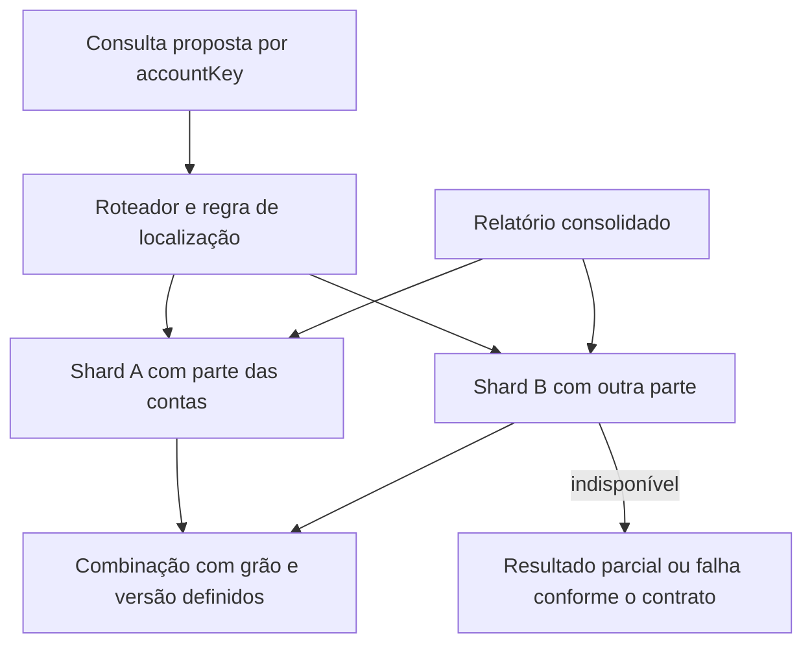
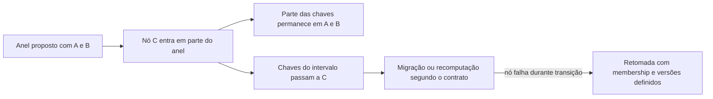
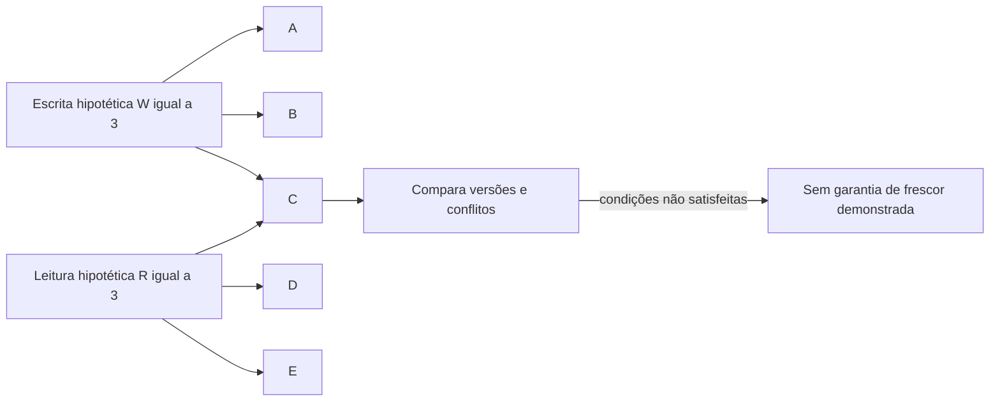

# Repartir dados sem perder o contrato de leitura

Um dashboard consulta movimentos de vários períodos e equipes. Repartir os dados pode ajudar a localizar uma parte menor ou distribuir capacidade entre bancos. Também pode transformar uma JOIN local em uma operação entre sistemas. Aprender a diferença evita escolher uma divisão que encarece justamente a pergunta que o negócio faz.

O exemplo de volume vem da medição de **14/10/2026, 15:56:30 UTC**, em `public.rpt_inflow__movement_adjusted`, PostgreSQL `192.168.254.137/faz_capital`: 557.731 linhas, 557.731 chaves distintas e 3.380 movimentos de outubro, com última data em 08/10. A consulta das **16:07:16 UTC** encontrou uma tabela comum, `relkind=r`. Esses números não medem saturação, custo de consulta ou necessidade de sharding. Os [recibos](/referencia/evidencias/) preservam a consulta integral.

## Partições dividem uma tabela; shards dividem o lugar da decisão

O **particionamento horizontal** distribui linhas em partes, por exemplo, conforme o mês. O **particionamento vertical** separa colunas ou grupos de atributos, mantendo uma identidade que permita reuni-los. Esses desenhos podem continuar dentro do mesmo banco.

Em uma proposta para a tabela de movimentos, partições por mês poderiam facilitar o recorte temporal e a gestão de retenção. Isso só ajuda uma consulta se a divisão combina com seu filtro e o banco consegue evitar partes irrelevantes. Acrescentar partições também acrescenta objetos e manutenção. A [documentação PostgreSQL 16](https://www.postgresql.org/docs/16/ddl-partitioning.html) descreve seu contrato; não foi comprovado que essa tabela esteja particionada.

## 31. Sharding: distribuir partes entre bancos

**Sharding** distribui subconjuntos de dados entre unidades de armazenamento ou bancos, conforme uma regra de localização. Uma shard guarda parte do conjunto; uma réplica guarda uma cópia com papel definido. Cada shard pode ter suas próprias réplicas.

Em um exemplo **hipotético**, dados por conta são distribuídos entre dois bancos. Uma consulta de uma conta pode localizar sua shard. Um relatório que soma movimentos de todas as contas precisa consultar ambas ou usar um resultado consolidado. Transferir uma conta de shard exige coordenar localização, dados e versões durante a mudança.

O benefício é distribuir capacidade e limites por unidade. O custo inclui roteamento, movimentação, operação de mais bancos e consultas ou transações que atravessam shards. O número de linhas sozinho não decide essa troca. No caso medido, primeiro seria necessário conhecer planos, índices, filtros, carga e gargalos; S4 não mediu essas condições.

O desenho é proposto. A aplicação precisa escolher se um relatório incompleto é aceitável; não deve apresentá-lo silenciosamente como total. [Vitess](https://vitess.io/docs/23.0/reference/features/sharding/) fornece uma base e produto OSS **PROD** para sharding de MySQL. Sua maturidade não o torna uma biblioteca diretamente intercambiável com PostgreSQL. A adequação à stack é parte da escolha. A skill `postgresql-table-design`, em `~/.codex/skills/postgresql-table-design/SKILL.md`, ajuda na avaliação anterior de dados e partições; não é uma implementação de sharding distribuído.

Uma **range shard** atribui faixas; uma **hash shard** usa o resultado de um hash; um **directory-based shard** consulta um mapa de localização. Uma **geographic shard** organiza dados por localização e seu contrato de residência ou proximidade. Faixas podem concentrar uma região movimentada; hash pode dificultar consultas por intervalo; diretório vira dependência operacional; distribuição geográfica acrescenta latência e decisões sobre dados que atravessam regiões. O [grupo 5](/referencia/catalogo/05-banco-de-dados-e-armazenamento/) registra essas diferenças sem presumir uma implantação local.

## 32. Consistent Hashing: reduzir o remapeamento ao mudar participantes

O **hashing consistente** associa chaves a posições de um anel ou estrutura equivalente. Quando um participante entra ou sai, o mecanismo procura reduzir a parte de chaves que muda de destino. Pontos virtuais e regras de replicação ajudam a distribuir responsabilidade, mas precisam ser definidos pela implementação.

Considere um cache **hipotético** com dez chaves e dois nós. Se a regra fosse `hash(key) mod node_count`, trocar o divisor de dois para três poderia mudar muitos destinos. Em um anel, a entrada de C toma responsabilidade por uma parte de um intervalo. O benefício é reduzir movimentação; a quantidade exata precisa ser calculada para as chaves e posições escolhidas, não inventada como uma porcentagem universal.

O custo inclui membership, mudanças concorrentes, desequilíbrio de chaves quentes e recuperação durante a transição. Hashing consistente localiza dados; não prova consenso, frescor ou ausência de duplicação. Gossip pode distribuir membership, mas essa informação também pode chegar atrasada.

A [arquitetura de componentes do Loki](https://grafana.com/docs/loki/latest/get-started/components/) documenta uso de anéis na distribuição de trabalho. [Grafana Loki](https://github.com/grafana/loki) é uma aplicação OSS **PROD** de referência, sem implantação confirmada neste recorte. [memberlist](https://github.com/hashicorp/memberlist) é uma base de membership/gossip; não é sozinho o algoritmo inteiro de sharding nem um protocolo de consenso. A skill local `backend-concurrency-mechanics`, em `~/.codex/skills/backend-concurrency-mechanics/SKILL.md`, oferece apoio adjacente; não foi verificada uma skill específica de consistent hashing.

## 33. Optimistic Concurrency: aceitar uma alteração se a versão ainda coincide

O controle otimista de concorrência permite trabalhar sobre uma versão e detectar se ela mudou antes de aceitar a alteração. Em um caso hipotético, dois gestores leem a versão 7. O primeiro grava a versão 8; o segundo recebe conflito ao tentar usar a versão 7. O ganho é evitar sobrescrita silenciosa; o custo é tratar o conflito e decidir como recarregar ou reconciliar.

No `_apply` do MakersHub lido, o UPDATE exige o responsável anterior esperado. É uma condição concreta sobre o valor lido, com limite próprio; não foi demonstrado ali um contador de versão universal. Versionar um lead também não impede dois leads diferentes de reservarem o mesmo horário. A restrição precisa proteger o recurso compartilhado. O [capítulo de concorrência](/explicacoes/concurrency/) desenvolve esse mecanismo e sua recuperação. PostgreSQL é base **PROD**; [EventSourcing.NetCore](https://github.com/oskardudycz/EventSourcing.NetCore) é referência **REF**; a skill de apoio é `backend-concurrency-mechanics`.

## 29. Distributed Lock + Lease + Fencing: limitar ownership e rejeitar o executor antigo

O lock coordena exclusividade, a lease limita sua duração e o fencing permite que o recurso protegido rejeite uma autoridade antiga. O benefício é evitar efeitos de um executor que voltou depois de perder sua autorização. O custo é fazer o destino conferir a autoridade, além de administrar expiração e retomada.

`idempotency_store.py` usa UUID de ownership para condicionar `finish` e impedir conclusão local de um claim antigo. O Salesforce não foi demonstrado como validador de um contador monotônico nesse fluxo. Esse UUID não comprova fencing de efeitos externos. O [capítulo de concorrência](/explicacoes/concurrency/) é o desenvolvimento principal do padrão. [etcd](https://github.com/etcd-io/etcd) é base **PROD** de coordenação; a [referência de fencing](/referencia/catalogo/02-sistemas-distribuidos-e-consistencia/#g02-e028) aponta ao Journal do Hadoop, que rejeita a época antiga no destino. Esse caso externo ensina a fronteira ausente da prova do Salesforce, sem afirmar sua implementação no MakersHub. O localizador de skill é `~/.codex/skills/backend-distributed-locking/SKILL.md`.

## Quórum fornece interseção sob condições definidas

Em um conjunto fixo de cinco réplicas, uma escrita aceita por três e uma leitura que reúne três respostas têm ao menos uma réplica em comum: 3 + 3 = 6, maior que 5. Esse é um cálculo de interseção. Ainda é necessário conhecer o conjunto elegível, a regra de versão e o tratamento de escritas concorrentes.

Se membership muda, se o mecanismo usa fallback fora do conjunto ou se a leitura aceita apenas a primeira resposta, a mesma conta não prova a promessa pretendida. Versões concorrentes também precisam de reconciliação. O artigo [Dynamo](https://www.allthingsdistributed.com/files/amazon-dynamo-sosp2007.pdf) descreve um desenho quorum-like com versões; `R + W > N` não basta para concluir linearizabilidade de qualquer produto.

S6 mediu a política síncrona do banco de metadados do Airflow. Esperar um standby elegível segundo essa política não equivale automaticamente ao protocolo de quórum de leitura e escrita deste exemplo. Os escopos permanecem separados em [disponibilidade](/explicacoes/availability/).

## Consistência e relógios precisam de uma promessa precisa

**Consistência eventual** promete convergência após a propagação bem-sucedida e a pausa das mudanças relevantes, sem estabelecer sozinha um prazo máximo. “Consistência forte” precisa indicar a propriedade pretendida. Uma leitura linearizável respeita a ordem real de operações completadas dentro do contrato. **Read-your-writes** inclui alterações anteriores da sessão; **monotonic reads** impede que a sessão perca alterações já vistas. Essas garantias de sessão não implicam, sozinhas, serialização global. [Terry e colaboradores](https://www.cs.cornell.edu/courses/cs734/2000FA/cached%20papers/SessionGuaranteesPDIS_1.html).

Um **version vector** guarda contadores por participante para distinguir descendência causal de versões concorrentes. Um **Lamport clock** preserva a ordem de acontecimentos causalmente relacionados; um número maior não prova que houve relação causal. Um **Hybrid Logical Clock** combina tempo físico aproximado e contador lógico para acompanhar causalidade recebida. Nenhum desses valores prova sozinho a hora legal exata de um fato financeiro. [Fonte HLC](https://www.cse.buffalo.edu/tech-reports/2014-04.pdf).

**Consenso** estabelece acordo sob o modelo de falhas do protocolo. **Raft** combina eleição e log replicado; **Paxos** é outra família de construção de acordo. **Gossip** dissemina informação entre participantes e não decide sozinho um log único. S6 desenvolve o caso Raft em [disponibilidade](/explicacoes/availability/); a [referência do grupo 2](/referencia/catalogo/02-sistemas-distribuidos-e-consistencia/) preserva cada definição, sua implementação de estudo e seus limites.

## Repartir não substitui preparar a pergunta

Um índice localiza valores e custa espaço e manutenção nas escritas. Um **covering index** inclui atributos que a consulta precisa, mas o motor ainda verifica visibilidade conforme seu mecanismo. **Desnormalização** repete informações para facilitar a leitura; **pré-cálculo** guarda trabalho já realizado. Ambos exigem atualização e identificação de frescor. [Contrato de index-only scans do PostgreSQL](https://www.postgresql.org/docs/16/indexes-index-only-scans.html).

Essas alternativas são diferentes de sharding. O [capítulo de modelos de leitura](/explicacoes/read-models/) mostra a decisão por representação, e o [capítulo de durabilidade](/explicacoes/data-durability/) mostra cópias e recuperação. A escolha depende da pergunta, do gargalo medido e da consequência de uma falha, com uma fronteira explícita para cada garantia.
