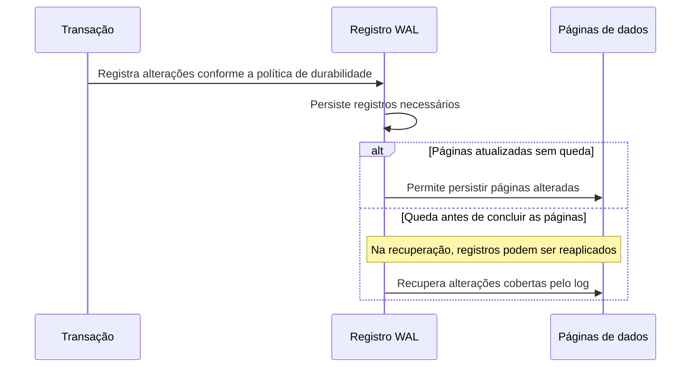
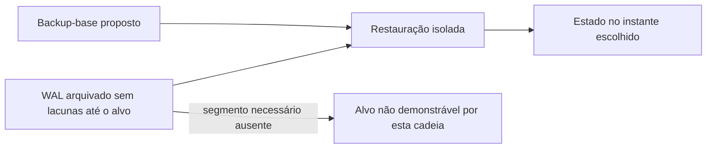
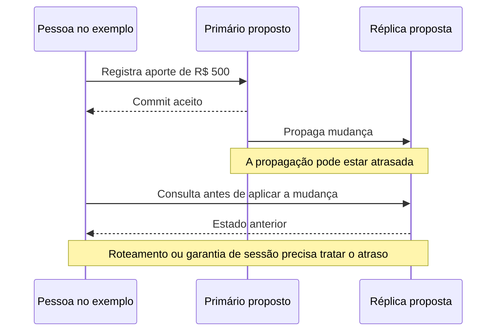
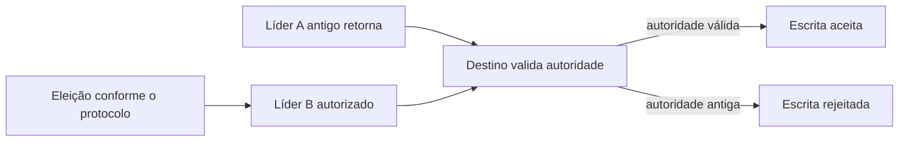

# Manter dados recuperáveis quando uma cópia falha

Um relatório parece salvo. Depois, o processo ou a máquina cai. A pessoa que o enviou precisa saber o que foi confirmado e como o sistema volta a funcionar. Para responder, é necessário distinguir o registro usado na recuperação, uma cópia operacional e uma cópia preservada para restaurar erros do passado.

O caso medido nesta frente é PostgreSQL **16.13 em `192.168.254.137/faz_capital`, às 16:08 UTC de 14/10/2026**. A consulta retornou `pg_is_in_recovery=false` e `wal_level=minimal`. Essa fotografia não descreve todos os bancos da Faz. O banco de metadados do Airflow, administrado por CloudNativePG na evidência de S6, é outro sistema; suas réplicas e sua configuração não podem ser atribuídas ao banco de negócio `.137`. Veja os [recibos](/referencia/evidencias/) e o [capítulo de disponibilidade](/explicacoes/availability/).

## 34. WAL: registrar antes de alterar as páginas persistidas

O registro antecipado de escrita (**Write-Ahead Log**, WAL) permite recuperar alterações quando uma queda interrompe a atualização dos arquivos de dados. O motor registra as informações necessárias no log antes de tornar persistentes as páginas correspondentes. Durante a recuperação, ele pode reaplicar registros que ainda não chegaram a essas páginas.

O benefício é organizar recuperação e reduzir a necessidade de gravar toda página alterada a cada commit. O custo inclui espaço, escrita do log, checkpoints e retenção conforme os consumidores e mecanismos habilitados. A existência de WAL não mede sozinha a durabilidade de cada resposta: configurações de sincronização, armazenamento e política de commit também participam do contrato. [Fundamento PostgreSQL WAL](https://www.postgresql.org/docs/16/wal-intro.html).

O desenho explica o mecanismo do PostgreSQL. A queda é didática, não um incidente observado no servidor medido.

O nível `minimal` medido conserva informações para recuperação de crash, mas não habilita o conjunto de informações necessário para streaming físico e arquivamento contínuo. Essas capacidades requerem `replica` ou superior; decodificação lógica requer `logical`. Essa interpretação vem do [contrato PostgreSQL 16](https://www.postgresql.org/docs/16/runtime-config-wal.html), não de uma inferência sobre outros servidores.

Recuperar para um instante anterior (**point-in-time recovery**, PITR) exige uma cadeia compatível de backup-base e WAL arquivado. Se uma exclusão incorreta foi confirmada, restaurar até antes dela pode recuperar o estado naquele instante. Isso é diferente de reiniciar após crash ou promover uma réplica que já recebeu a exclusão. A evidência S4 não contém ensaio de restauração nem cadeia de backups da instância `.137`.

PostgreSQL é uma base e aplicação OSS **PROD**: um produto com motor WAL documentado. Isso não comprova PITR habilitado na Faz. A skill `postgresql-table-design`, em `~/.codex/skills/postgresql-table-design/SKILL.md`, oferece apoio adjacente de armazenamento; não substitui um procedimento de backup e restore. S6 possui a explicação operacional desse procedimento.

## 30. Replication: manter outra cópia operacional

**Replicação** propaga dados para outras cópias que têm funções definidas. Em um desenho primary/replica, um primário recebe as gravações e as réplicas acompanham. Uma réplica de leitura pode reduzir carga de consultas. Uma cópia preparada para assumir o papel de primário pode apoiar disponibilidade, se o processo de promoção e a proteção contra dois escritores estiverem definidos.

Considere uma confirmação de aporte de R$ 500 em um sistema **hipotético**. Se a leitura seguinte for encaminhada a uma réplica atrasada, a pessoa pode ver o status anterior. A cópia existe e a gravação deu certo; a promessa de leitura da sessão continua sendo outra questão. Read-your-writes evita esse recuo dentro do contrato da sessão. Uma decisão de liberação de dinheiro pode exigir uma garantia ainda mais forte.

Na replicação **assíncrona**, a confirmação local não espera a condição remota de durabilidade. Existe uma janela de dados ainda não propagados. Na replicação **síncrona**, a confirmação espera a condição remota configurada, como recebimento, persistência ou aplicação. Isso acrescenta espera e pode reduzir disponibilidade de escrita quando a condição não pode ser atendida. A regra precisa especificar qual cópia e qual estado são exigidos. [Contrato de standby PostgreSQL](https://www.postgresql.org/docs/16/warm-standby.html).

O benefício é distribuir leitura e manter cópias para recuperação operacional. O custo é rede, armazenamento, lag, observação e reconciliação de papéis. Uma exclusão incorreta também pode ser replicada. Por isso replicação não substitui backup. Duas instâncias no mesmo domínio de falha não protegem automaticamente contra a perda desse domínio.

O banco `.137` tinha `wal_level=minimal` no horário medido. Este capítulo apresenta streaming e PITR como mecanismos e propostas para essa instância, sem afirmar que estavam habilitados. A referência operacional **PROD** de CloudNativePG pertence ao banco de metadados do Airflow documentado em [disponibilidade](/explicacoes/availability/), com seus próprios recibos. A skill `devops-gitops-advanced`, em `~/.codex/skills/devops-gitops-advanced/SKILL.md`, oferece apoio adjacente ao ciclo operacional.

## 28. Leader Election: escolher quem exerce o papel

A **eleição de líder** escolhe um participante para exercer determinada função. Ela ajuda a evitar que todos atuem deliberadamente como coordenadores ao mesmo tempo. O custo é manter membership, detecção de falha e retomada do papel. O limite é que vencer a eleição não impede, por si só, que um líder antigo retorne e grave.

Se o líder A fica isolado e B assume, o destino da escrita precisa reconhecer a autoridade válida. A eleição, a replicação e o fencing são mecanismos relacionados, com funções próprias. O [capítulo de disponibilidade](/explicacoes/availability/) desenvolve o caso etcd/Raft de S6 e sua retomada; o [capítulo de concorrência](/explicacoes/concurrency/) desenvolve a rejeição de escritor antigo.

O desenho é conceitual; não prova um destino com fencing na Faz. As bases são [etcd](https://github.com/etcd-io/etcd) e [Raft](https://raft.github.io/raft.pdf), com Kubernetes como produto **PROD** na evidência S6. `client-go` não garante sozinho fencing de efeitos externos. A skill local `backend-distributed-locking`, em `~/.codex/skills/backend-distributed-locking/SKILL.md`, apoia a distinção entre papel, lease e recurso protegido.

## Um log, uma árvore e um snapshot têm contratos próprios

Um **append-only log** acrescenta registros na ordem definida. Essa propriedade pode servir a eventos, auditoria ou mensagens; não basta para provar Event Sourcing. É necessário que o histórico seja a fonte de verdade reconstruível, como explica o [capítulo de modelos de leitura](/explicacoes/read-models/#pattern-12).

**Copy-on-write** preserva blocos existentes e grava novas versões antes de mudar referências. Ele facilita snapshots em mecanismos que implementam esse contrato, com custo de espaço e manutenção. [Btrfs](https://btrfs.readthedocs.io/en/latest/Introduction.html) é um produto OSS **PROD** de referência; seu uso no armazenamento da Faz não foi demonstrado aqui.

O armazenamento organizado por log (**log structured storage**) pode reunir escritas em memória e produzir arquivos ordenados, depois compactados. [RocksDB](https://github.com/facebook/rocksdb/wiki/RocksDB-Overview) é uma base documentada desse desenho. A compactação e os índices podem fazer o motor escrever mais bytes que o tamanho lógico da alteração: essa diferença é a amplificação de escrita. Melhorar esse custo exige medição e escolha de políticas, sem prometer um único ajuste que resolva todos os workloads.

Esses mecanismos aparecem individualmente no [grupo 5](/referencia/catalogo/05-banco-de-dados-e-armazenamento/). Para separar cópias dos dados de partes diferentes dos dados, siga para [distribuição](/explicacoes/data-distribution/).
