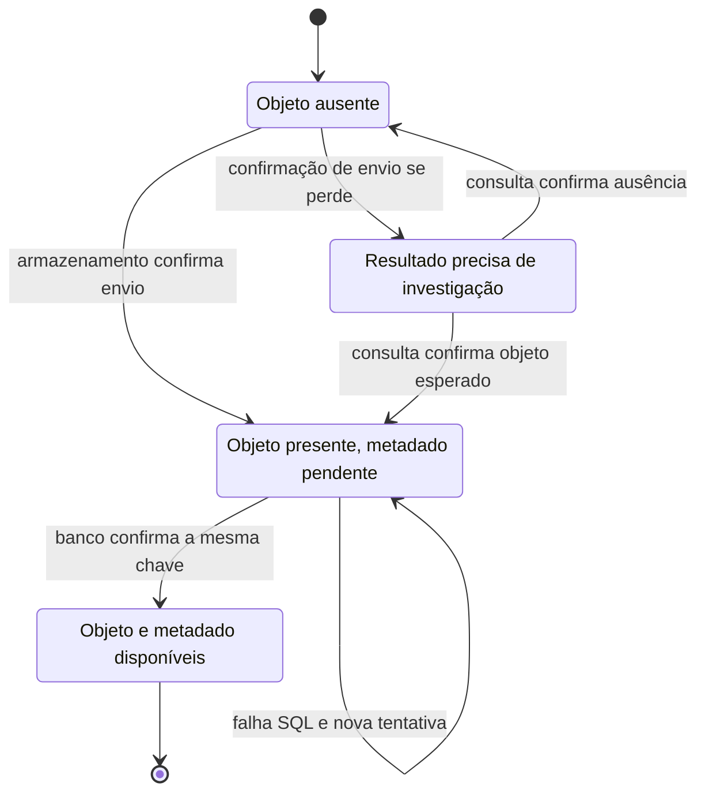
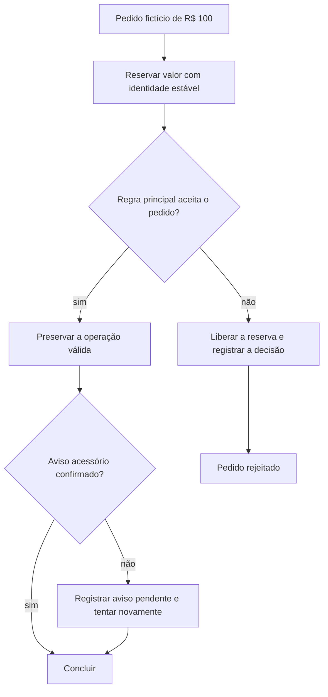

# Concluir uma operação quando cada parte responde em seu tempo

Uma operadora procura uma gravação e a consulta devolve uma lista vazia. O arquivo pode ter sido enviado ao armazenamento, enquanto a gravação de seus metadados no banco falhou. Para recuperar o trabalho, ela precisa saber qual efeito aconteceu, qual falta e qual pode ser repetido. Essa pergunta aparece sempre que uma operação atravessa sistemas que confirmam suas escritas em momentos diferentes.

Neste capítulo, o caminho de áudio vem de uma leitura do código Airflow em 14/10/2026. Os episódios de queda são **cenários didáticos**, e a reserva financeira é **hipotética**. Eles ajudam a escolher uma recuperação sem representar incidentes ou operações financeiras internas observadas. Os [recibos dos exemplos](/referencia/evidencias/) preservam os ambientes; a [explicação de workflows](/explicacoes/workflow/) detalha os três pipelines.

## Saber o que já aconteceu: State Machine

Uma máquina de estados descreve as situações em que uma operação pode estar e as transições permitidas entre elas. O nome técnico é **State Machine**, um dos 40 padrões prioritários. Para a gravação, três situações úteis ao raciocínio são: o objeto ainda falta; o objeto existe, mas falta sua referência no banco; ambos existem. Cada situação pede uma ação diferente.

Na DAG `dags/recordings__nextbilling__api_to_stg__audio.py`, `download_and_upload` consulta a existência do objeto com `stat_object` e envia seus bytes com `put_object` quando necessário. Depois, `load_metadata` grava `public.fct_minio__call` com `ON CONFLICT(nextbilling_call_id)`. O código observado possui essas operações. A máquina abaixo é um **modelo proposto para explicar a recuperação**; não foi encontrada como registro persistido próprio da DAG.

Se a confirmação se perde, escrever “falhou” ainda não informa se o efeito ocorreu. A transição para investigação impede que o processo invente uma resposta. Para avançar com segurança, ele precisa consultar uma identidade conhecida e conferir o resultado. Uma resposta que indique somente existência também pode ser insuficiente: o contrato pode exigir tamanho, checksum, versão e origem esperados. Esses controles adicionais são uma proposta, sem prova de implementação no caso observado.

A identidade estável permite retomar o mesmo trabalho. No exercício, a gravação usa o identificador fictício `CALL-SYNTH-001`; a nova tentativa procura o objeto correspondente e grava a mesma chave de metadado. A consulta de existência ajuda a evitar um segundo envio, e o conflito SQL ajuda a tratar uma repetição da linha. Essas duas decisões dependem da mesma identidade continuar válida durante a retomada.

Persistir uma máquina de estados acrescenta transições, atualização concorrente e tratamento de situações antigas. Duas pessoas podem tentar resolver o mesmo item; uma transição deve verificar o estado ou a versão que espera encontrar. Declarar estados no desenho não resolve essa concorrência nem cria atomicidade entre armazenamento e PostgreSQL. Os mecanismos de [concorrência](/explicacoes/concurrency/) e [integração confiável](/explicacoes/reliable-integration/) completam essa decisão.

Uma **Finite State Machine** possui um conjunto finito de estados e transições. Ela é útil para tornar esse contrato inspecionável. O conjunto finito não obriga toda informação da operação a caber no nome do estado: identificação, tentativa, prazo e causa ficam em dados associados. Acrescentar um estado para cada combinação de erro e detalhe tornaria o modelo difícil de manter.

## Quem decide o próximo passo

Na **orquestração**, um coordenador conhece os passos, decide quando cada um pode começar e acompanha os resultados. Airflow oferece esse papel para as DAGs analíticas observadas. A sequência de áudio fica visível em um lugar: extração, enriquecimento, download/upload e metadados. O coordenador pode explicar qual dependência impede o avanço, mas seus efeitos externos continuam pertencendo aos sistemas chamados.

Uma operação longa pode precisar esperar uma confirmação de negócio, uma resposta humana ou uma data distante. Um motor de workflow durável mantém progresso e retoma o fluxo conforme seu contrato. O [Temporal](https://docs.temporal.io/temporal) é uma referência OSS para estudar esse mecanismo; o corpus local inclui código de reconstrução e envio de Workflow Tasks. A evidência do ambiente deste curso não confirma Temporal implantado. Os usos de Airflow, Cosmos e dbt observados estão descritos no [capítulo de workflows](/explicacoes/workflow/).

Na **coreografia**, cada participante reage a fatos publicados e pode produzir novos fatos. Uma confirmação de reserva poderia disparar a preparação do pedido; a preparação poderia disparar a confirmação de entrega. Esse é um desenho hipotético. A autonomia reduz o conhecimento que um coordenador central precisa ter, enquanto aumenta a necessidade de contratos de eventos, rastreamento, deduplicação e entendimento da sequência entre participantes.

Uma emissão de Asset no Airflow informa prontidão ao scheduler que decide quais DAGs podem avançar. O caso XP ensina reação a uma condição de dados, dentro de uma coordenação central. Ele não comprova uma Saga coreografada. Para estudar reações por mensagens, o corpus [Watermill](https://github.com/ThreeDotsLabs/watermill) oferece router e handlers; sua capacidade é uma referência, sem implantação presumida aqui.

## Reservar antes de confirmar

Uma **reserva** separa “o recurso está disponível para esta operação” de “a operação foi concluída”. Imagine um exercício financeiro com R$ 100 fictícios disponíveis. Reservar R$ 30 deixa R$ 70 disponíveis e R$ 30 comprometidos; confirmar a operação usa a reserva, enquanto cancelá-la devolve os R$ 30. Esse cálculo conserva o valor total e torna visível o que ainda está pendente.

Uma reserva precisa de proprietário, identidade, prazo e regra de liberação. Caso duas tentativas reservem a mesma intenção como se fossem diferentes, a operação pode consumir capacidade duas vezes. Caso uma reserva expirada seja confirmada depois de o recurso ser reutilizado, o sistema precisa rejeitar essa confirmação ou aplicar uma regra explícita. Essas são condições do contrato de negócio, não decisões que o autor do pipeline deve adivinhar.

O padrão **TCC — Try/Confirm/Cancel** organiza participantes que oferecem três ações: tentar e reservar; confirmar; cancelar a reserva. Cada ação precisa tolerar a repetição e decidir como trata um pedido fora de ordem. Se um participante oferece somente uma ação irreversível, chamar essa ação de Try não a transforma em uma reserva reversível. O desenho é útil quando os próprios participantes sustentam o contrato; seu custo é implementar e operar esse contrato em todos eles.

## Saga e a compensação que o negócio realmente precisa

Uma **Saga** divide uma operação em passos com transações locais e define como lidar com efeitos já confirmados quando a operação deixa de ser desejada. Uma **Compensating Transaction** realiza uma nova ação de negócio que corrige um efeito anterior. Seu resultado e sua auditoria continuam existindo; compensar não apaga o passado.

Imagine um pedido fictício de R$ 100. A reserva foi aprovada e a regra principal aceitou o pedido, mas um aviso acessório falhou. Liberar a reserva por causa do aviso cancelaria uma operação válida. A decisão adequada ao contrato do exercício é preservar o pedido e guardar o aviso para nova tentativa. Se a regra principal rejeitar o pedido depois da reserva, a liberação passa a ser necessária.

O diagrama a seguir é **proposto para o exercício**. Ele mostra qual condição de negócio autoriza a compensação e qual falha pede concluir o trabalho para a frente.

Uma **Orchestration Saga** coloca essas decisões no coordenador. Uma **Choreography Saga** as distribui em participantes que reagem aos eventos contratados. Ambas precisam tratar mensagens repetidas, prazo de espera e compensação que também pode falhar. A escolha depende de quem precisa conhecer e governar a decisão inteira. A [aula de integração confiável](/explicacoes/reliable-integration/) desenvolve Saga e seus contratos; aqui o exemplo serve para ligar decisões de negócio ao progresso de um workflow.

O exemplo OSS [Eventuate CreateOrderSaga](https://github.com/eventuate-tram/eventuate-tram-sagas/blob/master/orders-and-customers/src/main/java/io/eventuate/examples/tram/sagas/ordersandcustomers/orders/sagas/createorder/CreateOrderSaga.java) contém etapas de reserva de crédito e aprovação, com compensação de rejeição. Ele é **REF**, código de aplicação usado para estudo. Seu domínio e seus serviços não representam uma operação financeira interna da XP, e a evidência não confirma sua implantação neste ambiente.

## Recuperar é escolher o efeito que falta

No exercício do áudio, apagar o objeto após uma falha SQL poderia destruir uma gravação válida. Concluir os metadados para a frente preserva o trabalho útil. Uma compensação só faria sentido se o contrato determinasse que aquele arquivo não deve mais existir. O mesmo raciocínio aplica a reserva: primeiro determine se a operação ainda é desejada e só então escolha avançar, esperar ou compensar.

O benefício desses modelos é permitir que uma pessoa explique a decisão de recuperação com evidências. O custo é manter identidades, estados, prazos e intervenções operacionais. Um motor de workflow executa o contrato que recebeu; ele não decide sozinho se um áudio deve ser apagado ou uma reserva liberada.

Para aplicar esse raciocínio a uma investigação, siga [Como preparar a recuperação de um pipeline](/guias/recuperar-pipeline/). Para consultar os termos, use a [referência de workflows](/referencia/catalogo/16-workflow-e-processamento/) e a [referência de consistência](/referencia/catalogo/02-sistemas-distribuidos-e-consistencia/).
