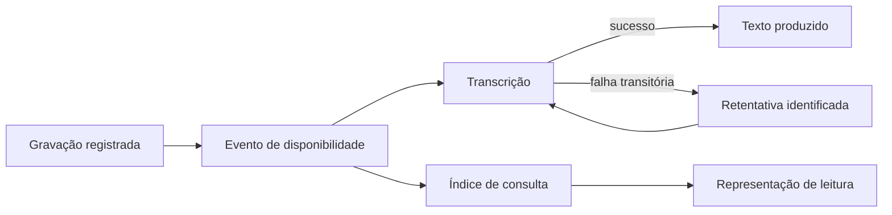
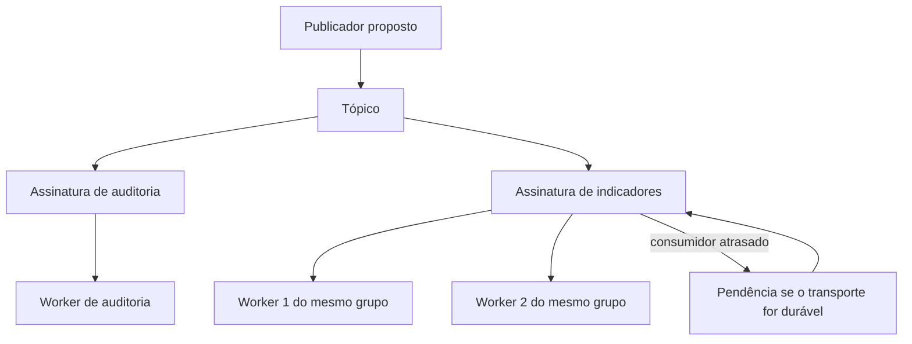
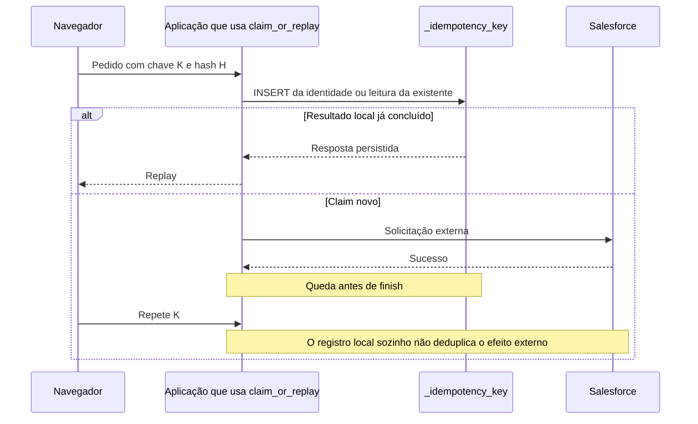
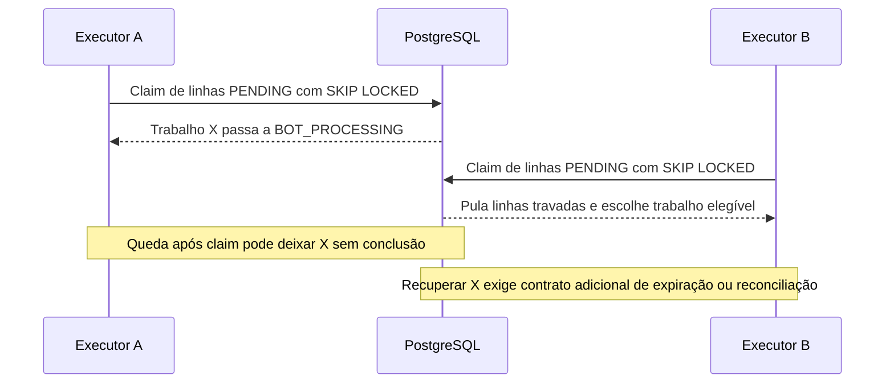
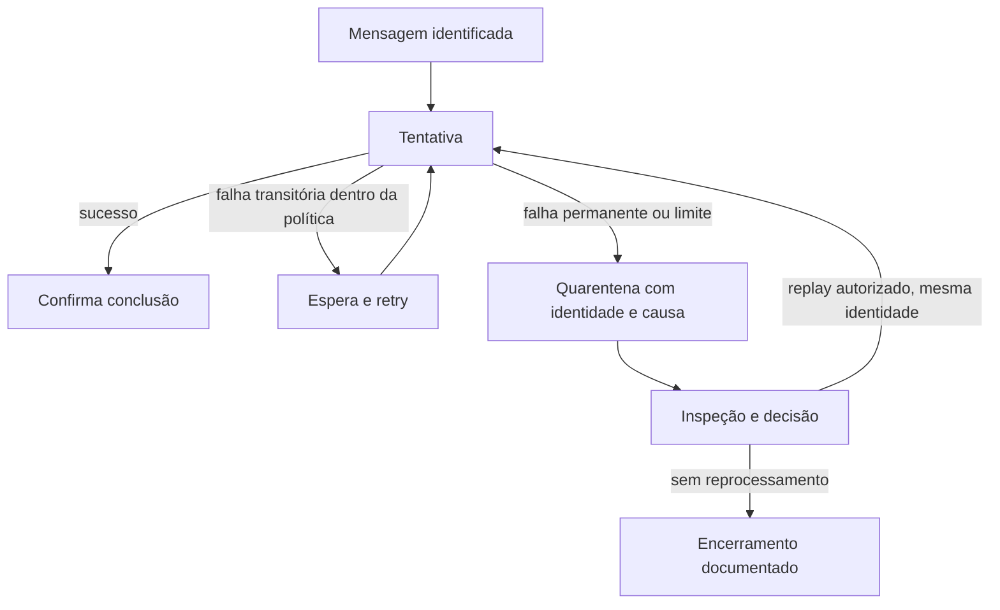

# Entregar mensagens sem confundir envio com efeito

Uma chamada externa terminou, mas a resposta se perdeu. O navegador tenta de novo. Ao mesmo tempo, dois executores podem encontrar o mesmo trabalho. Essas repetições são normais quando sistemas conversam pela rede. A arquitetura precisa decidir quem recebe o trabalho, o que confirma sua conclusão e como reconhecer a mesma operação.

Esta página usa código do MakersHub lido em 14/10/2026 no SHA `e233fb046ec333982cd1547171b0f0bd8d8d92ee`. O claim de idempotência está em `backend/app/services/idempotency_store.py:70–214`; o claim de trabalho está em `backend/app/repositories/lead_pipeline_repository.py:485–515`. Esses trechos não comprovam um broker implantado, número de workers ativos ou entrega externa exatamente uma vez. Os desenhos que acrescentam um broker são propostas.

## 5. Event-Driven Architecture: reagir a um acontecimento

Uma arquitetura orientada a eventos (**Event-Driven Architecture**) permite que componentes reajam a acontecimentos descritos por mensagens. O produtor informa um fato; consumidores aplicam suas próprias consequências. Um comando pede uma ação e pode ser recusado. Um evento descreve algo que já aconteceu dentro da fronteira do produtor.

Considere uma proposta para uma gravação que ficou disponível. Transcrição, indexação e atualização de um histórico poderiam reagir a esse fato. O recebimento da gravação não precisaria esperar todas essas atividades. Uma falha da transcrição ficaria identificada no consumidor que a executa, com seu próprio processo de recuperação.

O benefício é poder acrescentar reações e recuperar cada uma sem prender a solicitação original a toda a cadeia. O custo inclui contratos de evento, identidade, observabilidade, retenção e acompanhamento de resultados incompletos. Publicar o evento não confirma que a transcrição foi produzida. Se a publicação pode se perder após salvar a gravação, a [intenção durável de integração](/explicacoes/reliable-integration/#pattern-7) continua necessária conforme o contrato escolhido.

O diagrama é **proposto**, não uma reconstrução da implantação atual de transcrição.

A base de estudo [Watermill](https://github.com/ThreeDotsLabs/watermill) possui roteadores e aplicações **REF**. Seu [exemplo de consumer groups](https://github.com/ThreeDotsLabs/watermill/tree/master/_examples/real-world-examples/consumer-groups) mostra reações separadas. A skill `backend-message-queue`, em `~/.codex/skills/backend-message-queue/SKILL.md`, apoia entrega e consumo. A referência demonstra um desenho de estudo; não prova que o MakersHub usa essa biblioteca.

## 6. Pub/Sub: cada assinatura recebe sua consequência

Na publicação e assinatura (**Publish/Subscribe**, ou Pub/Sub), um produtor publica e cada assinatura interessada recebe o acontecimento segundo o contrato do transporte. Em uma proposta de conversão de lead, auditoria e indicadores poderiam ter assinaturas independentes. Uma falha dos indicadores não deveria apagar o trabalho destinado à auditoria.

Quando três workers compartilham uma fila ou um grupo de consumo, eles dividem as mensagens desse grupo. Quando existem três assinaturas independentes, cada assinatura pode receber sua própria cópia. Acrescentar workers aumenta a capacidade de uma consequência; acrescentar assinaturas acrescenta consequências.

O ganho é permitir interesses independentes. O custo é manter contratos e progresso por assinatura; a mesma ocorrência pode gerar várias operações. A palavra Pub/Sub não garante persistência. [Redis Pub/Sub](https://redis.io/docs/latest/develop/pubsub/) tem entrega at-most-once: uma desconexão pode perder a mensagem. Redis Streams e [NATS JetStream](https://docs.nats.io/learn/jetstream/pull-consumers) oferecem outros mecanismos, com retenção e confirmação configuráveis.

Watermill consumer groups é uma aplicação **REF** com Redis Streams. Ela não é prova de Redis Pub/Sub volátil. Apache Superset aparece neste curso como consumidor de tarefas Celery, não como comprovação desse padrão. A skill local de apoio é `backend-message-queue`.

## 10. Idempotency: reconhecer a mesma intenção

Uma operação idempotente produz o mesmo efeito relevante quando a mesma intenção é repetida. A identidade precisa representar a operação, não apenas uma tentativa de rede. Se cada retry recebe uma chave nova, o servidor pode interpretar cada um como trabalho novo.

No código lido, `claim_or_replay` tenta inserir uma chave composta por escopo, identidade de usuário e chave idempotente. O `request_hash` permite perceber quando a mesma chave chegou com outro pedido. Um resultado pronto pode ser reproduzido; uma operação ainda em andamento pode ser tratada como ocupada. O claim e o resultado usam transações curtas próprias.

O benefício para a pessoa é poder repetir uma solicitação cuja resposta se perdeu e receber um resultado identificável. O custo é gravar chave, hash, resultado, prazo de retenção e estado. É necessário definir o comportamento para chave incompatível, pedido ainda em andamento e chave expirada.

O diagrama explica a guarda local e acrescenta uma chamada externa e uma queda **hipotéticas**. Ele não é um trace de produção nem afirma que `claim_or_replay` chama diretamente o Salesforce.

Às **16:08 UTC de 14/10/2026**, PostgreSQL `192.168.254.137/faz_capital` tinha 4.771 linhas com status `done` em `makershub._idempotency_key`. Isso conta estados locais. Não mede 4.771 efeitos externos distintos, nem uma garantia de Exactly Once no Salesforce. A consulta integral está nos [recibos](/referencia/evidencias/).

O UUID de ownership impede que um executor antigo finalize a linha depois que outro assumiu. Essa guarda local não é um contador monotônico validado por um destino externo; [concorrência](/explicacoes/concurrency/) desenvolve a diferença. Correlação também é outro papel: `correlationId` liga mensagens de uma conversa; a chave idempotente decide se duas solicitações representam a mesma intenção.

A aplicação **REF** [contador transacional do Watermill](https://github.com/ThreeDotsLabs/watermill/tree/master/_examples/real-world-examples/exactly-once-delivery-counter) reúne consumo e efeito no mesmo banco. Esse é o escopo de sua atomicidade. A oficina **REF** [Idempotency de EventSourcing.NetCore](https://github.com/oskardudycz/EventSourcing.NetCore/tree/main/Workshops/IntroductionToEventSourcing/22-Idempotency) oferece outra comparação. A skill `backend-idempotency`, em `~/.codex/skills/backend-idempotency/SKILL.md`, apoia esse contrato.

## 38. Competing Consumers: dividir o trabalho disponível

Consumidores concorrentes (**Competing Consumers**) disputam unidades de trabalho da mesma fila ou grupo. Cada tentativa é atribuída a um consumidor. A distribuição pode aumentar capacidade, mas uma reentrega ainda pode levar a mesma mensagem a outro executor.

O método `claim_pending_for_bot` do MakersHub seleciona linhas PENDING com `FOR UPDATE SKIP LOCKED`, muda seu estado para `BOT_PROCESSING` na mesma instrução e devolve os IDs claimados. Enquanto outra transação mantém determinadas linhas travadas, o próximo claim pode escolher outras. Esse mecanismo usa o próprio PostgreSQL como coordenador de trabalho.

O ganho é coordenar claims sem fazer os executores processarem deliberadamente o mesmo lote. O custo inclui locks, transações e gestão de estados abandonados. O trecho não demonstra quantos workers existem nem o caminho completo de recuperação após crash. Um pool de conexões fornece acesso ao banco; não desempenha sozinho o papel de fila, broker ou scheduler.

[Celery](https://docs.celeryq.dev/en/stable/) é uma base madura. Apache Superset é uma aplicação OSS **PROD**, com workers e tarefas no [Compose](https://github.com/apache/superset/blob/master/docker-compose.yml) e na [documentação de Alerts/Reports](https://github.com/apache/superset/blob/master/docs/admin_docs/configuration/alerts-reports.mdx). PROD descreve o produto, não uma contagem viva de workers. A skill local é `backend-message-queue`. O [capítulo de workflows](/explicacoes/workflow/) relaciona esse padrão aos executores do Airflow.

## 39. Dead Letter Queue: preservar a falha que precisa de decisão

Uma fila de mensagens problemáticas (**Dead Letter Queue**, DLQ) isola trabalho que não deve continuar na retentativa automática comum. Ela preserva identidade, conteúdo necessário, causa e contexto de tentativas para inspeção e replay controlado. Registrar apenas “falhou” não fornece esse contrato de recuperação.

Em uma integração **proposta**, um webhook inválido pode falhar sempre na validação. Repeti-lo a cada segundo consome capacidade e esconde trabalhos que poderiam terminar. Depois de classificar a falha, o processo envia a mensagem para quarentena. Quando o contrato é corrigido, a decisão de replay preserva a identidade original da operação.

O benefício é tornar recuperável uma falha persistente sem deixá-la ocupar toda a fila. O custo é operar a quarentena, proteger payloads, definir retenção e acompanhar a decisão. A DLQ pode receber a mesma mensagem várias vezes, e o replay pode repetir um efeito já aplicado parcialmente. Deduplicação e reconciliação continuam necessárias.

RabbitMQ oferece [dead-letter exchanges](https://www.rabbitmq.com/docs/dlx) e [acknowledgements](https://www.rabbitmq.com/docs/confirms). A configuração precisa considerar a segurança da republicação: uma DLX comum não oferece automaticamente todas as garantias de transferência. RabbitMQ é **PROD** como broker OSS. A implementação do broker e os caminhos Management e Shovel para inspeção e transporte estão ligados na [referência de DLQ](/referencia/catalogo/03-event-driven-messaging/#g03-e018). Esses mecanismos são concretos, mas a identidade preservada, a autorização de replay e o tratamento do efeito externo continuam sendo decisões da aplicação. As skills locais `backend-message-queue` e `backend-resilience-patterns` apoiam entrega e recuperação.

## Como uma mensagem muda de caminho e de representação

Um **router** escolhe o destino; um **content-based router** decide pelo conteúdo. Um **filter** aplica um predicado para aceitar ou descartar. Um **translator** adapta um contrato, enquanto um **enricher** acrescenta contexto obtido de uma fonte definida. A falha de enriquecimento pode impedir o envio seguinte; um descarte precisa ter consequência conhecida.

Um **splitter** divide um lote em mensagens correlacionadas. Um **aggregator** reúne partes e precisa definir quando há resultado completo ou parcial. Um **resequencer** reorganiza mensagens conforme uma sequência; precisa tratar o número que nunca chega. **Fan-in** converge fluxos para um destino e pode apenas encaminhá-los, sem agregá-los. Essas distinções evitam transformar “juntar mensagens” em uma promessa ambígua.

O [loan broker do Spring Integration](https://docs.spring.io/spring-integration/reference/samples.html) é uma aplicação **REF** descrita na documentação oficial, com enriquecimento, roteamento e agregação. Não foi localizada a pasta desse sample no checkout. A [referência do grupo 3](/referencia/catalogo/03-event-driven-messaging/) registra individualmente as 25 ocorrências, suas implementações e os limites de cada vínculo.

## O alcance da confirmação

Entrega **at-most-once** permite perda e evita a reentrega pelo mecanismo descrito. Entrega **at-least-once** permite repetição e depende de continuidade do processo para progresso. **Exactly Once** precisa declarar o efeito e a fronteira: consumo e escrita na mesma transação local são diferentes de banco, broker e serviço externo decidirem juntos.

Uma confirmação do publicador informa a aceitação pelo transporte segundo seu contrato; um ACK do consumidor informa que ele concluiu a etapa definida. Um timeout em Request/Reply não prova cancelamento do comando. Por isso a recuperação precisa conhecer identidade e estado, além de repetir a chamada.

Para estudar essa fronteira, siga para [integração confiável](/explicacoes/reliable-integration/). Para distinguir eventos de consulta de dados preparados, siga para [modelos de leitura](/explicacoes/read-models/).
