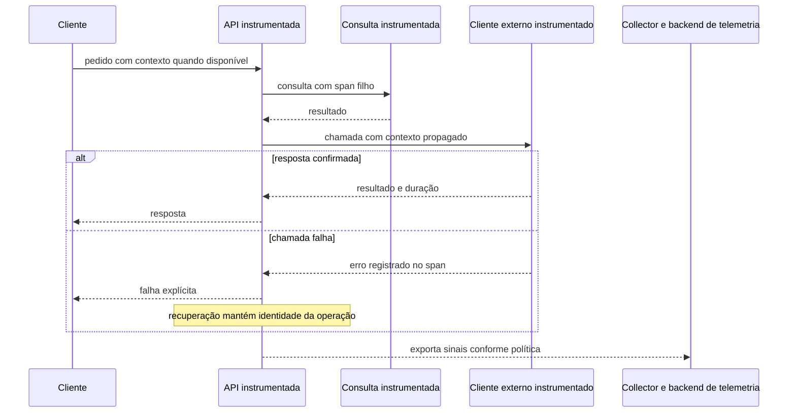
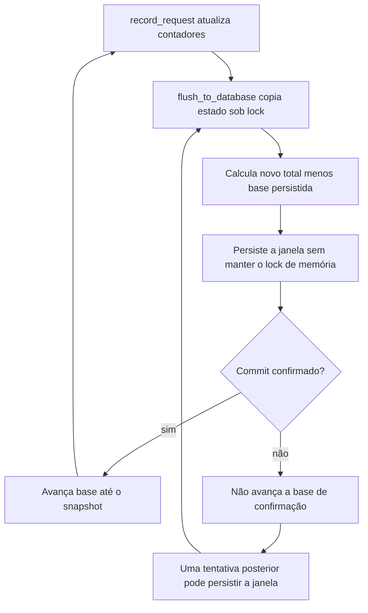

# Descobrir em qual etapa a operação ficou lenta ou incompleta

Uma pessoa diz que o pedido demorou e a tela não confirmou o resultado. A API pode ter esperado o banco, a integração pode ter repetido uma tentativa ou a resposta pode ter se perdido depois do efeito. Observar cada fronteira permite reconstruir o que ocorreu e escolher a recuperação com menos suposições.

O caso MakersHub vem do código `main@e233fb046ec333982cd1547171b0f0bd8d8d92ee`, lido em **14/10/2026 às 16:16 UTC**. Foram observados request IDs, medição de pedidos e persistência de métricas. Não foram medidos exporters OpenTelemetry, spans, dashboards ou alertas em produção. A [referência de evidências](/referencia/evidencias/) conserva a diferença entre instrumentação escrita e sinal realmente consultado.

## Três tipos de sinal respondem perguntas diferentes

Um **Structured Logging** registra acontecimentos com campos estáveis, como nome do evento, resultado, tentativa e duração. O leitor consegue filtrar sem decodificar uma frase diferente a cada função. Um **Centralized Logging** reúne esses registros para consultar componentes num mesmo lugar, com retenção e acesso definidos. Centralizar texto desorganizado não corrige automaticamente sua qualidade.

**Metrics** medem quantidades e distribuições ao longo do tempo. Elas ajudam a perceber aumento de erros ou espera, mas não guardam necessariamente a história de cada pedido. **Distributed Tracing** liga etapas causais de uma operação por spans e contexto. Um span descreve uma etapa com início, fim e relação com outras etapas.

O produto OSS [Loki](https://github.com/grafana/loki/blob/main/cmd/loki/main.go) fornece comparação de logging centralizado. O [OpenTelemetry Demo](https://opentelemetry.io/docs/demo/architecture/) é aplicação **REF didática** com serviços e telemetria. Seu uso aqui não demonstra que o MakersHub envia sinais para esses produtos. As skills `observability-and-instrumentation` e `distributed-tracing` estão na [curadoria](/referencia/skills-e-projetos/).

## Identificar um pedido e uma operação

Um **Request ID** identifica uma requisição. Um **Correlation ID** reúne acontecimentos da mesma operação, que pode atravessar várias requisições e tentativas. Se a tentativa 2 usar outra conexão HTTP, a equipe ainda precisa reconhecer que ela pertence à mesma intenção.

No código lido, `security_headers.py:37` gera um UUID, guarda-o no estado do request e devolve `X-Request-ID`. O cliente Airflow mantém seu próprio ContextVar e envia um ID em header. A ligação entre o ID de entrada e esse contexto não foi comprovada na busca delimitada. Por isso, esses caminhos não serão desenhados como um trace distribuído já existente.

O diagrama seguinte é um **blueprint OpenTelemetry**, sem integração implantada afirmada. O contexto acompanha chamadas; spans permitem localizar a etapa que falhou e relacioná-la ao pedido original.

A [propagação OpenTelemetry](https://opentelemetry.io/docs/concepts/context-propagation/) usa contexto como trace ID, span ID e `traceparent` entre etapas. O custo inclui coleta, exportação, amostragem e cuidado com os campos. Dados pessoais, payloads completos e identificadores de cliente não precisam entrar numa métrica para localizar a falha. Um ID arbitrário em cada linha também não prova que as relações causais foram preservadas.

## RED, USE e Golden Signals

O **RED Method** observa taxa de pedidos, erros e duração de uma operação ou serviço. Num exemplo fictício, 600 pedidos em 60 segundos dão **600 ÷ 60 = 10 pedidos por segundo**. Se 12 falharam, a proporção é **12 ÷ 600 × 100 = 2%**. O período e o que conta como erro precisam ficar explícitos.

O **USE Method** observa utilização, saturação e erros de um recurso. Num pool hipotético com dez vagas e sete ocupadas, a utilização é **7 ÷ 10 × 100 = 70%**. Pedidos esperando vaga mostram outra pergunta: saturação e espera. Usar essas medidas ajuda a distinguir um serviço que recebe muitos pedidos de um recurso que não consegue atendê-los. [Fonte USE](https://www.brendangregg.com/usemethod.html).

Os **Golden Signals** reúnem latência, tráfego, erros e saturação para entender o serviço. Esses conjuntos se sobrepõem, mas orientam perguntas diferentes: RED começa na operação; USE começa no recurso. Nenhum método, sozinho, comprova a causa de um erro. [Fonte Google SRE](https://sre.google/sre-book/monitoring-distributed-systems/).

Uma média pode esconder a espera de poucas pessoas. Se 95 pedidos demorarem 10 ms e cinco demorarem 1.000 ms, a média será **(95 × 10 + 5 × 1.000) ÷ 100 = 59,5 ms**. Mesmo assim, cinco pessoas esperaram um segundo. Histogramas e quantis definidos ajudam a observar essa distribuição; a média do checkout não será chamada de percentil.

## Uma métrica errada também produz um diagnóstico errado

`RequestTimingMiddleware`, em `backend/app/utils/request_timing.py:111` e `:140`, registra método, caminho normalizado, status, duração e erro conforme o ramo. `main.py` instala o middleware e programa flush com intervalo declarado de 300 segundos. O serviço de métricas copia o estado sob lock e libera a proteção antes de aguardar o banco.

O commit histórico `84ef5d40ee205fd9ce420c646b2492c715c45ea6`, de 29/06/2026, trocou contadores acumulados por deltas na persistência e passou a avançar as bases após commit. Ele é ancestral do HEAD local citado. Seu relato de overflow é histórico; não é um erro presente do banco medido nesta aula.

Na história didática, chegaram dez pedidos na primeira janela e cinco na segunda. As fotografias acumuladas são dez e quinze. Somá-las produz **10 + 15 = 25**, contando a primeira janela outra vez. As janelas corretas são dez e cinco, que somam **15**. Se o commit falha, avançar a base mesmo assim poderia esconder os cinco que ainda precisam ser persistidos.

O diagrama descreve o mecanismo de base e confirmação lido. Ele não certifica a corretude de todas as agregações, persistência concorrente ou retenção. Instrumentar o próprio caminho de gravação ajuda a perceber quando a telemetria deixou de representar o tráfego.

## Saúde observada e experiência simulada

**Health Checks** verificam condições específicas de uma instância ou dependência. **Synthetic Monitoring** executa uma operação controlada para observar a experiência. Uma probe que recebeu resposta não demonstra que um agendamento inteiro funciona; um teste sintético com identidade fictícia precisa de saída segura e não deve produzir efeitos de cliente.

O [blackbox_exporter](https://github.com/prometheus/blackbox_exporter) é produto OSS de probes de comparação. Os ensaios completos de negócio precisam de contrato próprio. Nesta frente, foram lidos arquivos e diffs; não houve execução de uma operação sintética em produção.

**OpenTelemetry** fornece APIs, SDKs e protocolos para produzir e transportar sinais. Instalar um pacote não demonstra spans exportados. A prova operacional precisa de produtor, exporter, destino e leitura do sinal no mesmo escopo de execução. A referência **REF** do [Demo](https://opentelemetry.io/docs/demo/architecture/) ajuda a estudar essas peças sem atribuir sua topologia ao MakersHub.

Os doze conceitos completos estão na [referência de observabilidade](/referencia/catalogo/15-observabilidade/). Para usar os sinais ao escolher tentativas, tempo e admissão, siga para [capacidade](/explicacoes/capacity/). Para entender a validade de dados guardados, volte a [cache](/explicacoes/cache/).
