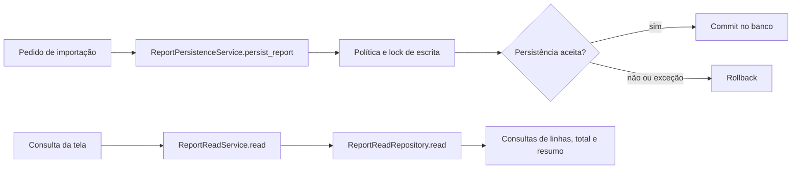
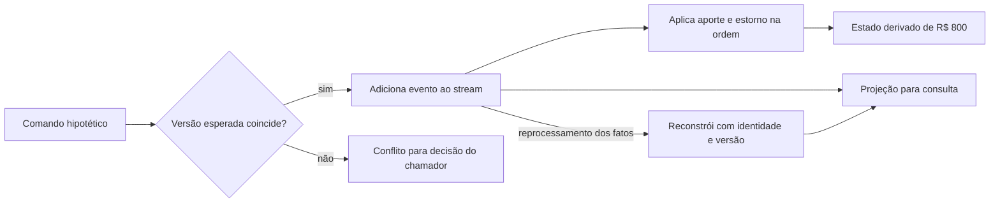
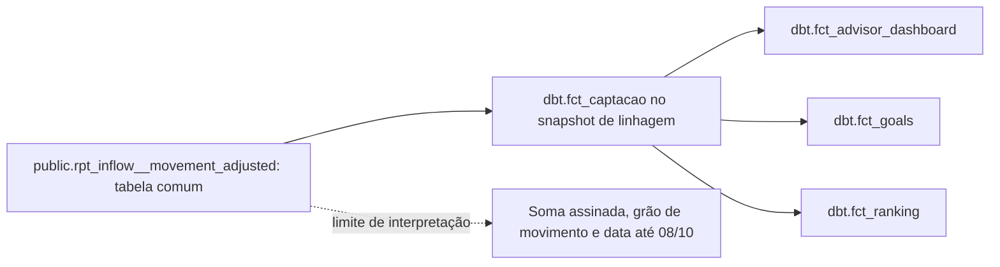
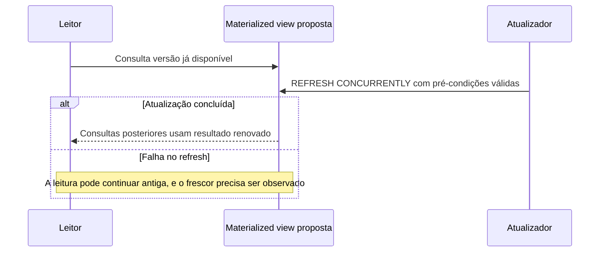

# Alterar o negócio e preparar sua leitura

Quem envia um relatório quer ter certeza de que os dados foram aceitos conforme suas regras. Quem abre o dashboard quer uma resposta adequada à tela. Fazer as duas pessoas dependerem do mesmo modelo pode misturar validação, transação, filtros e cálculos. Separar alteração e leitura permite dar a cada caminho o contrato de que ele precisa.

O caso de código foi lido no MakersHub `main@e233fb046ec333982cd1547171b0f0bd8d8d92ee`, em 14/10/2026. `ReportPersistenceService.persist_report`, em `backend/app/services/report_persistence_service.py:127–156`, administra a transação de escrita. `ReportReadService`, em `backend/app/services/report_read_service.py:16–66`, usa `ReportReadRepository` para consultar o resultado. A API em `backend/app/api/v1/report_data.py:59` chama esse serviço de leitura. O exemplo pertence a esse fluxo delimitado; não classifica todo o sistema.

## 11. CQRS: modelos diferentes para mudar e consultar

A separação de comandos e consultas (**Command Query Responsibility Segregation**, CQRS) permite que o modelo de alteração expresse regras de negócio e que o modelo de consulta sirva às necessidades de leitura. Um comando pede algo como importar um relatório. Uma consulta pede dados, filtros ou resumo sem executar essa alteração.

No código lido, a persistência consulta a política de escrita, obtém um lock e escolhe commit ou rollback. O leitor recebe parâmetros próprios e prepara consultas de total, linhas e resumo. A leitura não precisa receber toda a estrutura utilizada na importação para responder à tela.

O benefício é mudar e otimizar esses contratos com responsabilidades claras. O custo é manter sua correspondência, validar regras no lado correto e administrar representações derivadas quando existirem. CQRS pode usar o mesmo processo e o mesmo PostgreSQL. Um broker, outro banco ou Event Sourcing são escolhas adicionais.

O diagrama mostra as responsabilidades lidas; não mostra um transporte assíncrono entre dois bancos. A disponibilidade de um horário, por exemplo, precisa ser decidida pelo contrato de reserva e suas restrições. Uma projeção atrasada adequada para um KPI pode ser insuficiente para aceitar um novo agendamento.

A [documentação CQRS do Azure Architecture Center](https://learn.microsoft.com/en-us/azure/architecture/patterns/cqrs) fornece a base. A aplicação **REF** [Wild Workouts](https://github.com/ThreeDotsLabs/wild-workouts-go-ddd-example/tree/master/internal/trainings/app) separa comandos e consultas em uma aplicação de estudo. A skill `backend-cqrs-patterns`, em `~/.codex/skills/backend-cqrs-patterns/SKILL.md`, apoia contratos e separação. O [grupo 4](/referencia/catalogo/04-cqrs-event-sourcing-e-modelos-de-leitura/) descreve cada peça.

O PR #362 foi observado **OPEN às 16:06 UTC de 14/10/2026**, com source `b7889a88fc1764f70442b9f4e332f4d5098cb58a` e target `c00126e9c5132d9989caad2b531e31f40d7ffda3`. Seu diff lido tinha 601 arquivos e não alterava os três serviços/repositórios de relatório citados. Ele serve como artefato de refatoração e evolução de contratos; a introdução do CQRS não foi comprovada por esse diff. [PR #362](https://bitbucket.org/fazcapital/makershub/pull-requests/362).

## 12. Event Sourcing: os eventos permitem reconstruir o estado

Em **Event Sourcing**, o fluxo de eventos é a fonte de verdade do estado modelado. O estado atual é obtido aplicando esses eventos na ordem definida. Essa escolha torna importante guardar identidade, versão, significado e evolução dos eventos, porque o futuro precisa continuar conseguindo interpretá-los.

O MakersHub lido grava `public.stg_salesforce__routing_history` na reatribuição. Isso demonstra auditoria desse caminho. S4 não verificou que todos os comandos relevantes gerem eventos completos nem que o responsável atual possa ser reconstruído somente a partir desse histórico. Uma dimensão com versões históricas ou uma tabela de logs também não estabelece esse contrato sozinha.

Para estudar o mecanismo, use um registro financeiro **hipotético**. Um aporte de R$ 1.000 é seguido de um estorno de R$ 200. Aplicar os dois eventos deixa R$ 800: R$ 1.000 menos R$ 200. O saldo deriva do histórico aceito. Corrigir o estorno exige uma política explícita de novo evento, identidade e autorização; esse exemplo não descreve um ledger implantado na Faz nem uma operação interna da XP.

O benefício é reconstruir o estado e produzir novas leituras de fatos preservados. O custo inclui evolução de eventos, concorrência do stream, retenção, proteção de informações pessoais e efeitos de replay. Reproduzir eventos para calcular uma projeção não deve repetir automaticamente um pagamento, e-mail ou sincronização externa.

A comparação de versão e a inclusão do evento precisam formar uma decisão atômica no event store. Ler a versão e depois inserir sem essa condição permitiria que dois comandos aceitassem a mesma versão anterior.

Um **snapshot** guarda uma representação do estado em determinada versão para reduzir o trabalho de reconstrução. Se o snapshot corresponde à versão 100, o leitor aplica os eventos posteriores a 100. O snapshot é uma otimização; o stream continua sendo a fonte de verdade. Um backup do banco tem outra função e outro contrato. [Fonte Event Sourcing](https://learn.microsoft.com/en-us/azure/architecture/patterns/event-sourcing).

A aplicação **REF** [Helpdesk do EventSourcing.NetCore](https://github.com/oskardudycz/EventSourcing.NetCore/tree/main/Sample/Helpdesk) oferece um domínio para comparação. A base é o [corpus de EventSourcing.NetCore](https://github.com/oskardudycz/EventSourcing.NetCore), com exemplos e oficinas, sem implantação local confirmada. A skill `backend-event-sourcing`, em `~/.codex/skills/backend-event-sourcing/SKILL.md`, apoia eventos, versões e reconstrução.

## 13. Materialized Views / Projections: preparar uma representação consultável

Uma **projeção** transforma dados de origem em uma representação de leitura. Ela pode consumir eventos, mudanças de tabelas ou um lote periódico. Uma **materialized view** nativa do PostgreSQL persiste o resultado de uma consulta definida no banco. Uma tabela de relatório também pode guardar resultado derivado, mas seu nome não a transforma nessa espécie de objeto SQL.

Às **15:56:30 UTC de 14/10/2026**, a consulta da raiz em `public.rpt_inflow__movement_adjusted`, no banco `192.168.254.137/faz_capital`, encontrou 557.731 linhas e 557.731 chaves distintas. O recorte de outubro tinha 3.380 movimentos e soma BRL assinada de **R$ 18.742.122,16**. A última data de movimento era 08/10/2026. Isso é a soma do campo medido, com seu sinal; não é receita ou fechamento do mês.

Na consulta ao catálogo às **16:07:16 UTC**, esse objeto tinha `relkind=r`, ou seja, era tabela comum. O snapshot FazGraph construído em 13/10 indicava a ligação com `dbt.fct_captacao` e consumidores derivados. Essa linhagem identifica dependências do snapshot; não comprova execução ou frescor atual de cada dashboard.

O desenho representa relações do snapshot FazGraph de 13/10/2026, não uma execução medida. O benefício de persistir uma leitura é evitar calcular a mesma transformação pesada a cada consulta. O custo é atualizar, armazenar e identificar a versão servida. O atraso aceitável depende da decisão que a leitura alimenta.

Em uma proposta didática, duplicar um movimento de R$ 1.000 elevaria a soma medida para R$ 18.743.122,16. Essa conta mostra por que grão e deduplicação importam; a duplicação não ocorreu na medição. Se uma JOIN multiplica movimentos, uma chave de idempotência no endpoint não corrige a consulta.

Uma materialized view nativa é uma alternativa quando o contrato cabe no mecanismo do banco. `REFRESH MATERIALIZED VIEW` recalcula seu resultado; `CONCURRENTLY` permite SELECTs durante o refresh, com índice UNIQUE compatível e view já populada. Não torna o cálculo automaticamente incremental. [Contrato PostgreSQL 16](https://www.postgresql.org/docs/16/sql-refreshmaterializedview.html).

PostgreSQL é uma base e produto OSS **PROD**; a aplicação **REF** [AsyncProjections do EventSourcing.NetCore](https://github.com/oskardudycz/EventSourcing.NetCore/tree/main/Sample/AsyncProjections) mostra outra forma de manter leitura derivada. A skill `projection-patterns`, em `~/.codex/skills/projection-patterns/SKILL.md`, apoia progresso e reconstrução. Não foi demonstrado refresh dessa view proposta na Faz.

## Eventos internos e contratos publicados

Um **Domain Event** descreve um fato dentro de um contexto de negócio. Um **Integration Event** publica um contrato para outro contexto. O segundo precisa considerar consumidores, versões, informação permitida e entrega. Copiar diretamente cada coluna da tabela interna pode espalhar detalhes que esses consumidores não deveriam conhecer.

Comando, evento e resultado de leitura também podem ter nomes e estruturas diferentes. O comando pede uma alteração; o evento registra o fato aceito; a projeção responde uma pergunta. Entender seus contratos ajuda a escolher uma [integração confiável](/explicacoes/reliable-integration/) e a tratar [reentregas](/explicacoes/messages/) sem confundir reconstrução de leitura com repetição de efeitos externos.
