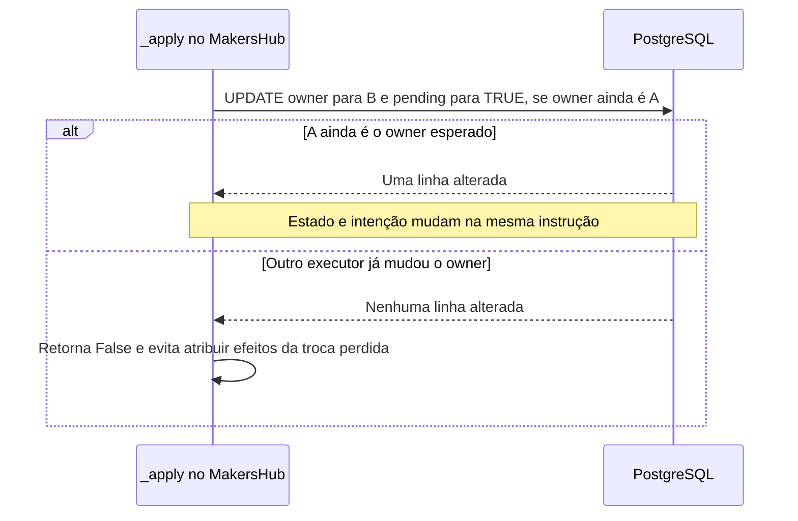
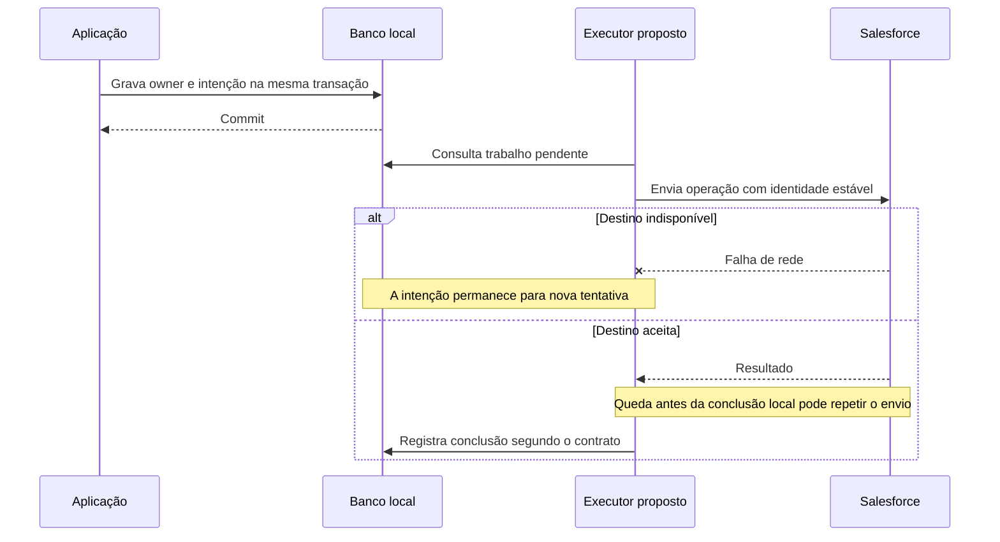
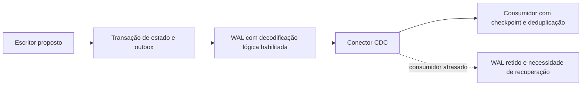
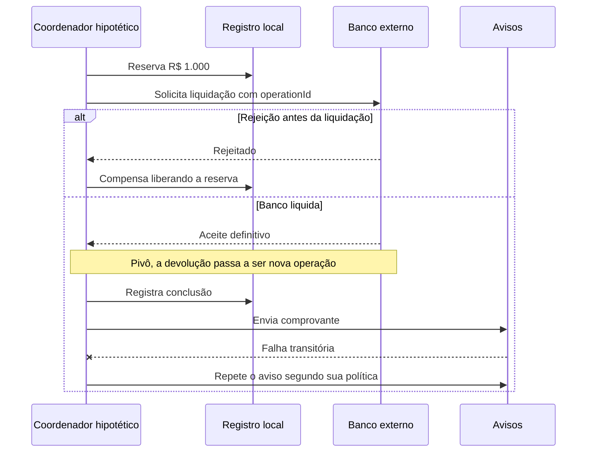

# Salvar uma mudança e recuperar sua integração

Uma reunião muda de responsável no MakersHub. A alteração local pode dar certo enquanto uma chamada ao Salesforce falha. Para quem abre a agenda, os dois sistemas passam a contar histórias diferentes. Aprender integração confiável ajuda a localizar essa fronteira e a decidir como o trabalho será retomado.

O caso de código desta página foi lido em 14/10/2026 no MakersHub, `main@e233fb046ec333982cd1547171b0f0bd8d8d92ee`. Em `backend/app/services/absence_reassignment_service.py:337–418`, `_apply` altera `processed_employee_id` e marca `sf_owner_sync_pending=TRUE` no mesmo UPDATE. O WHERE exige o responsável anterior esperado. Isso demonstra uma mudança condicional com intenção durável de sincronização. Não demonstra o resultado de cada chamada externa. Os [recibos de evidência](/referencia/evidencias/) preservam essa diferença.

## A transação tem uma fronteira

Uma transação local agrupa alterações que o mesmo banco pode confirmar ou abortar. Quando o estado e a intenção de integração entram nessa transação, ambos ficam registrados juntos. Uma chamada HTTP ao Salesforce fica fora dessa decisão do PostgreSQL: o COMMIT não desfaz algo que o serviço remoto já aceitou.

Escrever primeiro no PostgreSQL e depois no Salesforce é uma escrita em dois sistemas, chamada **dual write**. Inverter a ordem troca o lado que pode ficar incompleto. Também existe uma falha menos visível: o Salesforce aceita a alteração, mas sua resposta se perde. O chamador vê timeout e precisa descobrir se deve repetir ou reconciliar.

O desenho abaixo explica somente o UPDATE lido no código. O horário, os responsáveis A e B e a disputa são representações didáticas; não são uma ocorrência de cliente registrada.

## 7. Transactional Outbox: guardar a intenção junto da mudança

A **Transactional Outbox** registra o estado de negócio e o trabalho que deverá ser publicado ou enviado dentro da mesma transação local. Um executor posterior encontra esse trabalho e tenta entregá-lo. Se a integração fica indisponível, o registro continua disponível para recuperação.

No trecho do MakersHub, a flag `sf_owner_sync_pending` cumpre esse papel de sinalização. Ela acompanha a mudança do responsável na própria linha. Uma outbox também pode usar uma tabela separada, com identidade, tipo, versão e payload de cada mensagem. Os dois desenhos têm contratos diferentes: uma flag de estado pode representar a sincronização mais recente, enquanto um log de eventos preserva cada mudança. Não se deve atribuir à flag um histórico completo que ela não guarda.

O benefício é poder reconhecer o trabalho pendente após uma queda. O custo é administrar tentativas, prazos, observabilidade, retenção e atraso entre os sistemas. Se o destino aceita uma atualização e o executor cai antes de marcar a conclusão, pode haver repetição. A proteção desse efeito precisa existir no destino, ou em outro protocolo comprovado.

Este fluxo de recuperação é uma **proposta explicativa**. A seta até o Salesforce representa a integração pretendida; os recibos de S4 não provaram toda a execução do lote.

Um executor que consulta periodicamente a tabela, chamado polling publisher, pode bastar. Outbox não exige CDC, Kafka ou outro broker. A base de estudo é [Eventuate Tram](https://github.com/eventuate-tram/eventuate-tram-core); a aplicação **REF** [Customers and Orders](https://github.com/eventuate-tram/eventuate-tram-sagas-examples-customers-and-orders) permite comparar uma integração transacional. O mecanismo interno completo não foi auditado neste recorte. A skill local `backend-transactional-outbox`, localizada em `~/.codex/skills/backend-transactional-outbox/SKILL.md`, orienta estado, publicação e recuperação.

## 8. CDC: observar mudanças a partir do banco

A captura de alterações (**Change Data Capture**, CDC) acompanha mudanças confirmadas e as disponibiliza a outros consumidores. Uma implementação baseada no log pode ler alterações que vieram do FastAPI, do Airflow ou de outro escritor. Isso evita depender de cada escritor chamar a mesma integração.

Há dois casos distintos. Ler uma tabela de negócio descreve mudanças na representação interna, como uma coluna que mudou. Ler uma outbox permite publicar uma mensagem que a aplicação já definiu como contrato de integração. No segundo caso, a intenção foi expressa antes da captura. No primeiro, um UPDATE não informa sozinho o motivo de negócio nem todos os dashboards afetados.

O [Outbox Event Router do Debezium](https://debezium.io/documentation/reference/stable/transformations/outbox-event-router.html) é uma base madura para o segundo desenho. O projeto **PROD** [Debezium](https://github.com/debezium/debezium) é um produto OSS; essa classificação não significa implantação na Faz. A skill `data-streaming`, em `~/.codex/skills/data-streaming/SKILL.md`, apoia contratos e processamento de mudanças. Não foi verificada uma aplicação Airbyte neste corpus, portanto ela não serve aqui como prova aplicada de CDC.

O custo inclui snapshots iniciais, checkpoints, evolução de schema e retenção do log enquanto consumidores estão atrasados. Um slot que retém WAL exige acompanhamento de disco e progresso. Isso depende de configuração, não do nome da biblioteca. No servidor `192.168.254.137/faz_capital`, a consulta das **16:08 UTC de 14/10/2026** encontrou PostgreSQL 16.13 e `wal_level=minimal`. CDC por decodificação lógica é uma proposta para esse servidor: o PostgreSQL exige nível `logical` para esse mecanismo. [Fonte PostgreSQL 16](https://www.postgresql.org/docs/16/runtime-config-wal.html).

O diagrama é proposto. Ele não representa uma capacidade habilitada no banco medido, nem recomenda trocar polling por CDC sem medir o problema existente.

## 9. Saga: completar passos locais e compensar o que for reversível

Uma **Saga** coordena uma operação de negócio que precisa de vários commits locais. Se uma etapa necessária falha, o processo aplica compensações previstas para os passos já confirmados. A compensação é uma nova ação de negócio: liberar uma reserva é diferente de apagar o passado.

Em um caso financeiro **hipotético**, uma pessoa solicita um desembolso de R$ 1.000. O processo reserva esse valor, pede a liquidação ao banco e envia o comprovante. Se o banco rejeita antes de liquidar, liberar a reserva recupera a disponibilidade. Se o banco já liquidou, cancelar um registro local não recupera o dinheiro. Uma devolução exige outra operação e outra identidade.

O ponto após o qual o processo não pode simplesmente voltar é o **pivô**. Depois dele, etapas auxiliares podem seguir com retentativas; a falha no comprovante não desfaz automaticamente um pagamento válido. Esse contrato é de negócio e precisa ser definido antes do mecanismo.

Na Saga **orquestrada**, um coordenador decide o próximo passo e acompanha o estado. Na Saga **coreografada**, participantes reagem a eventos de outros participantes. A primeira centraliza a leitura do processo e exige um coordenador recuperável; a segunda distribui decisões e exige reconstruir dependências e estado a partir das mensagens. Contar etapas ajuda a enxergar complexidade, mas não fornece um limiar universal para escolher.

Os commits locais continuam usando o isolamento de seus bancos. O problema adicional é que outro processo pode enxergar um estado de negócio intermediário já confirmado. Isso não é automaticamente uma leitura de dado não confirmado, nem torna toda Saga uma arquitetura AP no CAP. Reservas, estados pendentes e condições de versão ajudam a proteger invariantes. A outbox é uma opção para entregar mensagens; ela não é uma condição obrigatória de toda Saga.

O ganho é recuperar processos que atravessam serviços sem fingir um rollback global. O custo é manter identidade, transições, compensações, tratamento de ações irreversíveis e intervenção quando a recuperação falha. [Eventuate Tram Sagas](https://github.com/eventuate-tram/eventuate-tram-sagas) e sua aplicação **REF** Customers and Orders oferecem uma base concreta. [Temporal](https://github.com/temporalio/temporal) oferece execução durável, mas o corpus contém o servidor, sem uma aplicação Temporal Samples verificada. A skill local `saga-orchestration`, em `~/.codex/skills/saga-orchestration/SKILL.md`, é um localizador de apoio; nenhuma Saga foi confirmada no fluxo MakersHub lido.

## Reservar, preparar ou compensar são escolhas distintas

No protocolo **Try/Confirm/Cancel** (TCC), Try valida e reserva; Confirm finaliza; Cancel libera a reserva. Cada chamada precisa tolerar repetição. Uma reserva de R$ 1.000 sobre R$ 1.500 deixa R$ 500 disponíveis enquanto a decisão está pendente. Esse é um caso hipotético, sem descrição de uma operação interna da XP. O [TCC do Apache Seata](https://seata.apache.org/docs/user/mode/tcc/) e seus [samples](https://github.com/apache/incubator-seata-samples) são referências **REF**.

No commit em duas fases (**2PC**), participantes primeiro preparam e depois recebem a decisão de commit ou abort. Um participante preparado pode permanecer bloqueado quando perde contato com o coordenador. O **3PC** acrescenta uma fase de pré-commit para tratar certos bloqueios no modelo de falhas assumido. Não promete progresso em qualquer partição ou com atrasos sem limite. [Skeen, 1981](https://doi.org/10.1145/582318.582339) é a fonte teórica. A aplicação OSS **REF** [Committer](https://github.com/vadiminshakov/committer/tree/8cdba9f473039ff5541665853274d0525810b5bf) fornece fases distintas e um cliente executável; a [referência do protocolo](/referencia/catalogo/02-sistemas-distribuidos-e-consistencia/#g02-e010) delimita o mecanismo. Esse código de estudo não demonstra segurança sob partição arbitrária nem justifica adotar 3PC na integração com Salesforce.

As definições, fronteiras e referências desses protocolos estão no [grupo 2](/referencia/catalogo/02-sistemas-distribuidos-e-consistencia/). Para a diferença entre aceitar uma mensagem e concluir seu efeito, siga para [mensagens](/explicacoes/messages/). Para a reconstrução do estado a partir de eventos, siga para [modelos de leitura](/explicacoes/read-models/).
