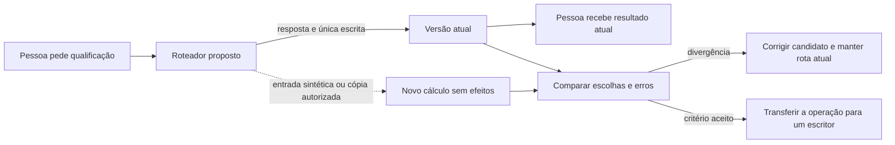
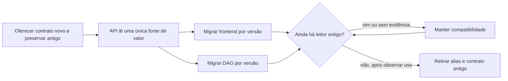
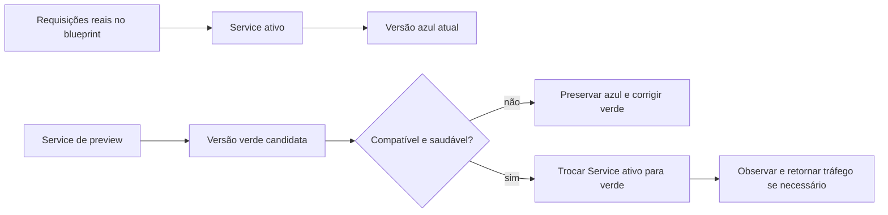
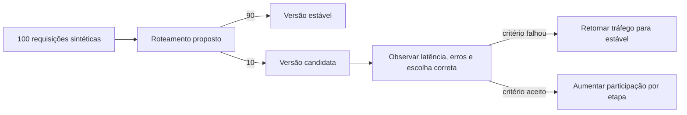
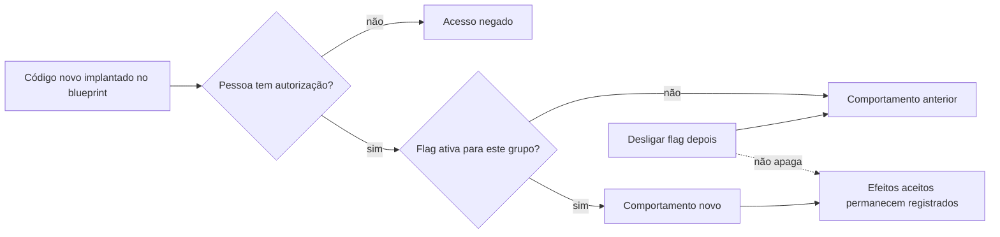

# Como trocar uma regra sem romper seus consumidores

Uma equipe quer melhorar a escolha de quem recebe um lead. A pessoa que usa a tela espera continuar trabalhando enquanto a regra muda. Para isso, a equipe precisa decidir quem grava, quais versões podem coexistir e como observar o resultado antes de ampliar a exposição. Colocar código novo no ambiente e permitir que as pessoas o usem são decisões relacionadas, com efeitos próprios.

O código MakersHub lido por S2 estava no checkout `e233fb046ec333982cd1547171b0f0bd8d8d92ee`. A rota `POST /api/v1/super-r1/qualify` chama o serviço de qualificação e persiste uma intenção de roteamento. Esse é um efeito relevante: copiar a requisição para comparar versões pode repetir uma gravação. O código lido sustenta essa preocupação; não comprova uma migração em execução ou um deploy dessa revisão. Os exemplos novos deste capítulo são **propostas didáticas**, com entradas sintéticas e sem efeitos reais.

## 23. Strangler Fig: transferir uma responsabilidade por vez

Uma migração gradual mantém o caminho existente e transfere funções delimitadas para uma implementação nova (**Strangler Fig**). No caso proposto, o roteador continua enviando a qualificação à versão atual até a equipe aceitar o resultado da comparação. Depois, uma operação passa a ter a nova versão como seu único escritor. As outras operações seguem o contrato anterior até sua própria migração.

O ganho é reduzir o tamanho de cada troca. O custo é operar dois caminhos e tornar explícitos seus contratos. O limite é a fronteira: compartilhar uma tabela ou repetir efeitos no Salesforce pode manter o acoplamento mesmo após separar os processos. Shadow Traffic exige impedir gravações, notificações e outras chamadas com efeitos na cópia. Mudar a rota não resolve sozinho dados divergentes. [Strangler Fig Microsoft](https://learn.microsoft.com/en-us/azure/architecture/patterns/strangler-fig).

Envoy ou Traefik fornecem uma base de roteamento. O [sandbox front proxy do Envoy](https://www.envoyproxy.io/docs/envoy/latest/start/sandboxes/front_proxy) é uma aplicação OSS **REF** para observar esse mecanismo; ele não prova uma migração completa. A skill local `deprecation-and-migration`, em `~/.codex/skills/deprecation-and-migration/SKILL.md`, apoia a transferência e a retirada do caminho antigo. A [curadoria](/referencia/skills-e-projetos/) distingue ferramenta e método.

## 24. Expand/Contract: permitir que versões convivam

Uma mudança compatível primeiro acrescenta o contrato novo, depois migra seus consumidores e só então retira o antigo (**Expand/Contract**). Imagine um **exemplo fictício** em que um campo de apresentação recebe um nome mais claro. API, frontend e DAG não precisam publicar no mesmo minuto: durante a expansão, a API oferece os dois nomes como aliases de um único valor; os consumidores passam a preferir o novo; a contração ocorre depois que nenhum leitor antigo precisa do alias.

A conta prática é simples: se há quatro consumidores e apenas três migraram, `3/4=75%` migrados ainda deixa um dependente. Remover o contrato antigo nesse momento rompe esse consumidor. O benefício é publicar cada parte por vez; o custo é manter compatibilidade temporária, observar uso e concluir a limpeza. O limite é semântico: dois nomes precisam representar o mesmo conceito. Gravar duas colunas independentes pode criar divergência. [Parallel Change de Fowler](https://martinfowler.com/bliki/ParallelChange.html).

Uma DAG que escreve staging Salesforce, uma transformação dbt, uma procedure PostgreSQL, uma API e a tela podem consumir contratos em momentos distintos. Os [workflows](/explicacoes/workflow/) mostram essas fronteiras reais; o desenho de aliases acima é proposta. O histórico S2 do commit `8206752f9b1bc8650d0a4572f4a0d64566260b83` mostra a ampliação da qualificação para Opportunity. Esse diff demonstra evolução do contrato; não estabelece que a equipe tenha adotado Expand/Contract como intenção histórica.

Flyway ou Liquibase são bases para administrar migrações de banco. A aplicação OSS [GitLab](https://docs.gitlab.com/development/database/avoiding_downtime_in_migrations/) documenta como evitar quebra durante mudanças, como referência de prática. A skill local `database-migration`, em `~/.codex/skills/database-migration/SKILL.md`, apoia a compatibilidade e os gates de contração. Nem uma biblioteca de migration nem o retorno da imagem anterior desfazem automaticamente dados incompatíveis.

## 25. Blue/Green: preparar outra versão antes de trocar o tráfego

Essa estratégia mantém dois conjuntos de aplicação e direciona o tráfego principal para um deles (**Blue/Green**). No blueprint, a versão verde recebe verificações por um Service de preview enquanto a azul atende. Após o critério de promoção, o Service ativo passa à verde. Se um gate posterior reprovar a versão, a estratégia pode retornar o tráfego à versão anterior conforme o contrato configurado.

O ganho é preparar e verificar uma versão antes da troca. O custo é manter capacidade para os dois conjuntos e administrar conexões durante a transição. O limite é o banco compartilhado: se a versão verde muda o dado de modo que a azul não entende, retornar o tráfego pode falhar. Expand/Contract ajuda a preservar essa compatibilidade.

[Argo Rollouts Blue/Green](https://argo-rollouts.readthedocs.io/en/stable/features/bluegreen/) fornece gates antes e depois da promoção; o [rollouts-demo](https://github.com/argoproj/rollouts-demo) é a aplicação OSS **REF**. A skill local `devops-progressive-delivery`, em `~/.codex/skills/devops-progressive-delivery/SKILL.md`, apoia critérios e retomada. Argo e Blue/Green não foram confirmados no ambiente medido.

## 26. Canary: aumentar a exposição após observar o resultado

Uma liberação gradual envia parte do tráfego à versão nova e aumenta sua participação conforme critérios observados (**Canary**). No exercício, de 100 requisições sintéticas escolhidas, 10 vão à versão candidata: `10/100=10%`. Esse desenho delimita tráfego. A quantidade de pessoas expostas depende de como suas requisições são roteadas e mantidas na mesma versão.

A dor da qualificação mostra por que medir apenas HTTP 200 é insuficiente: a resposta pode chegar e escolher uma pessoa inelegível. O gate precisa medir o resultado de negócio definido, além de erros e latência. O ganho é observar o candidato com exposição delimitada; o custo é manter versões, roteamento e análise. Uma amostra pequena pode esconder um erro raro, e voltar tráfego não apaga efeitos já gravados.

[Argo Rollouts Canary](https://argo-rollouts.readthedocs.io/en/stable/features/canary/) e Flagger são bases de comparação. O mesmo **REF** `rollouts-demo` permite estudar a exposição por etapas. A skill `devops-progressive-delivery` apoia os gates. Na captura Airflow de **14/10/2026 às 16:11 UTC**, as estratégias reais eram RollingUpdate e Recreate; essa configuração não comprova Canary. [Disponibilidade do caso medido](/explicacoes/availability/).

## 27. Feature Flags: decidir quem pode usar a função

Uma chave de comportamento permite ativar uma função já implantada para um grupo escolhido (**Feature Flag**). No exercício, a versão nova está disponível, mas apenas 10 de 100 usuários sintéticos veem o novo resumo: `10/100=10%`. Isso controla elegibilidade da função. A Canary controla a versão que recebe tráfego; os dois mecanismos podem existir juntos. [Feature flags Unleash](https://docs.getunleash.io/concepts/feature-flags).

O ganho é controlar a exposição sem exigir outro deploy para cada ativação. O custo é testar as combinações, definir comportamento quando a consulta da flag falha e retirar flags temporárias. Uma flag não concede autorização. Se a regra distribuiu 12 leads sintéticos antes de ser desligada, os 12 registros continuam existindo. Corrigi-los exige uma política de negócio aprovada; a chave não decide essa compensação.

Unleash é a base OSS; a aplicação OSS [GitLab feature flags](https://docs.gitlab.com/operations/feature_flags/) oferece uma API compatível com Unleash. Elas são **REF** neste estudo, sem instalação confirmada na Faz. A skill local `backend-feature-flags`, em `~/.codex/skills/backend-feature-flags/SKILL.md`, apoia ciclo de vida e comportamento de falha.

## Como os controles se combinam

No blueprint, a equipe expande o contrato, implanta uma versão compatível, observa uma exposição delimitada, libera a função para grupos autorizados e só contrai depois de observar o fim dos consumidores antigos. Cada controle tem uma condição de avanço própria. GitOps pode reconciliar o estado desejado da infraestrutura; uma flag continua precisando de owner e política de liberação. Git-sync de DAGs não comprova esse ciclo completo.

Os [grupos 11](/referencia/catalogo/11-padroes-para-decompor-sistemas/) e [12](/referencia/catalogo/12-deploy-e-releases/) detalham Branch by Abstraction, Parallel Run, Shadow Deployment, Dark Launch, A/B, extração de serviço, decomposição de banco e migração por CDC. A [integração de APIs](/explicacoes/api-integration/#pattern-37) desenvolve a camada que protege o vocabulário interno durante uma troca de fornecedor (Anti-Corruption Layer). Essa ACL tem uma função semântica; a [segurança](/explicacoes/security/) descreve regras de acesso.
