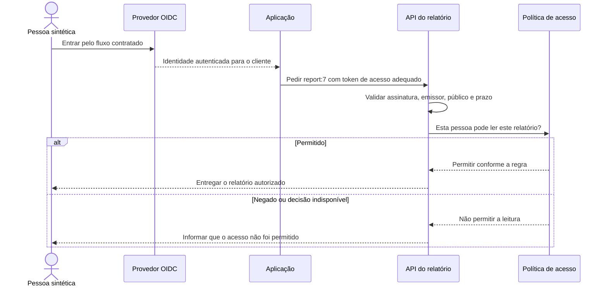
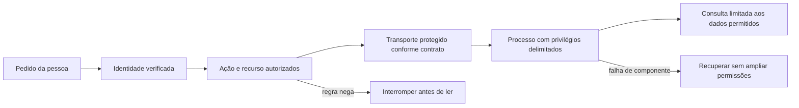

# Quem pode abrir este relatório

Uma pessoa pode estar identificada e ainda não ter permissão para abrir um relatório. O sistema precisa reconhecer quem faz o pedido, verificar a ação permitida sobre aquele recurso e proteger a comunicação e os dados. Separar essas decisões ajuda a entender por que um login válido pode terminar em acesso negado.

O caminho real de código deste capítulo é o Calendar do MakersHub, lido por S5 no checkout `e233fb046ec333982cd1547171b0f0bd8d8d92ee`. Em `frontend/app/api/calendar/events/route.ts`, a rota obtém a sessão, obtém o token Azure e chama Microsoft Graph. Esse caminho é composição de código comprovada, com mtime **2026-06-06 00:30:07 UTC** na leitura de **14/10/2026**. Ele não certifica login, permissões ou transporte em produção. O [capítulo de integração](/explicacoes/api-integration/) acompanha sua adaptação.

## Identidade e acesso delegado têm contratos distintos

OAuth 2.0 administra acesso delegado a uma API. OpenID Connect acrescenta um contrato de autenticação e identidade sobre OAuth 2.0. Um token de acesso é apresentado à API para o público a que se destina; um token de ID informa a autenticação ao cliente correspondente. Usar o token para a finalidade errada pode romper esse contrato. [Microsoft Entra OIDC](https://learn.microsoft.com/en-us/entra/architecture/auth-oidc).

O desenho abaixo é um **exemplo didático de contrato**, inspirado no caminho Calendar. Ele não é uma captura de uma autenticação realizada. Os nomes de pessoa, conta e relatório são sintéticos.

[Keycloak Quickstarts](https://github.com/keycloak/keycloak-quickstarts) oferece aplicações OSS **REF** para estudar integração OIDC. Keycloak é uma alternativa de provedor, sem implantação medida aqui. Na captura Airflow de **14/10/2026 às 16:15 UTC**, o auth manager era FAB. Esse fato não confirma OAuth/OIDC no Airflow nem descreve a autenticação de todo MakersHub. A skill local `backend-auth-patterns`, em `~/.codex/skills/backend-auth-patterns/SKILL.md`, apoia a revisão dos contratos; os [recibos](/referencia/evidencias/) fixam os ambientes.

## Papel, atributo e relação respondem ao pedido concreto

No exercício, `user:ana` precisa abrir `report:7`, pertencente a `account:42`. Com autorização por papel (**RBAC**), ela pode ter o papel `viewer` nessa conta. Com autorização por atributos (**ABAC**), a decisão pode verificar o vínculo ativo, a classificação do relatório e o contexto da ação. Com autorização por relações (**ReBAC**), o sistema percorre a relação de membro da conta e a relação entre conta e relatório. Esses são desenhos alternativos do exemplo, e não veredictos sobre uma implementação existente.

| Mecanismo | O que decide no exemplo | Benefício e custo |
|---|---|---|
| RBAC | O papel `viewer` da conta permite a leitura. | Papéis estáveis são fáceis de entender; criar um papel para cada combinação pode tornar a administração difícil. |
| ABAC | A regra combina atributos da pessoa, recurso e pedido. | Oferece precisão; atributos desatualizados e regras difíceis de explicar podem produzir decisões incorretas. |
| ReBAC | O vínculo de Ana à conta alcança o relatório. | Modela compartilhamento; mudanças de vínculo e o tempo de revogação precisam de um contrato. |

O benefício comum é conferir a ação sobre o recurso solicitado, incluindo sua conta. O custo é manter a regra e os fatos de autorização corretos. Ter permissão na conta 42 não autoriza ler a conta 43. A regra deve seguir até a consulta dos dados; esconder um botão não protege a API.

[OpenFGA multi-tenant SaaS](https://openfga.dev/docs/use-cases/multi-tenant-saas) e [sample-stores](https://github.com/openfga/sample-stores) são referências OSS **REF** para relações e papéis. O [exemplo HTTP do OPA](https://www.openpolicyagent.org/docs/http-api-authorization) mostra uma aplicação consultando uma política. As bases oferecem mecanismos; o contrato do negócio continua precisando ser definido. A skill local `security-and-hardening`, em `~/.codex/skills/security-and-hardening/SKILL.md`, é apoio geral, não prova de que OPA ou OpenFGA estejam instalados.

## Proteger cada camada mantém a falha delimitada

No scheduler Kubernetes, a captura de **14/10/2026 entre 16:10 e 16:14 UTC** encontrou uma ServiceAccount, `runAsUser=50000`, escalada de privilégio desabilitada e capabilities removidas. O namespace tinha RoleBindings. São exemplos concretos de identidades e camadas de defesa. A existência de um papel não prova que seus direitos sejam os menores necessários para cada tarefa.

Reduzir privilégios limita o que um processo comprometido consegue fazer. Identidades de serviço e mTLS protegem a comunicação entre participantes autorizados pelo contrato de transporte. Credenciais curtas reduzem a janela de uso de uma credencial exposta, mas precisam de renovação e de tratamento de indisponibilidade. Rotação troca o material de acesso; ela precisa alcançar os consumidores antes da retirada do material antigo.

Os Ingresses lidos em `airflow` tinham `spec.tls=None`, e a consulta de NetworkPolicies desse namespace retornou lista vazia. Esse recorte não exclui terminação TLS em outro salto, ACL de rede externa ou política de outro mecanismo. Também não fornece um veredicto geral de segurança: não houve ensaio de tráfego nem auditoria de toda a rede. [NetworkPolicy Kubernetes](https://kubernetes.io/docs/concepts/services-networking/network-policies/).

As skills locais `k8s-security-policies`, `mtls-configuration` e `secrets-management`, em `~/.codex/skills/`, apoiam políticas, transporte e ciclo de credenciais. Elas são instruções de trabalho, sem segredos publicados pelo curso. O [catálogo de segurança](/referencia/catalogo/14-seguranca/) descreve cada conceito individualmente.

## Como disponibilidade e mudança entram na decisão de acesso

Uma flag pode decidir se o resumo novo aparece para uma pessoa já autorizada. A [explicação de mudanças](/explicacoes/safe-change/#pattern-27) mostra por que ela não concede autorização. Um mesh pode reconhecer o serviço que fez a chamada. A [explicação de disponibilidade](/explicacoes/availability/#pattern-36) mostra por que essa identidade não decide a conta de negócio permitida.

Se o serviço de política não consegue responder, o exemplo acima preserva os dados ao não permitir a leitura. Isso reduz disponibilidade dessa ação. Outros contratos podem usar uma decisão previamente válida por um prazo explicitamente aceito; esse desenho precisa tratar revogação e validade. O curso não apresenta tal cache como comportamento existente.

A camada que traduz o vocabulário externo em um contrato interno (**Anti-Corruption Layer**) é desenvolvida no [core 37](/explicacoes/api-integration/#pattern-37). Sua sigla ACL tem sentido semântico. Uma lista de controle de acesso usa a mesma sigla para direitos sobre recursos; a semelhança da sigla não unifica as responsabilidades.
