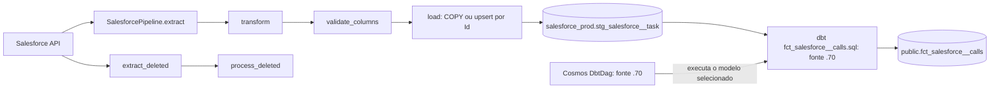
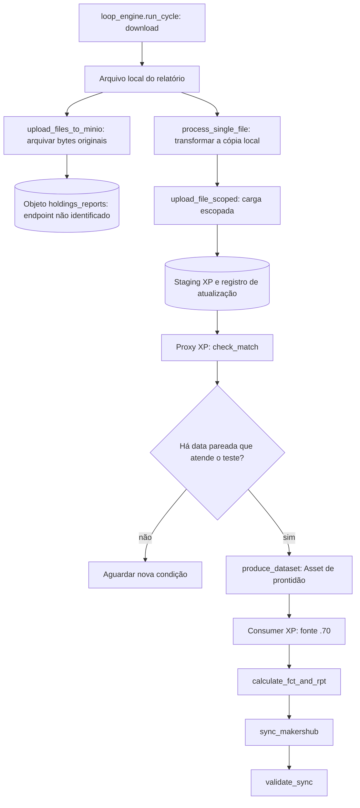
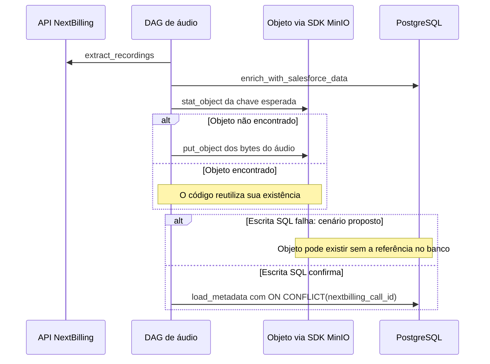

# Fazer os dados avançarem com ordem, capacidade e recuperação

Uma pessoa abre o relatório e espera encontrar o trabalho já registrado no CRM. Entre a gravação original e o número exibido, alguém precisa buscar dados, transformar formatos, conferir regras e atualizar a leitura. Se uma etapa avança cedo demais, o resultado pode ficar incompleto. Se todas disputam o mesmo recurso, o trabalho pode acumular. Um workflow torna essas dependências e limites visíveis.

Este capítulo usa arquivos lidos em 14/10/2026. Cinco deles tiveram hashes iguais no disco de `airflow-70` e no scheduler Kubernetes: a DAG de Task Salesforce, sua factory, o proxy XP, o processor XP e a DAG de áudio. A medição de paridade ocorreu entre 16:11 e 16:12 UTC. O scheduler Kubernetes usava Airflow 3.2.2, `LocalExecutor` e paralelismo configurado em 32; o container Docker `.70` respondeu `LocalExecutor` e paralelismo 5 às 15:57 UTC. Essas configurações são snapshots dos ambientes e não contagens de tasks efetivamente executadas.

A DAG consumidora de Salesforce, seu modelo dbt e a DAG consumidora XP foram lidos somente em `.70`. Seus conteúdos podem ensinar o caminho existente nessa fonte, mas sua paridade Kubernetes não foi demonstrada. Os [recibos](/referencia/evidencias/) dão o escopo das medições. Cenários de falha e alternativas abaixo estão identificados como propostas.

## O mapa, o passo e quem o executa

Uma **task** é uma unidade de trabalho executável. Uma **DAG** é um grafo de dependências dirigido e sem ciclos: indica quais tasks precisam terminar antes de outras começarem. Um **pipeline** organiza etapas que levam dados de uma representação a outra. Um **orchestrator**, ou coordenador, decide quando o trabalho pode avançar e acompanha seus resultados. O **workflow engine** é o sistema que interpreta e executa esse contrato.

Esses papéis ajudam a localizar uma falha. Se um relatório não ficou pronto, a dependência pode ter impedido seu início. Se a task começou, uma chamada externa pode ter falhado. Se a chamada terminou, o efeito pode ter sido gravado sem que a confirmação chegasse. Uma seta na DAG representa uma condição de execução; ela não cria uma transação entre os sistemas chamados. [A documentação Airflow](https://airflow.apache.org/docs/apache-airflow/3.2.2/core-concepts/overview.html) apresenta essas dependências e o transporte de dados entre tasks.

O padrão **Pipe and Filter** acrescenta uma forma de compor a transformação: cada etapa recebe dados, aplica uma transformação definida e fornece saída para a próxima. Separar etapas facilita observar onde um registro foi descartado ou ganhou um campo. O contrato de saída de uma etapa, entretanto, precisa combinar com o contrato de entrada seguinte. Acrescentar uma coluna ou mudar um tipo pode afetar todas as etapas posteriores.

## Salesforce: do registro original à análise

No código observado, `dags/crm__salesforce__api_to_stg__task.py` instancia `SalesforceDagFactory`, que cria a cadeia `extract`, `transform`, `validate_columns`, `load`. A configuração aponta para staging `salesforce_prod` com prefixo `stg_salesforce__`. A extração lê os campos descritos pela API, e o pipeline usa `SystemModstamp` para orientar a busca incremental. Uma cadeia adicional trata os registros removidos.

O desenho representa as ligações estáticas lidas. A factory e a DAG de ingestão tiveram paridade de arquivo entre `.70` e Kubernetes. A implementação de `SalesforcePipeline` e a parte Cosmos/dbt são **fontes `.70`**, com paridade no cluster não confirmada. A conexão pelo staging não demonstra sozinha uma sequência de agendamento entre as duas DAGs.

Uma ligação pode ser registrada ontem e corrigida hoje. Filtrar somente sua data de criação deixaria a correção fora do próximo processamento. O modelo `dbt/models/facts/fct_salesforce__calls.sql`, lido em `.70`, filtra calls por `TaskSubtype='Call'`, usa `call_id` como chave e considera a marca de atualização com duas horas de margem retrospectiva. Reler essa margem custa leitura repetida, mas ajuda a incluir alterações que chegam tarde. A chave e a regra de atualização precisam tratar a repetição corretamente.

O PostgreSQL de negócio `192.168.254.137:5432/faz_capital` devolveu, às 15:56:22 UTC de 14/10, 746.779 linhas de Task e 723.247 linhas de calls. As tabelas representam grãos diferentes, portanto dividir as contagens não produz conversão comercial. O máximo de `SystemModstamp` das Tasks era `2026-10-14 12:54:02-03:00`. Esses números são um recibo datado, não o estado presente do relatório do leitor.

Uma task com retry pode executar outra vez um efeito que já ocorreu. No cenário didático `SF-001`, a primeira tentativa grava o registro e perde sua confirmação; a segunda tenta a mesma identidade. O upsert observado compara `Id` e `SystemModstamp`. Ele ajuda a preservar a identidade na carga, enquanto outros efeitos precisam de seus próprios contratos. Uma repetição injetada em um exercício não comprova que reiniciar o scheduler produza essa repetição automaticamente.

## XP: esperar a entrada certa antes de calcular

Imagine que o relatório de renda fixa chega primeiro e o de diversificação chega depois. O processamento precisa distinguir “recebi um arquivo” de “tenho o conjunto necessário para calcular a posição”. No código observado, `processor.process_downloaded_files_scoped` arquiva os bytes originais e transforma a cópia local baixada. `upload_files_to_minio` usa o SDK MinIO; o endpoint efetivo não foi identificado.

O gráfico mostra a bifurcação a partir do **arquivo local**. O replay que buscaria o arquivo de volta do objeto não foi comprovado. O processor e o proxy XP tiveram paridade de arquivo no cluster; `loop_engine.run_cycle` e a DAG consumidora abaixo foram lidos somente em `.70`.

O proxy `dags/stg_xp__diversification__proxy.py` consulta logs de atualização e `get_available_dates_with_match()`. A cadeia `check_match`, `produce_dataset` publica `dataset://xp_consolidated_positions_ready`. O teste observa pareamento e critérios de contagem; não valida sozinho checksum, identidade de cada linha ou completude do arquivo. Dois relatórios com a mesma data ainda podem estar incompletos. Uma validação adicional antes da prontidão seria uma proposta a avaliar com o contrato do relatório.

A publicação do Asset liga **produtor e consumidor**: o produtor declara a condição atendida e o scheduler pode liberar o trabalho dependente. Esperar duas entradas é um **fan-in**, uma barreira de prontidão. Um **Aggregator** reúne dados das partes, como uma soma por carteira; a emissão do Asset não realiza essa soma. Esses conceitos se relacionam, mas fazem trabalhos distintos. O contrato de [Assets do Airflow](https://airflow.apache.org/docs/apache-airflow/3.2.2/authoring-and-scheduling/assets.html) explica o mecanismo de agendamento.

Esse caso é **Batch Processing**: um conjunto finito de dados entra e produz um resultado para o lote. O benefício é poder definir quais entradas pertencem à execução e compará-las. O custo é esperar o conjunto ficar pronto. Um relatório que falta pode atrasar todos os consumidores dependentes, o que exige prazo e uma ação operacional definidos pelo negócio.

## Áudio: guardar bytes e tornar o arquivo encontrável

A DAG `recordings__nextbilling__api_to_stg__audio.py` encadeia `extract_recordings`, `enrich_with_salesforce_data`, `download_and_upload`, `load_metadata`. O enriquecimento acrescenta a relação com dados Salesforce; o download/upload guarda o binário; a carga registra sua referência em `public.fct_minio__call`. A DAG teve paridade de arquivo entre `.70` e Kubernetes, sem prova de execução recente de uma gravação.

O diagrama representa a ordem e as chamadas lidas. A falha entre upload e banco é **um cenário proposto**, usado para pensar na recuperação.

O armazenamento responde pela existência dos bytes; o banco permite consultar seus metadados. Uma interrupção entre essas duas escritas pede descobrir qual efeito falta. A [máquina de estados e a recuperação](/explicacoes/distributed-work/) desenvolvem esse exemplo. A DAG também passa caminhos temporários locais entre tasks; um desenho com tasks em máquinas diferentes precisa garantir que a próxima consiga ler o arquivo. Uma configuração de paralelismo, por si só, não fornece esse transporte.

## Objetos têm papéis e contratos diferentes

O código observado usa objetos para três necessidades. `AirflowMinIOHelper` transporta dados temporários entre etapas em `airflow-temp/{dag_id}/{execution_date}/{file_key}.pkl`. O builder conserva a extensão `.pkl` mesmo quando o chamador passa serialização JSON. `RawParquetS3Sink`, lido em `.70`, preserva registros anteriores à transformação com boto3 e Parquet. A gravação de áudio é um produto binário que precisa continuar encontrável. O nome do bucket ou da extensão não decide sozinho retenção e formato.

Guardar o original ajuda a explicar uma transformação antiga e a planejar replay. Para o replay funcionar, alguém precisa ler a versão correta, conhecer seu formato e executar uma transformação identificada. Guardar um temporário e apagá-lo depois de uma task tem outro objetivo. Se o único original for confundido com transporte descartável, a capacidade de investigar e reconstruir pode se perder.

O [SeaweedFS oferece uma interface S3](https://github.com/seaweedfs/seaweedfs/wiki/Amazon-S3-API). Isso o torna uma base candidata para um cliente compatível, e não identifica o backend das DAGs lidas. O contrato precisa conferir as operações, autenticação, consistência, versões e falhas que o cliente usa. O cluster tinha configuração de log remoto `s3://airflow-task-logs/prod` às 16:11 UTC; o prefixo S3 também não identifica sozinho MinIO, SeaweedFS ou AWS.

Dois workflows n8n consultados, `Meta - Formulário Nativo` e `Meta - Landing Page`, estavam ativos e tinham três nós PostgreSQL conectados cada um em 14/10, às 16:58 UTC. Isso prova sua configuração lida, sem execução de um lead. As buscas por MinIO, S3 e Airflow retornaram zero naquele escopo; nós HTTP tinham destinos não examinados. A ligação desses fluxos com objetos ou Airflow permanece não confirmada. O [nó S3 OSS do n8n](https://github.com/n8n-io/n8n/blob/master/packages/nodes-base/nodes/S3/S3.node.ts) demonstra capacidade do produto, e pode apoiar um blueprint claramente identificado.

## Trabalho esperando e capacidade para fazê-lo

Uma **Job Queue** guarda trabalho pendente até que um executor possa recebê-lo. Um **Worker Pool** reúne capacidade de execução. Com **Competing Consumers**, vários consumidores disputam trabalhos da mesma fila, conforme o contrato de entrega. Distinguir esses elementos permite entender por que uma task pronta ainda pode esperar. O scheduler e os limites também podem segurar trabalho antes de sua execução.

Um pool Airflow limita a concorrência de um conjunto de tasks contra um recurso compartilhado. Por exemplo, tarefas de uma API podem ocupar slots desse pool para proteger o serviço. Isso não substitui o orçamento de memória, CPU e subprocessos do worker. O [contrato de pools](https://airflow.apache.org/docs/apache-airflow/3.2.2/administration-and-deployment/pools.html) permite atribuir mais de um slot a uma task.

No exemplo hipotético, 12 tasks independentes e três vagas permitem quatro grupos de três: 12 ÷ 3 = 4. Essa conta informa o número mínimo de grupos sob a hipótese de ocupação uniforme, não o tempo total. Se uma task demora muito ou espera uma resposta, ela segura sua vaga. Os valores 32 no Kubernetes e 5 no Docker `.70` são limites de configuração medidos, sem equivalência automática a workers ativos, memória disponível ou chamadas seguras ao Salesforce.

## Dividir trabalho, reunir resultados e reconhecer o custo

Em **Fork/Join**, um fluxo abre ramos e os reúne depois. No desenho didático do arquivo XP, arquivar e transformar podem ser pensados como ramos; o código lido faz chamadas em sequência, sem prova de execução paralela. Abrir ramos de fato exige decidir quais são independentes, que falha impede a junção e quanto cada ramo pode consumir.

Em **Scatter/Gather**, o coordenador distribui solicitações a destinos e coleta suas respostas. Imagine três partições sintéticas de um relatório. Uma delas atrasa. O contrato de coleta deve decidir se espera todas, falha no prazo ou aceita uma resposta parcial identificada. Essa decisão muda o resultado entregue ao leitor; chamar uma coleta incompleta de completa esconderia a partição que falta.

Em **MapReduce**, o processamento mapeia entradas para pares de chave e valor, agrupa os valores de cada chave e reduz o grupo. No exercício, cada arquivo fictício produz valores por `portfolio_code`; a redução soma os valores da mesma carteira. Distribuir arquivos entre tarefas é apenas uma parte do trabalho. O agrupamento entre partições, chamado de shuffle, pode mover muitos dados pela rede. O [WordCount do Hadoop](https://hadoop.apache.org/docs/stable/hadoop-mapreduce-client/hadoop-mapreduce-client-core/MapReduceTutorial.html) fornece uma aplicação OSS de referência com map, agrupamento e reduce.

Filtrar mensagens irrelevantes, traduzir campos, enriquecer um registro, repartir um lote, reordenar partes e agregar resultados são mecanismos de transformação. Eles ajudam a pensar nas entradas de cada etapa. A [aula de mensagens](/explicacoes/messages/) desenvolve esses padrões e seus contratos; um nome de função ou um processamento por arquivo não comprova que todo esse conjunto esteja instalado no pipeline.

## Lote, fluxo e a história que permite reconstruir

No **Stream Processing**, eventos chegam continuamente e o processamento precisa decidir como agrupar o tempo. Imagine que um evento de 10h03 chegue às 10h10, depois de eventos mais novos. Uma janela por horário do evento precisa de uma política para esse atraso. A marca que estima o avanço do tempo de evento é chamada de watermark; ela não é a mesma coisa que uma simples data máxima encontrada no banco.

A [programação Apache Beam](https://beam.apache.org/documentation/programming-guide/) oferece referências de coleções finitas e contínuas, janelas, tempo de evento e agrupamento. É uma base para o exercício, sem Beam implantado confirmado neste ambiente. Uma DAG disparada por Asset ainda pode processar um lote finito; o gatilho e o modo de processamento são decisões diferentes.

A **Lambda Architecture** mantém um caminho batch para reconstrução completa e um caminho stream para resultados rápidos, combinando as duas visões. A **Kappa Architecture** procura manter uma lógica de processamento contínuo e reconstruir resultados pelo replay de um log retido. São alternativas de estudo, sem implantação comprovada aqui. Lambda exige manter coerência entre dois caminhos; Kappa exige que o histórico, a identidade e a lógica de replay bastem para reconstruir o resultado.

Esses estilos só ajudam quando respondem a uma necessidade de atraso e recuperação medida. Manter dois caminhos para um relatório que aceita lote diário pode aumentar operação sem benefício suficiente. Usar replay de um log que expirou antes do período necessário pode impedir reconstrução. Beam ajuda a estudar os mecanismos, mas sua presença em uma lista de referências não comprova uma aplicação Lambda ou Kappa completa.

## O próximo passo depende da pergunta

Para decidir como retomar uma gravação ou uma carga repetida, leia [operações distribuídas](/explicacoes/distributed-work/). Para consultar a definição e o limite de cada termo, use [Workflow e processamento](/referencia/catalogo/16-workflow-e-processamento/). Para investigar um fluxo real com comandos de leitura, siga [Como preparar a recuperação de um pipeline](/guias/recuperar-pipeline/). Os exercícios locais da trilha usam dados sintéticos e não acionam os serviços descritos neste capítulo.
