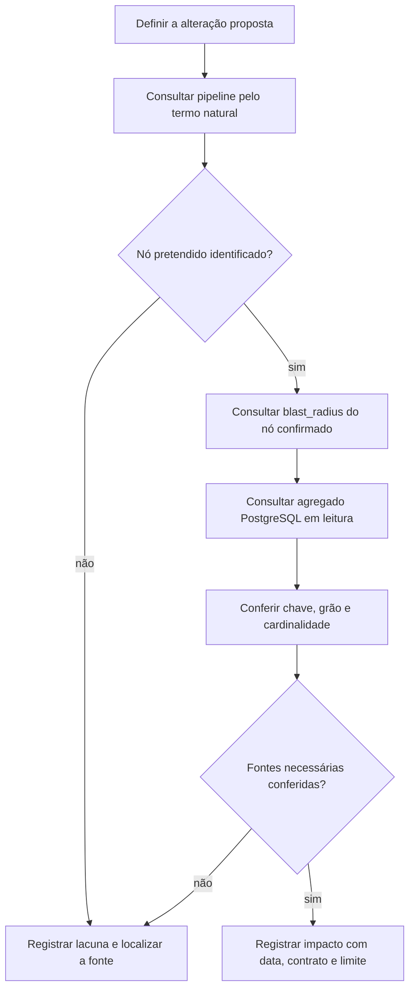

# Investigue quem uma mudança de dados pode afetar

Este guia ajuda a preparar o impacto de uma alteração em uma tabela ou regra de relatório. Você localizará o produtor, os consumidores e os dados relevantes para decidir quais contratos precisam ser conferidos antes da mudança. O resultado é um registro de impacto com fontes e lacunas identificáveis.

## Antes de começar

Você precisa conhecer o problema que pretende resolver, ter acesso autorizado aos MCPs FazGraph e PostgreSQL e usar uma sessão ou transação PostgreSQL somente para leitura. Use uma consulta limitada ao escopo necessário e um tempo máximo de execução apropriado à investigação. Confirme o endereço do banco, a porta, a database, o usuário efetivo e o horário do servidor. Esses dados distinguem ambientes que podem ter tabelas com o mesmo nome.

Registre a alteração proposta em uma frase. Para acompanhar o exemplo deste guia, use: “Vou avaliar uma mudança no cálculo que alimenta os indicadores de captação”. Esta frase define a investigação; ela não autoriza alterar cálculo, tabela, grafo ou serviço.

## 1. Localize o fluxo pelo termo de negócio

No MCP FazGraph, comece pela ferramenta `pipeline` com o termo natural:

```text
pipeline("captacao", max_matches=1)
```

Guarde o nó identificado, o produtor, os upstreams, os downstreams, o horário da consulta e a data de construção do grafo. Aproveite os dados que já vieram nessa resposta para orientar a próxima ação.

No recibo de 14/10/2026 às 15:55 UTC, essa chamada encontrou `dbt.fct_captacao`, produzido pelo modelo dbt `fct_captacao`, com upstream `public.rpt_inflow__movement_adjusted`. Entre os downstreams apareceram `dbt.fct_advisor_dashboard`, `dbt.fct_goals` e `dbt.fct_ranking`. O grafo tinha `graph_mtime_utc=2026-10-13T03:08:04+00:00`.

A resposta marcou `db_stats` e `airflow_runs` como antigos. Use essas marcações para manter as contagens de banco e as execuções de DAG fora das afirmações atuais. A regra de negócio veio inferida; confira sua definição no documento ou contrato do domínio antes de aceitar seu significado financeiro.

Se o fluxo não identificar o objeto pretendido, ajuste a pergunta a partir dos resultados encontrados. Conserve a ausência como uma lacuna até localizar a fonte que a resolve.

## 2. Consulte o impacto do nó identificado

Use `blast_radius` sobre um identificador que o fluxo já confirmou:

```text
blast_radius(node_id="public.rpt_inflow__movement_adjusted")
```

Registre consumidores diretos e indiretos, os tipos de consumidor e a data do snapshot. Na chamada de 14/10/2026 às 15:56 UTC, a resposta foi:

```text
43 downstream table(s), 424 Metabase card(s), 27 endpoint(s).
Direct on this table: 322 card(s), 3 endpoint(s).
```

São unidades diferentes. As 43 tabelas, os 424 cards e os 27 endpoints formam três populações de dependências. Os 322 cards diretos fazem parte dos 424; somá-los novamente duplicaria a contagem. A diferença é 424 − 322 = 102 cards indiretos no alcance retornado. Da mesma forma, 27 − 3 = 24 endpoints são indiretos nesse alcance.

Essas contagens pertencem ao grafo construído em 13/10/2026. Elas ajudam a selecionar o que conferir, mas não comprovam que todos os consumidores estavam ativos em 14/10. Para os consumidores relevantes à mudança, confira também o contrato ou o código que usa o campo ou cálculo afetado.

## 3. Confirme os dados com uma consulta agregada

Depois de identificar a tabela e sua ligação com o fluxo, formule a consulta PostgreSQL. Prefira contagens, chaves distintas, datas mínima e máxima e agregados do recorte necessário. Evite trazer linhas, nomes, contatos ou documentos de clientes para um relatório de impacto.

O banco do exemplo foi identificado no recibo de 14/10/2026 às 15:54 UTC como `192.168.254.137/32`, porta `5432`, database `faz_capital`. Antes de executar a consulta no seu trabalho, confira a identidade da conexão e mantenha a execução em leitura. A consulta do exemplo abaixo já foi medida; ela aparece aqui para permitir reproduzir seu recorte em uma investigação autorizada.

```sql
SELECT
    clock_timestamp() AT TIME ZONE 'UTC' AS measured_at_utc,
    count(*) AS row_count,
    count(DISTINCT movement_adjusted_sk) AS distinct_movement_keys,
    min(movement_date) AS first_movement_date,
    max(movement_date) AS latest_movement_date,
    count(*) FILTER (
        WHERE movement_date >= DATE '2026-10-01'
          AND movement_date < DATE '2026-11-01'
    ) AS october_row_count,
    round(sum(brl_amount) FILTER (
        WHERE movement_date >= DATE '2026-10-01'
          AND movement_date < DATE '2026-11-01'
    ), 2) AS october_signed_brl_sum
FROM public.rpt_inflow__movement_adjusted;
```

A leitura retornou uma única linha agregada, com `measured_at_utc=2026-10-14 15:56:30.702110`:

| Medição | Resultado |
| --- | --- |
| Linhas do conjunto consultado | 557.731 |
| Chaves `movement_adjusted_sk` distintas | 557.731 |
| Primeira `movement_date` | 03/01/2022 |
| Última `movement_date` | 08/10/2026 |
| Linhas entre 01/10/2026 e antes de 01/11/2026 | 3.380 |
| Soma de `brl_amount` nesse recorte, preservando os sinais | R$ 18.742.122,16 |

As datas e o horário fazem parte do resultado. Uma nova consulta pode devolver outros números e precisa de outro recibo. A última data de movimento estava seis dias antes da data da leitura; esse intervalo, sozinho, não confirma atraso do pipeline nem violação de um prazo.

## 4. Confira o que cada linha representa

Descreva a unidade representada por uma linha, chamada de grão, antes de interpretar contagens ou somas. Neste caso, 557.731 linhas e 557.731 chaves distintas comprovam a unicidade de `movement_adjusted_sk` no conjunto consultado. A diferença entre as duas contagens é zero.

Essa igualdade não identifica, sozinha, uma operação financeira única por linha. Confira a definição da chave, a transformação produtora e o contrato do domínio para descrever o grão de negócio. Se a mudança acrescentar um JOIN, confira a cardinalidade das duas pontas e se o resultado conserva a unidade esperada. Uma chave única antes do JOIN pode aparecer várias vezes depois dele.

Mantenha a interpretação da soma limitada à coluna e ao recorte medidos. Os R$ 18.742.122,16 são a soma assinada de `brl_amount` das 3.380 linhas selecionadas. O recibo não confirmou que esse valor represente receita ou fechamento de outubro. Uma comparação entre relatórios precisa conservar período, sinal, filtros e grão.

## 5. Feche o registro de impacto

Para concluir a investigação, registre em frases completas:

- Qual alteração foi proposta e qual produtor ou contrato ela alcança.
- Qual nó o FazGraph identificou e quando o grafo usado foi construído.
- Quais consumidores precisam de conferência, distinguindo os vínculos do snapshot daqueles que você confirmou em código ou contrato.
- Contra qual banco e horário a consulta foi medida, com SQL e resultado agregado.
- Qual grão foi comprovado, qual interpretação depende da regra de negócio e quais lacunas ainda afetam a decisão.

No caso deste guia, o registro poderia terminar assim: “O fluxo de captação encontrado passa por `public.rpt_inflow__movement_adjusted` e pelo modelo dbt `fct_captacao`. O snapshot de 13/10 listou 43 tabelas, 424 cards e 27 endpoints no alcance consultado. Em 14/10 às 15:56:30 UTC, o PostgreSQL de negócio tinha 557.731 linhas com chaves distintas nesse conjunto. A definição financeira do grão e os contratos dos consumidores afetados ainda precisam ser conferidos para aprovar uma mudança no cálculo”.

Quando faltar uma dessas fontes, registre a lacuna e a ação que a resolveria. Termine a análise como parcial se a lacuna puder mudar a decisão. O critério de conclusão é um impacto rastreável, com medições e limites; uma contagem grande de consumidores não substitui seus contratos.

## Sequência usada no guia

O desenho representa o procedimento da investigação. As ligações específicas do exemplo continuam sujeitas às datas e aos limites informados acima.



Os [recibos dos exemplos](/referencia/evidencias/) preservam as medições e seus ambientes. A [explicação sobre modelos de leitura](/explicacoes/read-models/) aprofunda a relação entre origem, transformação e consulta. A [explicação sobre distribuição de dados](/explicacoes/data-distribution/) ajuda a avaliar mudanças de grão e localização dos dados.
