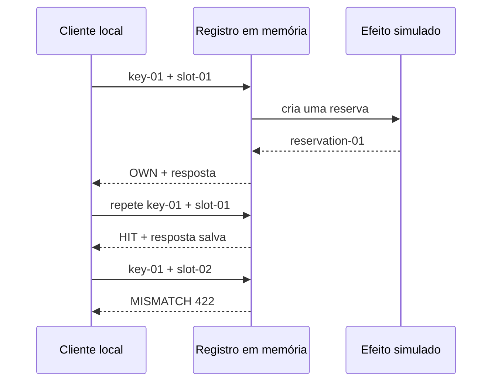

# Repita um pedido sem criar outra reserva

Neste tutorial, vamos enviar um pedido fictício de reserva e repetir a mesma operação. Você verá o resultado anterior reaparecer e terminará com um único efeito de negócio, mesmo depois de duas tentativas iguais.

Este exercício usa somente Python 3.11 ou superior e a biblioteca padrão. Todos os identificadores, registros e respostas são fictícios. O programa trabalha em memória e não acessa rede, banco, Redis, Salesforce ou Airflow.

## 1. Prepare a pasta local

Abra um terminal em um diretório local de estudo e execute:

```sh
python3 --version
mkdir -p architecture-labs
cd architecture-labs
```

O primeiro comando deve informar Python 3.11 ou uma versão posterior. Os dois seguintes criam e abrem a pasta do exercício. Mantenha essa pasta dedicada aos dados fictícios desta lição.

## 2. Salve o programa completo

Crie o arquivo `lab-01.py` nessa pasta e salve exatamente este conteúdo:

```python
from hashlib import sha256
from json import dumps

records = {}
effect_count = 0


def handle(key, payload):
    global effect_count
    canonical = dumps(payload, sort_keys=True, separators=(",", ":"))
    request_hash = sha256(canonical.encode()).hexdigest()
    if key in records:
        old_hash, response = records[key]
        if old_hash != request_hash:
            return "MISMATCH 422: key reused with another payload"
        return f"HIT replay={response}"
    effect_count += 1
    response = "reservation-01"
    records[key] = (request_hash, response)
    return f"OWN created={response}"


print("first=" + handle("key-01", {"slot": "slot-01"}))
print("repeat=" + handle("key-01", {"slot": "slot-01"}))
print("changed=" + handle("key-01", {"slot": "slot-02"}))
print(f"business_effects={effect_count}")
```

## 3. Execute e confira a saída

Execute:

```sh
python3 lab-01.py
```

A saída esperada é:

```text
first=OWN created=reservation-01
repeat=HIT replay=reservation-01
changed=MISMATCH 422: key reused with another payload
business_effects=1
```

## 4. Observe o resultado que você produziu

Observe `OWN` na primeira tentativa e `HIT` na repetição. A chamada com outro horário recebe `MISMATCH`. Há três chamadas, mas apenas uma cria uma reserva; duas chamadas não acrescentam um efeito.

O desenho abaixo representa a simulação local que acabamos de executar:



Guarde o sinal: a chave `key-01` identifica a intenção original. O mesmo conteúdo recupera a resposta; outro conteúdo exige outra intenção.

## 5. Repita a experiência

Execute novamente `python3 lab-01.py`. O programa começa com a memória vazia; a saída completa deve repetir a mesma sequência. Confira o último resultado com o bloco acima e mantenha o arquivo para praticar novamente.

Você concluiu a experiência local. Para entender as decisões e alternativas envolvidas, siga para a [explicação sobre integrações confiáveis](/explicacoes/reliable-integration/).

## Benefício e limite da experiência

Para manter esse comportamento fora do laboratório, é necessário conservar a chave, o resumo do pedido e a resposta, além de definir um prazo e o tratamento da tentativa em andamento.

O registro fica em um dicionário e desaparece quando o programa termina. O exercício não coordena processos nem torna um efeito externo atômico com o armazenamento da resposta.

## De onde veio o exemplo

O roteiro relacionou o mecanismo a `backend/app/services/idempotency_store.py::claim_or_replay` e `finish`, no checkout MakersHub `main@e233fb046ec333982cd1547171b0f0bd8d8d92ee`, lido em 14/10/2026. Este script simplifica esse contrato em memória.

As seis receitas de origem tiveram suas saídas conferidas em Python 3.14.8 no worktree de estudo em 14/10/2026 às 16:40 UTC. Esse recibo é sintético e está em `tasks/architecture-course-2026-10-14/evidence/l1c-labs.md`. Os [recibos dos exemplos](/referencia/evidencias/) explicam os escopos de checkout, banco e runtime usados pela trilha.
