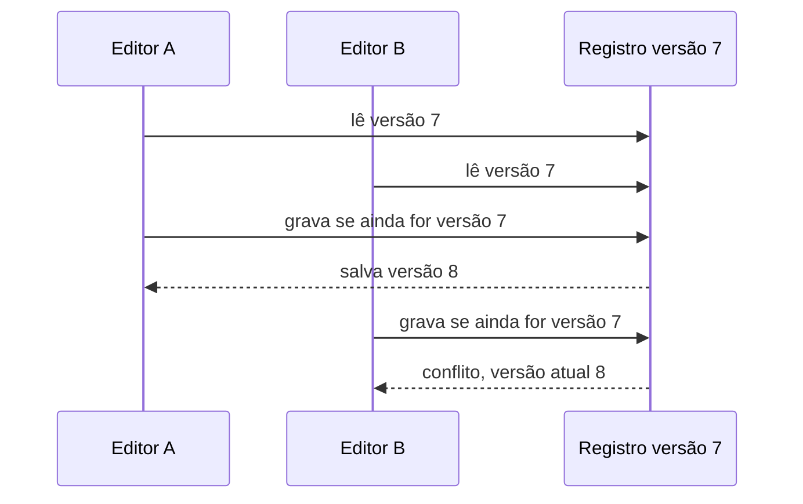

# Recuse a gravação feita sobre uma versão antiga

Neste tutorial, vamos fazer dois editores fictícios abrirem o mesmo registro na versão 7. O primeiro salvará uma alteração. Quando o segundo tentar salvar sua cópia antiga, você verá um conflito explícito e a primeira alteração será preservada.

Este exercício usa somente Python 3.11 ou superior e a biblioteca padrão. Todos os identificadores, registros e respostas são fictícios. O programa trabalha em memória e não acessa rede, banco, Redis, Salesforce ou Airflow.

## 1. Prepare a pasta local

Abra um terminal em um diretório local de estudo e execute:

```sh
python3 --version
mkdir -p architecture-labs
cd architecture-labs
```

O primeiro comando deve informar Python 3.11 ou uma versão posterior. Os dois seguintes criam e abrem a pasta do exercício. Mantenha essa pasta dedicada aos dados fictícios desta lição.

## 2. Salve o programa completo

Crie o arquivo `lab-03.py` nessa pasta e salve exatamente este conteúdo:

```python
record = {"version": 7, "text": "draft"}


def read_record():
    return {"version": record["version"], "text": record["text"]}


def save_record(expected_version, new_text):
    if expected_version != record["version"]:
        return f"conflict expected={expected_version} actual={record['version']}"
    record["text"] = new_text
    record["version"] += 1
    return f"saved version={record['version']}"


editor_a = read_record()
editor_b = read_record()
print(f"editor-a-read=version:{editor_a['version']}")
print(f"editor-b-read=version:{editor_b['version']}")
print("editor-a-save=" + save_record(editor_a["version"], "approved"))
print("editor-b-save=" + save_record(editor_b["version"], "needs-review"))
print(f"stored=version:{record['version']} text:{record['text']}")
```

## 3. Execute e confira a saída

Execute:

```sh
python3 lab-03.py
```

A saída esperada é:

```text
editor-a-read=version:7
editor-b-read=version:7
editor-a-save=saved version=8
editor-b-save=conflict expected=7 actual=8
stored=version:8 text:approved
```

## 4. Observe o resultado que você produziu

Os dois editores leem a versão 7. O editor A salva e produz a versão 8. O editor B ainda apresenta a versão 7 e recebe conflito. O registro termina em `version:8 text:approved`.

O desenho abaixo representa a simulação local que acabamos de executar:



Guarde o sinal: o conflito diz qual versão foi lida e qual existe agora. Ele oferece a oportunidade de reler a alteração antes de substituí-la.

## 5. Repita a experiência

Execute novamente `python3 lab-03.py`. O programa começa com a memória vazia; a saída completa deve repetir a mesma sequência. Confira o último resultado com o bloco acima e mantenha o arquivo para praticar novamente.

Você concluiu a experiência local. Para entender as decisões e alternativas envolvidas, siga para a [explicação sobre concorrência](/explicacoes/concurrency/).

## Benefício e limite da experiência

A segunda pessoa precisa reler o estado atual e decidir como reaplicar sua mudança. A aplicação precisa conservar e comparar a versão.

Os editores são executados em sequência sobre um dicionário. Em um banco compartilhado, a comparação e a gravação precisam ocorrer atomicamente. Uma versão do registro também não protege, por si, outro recurso compartilhado, como um horário.

## De onde veio o exemplo

Este contrato de versão é didático. O roteiro leu `ReportPersistenceService.persist_report` no checkout MakersHub `main@e233fb046ec333982cd1547171b0f0bd8d8d92ee`, mas não confirmou uma edição otimista genérica por versão no produto.

As seis receitas de origem tiveram suas saídas conferidas em Python 3.14.8 no worktree de estudo em 14/10/2026 às 16:40 UTC. Esse recibo é sintético e está em `tasks/architecture-course-2026-10-14/evidence/l1c-labs.md`. Os [recibos dos exemplos](/referencia/evidencias/) explicam os escopos de checkout, banco e runtime usados pela trilha.
