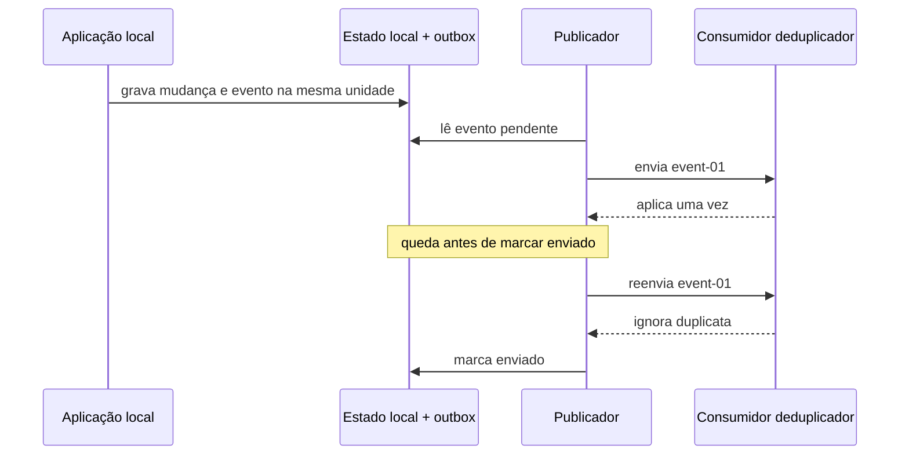

# Recupere uma entrega após uma queda simulada

Neste tutorial, vamos confirmar um pedido fictício e guardar uma mensagem para envio. O publicador sofrerá uma queda simulada depois da entrega. Você o retomará e verá duas tentativas de entrega produzirem um único efeito no consumidor.

Este exercício usa somente Python 3.11 ou superior e a biblioteca padrão. Todos os identificadores, registros e respostas são fictícios. O programa trabalha em memória e não acessa rede, banco, Redis, Salesforce ou Airflow.

## 1. Prepare a pasta local

Abra um terminal em um diretório local de estudo e execute:

```sh
python3 --version
mkdir -p architecture-labs
cd architecture-labs
```

O primeiro comando deve informar Python 3.11 ou uma versão posterior. Os dois seguintes criam e abrem a pasta do exercício. Mantenha essa pasta dedicada aos dados fictícios desta lição.

## 2. Salve o programa completo

Crie o arquivo `lab-02.py` nessa pasta e salve exatamente este conteúdo:

```python
order = {"state": "new"}
outbox = {}
consumer_seen = set()
applied_events = []
delivery_attempts = 0


class SimulatedCrash(Exception):
    pass


def commit_change():
    order["state"] = "confirmed"
    outbox["event-01"] = {"sent": False}
    print("commit order-01=confirmed outbox=event-01")


def publish(crash_before_ack=False):
    global delivery_attempts
    event_id = next(key for key, value in outbox.items() if not value["sent"])
    delivery_attempts += 1
    print(f"delivery attempt={delivery_attempts} event={event_id}")
    if event_id in consumer_seen:
        print(f"consumer=duplicate-ignored event={event_id}")
    else:
        consumer_seen.add(event_id)
        applied_events.append(event_id)
        print(f"consumer=applied event={event_id}")
    if crash_before_ack:
        raise SimulatedCrash
    outbox[event_id]["sent"] = True
    print(f"outbox=sent event={event_id}")


commit_change()
try:
    publish(crash_before_ack=True)
except SimulatedCrash:
    print("publisher=crashed before marking outbox sent")
publish()
print(f"delivery_attempts={delivery_attempts} applied_effects={len(applied_events)}")
```

## 3. Execute e confira a saída

Execute:

```sh
python3 lab-02.py
```

A saída esperada é:

```text
commit order-01=confirmed outbox=event-01
delivery attempt=1 event=event-01
consumer=applied event=event-01
publisher=crashed before marking outbox sent
delivery attempt=2 event=event-01
consumer=duplicate-ignored event=event-01
outbox=sent event=event-01
delivery_attempts=2 applied_effects=1
```

## 4. Observe o resultado que você produziu

Observe a mensagem de queda entre as duas entregas de `event-01`. A primeira aplica o evento; a segunda o reconhece. Duas tentativas menos uma duplicata ignorada deixam um efeito aplicado.

O desenho abaixo representa a simulação local que acabamos de executar:



Guarde o sinal: “a resposta da entrega se perdeu” e “o consumidor não recebeu” podem produzir a mesma aparência para o publicador. O registro pendente permite retomar; o registro do consumidor permite reconhecer a repetição.

## 5. Repita a experiência

Execute novamente `python3 lab-02.py`. O programa começa com a memória vazia; a saída completa deve repetir a mesma sequência. Confira o último resultado com o bloco acima e mantenha o arquivo para praticar novamente.

Você concluiu a experiência local. Para entender as decisões e alternativas envolvidas, siga para a [explicação sobre integrações confiáveis](/explicacoes/reliable-integration/).

## Benefício e limite da experiência

A intenção pendente ocupa armazenamento e exige publicação, confirmação, repetição e deduplicação. Uma mensagem aceita pode voltar a ser entregue.

A exceção interrompe a função, sem encerrar o processo. Os dicionários e o conjunto continuam em memória; eles representam armazenamento durável somente para a simulação. Não há transação SQL nem comprovação de recuperação após uma queda real.

## De onde veio o exemplo

O roteiro relacionou a intenção de sincronização a `backend/app/services/absence_reassignment_service.py::AbsenceReassignmentService._apply`, no checkout MakersHub `main@e233fb046ec333982cd1547171b0f0bd8d8d92ee`, lido em 14/10/2026. O script propõe uma outbox mínima; ele não descreve uma tabela universal de eventos do produto.

As seis receitas de origem tiveram suas saídas conferidas em Python 3.14.8 no worktree de estudo em 14/10/2026 às 16:40 UTC. Esse recibo é sintético e está em `tasks/architecture-course-2026-10-14/evidence/l1c-labs.md`. Os [recibos dos exemplos](/referencia/evidencias/) explicam os escopos de checkout, banco e runtime usados pela trilha.
