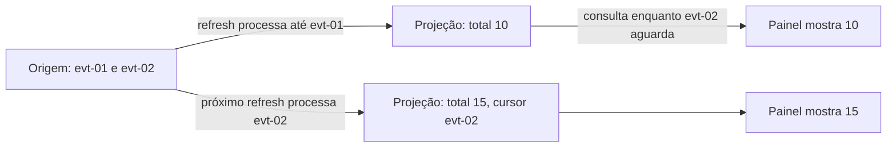

# Observe uma projeção alcançar os dados de origem

Neste tutorial, vamos registrar dois eventos fictícios e atualizar uma tela derivada em dois momentos. Você verá a origem alcançar o total 15 enquanto a tela ainda mostra 10, e depois verá ambos coincidirem quando o cursor avançar.

Este exercício usa somente Python 3.11 ou superior e a biblioteca padrão. Todos os identificadores, registros e respostas são fictícios. O programa trabalha em memória e não acessa rede, banco, Redis, Salesforce ou Airflow.

## 1. Prepare a pasta local

Abra um terminal em um diretório local de estudo e execute:

```sh
python3 --version
mkdir -p architecture-labs
cd architecture-labs
```

O primeiro comando deve informar Python 3.11 ou uma versão posterior. Os dois seguintes criam e abrem a pasta do exercício. Mantenha essa pasta dedicada aos dados fictícios desta lição.

## 2. Salve o programa completo

Crie o arquivo `lab-04.py` nessa pasta e salve exatamente este conteúdo:

```python
source_events = []
projected_events = []
cursor = 0


def commit_event(event_id, amount):
    source_events.append({"id": event_id, "amount": amount})
    print(f"source-commit={event_id} amount={amount}")


def refresh_projection():
    global cursor
    projected_events.extend(source_events[cursor:])
    cursor = len(source_events)
    watermark = source_events[cursor - 1]["id"] if cursor else "none"
    total = sum(event["amount"] for event in projected_events)
    print(f"projected-through={watermark} total={total}")


def source_total():
    return sum(event["amount"] for event in source_events)


def dashboard_total():
    return sum(event["amount"] for event in projected_events)


commit_event("evt-01", 10)
refresh_projection()
commit_event("evt-02", 5)
print(f"dashboard={dashboard_total()} source={source_total()} cursor=evt-01")
refresh_projection()
print(f"dashboard={dashboard_total()} source={source_total()} cursor=evt-02")
```

## 3. Execute e confira a saída

Execute:

```sh
python3 lab-04.py
```

A saída esperada é:

```text
source-commit=evt-01 amount=10
projected-through=evt-01 total=10
source-commit=evt-02 amount=5
dashboard=10 source=15 cursor=evt-01
projected-through=evt-02 total=15
dashboard=15 source=15 cursor=evt-02
```

## 4. Observe o resultado que você produziu

Depois de `evt-02`, a origem soma 10 + 5 = 15. O painel ainda soma 10 e informa `cursor=evt-01`. Na próxima atualização, ele alcança `evt-02` e também soma 15.

O desenho abaixo representa a simulação local que acabamos de executar:



Guarde o sinal: confira até qual evento a tela chegou antes de interpretar uma diferença como perda de dados. O cursor separa o valor exibido do ponto de processamento alcançado.

## 5. Repita a experiência

Execute novamente `python3 lab-04.py`. O programa começa com a memória vazia; a saída completa deve repetir a mesma sequência. Confira o último resultado com o bloco acima e mantenha o arquivo para praticar novamente.

Você concluiu a experiência local. Para entender as decisões e alternativas envolvidas, siga para a [explicação sobre modelos de leitura](/explicacoes/read-models/).

## Benefício e limite da experiência

A tela pode mostrar um total anterior enquanto a projeção avança. O sistema precisa informar sua atualidade e escolher quais decisões podem usar esse dado.

A atualização é controlada pelo programa. O exercício não mede atraso de um consumidor real, frequência de atualização, ordenação ou recuperação. Os valores 10 e 5 são unidades fictícias.

## De onde veio o exemplo

O roteiro leu `backend/app/services/report_read_service.py::ReportReadService.read`, no checkout MakersHub `main@e233fb046ec333982cd1547171b0f0bd8d8d92ee`. Essa leitura mostra um caminho de consulta; não confirma atraso configurado no relatório real. Os eventos desta página são fictícios.

As seis receitas de origem tiveram suas saídas conferidas em Python 3.14.8 no worktree de estudo em 14/10/2026 às 16:40 UTC. Esse recibo é sintético e está em `tasks/architecture-course-2026-10-14/evidence/l1c-labs.md`. Os [recibos dos exemplos](/referencia/evidencias/) explicam os escopos de checkout, banco e runtime usados pela trilha.
