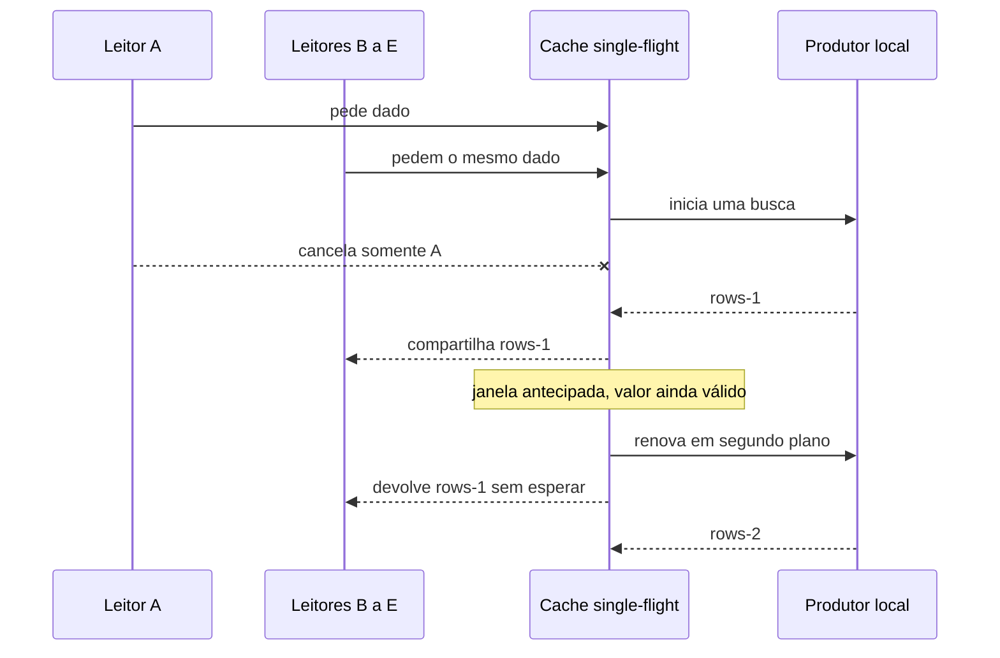

# Compartilhe uma busca sem cancelar os outros leitores

Neste tutorial, vamos iniciar cinco leitores fictícios do mesmo dado. Você cancelará um leitor, observará os outros quatro receberem a mesma resposta e depois verá uma renovação começar antes de o valor vencer.

Este exercício usa somente Python 3.11 ou superior e a biblioteca padrão. Todos os identificadores, registros e respostas são fictícios. O programa trabalha em memória e não acessa rede, banco, Redis, Salesforce ou Airflow.

## 1. Prepare a pasta local

Abra um terminal em um diretório local de estudo e execute:

```sh
python3 --version
mkdir -p architecture-labs
cd architecture-labs
```

O primeiro comando deve informar Python 3.11 ou uma versão posterior. Os dois seguintes criam e abrem a pasta do exercício. Mantenha essa pasta dedicada aos dados fictícios desta lição.

## 2. Salve o programa completo

Crie o arquivo `lab-05.py` nessa pasta e salve exatamente este conteúdo:

```python
import asyncio


class SingleFlightCache:
    def __init__(self, producer, ttl, early_window, clock):
        self.producer = producer
        self.ttl = ttl
        self.early_window = early_window
        self.clock = clock
        self.value = None
        self.expires_at = 0
        self.early_expires_at = 0
        self.inflight = None
        self.lock = asyncio.Lock()

    def start_fetch(self):
        if self.inflight is None:
            self.inflight = asyncio.create_task(self.load())
        return self.inflight

    async def load(self):
        task = asyncio.current_task()
        try:
            value = await self.producer()
            self.value = value
            self.expires_at = self.clock() + self.ttl
            self.early_expires_at = self.expires_at - self.early_window
            return value
        finally:
            if self.inflight is task:
                self.inflight = None

    async def get(self):
        now = self.clock()
        if self.value is not None and now < self.expires_at:
            if now >= self.early_expires_at:
                self.start_fetch()
            return self.value
        async with self.lock:
            if self.value is not None and self.clock() < self.expires_at:
                return self.value
            task = self.start_fetch()
        return await asyncio.shield(task)


async def main():
    now = [0]
    calls = 0
    started = [asyncio.Event(), asyncio.Event()]
    release = [asyncio.Event(), asyncio.Event()]

    async def producer():
        nonlocal calls
        calls += 1
        number = calls
        print(f"producer-started={number}")
        started[number - 1].set()
        await release[number - 1].wait()
        return f"rows-{number}"

    cache = SingleFlightCache(producer, ttl=10, early_window=3, clock=lambda: now[0])
    readers = [asyncio.create_task(cache.get()) for _ in range(5)]
    await started[0].wait()
    readers[0].cancel()
    cancelled = await asyncio.gather(readers[0], return_exceptions=True)
    release[0].set()
    survivors = await asyncio.gather(*readers[1:])
    print(f"cancelled-reader={type(cancelled[0]).__name__}")
    print(f"surviving-readers={len(survivors)} value={survivors[0]}")

    now[0] = 8
    stale = await cache.get()
    refresh_task = cache.inflight
    await started[1].wait()
    print(f"early-refresh-read={stale}")
    release[1].set()
    await refresh_task
    print(f"refreshed-read={await cache.get()}")
    print(f"producer-calls={calls}")


asyncio.run(main())
```

## 3. Execute e confira a saída

Execute:

```sh
python3 lab-05.py
```

A saída esperada é:

```text
producer-started=1
cancelled-reader=CancelledError
surviving-readers=4 value=rows-1
producer-started=2
early-refresh-read=rows-1
refreshed-read=rows-2
producer-calls=2
```

## 4. Observe o resultado que você produziu

Cinco leitores iniciam uma única busca. Após um cancelamento, quatro recebem `rows-1`. O relógio avança para 8; com validade de 10 e janela antecipada de 3, a renovação começa a partir de 10 − 3 = 7. A leitura em 8 ainda recebe `rows-1`; a próxima recebe `rows-2`.

O desenho abaixo representa a simulação local que acabamos de executar:



Guarde o sinal: `producer-calls=2` inclui uma busca inicial e uma renovação. Cancelar um leitor não cria outra busca nem cancela o trabalho que os demais aguardam.

## 5. Repita a experiência

Execute novamente `python3 lab-05.py`. O programa começa com a memória vazia; a saída completa deve repetir a mesma sequência. Confira o último resultado com o bloco acima e mantenha o arquivo para praticar novamente.

Você concluiu a experiência local. Para entender as decisões e alternativas envolvidas, siga para a [explicação sobre cache](/explicacoes/cache/).

## Benefício e limite da experiência

A tarefa compartilhada exige tratamento de cancelamento e expiração. Durante a renovação, um leitor recebe o valor anterior enquanto ele ainda é válido.

O relógio é controlado e as respostas são fictícias. O compartilhamento vale para este processo Python; processos ou workers diferentes podem iniciar suas próprias buscas. O script não consulta Redis nem uma API.

## De onde veio o exemplo

O roteiro leu `backend/app/utils/single_flight.py::SingleFlightCache.get` e seu uso em `backend/app/integrations/nextbilling_integration.py`, no checkout MakersHub `main@e233fb046ec333982cd1547171b0f0bd8d8d92ee`, em 14/10/2026. Parâmetros de código não comprovam a configuração efetiva do serviço.

As seis receitas de origem tiveram suas saídas conferidas em Python 3.14.8 no worktree de estudo em 14/10/2026 às 16:40 UTC. Esse recibo é sintético e está em `tasks/architecture-course-2026-10-14/evidence/l1c-labs.md`. Os [recibos dos exemplos](/referencia/evidencias/) explicam os escopos de checkout, banco e runtime usados pela trilha.
