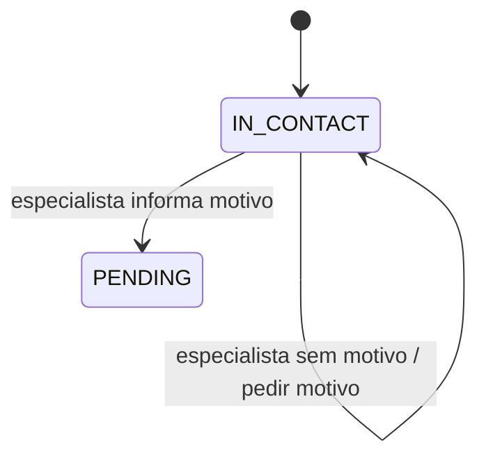

# Mude de estado somente depois das verificações

Neste tutorial, vamos mover uma oportunidade fictícia de `IN_CONTACT` para `PENDING`. Você observará três tentativas recusadas e uma tentativa aceita, sempre conservando o estado anterior enquanto falta uma condição.

Este exercício usa somente Python 3.11 ou superior e a biblioteca padrão. Todos os identificadores, registros e respostas são fictícios. O programa trabalha em memória e não acessa rede, banco, Redis, Salesforce ou Airflow.

## 1. Prepare a pasta local

Abra um terminal em um diretório local de estudo e execute:

```sh
python3 --version
mkdir -p architecture-labs
cd architecture-labs
```

O primeiro comando deve informar Python 3.11 ou uma versão posterior. Os dois seguintes criam e abrem a pasta do exercício. Mantenha essa pasta dedicada aos dados fictícios desta lição.

## 2. Salve o programa completo

Crie o arquivo `lab-06.py` nessa pasta e salve exatamente este conteúdo:

```python
class StateMachine:
    def __init__(self, state):
        self.state = state
        self.allowed_edges = {("IN_CONTACT", "PENDING")}

    def move(self, target, role, reason=None):
        special_stages = {"PENDING", "ORDER_SENT"}
        if self.state == target:
            return "unchanged"
        if role != "specialist" and (
            self.state in special_stages or target in special_stages
        ):
            return "blocked-specialist-only"
        if target == "PENDING" and not reason:
            return "needs-reason"
        if (self.state, target) not in self.allowed_edges:
            return "invalid-edge"
        self.state = target
        return "accepted"


machine = StateMachine("IN_CONTACT")
result = machine.move("UNKNOWN", role="specialist")
print(f"unsupported-target={result} state={machine.state}")
result = machine.move("PENDING", role="operator")
print(f"operator-result={result} state={machine.state}")
result = machine.move("PENDING", role="specialist")
print(f"specialist-without-reason={result} state={machine.state}")
result = machine.move("PENDING", role="specialist", reason="review")
print(f"specialist-with-reason={result} state={machine.state}")
```

## 3. Execute e confira a saída

Execute:

```sh
python3 lab-06.py
```

A saída esperada é:

```text
unsupported-target=invalid-edge state=IN_CONTACT
operator-result=blocked-specialist-only state=IN_CONTACT
specialist-without-reason=needs-reason state=IN_CONTACT
specialist-with-reason=accepted state=PENDING
```

## 4. Observe o resultado que você produziu

A tentativa de ir para `UNKNOWN` é recusada. O papel `operator` não pode concluir a transição; `specialist` ainda precisa informar um motivo. Somente a quarta tentativa reúne as condições e muda o estado para `PENDING`.

O desenho abaixo representa a simulação local que acabamos de executar:



Guarde o sinal: as três recusas deixam `state=IN_CONTACT`. O estado muda somente depois de validar o destino, o papel e o motivo.

## 5. Repita a experiência

Execute novamente `python3 lab-06.py`. O programa começa com a memória vazia; a saída completa deve repetir a mesma sequência. Confira o último resultado com o bloco acima e mantenha o arquivo para praticar novamente.

Você concluiu a experiência local. Para entender as decisões e alternativas envolvidas, siga para a [explicação sobre regras de negócio](/explicacoes/business-rules/).

## Benefício e limite da experiência

A pessoa autorizada precisa informar o motivo. Regras repetidas em diferentes telas e no servidor precisam permanecer alinhadas.

A máquina contém uma única transição e roda em memória. Ela não enumera todo o ciclo de uma oportunidade nem substitui autorização ou validação no servidor. Os papéis e os dados do script são fictícios.

## De onde veio o exemplo

O roteiro leu `frontend/app/(pages)/opportunities-hub/_lib/stageTransition.ts::classifyStageTransition`, no checkout MakersHub `main@e233fb046ec333982cd1547171b0f0bd8d8d92ee`. O classificador não comprova uma máquina de estados completa no servidor. O laboratório traduz seu papel didático para o identificador inglês `specialist`.

As seis receitas de origem tiveram suas saídas conferidas em Python 3.14.8 no worktree de estudo em 14/10/2026 às 16:40 UTC. Esse recibo é sintético e está em `tasks/architecture-course-2026-10-14/evidence/l1c-labs.md`. Os [recibos dos exemplos](/referencia/evidencias/) explicam os escopos de checkout, banco e runtime usados pela trilha.
