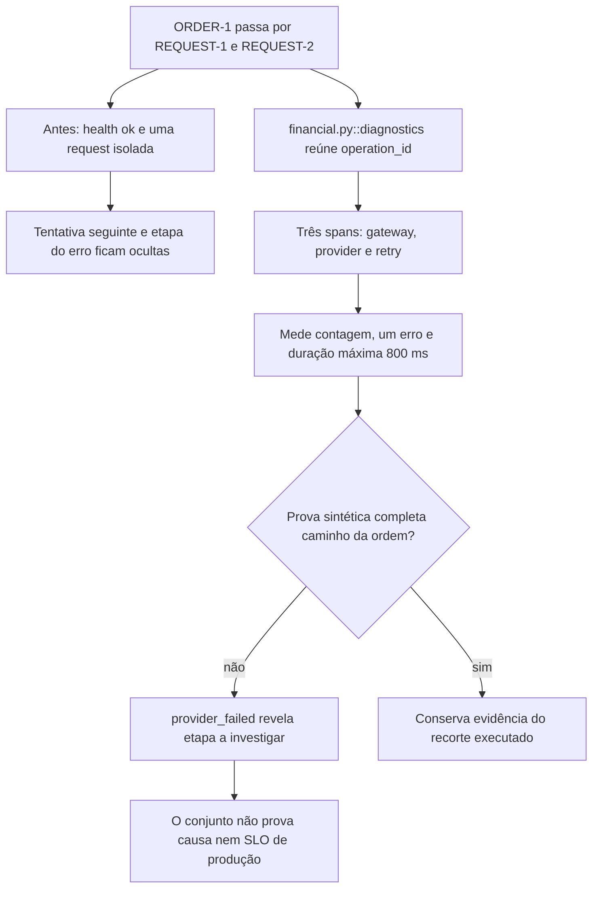

A ordem fictícia ORDER-1 passa por uma requisição que falha no provedor e por uma segunda tentativa. Ana vê um health endpoint verde e ainda não sabe onde o pedido parou. A prática reúne os dois request IDs sob um operation ID e separa tempo, erro e resultado do caminho de negócio.

### A condição anterior

Olhar somente uma requisição perde a tentativa seguinte. Um health endpoint verde pode deixar o caminho da ordem sem medição.

### O mecanismo que muda a condição

operation_id reúne os spans das duas requisições. As métricas mostram quantidade, erro e maior duração; a prova sintética percorre o caminho que a ordem precisa usar.

O fluxo abaixo descreve o modelo financeiro local proposto pelo curso. Ele não certifica um caminho de produção.

O localizador da operação é `diagnostics / correlate-retries / measure-signals / probe-business-path`. Este é um caso financeiro hipotético com participantes e dados fictícios. Uma corretora de maior porte, do setor em que atua a XP, é apenas o contexto de negócio. O texto não descreve um incidente nem uma arquitetura interna real da XP. A busca delimitada localizou candidatos da nossa stack, mas não estabeleceu um caso histórico completo para todos os conceitos desta família.

### O benefício, o custo e o limite

Uma operação reúne três spans e duas requisições. O trecho do provedor dura 800 ms e tem erro. Há duas requisições, uma com falha: 1 ÷ 2 = 50% de requisições com erro. Os três spans continuam sendo uma contagem distinta. O processo responde ao health endpoint, enquanto a prova da ordem detecta provider_failed. A proteção acrescenta uma responsabilidade: alguém precisa conservar a identidade, o estado ou o contrato que a decisão confere. Se essa responsabilidade ficar num participante que pode desistir ou num recorte incompleto, a garantia muda.

O conjunto é sintético e pequeno. Ele não prova instrumentação OpenTelemetry real, percentil, SLO, causa de incidente ou capacidade de produção.

Uma alternativa só atende esta dor se proteger o mesmo recurso e a mesma condição observável. Acrescentar um cache, uma fila ou um serviço separado pode resolver outra parte do fluxo e ainda deixar este mecanismo exposto. A matriz indica as comparações que o exercício permite fazer.

O [mapa de conceitos deste caso](/jornadas/diagnostics/conceitos/) informa qual observação cada conceito compartilha com a prática e o que ela não comprova.
