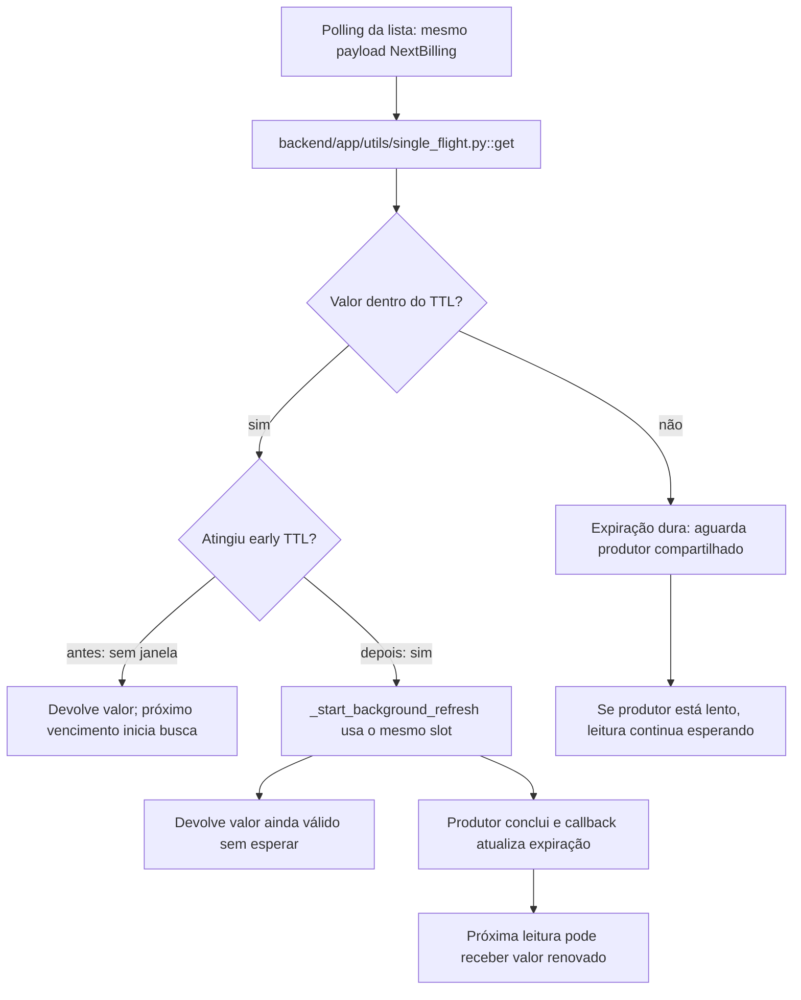

import { EarlyRefreshFact, EarlyRefreshOutput, EarlyRefreshProvenance, EarlyRefreshSources, EarlyRefreshCommand } from '../../components/EarlyRefreshFacts.jsx'

A lista de chamadas é consultada repetidamente. A versão anterior mantém o valor até o TTL, mas a primeira leitura após o vencimento espera a resposta do produtor. FBI-2331 acrescentou uma janela de renovação antecipada para que a consulta seguinte pudesse encontrar o valor novo. Esta história trata de uma evolução documentada.

### A condição anterior

<EarlyRefreshFact name="before" />

### O mecanismo que muda a condição

<EarlyRefreshFact name="mechanism" />

O fluxo abaixo descreve o corpo de código histórico lido; os recursos externos do laboratório são doubles declarados. Ele não certifica um caminho de produção.

O localizador da operação é `SingleFlightCache.get / _start_background_refresh`.

### O benefício, o custo e o limite

<EarlyRefreshFact name="outcome" />

A janela permite começar a busca enquanto o valor anterior ainda é válido. A tarefa compartilhada precisa terminar a tempo de a próxima leitura encontrar o valor renovado. A renovação deste mecanismo é disparada por uma leitura elegível; ela não é uma atualização periódica independente de consultas.

<EarlyRefreshFact name="limits" />

Uma alternativa só atende esta dor se proteger o mesmo recurso e a mesma condição observável. Acrescentar um cache, uma fila ou um serviço separado pode resolver outra parte do fluxo e ainda deixar este mecanismo exposto. A matriz indica as comparações que o exercício permite fazer.

O [mapa de conceitos deste caso](/jornadas/early-refresh/conceitos/) informa qual observação cada conceito compartilha com a prática e o que ela não comprova.
