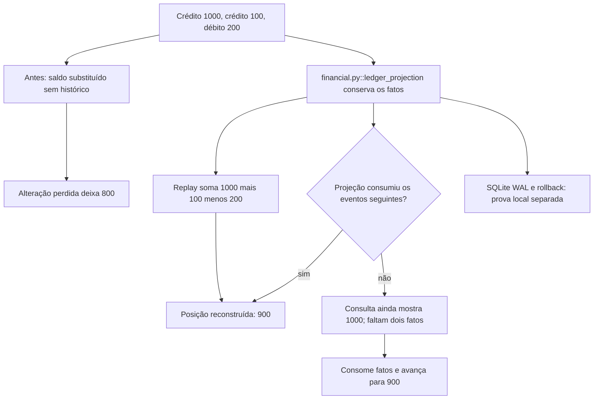

Uma posição fictícia recebe crédito de R$ 1.000, crédito de R$ 100 e débito de R$ 200. Um saldo mutável sem histórico pode perder uma alteração. A trilha de eventos permite refazer a conta: 1.000 + 100 − 200 = R$ 900, inclusive quando o modelo de consulta ainda não consumiu os dois últimos eventos.

### A condição anterior

A posição de consulta fica em R$ 1.000 enquanto faltam dois eventos. Uma substituição sem histórico deixa o saldo em R$ 800.

### O mecanismo que muda a condição

A projeção consome os fatos faltantes. Uma transação local pode fazer rollback. Um snapshot da posição 2 reduz o replay ao evento seguinte.

O fluxo abaixo descreve o modelo financeiro local proposto pelo curso. Ele não certifica um caminho de produção.

O localizador da operação é `ledger_projection / replay-events / projection-checkpoint / durable-transaction`. Este é um caso financeiro hipotético com participantes e dados fictícios. Uma corretora de maior porte, do setor em que atua a XP, é apenas o contexto de negócio. O texto não descreve um incidente nem uma arquitetura interna real da XP. A busca delimitada localizou candidatos da nossa stack, mas não estabeleceu um caso histórico completo para todos os conceitos desta família.

### O benefício, o custo e o limite

O replay e a projeção chegam a R$ 900. O snapshot de R$ 1.100 mais o débito de R$ 200 chega ao mesmo saldo. O SQLite executa uma transação em journal_mode=wal e conserva 100.000 centavos após rollback. A proteção acrescenta uma responsabilidade: alguém precisa conservar a identidade, o estado ou o contrato que a decisão confere. Se essa responsabilidade ficar num participante que pode desistir ou num recorte incompleto, a garantia muda.

Os eventos são fictícios. O WAL medido é do SQLite; ele não prova recovery PostgreSQL. Uma outbox, um log de auditoria ou uma projeção sozinha não transforma qualquer sistema em Event Sourcing.

Uma alternativa só atende esta dor se proteger o mesmo recurso e a mesma condição observável. Acrescentar um cache, uma fila ou um serviço separado pode resolver outra parte do fluxo e ainda deixar este mecanismo exposto. A matriz indica as comparações que o exercício permite fazer.

O [mapa de conceitos deste caso](/jornadas/ledger-projection/conceitos/) informa qual observação cada conceito compartilha com a prática e o que ela não comprova.
