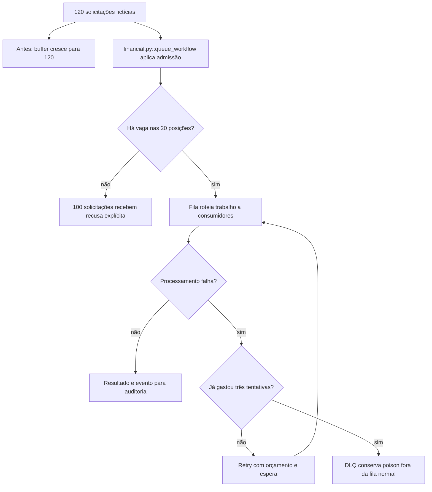

Ana importa 120 solicitações fictícias em uma corretora. O consumidor só consegue manter 20 na fila escolhida para a prática. Ao mesmo tempo, uma mensagem inválida falha sempre. O desenho anterior cresce sem limite e repete a mensagem inválida; a versão protegida limita a entrada e separa a mensagem que já gastou três tentativas.

### A condição anterior

A fila acumula 120 itens. A mensagem inválida repete sem orçamento. Uma publicação pode tentar ocorrer antes da transformação de que depende.

### O mecanismo que muda a condição

A admissão guarda 20 e recusa 100. Após três tentativas, a mensagem vai para a DLQ. Roteamento, metadados de sequência e dependências da DAG orientam cada etapa.

O fluxo abaixo descreve o modelo financeiro local proposto pelo curso. Ele não certifica um caminho de produção.

O localizador da operação é `queue_workflow / retry-dlq / admission / dag-dependencies`. Este é um caso financeiro hipotético com participantes e dados fictícios. Uma corretora de maior porte, do setor em que atua a XP, é apenas o contexto de negócio. O texto não descreve um incidente nem uma arquitetura interna real da XP. A busca delimitada localizou candidatos da nossa stack, mas não estabeleceu um caso histórico completo para todos os conceitos desta família.

### O benefício, o custo e o limite

A prática entrega o item válido, conserva o inválido fora da fila normal e processa extract, transform e publish nessa ordem. Workers compartilham tarefas; a assinatura de auditoria recebe seus próprios fatos. A proteção acrescenta uma responsabilidade: alguém precisa conservar a identidade, o estado ou o contrato que a decisão confere. Se essa responsabilidade ficar num participante que pode desistir ou num recorte incompleto, a garantia muda.

A fila está em memória. A DLQ, o circuito e as dependências são modelos limitados, sem broker, Airflow, durable workflow, promessa de exactly-once ou temporização de rede.

Uma alternativa só atende esta dor se proteger o mesmo recurso e a mesma condição observável. Acrescentar um cache, uma fila ou um serviço separado pode resolver outra parte do fluxo e ainda deixar este mecanismo exposto. A matriz indica as comparações que o exercício permite fazer.

O [mapa de conceitos deste caso](/jornadas/queue-workflow/conceitos/) informa qual observação cada conceito compartilha com a prática e o que ela não comprova.
