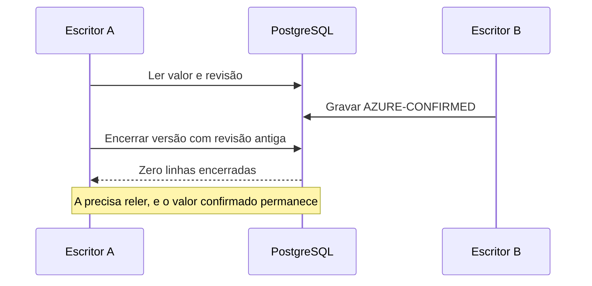

Dois escritores trabalham sobre o mesmo colaborador. O primeiro lê a linha atual. O segundo confirma uma alteração em azure_id. O primeiro ainda conserva a leitura antiga e tenta encerrar a versão para criar outra. Ter somente uma versão atual não impede que essa nova versão recoloque o valor antigo.

A gravação só pode prosseguir quando a revisão ainda é a mesma que o escritor leu (concorrência otimista, com comparação de versão). A versão selecionada compara a combinação de _employee_id com xmin. Se outro escritor alterou a linha, o UPDATE não encerra nenhuma versão. O chamador precisa tratar esse resultado como conflito e reler antes de decidir novamente.

### O que muda no código

A função estudada é `update_employee_scd2_without_commit`, em `backend/app/repositories/employee_repository.py`. Compare o predicado do UPDATE nos dois templates. A alteração acrescenta a comparação com `:source_revision` e devolve as linhas encerradas com `RETURNING _employee_id`. O exercício produz a alteração concorrente antes desse UPDATE e verifica o valor preservado.

A versão anterior termina com uma única linha atual, mas perde AZURE-CONFIRMED e conserva AZURE-OLD. O predicado alterado rejeita o escritor atrasado e preserva AZURE-CONFIRMED. Os identificadores deste exercício são sintéticos.

### Até onde essa conclusão vale

A revisão baseada em xmin é opaca e transitória. Ela não é uma identidade durável nem um fencing token monotônico. O laboratório isola o predicado de encerramento, com uma atualização concorrente entre leitura e escrita; não executa o método inteiro, a API ou a integração Azure. O commit selecionado pertence a um PR cuja leitura histórica estava aberta; este material não afirma implantação em produção.

Este recorte está ligado ao [card FBI-4924](https://fazcapital.atlassian.net/browse/FBI-4924) e ao [PR 630](https://bitbucket.org/fazcapital/makershub/pull-requests/630). A leitura histórica registrou o PR como **OPEN na leitura histórica registrada**. Compare a [fonte anterior](https://bitbucket.org/fazcapital/makershub/src/3ad846049c32fedee09d458c8d685fb39b675b82/backend/app/repositories/employee_repository.py) com a [fonte alterada](https://bitbucket.org/fazcapital/makershub/src/c5e8efc5913355a8545b8a27b8b72e0828f77660/backend/app/repositories/employee_repository.py). A investigação conserva as descrições de PR e do campo visível do Jira em `execution/history`; o laboratório verifica somente o kernel SQL selecionado.
