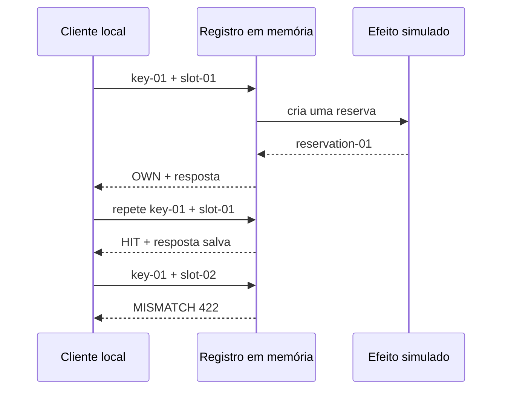
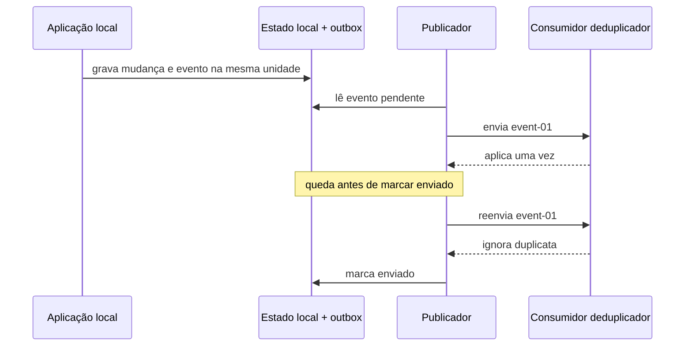
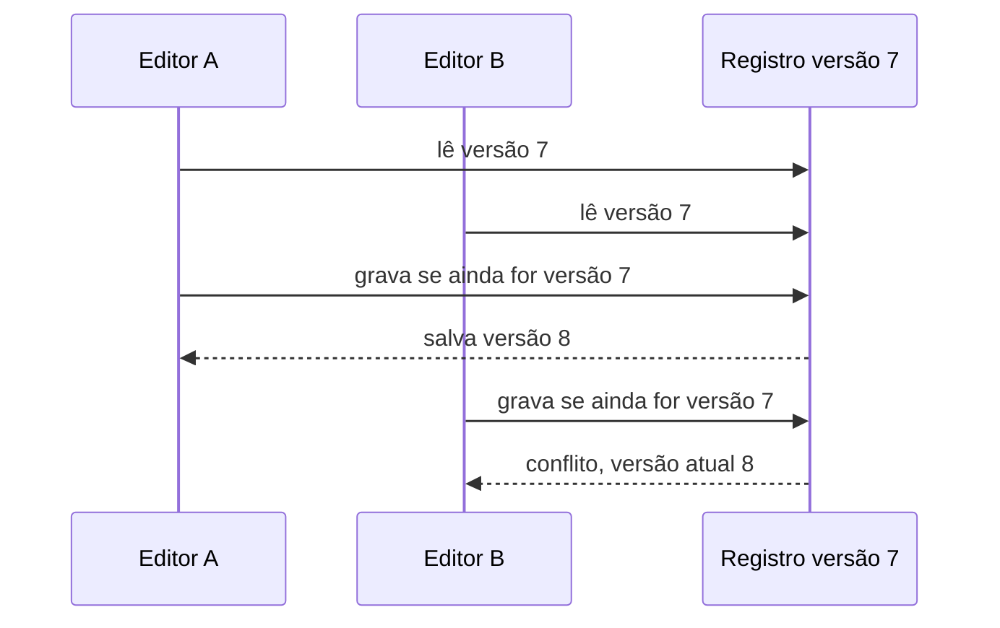
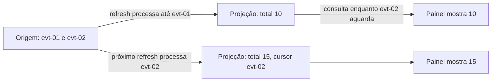
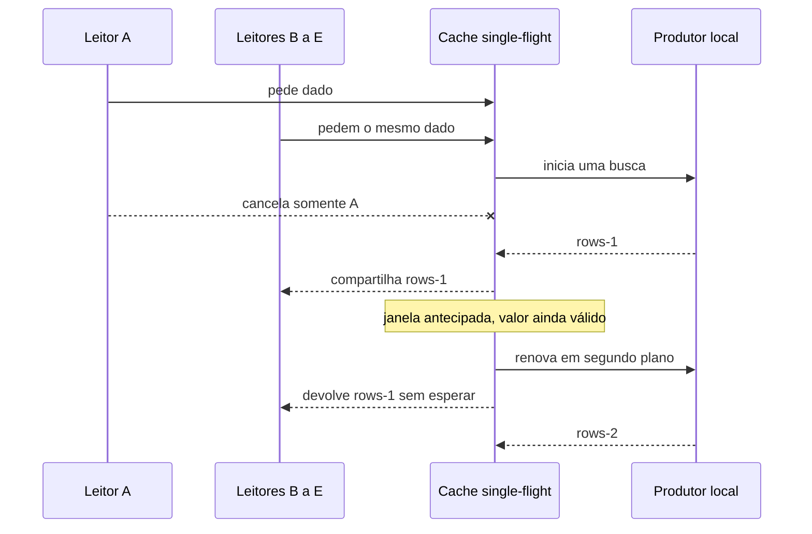
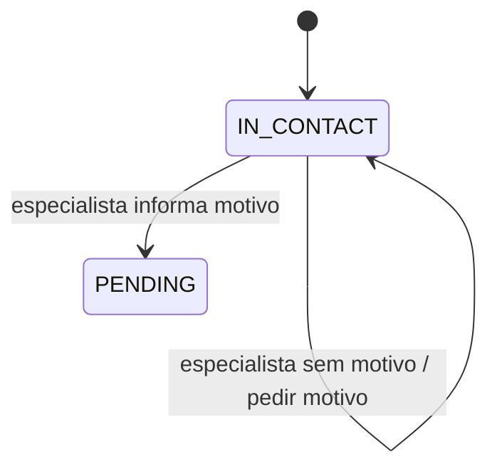

# S1 — Roteiro de seis laboratórios locais

Este arquivo prepara o texto de aula para S1. Ele ainda não é MDX final. Os laboratórios usam somente Python 3.11 ou superior e a biblioteca padrão. Cada exercício roda em memória, sem rede, banco, Redis, Salesforce, Airflow, arquivos de cliente ou instalação de pacotes. Os identificadores e valores dos exemplos são fictícios.

A referência de tutoriais do Diátaxis orienta cada receita: uma sequência fixa, uma atividade que termina com resultado visível, comandos reproduzíveis e explicações conceituais nos links dos capítulos. Os cinco passos levam a pessoa pela experiência; o texto abaixo registra o motivo, a fonte e o limite para S1.

## Reuso, encaixe e limites

O mapa S1 já organiza os capítulos e separa explicação, tutorial, guia e referência. S4 fornece os casos de chave idempotente, intenção de sincronização e caminhos de leitura e escrita. S5 fornece o cache single-flight com cancelamento e renovação antecipada. Reutilizo essas fontes para escolher a situação de cada laboratório e deixo o estudante praticar um mecanismo por vez.

O código observado não comprova que exista uma tabela de outbox para todos os eventos, uma edição otimista genérica por versão, um projetor com atraso garantido ou uma máquina de estados completa no servidor. Os laboratórios 2 a 4 e 6 isolam esses mecanismos em simulações pequenas. Cada receita diz qual ligação com MakersHub é direta e qual parte permanece didática. Nenhuma saída sintética é apresentada como evidência de produção.

### Fonte verificada

- [2026-10-14 16:26 UTC] Checkout local de MakersHub, `/Users/augustocarollo/Developer.noindex/makershub` — `git rev-parse HEAD; git branch --show-current; test -d .codegraph` → `e233fb046ec333982cd1547171b0f0bd8d8d92ee`; `main`; `CODEGRAPH_PRESENT`.
- [2026-10-14 16:40 UTC] Checkout local de MakersHub — `git status --short -- backend/app/services/idempotency_store.py backend/app/services/absence_reassignment_service.py backend/app/services/report_persistence_service.py backend/app/services/report_read_service.py backend/app/repositories/report_read_repository.py backend/app/utils/single_flight.py backend/app/integrations/nextbilling_integration.py frontend/app/'(pages)'/opportunities-hub/_lib/stageTransition.ts` → saída vazia. Os oito arquivos citados estão limpos em relação ao commit local. Isso vincula os símbolos ao checkout; não confirma deploy.
- [2026-10-14 16:26 UTC] Checkout local de MakersHub — `codegraph explore` com cada símbolo e arquivo indicado abaixo → código atual em disco para `claim_or_replay`, `_apply`, `persist_report`, `ReportReadService.read`, `SingleFlightCache.get` e `classifyStageTransition`.

## Laboratório 1 — Repetir uma operação sem criar outra reserva

**O benefício.** A pessoa pode repetir o mesmo pedido depois de uma resposta perdida e receber o resultado anterior. Uma chave reaproveitada com conteúdo diferente é recusada, o que evita transformar uma repetição em uma segunda operação.

**O custo.** O sistema precisa guardar a chave, o resumo do pedido e a resposta por um prazo definido, além de decidir o que fazer enquanto a primeira tentativa ainda está em andamento.

**Caso MakersHub.** No checkout `main@e233fb046ec333982cd1547171b0f0bd8d8d92ee`, `backend/app/services/idempotency_store.py::claim_or_replay` calcula um hash do pedido, tenta inserir uma chave única e devolve `OWN`, `HIT`, `BUSY` ou `MISMATCH`. `finish` exige o `owner_token` da tentativa atual antes de gravar a resposta. O laboratório reproduz o contrato em memória. Ele não executa a tabela real nem a integração externa.

**Pré-requisitos.** Python 3.11 ou superior e biblioteca padrão. Não é necessário instalar pacotes nem ter Node, rede ou serviço externo.

**Código completo (`lab-01.py`).**

```python
from hashlib import sha256
from json import dumps

records = {}
effect_count = 0


def handle(key, payload):
    global effect_count
    canonical = dumps(payload, sort_keys=True, separators=(",", ":"))
    request_hash = sha256(canonical.encode()).hexdigest()
    if key in records:
        old_hash, response = records[key]
        if old_hash != request_hash:
            return "MISMATCH 422: key reused with another payload"
        return f"HIT replay={response}"
    effect_count += 1
    response = "reservation-01"
    records[key] = (request_hash, response)
    return f"OWN created={response}"


print("first=" + handle("key-01", {"slot": "slot-01"}))
print("repeat=" + handle("key-01", {"slot": "slot-01"}))
print("changed=" + handle("key-01", {"slot": "slot-02"}))
print(f"business_effects={effect_count}")
```

**Passos.**

1. Crie uma pasta vazia chamada `architecture-labs` e entre nela.
2. Salve o bloco de código como `lab-01.py`.
3. Rode `python3 lab-01.py`.
4. Confira que a primeira chamada cria `reservation-01` e a repetição devolve o mesmo resultado.
5. Rode o comando de novo; como o programa começa em memória vazia, a saída completa deve se repetir exatamente.

**Saída literal esperada.**

```text
first=OWN created=reservation-01
repeat=HIT replay=reservation-01
changed=MISMATCH 422: key reused with another payload
business_effects=1
```

**O que a pessoa vê quando falha.** Se remover a verificação de hash, `key-01` com `slot-02` parece sucesso e pode representar a mesma chave protegendo duas intenções incompatíveis. Se remover o registro, cada repetição incrementa `business_effects`.

**Diagrama didático.**



**Limite do laboratório.** O dicionário desaparece quando o processo termina e não há corrida entre processos. Em produção, a unicidade, a transação, a janela entre efeito externo e `finish`, a lease e o comportamento do sistema chamado precisam ser avaliados separadamente. Consulte a [explicação sobre integrações confiáveis](/explicacoes/reliable-integration/).

## Laboratório 2 — Recuperar depois do commit e antes da confirmação

**O benefício.** Uma intenção de integração gravada junto com a mudança local pode ser publicada depois de uma queda. O consumidor deduplica o mesmo evento, porque o publicador pode enviá-lo outra vez quando caiu antes de registrar a confirmação.

**Caso MakersHub.** No checkout `main@e233fb046ec333982cd1547171b0f0bd8d8d92ee`, `backend/app/services/absence_reassignment_service.py::AbsenceReassignmentService._apply` atualiza o responsável e `sf_owner_sync_pending` no mesmo `UPDATE`, condicionado ao responsável anterior, e registra histórico. O comentário da função chama essa flag de outbox. A receita usa um outbox mínimo como simulação e não afirma que todo fluxo MakersHub use uma tabela de eventos ou tenha entrega externa comprovada.

**O custo.** Uma entrega pode se repetir, então o publicador precisa conservar o trabalho pendente e o consumidor precisa deduplicar efeitos.

**Pré-requisitos.** Python 3.11 ou superior e biblioteca padrão. Não é necessário instalar pacotes nem ter Node, rede ou serviço externo.

**Código completo (`lab-02.py`).**

```python
order = {"state": "new"}
outbox = {}
consumer_seen = set()
applied_events = []
delivery_attempts = 0


class SimulatedCrash(Exception):
    pass


def commit_change():
    order["state"] = "confirmed"
    outbox["event-01"] = {"sent": False}
    print("commit order-01=confirmed outbox=event-01")


def publish(crash_before_ack=False):
    global delivery_attempts
    event_id = next(key for key, value in outbox.items() if not value["sent"])
    delivery_attempts += 1
    print(f"delivery attempt={delivery_attempts} event={event_id}")
    if event_id in consumer_seen:
        print(f"consumer=duplicate-ignored event={event_id}")
    else:
        consumer_seen.add(event_id)
        applied_events.append(event_id)
        print(f"consumer=applied event={event_id}")
    if crash_before_ack:
        raise SimulatedCrash
    outbox[event_id]["sent"] = True
    print(f"outbox=sent event={event_id}")


commit_change()
try:
    publish(crash_before_ack=True)
except SimulatedCrash:
    print("publisher=crashed before marking outbox sent")
publish()
print(f"delivery_attempts={delivery_attempts} applied_effects={len(applied_events)}")
```

**Passos.**

1. Use a pasta local criada no laboratório anterior ou crie outra vazia chamada `architecture-labs`.
2. Salve o bloco de código como `lab-02.py`.
3. Rode `python3 lab-02.py`.
4. Note que o publicador tenta enviar `event-01` duas vezes, enquanto o consumidor aplica o efeito uma vez.
5. Rode o comando de novo; o script volta ao estado inicial e deve mostrar as mesmas duas tentativas.

**Saída literal esperada.**

```text
commit order-01=confirmed outbox=event-01
delivery attempt=1 event=event-01
consumer=applied event=event-01
publisher=crashed before marking outbox sent
delivery attempt=2 event=event-01
consumer=duplicate-ignored event=event-01
outbox=sent event=event-01
delivery_attempts=2 applied_effects=1
```

**O que a pessoa vê quando falha.** Se `consumer_seen` não reconhecer `event-01`, a segunda entrega aplica o efeito pela segunda vez. Se a mudança local não guardar a intenção de envio, a recuperação não tem um registro pendente para encontrar.

**Diagrama didático.**



**Limite do laboratório.** A exceção simula a queda do publicador sem encerrar o processo, e o conjunto em memória representa um registro de deduplicação persistente. Em produção, atomicidade do commit, armazenamento do consumidor, política de repetição e falha entre efeito externo e confirmação precisam de prova própria. Consulte a [explicação sobre integrações confiáveis](/explicacoes/reliable-integration/) e a [explicação sobre mensagens](/explicacoes/messages/).

## Laboratório 3 — Recusar a edição feita sobre uma versão antiga

**O benefício.** Uma gravação condicional impede que a segunda pessoa apague silenciosamente uma alteração salva desde que ela leu o formulário.

**Caso MakersHub.** No checkout `main@e233fb046ec333982cd1547171b0f0bd8d8d92ee`, `backend/app/services/report_persistence_service.py::ReportPersistenceService.persist_report` abre uma transação própria, aplica a política de escrita e faz commit ou rollback. A busca delimitada da S5 por `expected_version`, `xmin` e `expected_generation` em repositórios e rotas não confirmou um contrato genérico de versão. Este código acrescenta um compare-and-swap didático e não atribui sua regra ao serviço real.

**O custo.** A segunda pessoa recebe conflito e precisa reler a versão atual antes de decidir se reaplica ou combina a mudança.

**Pré-requisitos.** Python 3.11 ou superior e biblioteca padrão. Não é necessário instalar pacotes nem ter Node, rede ou serviço externo.

**Código completo (`lab-03.py`).**

```python
record = {"version": 7, "text": "draft"}


def read_record():
    return {"version": record["version"], "text": record["text"]}


def save_record(expected_version, new_text):
    if expected_version != record["version"]:
        return f"conflict expected={expected_version} actual={record['version']}"
    record["text"] = new_text
    record["version"] += 1
    return f"saved version={record['version']}"


editor_a = read_record()
editor_b = read_record()
print(f"editor-a-read=version:{editor_a['version']}")
print(f"editor-b-read=version:{editor_b['version']}")
print("editor-a-save=" + save_record(editor_a["version"], "approved"))
print("editor-b-save=" + save_record(editor_b["version"], "needs-review"))
print(f"stored=version:{record['version']} text:{record['text']}")
```

**Passos.**

1. Abra a pasta local dos laboratórios.
2. Salve o bloco de código como `lab-03.py`.
3. Rode `python3 lab-03.py`.
4. Compare as leituras iguais em versão `7` com as gravações; somente o primeiro editor salva.
5. Rode o comando de novo e confira que o programa sempre termina com a versão `8`.

**Saída literal esperada.**

```text
editor-a-read=version:7
editor-b-read=version:7
editor-a-save=saved version=8
editor-b-save=conflict expected=7 actual=8
stored=version:8 text:approved
```

**O que a pessoa vê quando falha.** Se remover a comparação de versão, a segunda gravação troca `approved` por `needs-review` sem avisar que outra pessoa já havia salvado.

**Diagrama didático.**



**Limite do laboratório.** O registro é um dicionário sem concorrência real; a atualização condicional precisa virar uma operação atômica no recurso compartilhado. O exemplo não prova que uma versão monotônica exista na aplicação. Consulte a [explicação sobre concorrência](/explicacoes/concurrency/).

## Laboratório 4 — Ver quando uma projeção ainda não alcançou a origem

**O benefício.** A pessoa identifica que uma tela derivada pode estar correta até o último evento que processou e ainda assim ficar atrás da origem. Ela consegue mostrar qual evento a tela alcançou antes de interpretar a diferença.

**Caso MakersHub.** No checkout `main@e233fb046ec333982cd1547171b0f0bd8d8d92ee`, `backend/app/services/report_read_service.py::ReportReadService.read` delega a consulta ao repositório de leitura, com paginação, totais e resumo. O S4 relaciona esse caminho ao relatório `rpt_inflow__movement_adjusted` e aos modelos de consulta e escrita separados. A existência de um atraso de projeção configurado não foi demonstrada. Os dois eventos e valores desta receita são inventados.

**O custo.** Até a projeção avançar, a pessoa pode ver um total mais antigo e precisa conhecer o cursor para não interpretar esse atraso como perda definitiva.

**Pré-requisitos.** Python 3.11 ou superior e biblioteca padrão. Não é necessário instalar pacotes nem ter Node, rede ou serviço externo.

**Código completo (`lab-04.py`).**

```python
source_events = []
projected_events = []
cursor = 0


def commit_event(event_id, amount):
    source_events.append({"id": event_id, "amount": amount})
    print(f"source-commit={event_id} amount={amount}")


def refresh_projection():
    global cursor
    projected_events.extend(source_events[cursor:])
    cursor = len(source_events)
    watermark = source_events[cursor - 1]["id"] if cursor else "none"
    total = sum(event["amount"] for event in projected_events)
    print(f"projected-through={watermark} total={total}")


def source_total():
    return sum(event["amount"] for event in source_events)


def dashboard_total():
    return sum(event["amount"] for event in projected_events)


commit_event("evt-01", 10)
refresh_projection()
commit_event("evt-02", 5)
print(f"dashboard={dashboard_total()} source={source_total()} cursor=evt-01")
refresh_projection()
print(f"dashboard={dashboard_total()} source={source_total()} cursor=evt-02")
```

**Passos.**

1. Abra a pasta local dos laboratórios.
2. Salve o bloco de código como `lab-04.py`.
3. Rode `python3 lab-04.py`.
4. Note que `evt-02` já está na origem enquanto o painel ainda aponta para `evt-01`.
5. Rode o comando de novo e confira que a projeção alcança `evt-02` na segunda atualização do script.

**Saída literal esperada.**

```text
source-commit=evt-01 amount=10
projected-through=evt-01 total=10
source-commit=evt-02 amount=5
dashboard=10 source=15 cursor=evt-01
projected-through=evt-02 total=15
dashboard=15 source=15 cursor=evt-02
```

**O que a pessoa vê quando falha.** Se consultar `dashboard=10` sem observar o cursor, parece que o evento de valor `5` nunca foi gravado. Se um refresh não mover o cursor, a tela continuará em `10` embora a origem some `15`.

**Diagrama didático.**



**Limite do laboratório.** O código controla a atualização manualmente; não mede fila, frequência do consumidor, ordenação ou recuperação. Não se deve concluir que o relatório real do MakersHub esteja atrasado a partir desta saída. Consulte a [explicação sobre modelos de leitura](/explicacoes/read-models/).

## Laboratório 5 — Cancelar um leitor sem cancelar a busca compartilhada

**O benefício.** Se vários leitores pedirem o mesmo dado ao mesmo tempo, uma única busca pode atendê-los. Cancelar um leitor não cancela a tarefa que os demais aguardam. Perto da expiração, uma leitura recebe o valor ainda válido enquanto uma renovação começa em segundo plano.

**Caso MakersHub.** No checkout `main@e233fb046ec333982cd1547171b0f0bd8d8d92ee`, `backend/app/utils/single_flight.py::SingleFlightCache.get` compartilha uma tarefa em voo, usa `asyncio.shield` para isolar cancelamento e inicia `_start_background_refresh` após o limiar antecipado. `backend/app/integrations/nextbilling_integration.py` instancia o cache para `_fetch_online_calls`. A documentação do código delimita a coordenação a um processo; os parâmetros declarados não provam a configuração efetiva do serviço.

**O custo.** O leitor pode receber um valor ainda válido, porém antigo, durante a renovação; com vários processos, cada processo pode iniciar sua própria busca.

**Pré-requisitos.** Python 3.11 ou superior e biblioteca padrão. Não é necessário instalar pacotes nem ter Node, rede ou serviço externo.

**Código completo (`lab-05.py`).**

```python
import asyncio


class SingleFlightCache:
    def __init__(self, producer, ttl, early_window, clock):
        self.producer = producer
        self.ttl = ttl
        self.early_window = early_window
        self.clock = clock
        self.value = None
        self.expires_at = 0
        self.early_expires_at = 0
        self.inflight = None
        self.lock = asyncio.Lock()

    def start_fetch(self):
        if self.inflight is None:
            self.inflight = asyncio.create_task(self.load())
        return self.inflight

    async def load(self):
        task = asyncio.current_task()
        try:
            value = await self.producer()
            self.value = value
            self.expires_at = self.clock() + self.ttl
            self.early_expires_at = self.expires_at - self.early_window
            return value
        finally:
            if self.inflight is task:
                self.inflight = None

    async def get(self):
        now = self.clock()
        if self.value is not None and now < self.expires_at:
            if now >= self.early_expires_at:
                self.start_fetch()
            return self.value
        async with self.lock:
            if self.value is not None and self.clock() < self.expires_at:
                return self.value
            task = self.start_fetch()
        return await asyncio.shield(task)


async def main():
    now = [0]
    calls = 0
    started = [asyncio.Event(), asyncio.Event()]
    release = [asyncio.Event(), asyncio.Event()]

    async def producer():
        nonlocal calls
        calls += 1
        number = calls
        print(f"producer-started={number}")
        started[number - 1].set()
        await release[number - 1].wait()
        return f"rows-{number}"

    cache = SingleFlightCache(producer, ttl=10, early_window=3, clock=lambda: now[0])
    readers = [asyncio.create_task(cache.get()) for _ in range(5)]
    await started[0].wait()
    readers[0].cancel()
    cancelled = await asyncio.gather(readers[0], return_exceptions=True)
    release[0].set()
    survivors = await asyncio.gather(*readers[1:])
    print(f"cancelled-reader={type(cancelled[0]).__name__}")
    print(f"surviving-readers={len(survivors)} value={survivors[0]}")

    now[0] = 8
    stale = await cache.get()
    refresh_task = cache.inflight
    await started[1].wait()
    print(f"early-refresh-read={stale}")
    release[1].set()
    await refresh_task
    print(f"refreshed-read={await cache.get()}")
    print(f"producer-calls={calls}")


asyncio.run(main())
```

**Passos.**

1. Abra a pasta local dos laboratórios.
2. Salve o bloco de código como `lab-05.py`.
3. Rode `python3 lab-05.py`.
4. Confira que um leitor recebe `CancelledError`, quatro leitores recebem `rows-1` e a renovação começa antes da expiração.
5. Rode o comando de novo; os eventos e resultados devem sair na mesma ordem.

**Saída literal esperada.**

```text
producer-started=1
cancelled-reader=CancelledError
surviving-readers=4 value=rows-1
producer-started=2
early-refresh-read=rows-1
refreshed-read=rows-2
producer-calls=2
```

**O que a pessoa vê quando falha.** Se substituir `asyncio.shield(task)` por `await task`, cancelar o primeiro leitor também cancela a busca e os quatro leitores restantes recebem cancelamento. Se não iniciar a renovação antes da expiração, o primeiro leitor depois do prazo precisa esperar a busca.

**Diagrama didático.**



**Limite do laboratório.** O relógio e as respostas são controlados pelo script; nenhum endpoint é chamado. Um cache local a um processo pode iniciar uma busca por processo, então single-flight não representa uma chamada global entre workers. Consulte a [explicação sobre cache](/explicacoes/cache/).

## Laboratório 6 — Bloquear uma transição que não atende à regra

**O benefício.** Uma mudança de estado precisa respeitar a permissão e pedir a informação obrigatória antes de alterar o registro. O estado anterior permanece visível quando a transição é bloqueada.

**Caso MakersHub.** No checkout `main@e233fb046ec333982cd1547171b0f0bd8d8d92ee`, `frontend/app/(pages)/opportunities-hub/_lib/stageTransition.ts::classifyStageTransition` devolve `blocked` para quem não é especialista ao mover de ou para `PENDING` e `ORDER_SENT`, e classifica a entrada em `PENDING` como uma ação que precisa de motivo. A própria fonte registra que o Kanban ainda tem regras inline; este classificador não comprova uma máquina completa ou a mesma validação no servidor.

**O custo.** A pessoa autorizada precisa completar uma confirmação antes da mudança, e as telas que repetem essa regra precisam permanecer alinhadas.

**Pré-requisitos.** Python 3.11 ou superior e biblioteca padrão. Não é necessário instalar pacotes nem ter Node, rede ou serviço externo.

**Código completo (`lab-06.py`).**

```python
class StateMachine:
    def __init__(self, state):
        self.state = state
        self.allowed_edges = {("IN_CONTACT", "PENDING")}

    def move(self, target, role, reason=None):
        special_stages = {"PENDING", "ORDER_SENT"}
        if self.state == target:
            return "unchanged"
        if role != "especialista" and (
            self.state in special_stages or target in special_stages
        ):
            return "blocked-specialist-only"
        if target == "PENDING" and not reason:
            return "needs-reason"
        if (self.state, target) not in self.allowed_edges:
            return "invalid-edge"
        self.state = target
        return "accepted"


machine = StateMachine("IN_CONTACT")
result = machine.move("UNKNOWN", role="especialista")
print(f"unsupported-target={result} state={machine.state}")
result = machine.move("PENDING", role="operator")
print(f"operator-result={result} state={machine.state}")
result = machine.move("PENDING", role="especialista")
print(f"specialist-without-reason={result} state={machine.state}")
result = machine.move("PENDING", role="especialista", reason="review")
print(f"specialist-with-reason={result} state={machine.state}")
```

**Passos.**

1. Abra a pasta local dos laboratórios.
2. Salve o bloco de código como `lab-06.py`.
3. Rode `python3 lab-06.py`.
4. Confira que a primeira tentativa permanece em `IN_CONTACT` e que a última só muda o estado após o motivo.
5. Rode o comando de novo; as três decisões devem se repetir em ordem.

**Saída literal esperada.**

```text
unsupported-target=invalid-edge state=IN_CONTACT
operator-result=blocked-specialist-only state=IN_CONTACT
specialist-without-reason=needs-reason state=IN_CONTACT
specialist-with-reason=accepted state=PENDING
```

**O que a pessoa vê quando falha.** Se o método atribuir `self.state = target` antes das verificações, a tentativa proibida muda o estado mesmo depois de devolver `blocked-specialist-only`.

**Diagrama didático.**



**Limite do laboratório.** A máquina tem somente a regra exercitada e roda em memória. Ela não enumera todo o ciclo de oportunidade, não substitui autorização no servidor e não prova que as regras da lista e do Kanban permaneçam iguais. Consulte a [explicação sobre regras de negócio](/explicacoes/business-rules/).

## Recibo das simulações locais

As seis saídas literais foram conferidas executando os blocos Python deste arquivo em memória, sem criar scripts no repositório e sem acessar serviços.

- [2026-10-14 16:26 UTC] Worktree de arquitetura — `python3 --version` → `Python 3.14.8`.
- [2026-10-14 16:40 UTC] Worktree de arquitetura — comando executado:

```sh
python3 - <<'PY'
from pathlib import Path
import re
path = Path('tasks/architecture-course-2026-10-14/evidence/l1c-labs.md')
content = path.read_text()
blocks = re.findall(r'```python\n(.*?)\n```', content, flags=re.DOTALL)
print(f'python_blocks={len(blocks)}')
for index, block in enumerate(blocks, start=1):
    print(f'--- lab-{index:02d} ---')
    exec(compile(block, f'lab-{index:02d}.py', 'exec'), {})
PY
```

  → `python_blocks=6`; as saídas abaixo.

```text
--- lab-01 ---
first=OWN created=reservation-01
repeat=HIT replay=reservation-01
changed=MISMATCH 422: key reused with another payload
business_effects=1
--- lab-02 ---
commit order-01=confirmed outbox=event-01
delivery attempt=1 event=event-01
consumer=applied event=event-01
publisher=crashed before marking outbox sent
delivery attempt=2 event=event-01
consumer=duplicate-ignored event=event-01
outbox=sent event=event-01
delivery_attempts=2 applied_effects=1
--- lab-03 ---
editor-a-read=version:7
editor-b-read=version:7
editor-a-save=saved version=8
editor-b-save=conflict expected=7 actual=8
stored=version:8 text:approved
--- lab-04 ---
source-commit=evt-01 amount=10
projected-through=evt-01 total=10
source-commit=evt-02 amount=5
dashboard=10 source=15 cursor=evt-01
projected-through=evt-02 total=15
dashboard=15 source=15 cursor=evt-02
--- lab-05 ---
producer-started=1
cancelled-reader=CancelledError
surviving-readers=4 value=rows-1
producer-started=2
early-refresh-read=rows-1
refreshed-read=rows-2
producer-calls=2
--- lab-06 ---
unsupported-target=invalid-edge state=IN_CONTACT
operator-result=blocked-specialist-only state=IN_CONTACT
specialist-without-reason=needs-reason state=IN_CONTACT
specialist-with-reason=accepted state=PENDING
```

Isso confirma apenas a reprodutibilidade sintética dos exemplos; não valida os serviços MakersHub, o comportamento de produção ou o renderer Mermaid do site.

## Mapa de capítulos usado

| Laboratório | Capítulo S1 | Rota proposta |
|---|---|---|
| 1 e 2 | 03 — `reliable-integration` | `/explicacoes/reliable-integration/` |
| 3 | 08 — `concurrency` | `/explicacoes/concurrency/` |
| 4 | 06 — `read-models` | `/explicacoes/read-models/` |
| 5 | 07 — `cache` | `/explicacoes/cache/` |
| 6 | 01 — `business-rules` | `/explicacoes/business-rules/` |

## Entrega para a raiz

Este arquivo contém seis receitas com benefício, fonte e símbolo do MakersHub vinculados ao SHA local, pré-requisitos, código Python completo, cinco passos, saída literal, falha observável, Mermaid e limite sintético. A única afirmação sobre edição por versão é que ela pertence ao laboratório didático; a busca delimitada da S5 não confirmou essa garantia genérica em MakersHub. A única afirmação sobre atraso de projeção é a divergência controlada no script; a leitura de relatórios no checkout não prova um atraso em produção.
