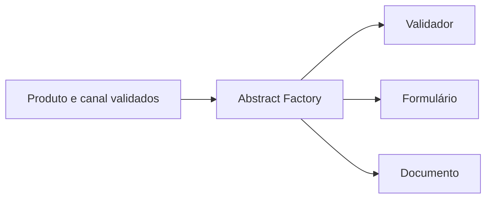
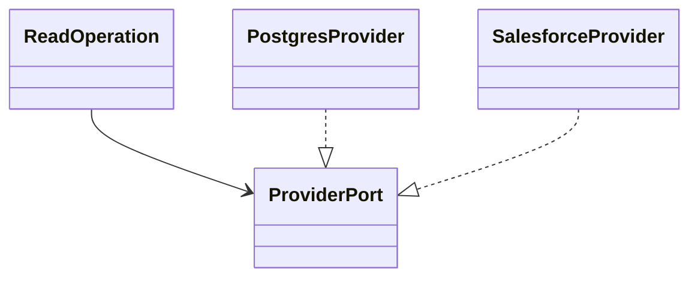
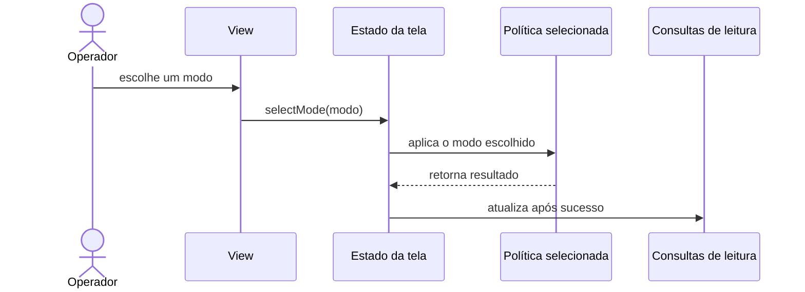

# Evidência S2 — catálogo dos 23 padrões GoF

## Escopo, composição e limites da prova

Esta nota complementa `evidence/s2-application.md`, que já descreve fluxos e símbolos do MakersHub. O preflight desta lane confirmou o worktree `/Users/augustocarollo/.superset/worktrees/architecture-engineer-expert/perfect-citizen-a30f5998`, branch `perfect-citizen-a30f5998`, commit `23d5d158d3a964dceba296296368ec14bcd8970b`. Reutilizo o catálogo em `docs/catalogos/catalogo-patterns.md`, as propostas já nomeadas em `docs/aplicado/aplicacao-makershub-40-patterns.md` e as provas citadas no pacote S2. Nenhum arquivo do MakersHub foi editado.

Os exemplos do MakersHub abaixo se limitam ao checkout local `fazcapital/makershub@e233fb046ec333982cd1547171b0f0bd8d8d92ee`, descrito no pacote S2. “Observado” significa que aquele trecho foi lido; não significa que o padrão explica o sistema inteiro. “Proposta” é exercício, não código entregue nem regra de negócio aprovada. Não fiz uma varredura global do MakersHub em busca de todos os padrões GoF.

Para cada conceito, o link **Base** aponta uma API oficial ou biblioteca que fornece um mecanismo útil; essa API, sozinha, não prova que o aplicativo usa o padrão GoF. O link **REF** abre o código da demonstração `iluwatar/java-design-patterns`, fixado no commit `4cabb204f240240bea319605a5ffa46ded728001`. A fonte é didática, não uma aplicação financeira de produção. Não consultei nem reproduzi contagem de estrelas. Os links **Skill** apontam para arquivos de skill existentes no ambiente desta lane.

## Criação — 5 padrões

| Padrão | O que resolve e exemplo aplicado | MakersHub e limite | Base · Skill · implementação OSS REF |
|---|---|---|---|
| **Abstract Factory** | Cria uma família de objetos compatíveis. Em uma proposta financeira, uma combinação de produto e canal poderia selecionar junto o validador, o formulário e o documento corretos. | **Proposta didática:** validar primeiro com o negócio quais famílias existem. O checkout mostra serviços e repositórios de Seguros, não prova essa fábrica. Cada nova família aumenta o número de contratos. | [JAXP `DocumentBuilderFactory`](https://docs.oracle.com/en/java/javase/21/docs/api/java.xml/javax/xml/parsers/DocumentBuilderFactory.html) · [design-code-architecture](</Users/augustocarollo/.codex/skills/design-code-architecture/SKILL.md>) · [KingdomFactory.java](https://github.com/iluwatar/java-design-patterns/blob/4cabb204f240240bea319605a5ffa46ded728001/abstract-factory/src/main/java/com/iluwatar/abstractfactory/KingdomFactory.java) |
| **Builder** | Monta um objeto complexo em etapas nomeadas. Para Call Sprint, um construtor poderia reunir período, assessor e filtros opcionais antes de executar uma consulta de leitura. | **Proposta:** não alterar escrita nem regra de qualificação. O exemplo `Hero.Builder` é GoF; montar um dicionário ou uma query com vários `if`s não basta. Um builder simples pode esconder valores padrão incorretos. | [JDK `HttpRequest.Builder`](https://docs.oracle.com/en/java/javase/21/docs/api/java.net.http/java/net/http/HttpRequest.Builder.html) · [api-and-interface-design](</Users/augustocarollo/.agents/skills/api-and-interface-design/SKILL.md>) · [Hero.java](https://github.com/iluwatar/java-design-patterns/blob/4cabb204f240240bea319605a5ffa46ded728001/builder/src/main/java/com/iluwatar/builder/Hero.java) |
| **Factory Method** | Deixa uma implementação concreta decidir qual produto criar por um método definido no contrato. Isso ajuda se vários provedores precisarem criar clientes compatíveis para uma mesma operação. | **Observado:** `get_call_list_service` em `backend/app/api/v1/call_list.py:43` é uma fábrica simples por DI; não há prova de Factory Method GoF. A referência mostra `Blacksmith` com criadores concretos. Não adote subclasses quando uma função de seleção for suficiente. | [JDK `ServiceLoader.Provider`](https://docs.oracle.com/en/java/javase/21/docs/api/java.base/java/util/ServiceLoader.Provider.html) (API de criação; não prova o GoF) · [backend-layered-architecture](</Users/augustocarollo/.agents/skills/backend-layered-architecture/SKILL.md>) · [ElfBlacksmith.java](https://github.com/iluwatar/java-design-patterns/blob/4cabb204f240240bea319605a5ffa46ded728001/factory-method/src/main/java/com/iluwatar/factory/method/ElfBlacksmith.java) |
| **Prototype** | Copia um objeto-base já configurado. Um exercício seguro seria duplicar um modelo vazio de filtros de relatório, preservando configurações sem copiar dados de clientes. | **Proposta:** não há exemplo GoF comprovado no recorte S2. `Cloneable` não promete cópia profunda; identidades, listas mutáveis e credenciais exigem tratamento explícito. | [JDK `Cloneable`](https://docs.oracle.com/en/java/javase/21/docs/api/java.base/java/lang/Cloneable.html) · [code-simplification](</Users/augustocarollo/.agents/skills/code-simplification/SKILL.md>) · [HeroFactoryImpl.java](https://github.com/iluwatar/java-design-patterns/blob/4cabb204f240240bea319605a5ffa46ded728001/prototype/src/main/java/com/iluwatar/prototype/HeroFactoryImpl.java) e [Prototype.java](https://github.com/iluwatar/java-design-patterns/blob/4cabb204f240240bea319605a5ffa46ded728001/prototype/src/main/java/com/iluwatar/prototype/Prototype.java) |
| **Singleton** | Mantém uma única instância dentro de um escopo definido. Poderia servir a uma configuração imutável compartilhada por serviços de um processo. | **Proposta, sem uso observado:** um singleton de processo não coordena instâncias diferentes do MakersHub. Não o use para estado de cliente, autorização, saldo ou transação. Escopo singleton do Spring é por contêiner, não “um por empresa”. | [Spring: escopos de beans](https://docs.spring.io/spring-framework/reference/core/beans/factory-scopes.html) · [backend-concurrency-mechanics](</Users/augustocarollo/.codex/skills/backend-concurrency-mechanics/SKILL.md>) · [BillPughImplementation.java](https://github.com/iluwatar/java-design-patterns/blob/4cabb204f240240bea319605a5ffa46ded728001/singleton/src/main/java/com/iluwatar/singleton/BillPughImplementation.java) |

## Estrutura — 7 padrões

| Padrão | O que resolve e exemplo aplicado | MakersHub e limite | Base · Skill · implementação OSS REF |
|---|---|---|---|
| **Adapter** | Converte uma interface externa para o contrato que o sistema espera. Poderia traduzir campos e respostas do Salesforce antes de chegar à regra de qualificação. | **Proposta:** S2 confirma que o caminho de Salesforce de Super R1 não usa o `ApiClient` compartilhado; isso não prova que já exista Adapter. Tradução não deve esconder campos ausentes nem mudar uma intenção financeira. | [Jakarta `XmlAdapter`](https://jakarta.ee/specifications/xml-binding/4.0/apidocs/jakarta.xml.bind/jakarta/xml/bind/annotation/adapters/xmladapter) · [api-and-interface-design](</Users/augustocarollo/.agents/skills/api-and-interface-design/SKILL.md>) · [FishingBoatAdapter.java](https://github.com/iluwatar/java-design-patterns/blob/4cabb204f240240bea319605a5ffa46ded728001/adapter/src/main/java/com/iluwatar/adapter/FishingBoatAdapter.java) |
| **Bridge** | Separa duas dimensões que variam independentemente. Uma operação de leitura poderia usar fontes diferentes sem duplicar toda a operação para cada fonte. | **Proposta:** o recorte S2 não prova essa estrutura. JDBC oferece um contrato comum com drivers diferentes, uma analogia útil, mas não basta para classificar o código como Bridge. Duas interfaces sem variação real só acrescentam indireção. | [JDK `java.sql.Driver`](https://docs.oracle.com/en/java/javase/21/docs/api/java.sql/java/sql/Driver.html) · [backend-layered-architecture](</Users/augustocarollo/.agents/skills/backend-layered-architecture/SKILL.md>) · [Sword.java](https://github.com/iluwatar/java-design-patterns/blob/4cabb204f240240bea319605a5ffa46ded728001/bridge/src/main/java/com/iluwatar/bridge/Sword.java) |
| **Composite** | Permite tratar um item e um grupo de itens pelo mesmo contrato. Um exercício de interface poderia compor grupos de filtros de leitura com `AND` e `OR`. | **Proposta:** não há prova no recorte S2. A árvore deve preservar significado e ordem; não transforme a política de elegibilidade ou uma transação em árvore genérica sem contrato aprovado. | [AWT `Container`](https://docs.oracle.com/en/java/javase/21/docs/api/java.desktop/java/awt/Container.html) · [frontend-ui-engineering](</Users/augustocarollo/.agents/skills/frontend-ui-engineering/SKILL.md>) · [LetterComposite.java](https://github.com/iluwatar/java-design-patterns/blob/4cabb204f240240bea319605a5ffa46ded728001/composite/src/main/java/com/iluwatar/composite/LetterComposite.java) |
| **Decorator** | Envolve um objeto e acrescenta comportamento, mantendo o mesmo contrato. Uma medição de duração pode cercar uma chamada sem reescrever o serviço. | **Observado, com fronteira:** `backend/app/utils/performance.py:62` usa decorator Python para envolver função e preservar seu contrato. Isso é um wrapper funcional comparável; a sintaxe `@` sozinha não prova o Decorator GoF. Evite alterar sem querer erros, ordem ou efeitos. | [JDK `FilterInputStream`](https://docs.oracle.com/en/java/javase/21/docs/api/java.base/java/io/FilterInputStream.html) · [code-simplification](</Users/augustocarollo/.agents/skills/code-simplification/SKILL.md>) · [ClubbedTroll.java](https://github.com/iluwatar/java-design-patterns/blob/4cabb204f240240bea319605a5ffa46ded728001/decorator/src/main/java/com/iluwatar/decorator/ClubbedTroll.java) |
| **Facade** | Oferece uma entrada simples para coordenar várias partes. A tela de Seguros poderia chamar uma interface única que organiza as consultas já necessárias à página. | **Observado como forma semelhante:** `InsuranceDataManager.getAllInsuranceData`, em `frontend/app/_data/InsuranceDataManager.tsx:406`, coordena 11 chamadas; isso não classifica o sistema inteiro como GoF Facade. A fachada deve manter falhas e origem dos dados visíveis. | [FastAPI: aplicações maiores](https://fastapi.tiangolo.com/tutorial/bigger-applications/) · [backend-layered-architecture](</Users/augustocarollo/.agents/skills/backend-layered-architecture/SKILL.md>) · [DwarvenGoldmineFacade.java](https://github.com/iluwatar/java-design-patterns/blob/4cabb204f240240bea319605a5ffa46ded728001/facade/src/main/java/com/iluwatar/facade/DwarvenGoldmineFacade.java) |
| **Flyweight** | Compartilha dados imutáveis repetidos para economizar memória. Uma tabela grande poderia reutilizar descrições estáticas de status, sem guardar uma cópia por linha. | **Proposta:** não há medição de repetição ou memória no recorte S2. Não compartilhe estado mutável, escopo de acesso, valores de cliente ou dados financeiros entre registros. | [JDK `String.intern`](https://docs.oracle.com/en/java/javase/21/docs/api/java.base/java/lang/String.html#intern()) · [backend-concurrency-mechanics](</Users/augustocarollo/.codex/skills/backend-concurrency-mechanics/SKILL.md>) · [PotionFactory.java](https://github.com/iluwatar/java-design-patterns/blob/4cabb204f240240bea319605a5ffa46ded728001/flyweight/src/main/java/com/iluwatar/flyweight/PotionFactory.java) |
| **Proxy** | Mantém o mesmo contrato de um serviço, mas controla o acesso antes de encaminhar a chamada. Um proxy de leitura poderia aplicar autorização ou cache diante de uma consulta de KPI. | **Observado apenas como comparação:** a rota de KPI de Seguros consulta cache e aplica TTL de 300 segundos em `backend/app/api/v1/insurance.py:46,67`; cache nessa rota não prova Proxy GoF. Cache não pode contornar autorização nem servir dado vencido como atual. | [JDK `Proxy`](https://docs.oracle.com/en/java/javase/21/docs/api/java.base/java/lang/reflect/Proxy.html) · [api-and-interface-design](</Users/augustocarollo/.agents/skills/api-and-interface-design/SKILL.md>) · [WizardTowerProxy.java](https://github.com/iluwatar/java-design-patterns/blob/4cabb204f240240bea319605a5ffa46ded728001/proxy/src/main/java/com/iluwatar/proxy/WizardTowerProxy.java) |

## Comportamento — 11 padrões

| Padrão | O que resolve e exemplo aplicado | MakersHub e limite | Base · Skill · implementação OSS REF |
|---|---|---|---|
| **Chain of Responsibility** | Passa uma solicitação por verificações independentes até uma aceitar ou recusar. Uma proposta de qualificação pode validar campos obrigatórios, permissão e elegibilidade antes de seguir. | **Proposta:** o dispatcher de Super R1 seleciona ramos em `qualify_service.py:2030`; isso não prova uma cadeia de handlers. A ordem importa, e nenhuma gravação deve começar antes das validações obrigatórias. | [Jakarta `FilterChain`](https://jakarta.ee/specifications/servlet/6.0/apidocs/jakarta.servlet/jakarta/servlet/filterchain) · [api-and-interface-design](</Users/augustocarollo/.agents/skills/api-and-interface-design/SKILL.md>) · [OrcOfficer.java](https://github.com/iluwatar/java-design-patterns/blob/4cabb204f240240bea319605a5ffa46ded728001/chain-of-responsibility/src/main/java/com/iluwatar/chain/OrcOfficer.java) |
| **Command** | Empacota uma ação e seus dados para que outro componente possa executá-la. Uma intenção `QualifyLead` poderia separar o pedido HTTP do tratamento do caso de uso. | **Proposta:** `post_qualify` encaminha a chamada a `run_qualify`, em `backend/app/api/v1/super_r1.py:405,422`; não prova um objeto Command. O wrapper deve preservar a transação e a idempotência existentes. | [JDK `Runnable`](https://docs.oracle.com/en/java/javase/21/docs/api/java.base/java/lang/Runnable.html) · [backend-layered-architecture](</Users/augustocarollo/.agents/skills/backend-layered-architecture/SKILL.md>) · [Wizard.java](https://github.com/iluwatar/java-design-patterns/blob/4cabb204f240240bea319605a5ffa46ded728001/command/src/main/java/com/iluwatar/command/Wizard.java) |
| **Interpreter** | Representa uma gramática pequena como objetos que avaliam partes de uma expressão. Um exercício de relatório poderia interpretar filtros de leitura aprovados, como `período E assessor`. | **Proposta:** não há linguagem de regras comprovada no recorte. Não interprete critérios financeiros inventados; uma gramática própria exige validação, limites e proteção contra consultas amplas. | [JDK `Pattern`](https://docs.oracle.com/en/java/javase/21/docs/api/java.base/java/util/regex/Pattern.html) · [design-code-architecture](</Users/augustocarollo/.codex/skills/design-code-architecture/SKILL.md>) · [PlusExpression.java](https://github.com/iluwatar/java-design-patterns/blob/4cabb204f240240bea319605a5ffa46ded728001/interpreter/src/main/java/com/iluwatar/interpreter/PlusExpression.java) |
| **Iterator** | Percorre uma coleção sem expor como ela armazena os itens. Uma exportação de Call Sprint poderia ler páginas de resultados sem carregar a lista inteira na memória. | **Proposta:** a consulta de Call Sprint agrega linhas em `backend/app/repositories/call_list_repo.py:140,211`; isso não prova um iterator GoF. Paginação precisa manter ordenação e lidar com novas linhas durante a leitura. | [JDK `Iterator`](https://docs.oracle.com/en/java/javase/21/docs/api/java.base/java/util/Iterator.html) · [backend-layered-architecture](</Users/augustocarollo/.agents/skills/backend-layered-architecture/SKILL.md>) · [TreasureChestItemIterator.java](https://github.com/iluwatar/java-design-patterns/blob/4cabb204f240240bea319605a5ffa46ded728001/iterator/src/main/java/com/iluwatar/iterator/list/TreasureChestItemIterator.java) |
| **Mediator** | Um coordenador recebe ações e organiza a conversa entre componentes que não devem conhecer uns aos outros. Uma tela de Call Sprint poderia coordenar sua janela e o seletor de modo. | **Comparação observada:** `useCallLifecycle` é compartilhado pela página e pela janela (`page.tsx:111`, `window/page.tsx:86`), mas um hook compartilhado não é automaticamente Mediator. Um mediador central pode virar um ponto único difícil de manter. | [React Context](https://react.dev/learn/passing-data-deeply-with-context) · [frontend-ui-engineering](</Users/augustocarollo/.agents/skills/frontend-ui-engineering/SKILL.md>) · [PartyImpl.java](https://github.com/iluwatar/java-design-patterns/blob/4cabb204f240240bea319605a5ffa46ded728001/mediator/src/main/java/com/iluwatar/mediator/PartyImpl.java) |
| **Memento** | Guarda um retrato privado para restaurar um estado depois. Uma tela poderia recuperar filtros ao voltar de um detalhe para a lista. | **Proposta:** não há memento comprovado. Recuperar filtros de interface não cria trilha de auditoria financeira; snapshots podem carregar dados pessoais e precisam de escopo e expiração. | [Swing `UndoManager`](https://docs.oracle.com/en/java/javase/21/docs/api/java.desktop/javax/swing/undo/UndoManager.html) · [frontend-ui-engineering](</Users/augustocarollo/.agents/skills/frontend-ui-engineering/SKILL.md>) · [Star.java](https://github.com/iluwatar/java-design-patterns/blob/4cabb204f240240bea319605a5ffa46ded728001/memento/src/main/java/com/iluwatar/memento/Star.java) |
| **Observer** | Notifica interessados quando algo muda, sem o produtor chamar cada tela diretamente. Depois de qualificar um lead, telas de leitura podem atualizar suas consultas. | **Observado como comportamento relacionado:** `useLeads.ts:330,340` chama a mutação e invalida cinco famílias React Query. Isso é invalidação de cache reativa, não prova de um objeto Observer GoF. Só notifique após o resultado confirmado. | [JDK `Flow`](https://docs.oracle.com/en/java/javase/21/docs/api/java.base/java/util/concurrent/Flow.html) · [frontend-ui-engineering](</Users/augustocarollo/.agents/skills/frontend-ui-engineering/SKILL.md>) · [Weather.java](https://github.com/iluwatar/java-design-patterns/blob/4cabb204f240240bea319605a5ffa46ded728001/observer/src/main/java/com/iluwatar/observer/Weather.java) |
| **State** | Muda o comportamento conforme um estado explícito. O seletor Manual/Automático pode responder de modo claro quando uma opção já está ativa. | **Observado:** o hook `useCallLifecycle.ts:76,139` guarda estado e ações; isso não prova classes de estado GoF. O patch histórico `a55d4d4a` protege a escolha do modo ativo, mas pertence a outro commit. Estados redundantes criam transições impossíveis. | [Spring `StateContext`](https://docs.spring.io/spring-statemachine/docs/current/api/org/springframework/statemachine/StateContext.html) · [frontend-ui-engineering](</Users/augustocarollo/.agents/skills/frontend-ui-engineering/SKILL.md>) · [Mammoth.java](https://github.com/iluwatar/java-design-patterns/blob/4cabb204f240240bea319605a5ffa46ded728001/state/src/main/java/com/iluwatar/state/Mammoth.java) |
| **Strategy** | Troca um algoritmo por outro por meio do mesmo contrato. Uma operação poderia escolher uma implementação de roteamento sem misturar os algoritmos no dispatcher. | **Comparação observada:** `qualify_service.py:2030,1630` seleciona o ramo D+1; o recorte não prova estratégias intercambiáveis. Extraia Strategy só se as alternativas tiverem contrato e efeitos compatíveis; não esconda regras de elegibilidade. | [JDK `Comparator`](https://docs.oracle.com/en/java/javase/21/docs/api/java.base/java/util/Comparator.html) · [design-code-architecture](</Users/augustocarollo/.codex/skills/design-code-architecture/SKILL.md>) · [DragonSlayer.java](https://github.com/iluwatar/java-design-patterns/blob/4cabb204f240240bea319605a5ffa46ded728001/strategy/src/main/java/com/iluwatar/strategy/DragonSlayer.java) |
| **Template Method** | Define a ordem estável de um processo e deixa etapas específicas para subclasses. Um exercício de exportação poderia fixar validar, buscar, formatar e registrar resultado. | **Proposta:** S2 não encontra essa sequência abstrata no fluxo de Seguros. Herança pode forçar fontes diferentes ao mesmo processo; composição costuma bastar quando as etapas realmente variam. | [JDK `AbstractList`](https://docs.oracle.com/en/java/javase/21/docs/api/java.base/java/util/AbstractList.html) · [backend-layered-architecture](</Users/augustocarollo/.agents/skills/backend-layered-architecture/SKILL.md>) · [StealingMethod.java](https://github.com/iluwatar/java-design-patterns/blob/4cabb204f240240bea319605a5ffa46ded728001/template-method/src/main/java/com/iluwatar/templatemethod/StealingMethod.java) |
| **Visitor** | Adiciona operações a uma estrutura de tipos estável, deixando cada tipo receber a visita. Uma saída analítica poderia formatar Lead, Account e Opportunity sem pôr a formatação em cada modelo. | **Proposta:** classificar um ID e abrir ramos não é Visitor. S2 descreve esse tratamento como mudança histórica em outro commit, não como prova do checkout. Cada tipo novo exige atualizar os visitantes e pode quebrar uma estrutura aberta. | [JavaParser `GenericVisitorAdapter.java`](https://github.com/javaparser/javaparser/blob/c4fb5365836e8c5a579687c9a78251059d489d47/javaparser-core/src/main/java/com/github/javaparser/ast/visitor/GenericVisitorAdapter.java) · [code-simplification](</Users/augustocarollo/.agents/skills/code-simplification/SKILL.md>) · [UnitVisitor.java](https://github.com/iluwatar/java-design-patterns/blob/4cabb204f240240bea319605a5ffa46ded728001/visitor/src/main/java/com/iluwatar/visitor/UnitVisitor.java) e [Soldier.java](https://github.com/iluwatar/java-design-patterns/blob/4cabb204f240240bea319605a5ffa46ded728001/visitor/src/main/java/com/iluwatar/visitor/Soldier.java) |

## Três diagramas propostos

Os três diagramas são exercícios de ensino. Eles não descrevem a topologia implementada no MakersHub nem autorizam mudança de produto ou regra financeira.

### 1. Abstract Factory para uma família compatível de artefatos

### 2. Bridge para separar operação e provedor

### 3. State, Strategy e atualização de tela no seletor Manual/Automático

## Conclusão da lane

O catálogo cobre 5 padrões de criação, 7 estruturais e 11 comportamentais. Os exemplos observados no MakersHub são analogias explicitamente limitadas; as demais aplicações permanecem propostas. Os 23 links `REF` levam a arquivos de implementação no commit fixado e não são alegações de uso em produção. Esta lane não alterou código do MakersHub, não remodelou transações, não executou testes e não publicou nada.
