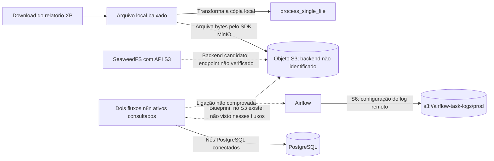
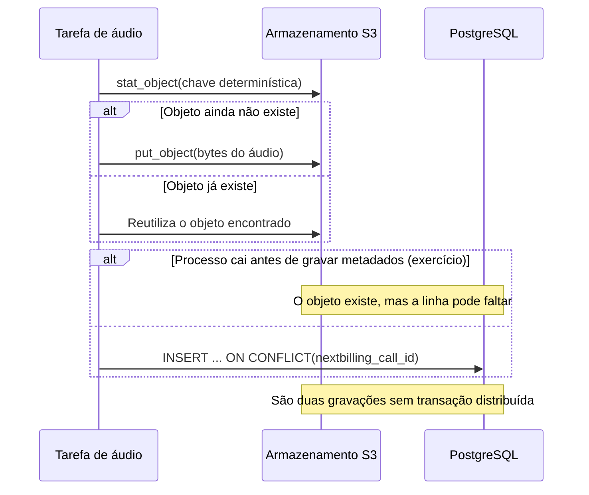

# EVIDENCE_PACKET — objetos e integrações

## Escopo e decisão

Este pacote complementa S3, S6 e L3A no checkout `perfect-citizen-a30f5998`, SHA `23d5d158d3a964dceba296296368ec14bcd8970b`. Ele fecha somente cinco relações e registra a falha entre upload de áudio e metadados como exercício sintético. Os arquivos de Airflow citados abaixo são os snapshots lidos em S3/S6; eles não provam uma execução atual. A consulta ao n8n foi somente leitura por `search_workflows` e `get_workflow_details`; nenhum fluxo foi executado e nenhum parâmetro de conexão, credencial, payload ou objeto privado foi processado.

## Cinco relações com evidência

1. **Download XP → arquivamento em objeto.** O snapshot de `toolkit/faz_consulting_scraping_portfolio_positions_headless/processor.py` mostra `upload_files_to_minio` guardando os bytes originais sob `holdings_reports/{report_type}/{date}/{file_name}`. O SHA-256 registrado para o arquivo é `dbb158f6a35fddb5135a23affd11e3baaea71adccd43542749d3f839ab357b16`; o endpoint efetivo não foi identificado, então “MinIO” nomeia o SDK usado, não necessariamente o servidor. Ver [S3, caso XP](s3-airflow.md#L27-L35) e o [código do SDK MinIO](https://github.com/minio/minio-py/blob/master/minio/minio.py#L3750).

2. **Arquivo local → transformação.** No mesmo `process_downloaded_files_scoped`, o arquivo baixado é arquivado e `process_single_file` transforma a cópia local. Não há prova de que a transformação leia o objeto de volta; portanto, o replay a partir do bucket permanece uma proposta. Ver [L3A, mapa XP](l3a-workflow.md#L40-L42) e [S3, caso XP](s3-airflow.md#L27-L35).

3. **Áudio → objeto → metadados PostgreSQL.** O snapshot da DAG `recordings__nextbilling__api_to_stg__audio.py` registra `stat_object`/`put_object` para o áudio e depois `load_metadata` com `ON CONFLICT(nextbilling_call_id)` em `public.fct_minio__call`. A chave estável ajuda uma repetição a reencontrar o objeto e evitar uma linha duplicada, mas objeto e linha vivem em sistemas diferentes e não formam uma transação única; o endpoint real continua desconhecido. Ver [S3, caso de áudio](s3-airflow.md#L37-L43), [SDK MinIO](https://github.com/minio/minio-py/blob/master/minio/minio.py#L4560) e [Airflow S3Hook](https://github.com/apache/airflow/blob/main/providers/amazon/src/airflow/providers/amazon/aws/hooks/s3.py#L164-L221), cujo código usa boto3 e aceita um endpoint de serviço pela configuração da conexão.

4. **SeaweedFS → interface S3.** O código do comando `weed s3` declara que inicia um servidor compatível com a API S3 apoiado por filer. Isso permite desenhar SeaweedFS como backend candidato para um cliente S3; não prova que o endpoint usado pelas DAGs XP/áudio aponta para SeaweedFS, nem que todos os recursos S3 necessários foram verificados. Ver [SeaweedFS `s3.go`](https://github.com/seaweedfs/seaweedfs/blob/master/weed/command/s3.go#L137-L139) e [S6, fonte e limites](s6-platform.md#L23-L25).

5. **n8n → PostgreSQL; MinIO/Airflow ainda sem ligação comprovada.** Entre `[2026-10-14 16:58:15 UTC]` e `[2026-10-14 16:58:16 UTC]`, `search_workflows(query=MinIO)`, `search_workflows(query=S3)` e `search_workflows(query=Airflow)` devolveram `count=0` cada; `get_workflow_details` mostrou `Meta - Formulário Nativo` e `Meta - Landing Page` como `active=true`, cada uma com três nós `n8n-nodes-base.postgres` e arestas conectadas. Nenhuma tinha nó explícito S3/MinIO/Airflow; há nós HTTP Request cujos destinos não foram examinados. O código aberto do n8n oferece um nó S3 genérico que menciona MinIO, mas ele não apareceu nesses dois fluxos. S6 mediu separadamente Airflow com log remoto `s3://airflow-task-logs/prod` às `16:11 UTC`; isso não identifica o backend como MinIO/SeaweedFS nem conecta n8n ao Airflow. Ver [código do nó S3 n8n](https://github.com/n8n-io/n8n/blob/master/packages/nodes-base/nodes/S3/S3.node.ts#L29-L45), [código da operação PostgreSQL](https://github.com/n8n-io/n8n/blob/master/packages/nodes-base/nodes/Postgres/v2/actions/database/executeQuery.operation.ts#L22-L55) e [S6, log remoto](s6-platform.md#L23-L25).

## Mapa das relações observadas e das propostas

## História curta: objeto gravado, linha ausente

Imagine um exercício com o identificador inventado `CALL-SYNTH-001`. A DAG termina o upload do áudio, mas o processo cai antes de gravar seus metadados. O arquivo existe no armazenamento; a consulta que procura a chamada não encontra uma linha em `public.fct_minio__call`. A pessoa que atende pensa que a gravação sumiu, embora ainda exista um objeto sem referência consultável. Esse é um cenário didático, não um incidente observado.

Como blueprint financeiro explícito, uma evolução poderia gravar primeiro uma linha `pending` com chave determinística, enviar o objeto e então mudar a linha para `available`, guardando checksum e tamanho. Uma rotina de reconciliação poderia retomar linhas pendentes e sinalizar objetos sem referência. Isso adiciona estados e trabalho de reconciliação, e ainda não cria uma transação única entre S3 e PostgreSQL. Esse fluxo não foi encontrado no código atual.

## Código aberto para reaproveitar como referência

| Código-fonte primário | Reuso confirmado pelo código | Limite da evidência |
|---|---|---|
| [MinIO Python SDK](https://github.com/minio/minio-py/blob/master/minio/minio.py#L3750) e [README do SDK](https://github.com/minio/minio-py/blob/master/README.md) | Implementa operações S3 como `put_object` e `stat_object`; o README descreve uso com serviços compatíveis com S3. | Não prova qual servidor atende o endpoint deste ambiente. |
| [SeaweedFS S3 server](https://github.com/seaweedfs/seaweedfs/blob/master/weed/command/s3.go#L137-L139) | Implementa o serviço S3 apoiado por filer. | A compatibilidade da instalação real não foi testada. |
| [Nós S3 e PostgreSQL do n8n](https://github.com/n8n-io/n8n/blob/master/packages/nodes-base/nodes/S3/S3.node.ts#L29-L45) e [Postgres execute query](https://github.com/n8n-io/n8n/blob/master/packages/nodes-base/nodes/Postgres/v2/actions/database/executeQuery.operation.ts#L22-L55) | O aplicativo inclui um nó S3 para serviços compatíveis, incluindo MinIO, e um nó que executa SQL PostgreSQL. | A capacidade do produto não prova configuração nos fluxos consultados. |
| [Apache Airflow S3Hook](https://github.com/apache/airflow/blob/main/providers/amazon/src/airflow/providers/amazon/aws/hooks/s3.py#L164-L221) | O hook usa boto3 e encaminha um `endpoint_url` da conexão ao cliente S3. | O `s3://` medido no scheduler não identifica o provedor configurado. |
| [Macro incremental do dbt](https://github.com/dbt-labs/dbt-adapters/blob/main/dbt-adapters/src/dbt/include/global_project/macros/materializations/models/incremental/is_incremental.sql#L2-L11) e [documentação de modelos incrementais](https://github.com/dbt-labs/docs.getdbt.com/blob/current/website/docs/docs/build/incremental-models.md) | A macro só ativa a condição incremental quando a relação é tabela, o modelo é incremental e não há full refresh. | O filtro de linhas continua sendo responsabilidade do modelo SQL; a macro não garante exatamente uma execução. |

Os links de GitHub usam referências de branch e podem mudar. Eles apontam para código de projetos abertos e sustentam a comparação de capacidades; não demonstram qual versão está instalada nem o que está implantado. Nenhum payload de cliente, credencial ou objeto privado foi consultado.
