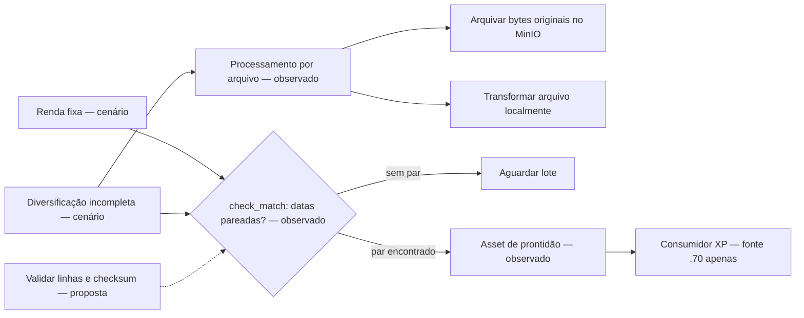
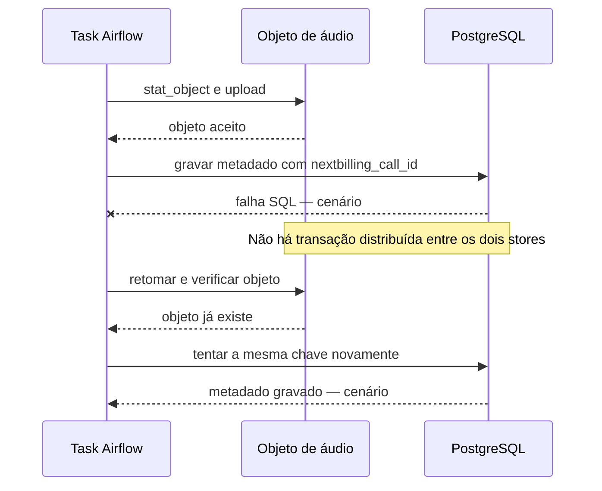
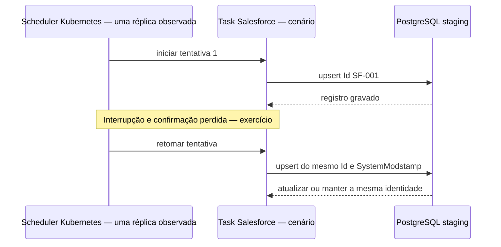
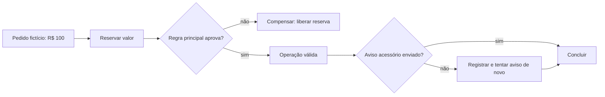

# EVIDENCE_PACKET — quatro histórias de recuperação

Este material descreve mecanismos observados e exercícios fictícios. Em 14/10/2026, cinco arquivos tinham o mesmo hash no disco `.70` e no scheduler Kubernetes: as DAGs Salesforce, XP e áudio, `toolkit/salesforce/factory.py` e o processor XP. Isso prova igualdade desses cinco arquivos, não execução recente. O scheduler Kubernetes medido usava Airflow 3.2.2, `LocalExecutor`, paralelismo 32, uma réplica e estratégia `Recreate`; o container `.70` usava o mesmo executor com paralelismo 5. A DAG consumidora XP, a DAG consumidora de Salesforce e `dbt/models/facts/fct_salesforce__calls.sql` foram lidos apenas em `.70`; não há paridade deles demonstrada. Nenhum cenário abaixo foi executado.

## 1. XP: um relatório chega incompleto

**Antes.** Imagine que os relatórios de renda fixa e diversificação tenham a mesma data, mas o segundo tenha linhas faltando. O código observado arquiva cada arquivo original no MinIO e transforma o arquivo baixado localmente. A DAG XP verifica se há datas pareadas antes de publicar o Asset `dataset://xp_consolidated_positions_ready`. A evidência mostra o teste de pareamento por data; ela não mostra validação de linhas, checksum ou completude do arquivo. Portanto, um par de datas não prova que o conteúdo esteja completo.

**Depois.** No exercício, uma validação explícita de completude entra antes da publicação do Asset. A DAG consumidora só pode começar quando o lote passa pelo pareamento e pela validação proposta. O Asset informa prontidão a outro fluxo; não é um log de eventos nem uma agregação de valores.

**Consequência e moral.** Esperar reduz o risco de calcular uma visão parcial, mas atrasa o lote quando falta um relatório. O processamento observado por arquivo se parece com dividir o trabalho em partes; não prova paralelismo nem um padrão Splitter instalado. `check_match` é uma barreira Fan-in, não um Aggregator. Somar os dois relatórios seria um Aggregator do exercício, não uma função comprovada da DAG.

## 2. Áudio: o objeto foi enviado, mas os metadados falharam

**Antes.** A DAG observada encadeia download/upload do áudio e gravação dos metadados. O upload consulta `stat_object` antes de enviar bytes; a gravação usa `ON CONFLICT(nextbilling_call_id)` no PostgreSQL. Se o objeto foi aceito e a escrita SQL falhou, o áudio existe, mas a consulta ainda não consegue encontrá-lo pela linha de metadados. São dois sistemas e não há uma transação que confirme ambos de uma vez.

**Depois.** No exercício, a mesma tentativa é retomada com a mesma chave. A etapa de upload reconhece o objeto que já existe e a etapa SQL tenta novamente a chave estável. Uma pequena máquina de estados ajuda a pensar: `ausente → objeto presente → metadado presente`. Esse desenho explica a recuperação; o código observado não persiste essa máquina como estado próprio.

**Consequência e moral.** Reaproveitar o objeto evita enviá-lo outra vez; a chave de conflito permite tratar a repetição do metadado. Apagar o áudio como “compensação” poderia destruir um arquivo válido. Primeiro tente concluir para a frente. Airflow coordena as tasks observadas; Temporal é uma referência para workflows duráveis, sem evidência de implantação aqui.

## 3. Uma task se repete durante a retomada do scheduler

**Antes.** O scheduler Kubernetes medido tinha uma réplica e `Recreate`; uma troca pode interromper o agendamento até a nova réplica estar pronta. Isso não prova que reiniciar o scheduler repita uma task. No exercício, uma task Salesforce grava o registro sintético `SF-001`, perde a confirmação de conclusão durante uma interrupção e é tentada de novo.

**Depois.** A carga observada usa o `Id` do Salesforce como chave de upsert e compara `SystemModstamp`. A segunda tentativa reutiliza a mesma identidade do registro. Isso reduz duplicatas nessa carga; não prova “exactly once” para todos os efeitos externos. A proposta de teste deve simular a repetição sem tocar no ambiente real.

**Consequência e moral.** Airflow fornece a DAG e o scheduler coordena; cada task executa um passo. A DAG consumidora lida apenas em `.70` usa Cosmos `DbtDag` para mapear o projeto dbt em tasks, e dbt define o modelo SQL. Não há paridade Kubernetes demonstrada para essa DAG ou modelo. Temporal serve como comparação para um workflow que precisa guardar progresso por muito tempo; não é o executor medido. A reinicialização é o contexto do exercício, e a repetição é uma falha injetada, não uma consequência automática comprovada.

## 4. Saga: uma reserva válida e um aviso acessório falha

**Antes.** Imagine um pedido fictício de R$ 100. A reserva financeira foi aprovada, mas o envio de um aviso acessório falhou. Um tratamento que compensa qualquer falha liberaria a reserva e cancelaria uma operação válida só porque o aviso atrasou.

**Depois.** A Saga separa a regra principal do aviso. Se a reserva e a decisão de negócio forem válidas, a operação permanece válida; o aviso fica registrado para nova tentativa. Se uma regra principal rejeitar o pedido depois da reserva, a Saga envia uma nova ação de negócio para liberar o valor. Compensação não apaga o passado nem é rollback de banco: ela corrige um efeito que deixou de ser desejado.

**Consequência e moral.** A orquestração torna claro quem decide o avanço e em que condição a compensação acontece. Temporal é uma base para estudar workflow durável; o exemplo OSS Eventuate `CreateOrderSaga.java` mostra etapas e uma compensação explícita. Ambos são referências, não serviços implantados neste ambiente. Airflow, Cosmos e dbt aparecem nos fluxos analíticos observados, não como prova de execução desta reserva.

## Fontes e limites

Os caminhos observados, horários, hashes e medições estão em [S3 — Airflow e objetos](s3-airflow.md#L27-L42), [S6 — paridade e scheduler](s6-platform.md#L3-L7) e [S6 — cinco arquivos reconciliados](s6-platform.md#L33-L45). O mapa de papéis e referências está em [L3A — workflows](l3a-workflow.md#L9-L44). Fontes oficiais já verificadas nesse pacote: [Airflow DAG Runs](https://airflow.apache.org/docs/apache-airflow/3.2.2/core-concepts/dag-run.html), [Airflow Assets](https://airflow.apache.org/docs/apache-airflow/3.2.2/authoring-and-scheduling/assets.html), [dbt incremental models](https://docs.getdbt.com/docs/build/incremental-models) e [Temporal](https://docs.temporal.io/temporal). A aplicação OSS Eventuate usada como referência está em [`CreateOrderSaga.java`](../../../references/repos/eventuate-tram-sagas/orders-and-customers/src/main/java/io/eventuate/examples/tram/sagas/ordersandcustomers/orders/sagas/createorder/CreateOrderSaga.java#L24-L59). Nenhum desses links prova implantação do produto correspondente no cluster.
