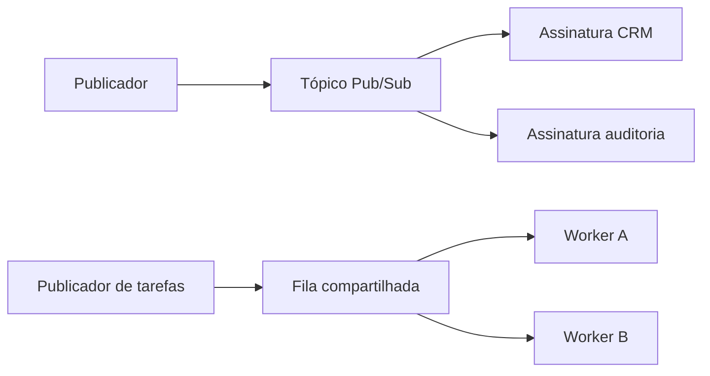
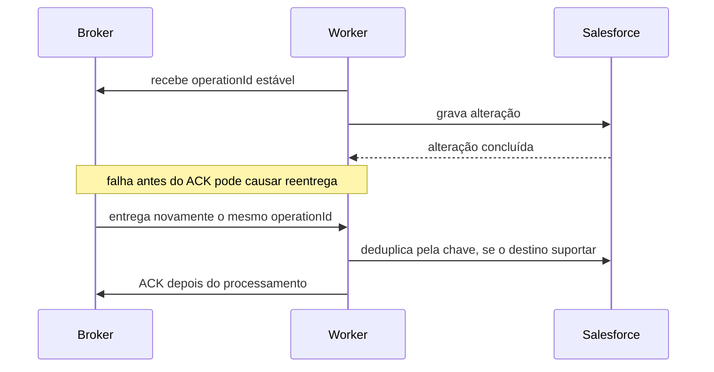
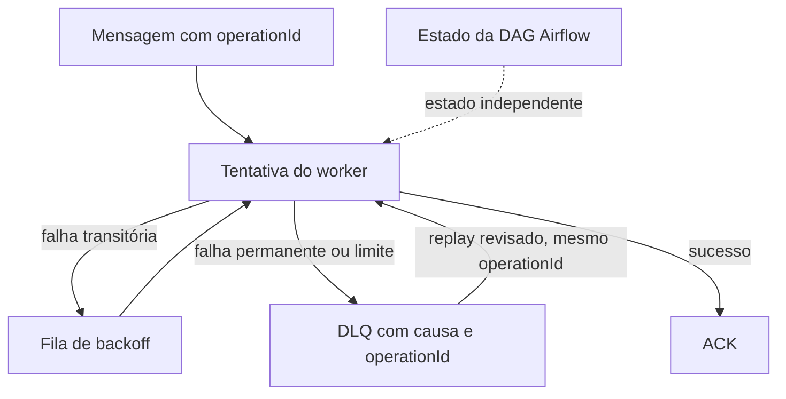

# L4B — evidência para mensageria

## Escopo e proveniência

Cobertura: as 25 linhas de “Event-driven / Messaging” em tasks/architecture-course-2026-10-14/evidence/coverage.json e docs/catalogos/catalogo-patterns.md. Checkout: branch perfect-citizen-a30f5998, SHA 23d5d158d3a964dceba296296368ec14bcd8970b. A página prevista content/referencia/catalogo/03-event-driven-messaging.mdx não existe; este arquivo é evidência, não MDX publicado.

Os arquivos em references/repos/ são código presente neste checkout, mas sem SHA upstream registrado. Watermill, Eventuate, Wild Workouts e EventSourcing.NetCore são referências didáticas (REF). Superset é produto OSS com workers Celery, sem prova de implantação viva. Não repito estrelas do snapshot L6B.

A aplicação de caso é uma proposta didática baseada na leitura anterior de S4: o caminho de reatribuição grava a sinalização sf_owner_sync_pending e um histórico; S4 não encontrou prova de broker implantado. Portanto, “evento de troca de responsável” abaixo é um exemplo de desenho, não um mecanismo observado no MakersHub.

## Skills existentes reutilizáveis

Os nomes e arquivos abaixo existem no ambiente. São instruções de trabalho, não prova de implementação:

- **MQ —** ~/.agents/skills/backend-message-queue/SKILL.md, versão 2.0.0.
- **DS —** ~/.agents/skills/data-streaming/SKILL.md, versão 1.0.0.
- **ID —** ~/.agents/skills/backend-idempotency/SKILL.md, versão 2.0.0.
- **RP —** ~/.agents/skills/backend-resilience-patterns/SKILL.md, versão 2.0.0.

Limite “exactly-once” à fronteira provada: a transação pode tornar consumo e escrita atômicos no mesmo banco; ACK não torna atômica uma escrita externa. A skill MQ usa formulações mais amplas; declare essa fronteira.

## Grupo 3 — 25 conceitos

Cada definição tem um caso e um limite. “Código” aponta para a pasta ou arquivo específico encontrado no corpus; “gap” marca quando a amostra próxima não demonstra o padrão.

| # | Conceito | Definição, caso e limite em uma frase | Base e código OSS | Skill |
|---:|---|---|---|---|
| 1 | Publish/Subscribe | Uma publicação é entregue a assinaturas independentes; CRM e auditoria poderiam receber o evento de reatribuição, mas a amostra Watermill usa Redis Streams e não prova Pub/Sub volátil. | [Spring Integration — core messaging](https://docs.spring.io/spring-integration/reference/core.html); [Watermill consumer groups](../../../references/repos/watermill/_examples/real-world-examples/consumer-groups); [Redis Pub/Sub: at-most-once](https://redis.io/docs/latest/develop/pubsub/) | MQ |
| 2 | Message Queue | Uma fila mantém trabalho para consumidores que o retiram e confirmam; o exemplo AMQP configura fila durável, mas não demonstra persistência de cada mensagem nem confirmação do produtor. | RabbitMQ/AMQP; [Watermill AMQP sample](../../../references/repos/watermill/_examples/pubsubs/amqp/main.go) declara “simple queue” | MQ |
| 3 | Competing Consumers | Consumidores concorrentes dividem mensagens da mesma fila; o Compose do Superset define um worker Celery com concorrência 2, mas isso é configuração do repositório, não contagem de workers em produção. | Celery; [Superset docker-compose.yml](https://github.com/apache/superset/blob/master/docker-compose.yml#L1241-L1280) e [configuração de Alerts/Reports](https://github.com/apache/superset/blob/master/docs/admin_docs/configuration/alerts-reports.mdx#L391-L446) | MQ |
| 4 | Producer/Consumer | Um produtor envia e um consumidor processa depois; o exemplo Watermill publica em um tópico e registra handlers, mas o sucesso do publish não significa que o efeito de negócio terminou. | Watermill; [basic router sample](../../../references/repos/watermill/_examples/basic/3-router/main.go) | MQ |
| 5 | Request/Reply | O solicitante espera uma resposta ligada à mesma operação; o pacote Watermill correlaciona comando e resposta por OperationID, mas timeout não prova que o comando foi cancelado. | Watermill; [request/reply package](../../../references/repos/watermill/components/requestreply) | MQ, ID |
| 6 | Fire-and-Forget | O chamador publica sem esperar resposta de negócio; a notificação Watermill segue esse formato, embora o publicador ainda verifique e devolva erro de publicação. | Watermill; [NotifyMiddleware](../../../references/repos/watermill/_examples/real-world-examples/consumer-groups/common/messaging.go) | MQ |
| 7 | Fan-out | Uma ocorrência alcança vários destinos independentes; o exemplo separa handlers de CRM e newsletter, enquanto consumidores que dividem uma fila não recebem cada um uma cópia. | Watermill; [consumer-groups sample](../../../references/repos/watermill/_examples/real-world-examples/consumer-groups) | MQ |
| 8 | Fan-in | Mensagens de vários tópicos são multiplexadas em um destino; o componente Watermill copia cada entrada para o tópico final, mas não espera todas nem agrega conteúdo. | Watermill; [FanIn implementation](../../../references/repos/watermill/components/fanin/fanin.go) | MQ |
| 9 | Message Router | Um roteador escolhe o canal de saída conforme uma regra; Spring Integration documenta routers e o exemplo Watermill registra handlers por tópico, mas esse exemplo não é roteamento por conteúdo. | Spring Integration; [message routing](https://docs.spring.io/spring-integration/reference/message-routing.html); [Watermill router sample](../../../references/repos/watermill/_examples/basic/3-router/main.go) | MQ |
| 10 | Content-Based Router | A rota é escolhida pelo conteúdo, como encaminhar uma solicitação conforme sua pontuação; o sample oficial loan-broker ilustra a escolha, mas o corpus local não contém sua pasta de aplicação. | Spring Integration; [samples — loan broker, roteador e agregador](https://docs.spring.io/spring-integration/reference/samples.html); **gap:** sem pasta do sample no checkout | MQ |
| 11 | Message Filter | Um filtro deixa passar ou descarta uma mensagem conforme predicado; uma proposta poderia selecionar apenas sincronizações pendentes, mas o corpus não tem aplicação executável desse filtro nem política observada para descarte. | Spring Integration; [message routing / Filter](https://docs.spring.io/spring-integration/reference/message-routing.html); **gap:** sem pasta de app no snapshot | MQ |
| 12 | Message Translator | Um tradutor converte o contrato da mensagem entre sistemas; mapear OwnerId do Salesforce para chave interna seria um caso, mas S4 não confirmou que essas identidades correspondem. | Spring Integration; [core messaging](https://docs.spring.io/spring-integration/reference/core.html); **gap:** sem tradutor aplicado no código selecionado | MQ |
| 13 | Message Enricher | Um enriquecedor acrescenta contexto verificado antes do próximo passo; uma mensagem poderia receber a chave interna após consulta autorizada, mas esse mapeamento ainda não foi demonstrado em S4. | Spring Integration; [samples — header enricher no loan broker](https://docs.spring.io/spring-integration/reference/samples.html); **gap:** sem pasta de app no checkout | MQ |
| 14 | Splitter | Um splitter transforma um lote em mensagens menores, preservando correlação e sequência; um arquivo de importação pode gerar uma mensagem por linha, mas o corpus não fornece essa aplicação nem sua regra de falha parcial. | Spring Integration; [message routing / Splitter](https://docs.spring.io/spring-integration/reference/message-routing.html); **gap:** sem pasta de app local | MQ |
| 15 | Aggregator | Um agregador combina respostas relacionadas quando a regra de completude é satisfeita; o loan broker junta cotações por solicitação, mas precisa definir timeout ou resultado parcial. | Spring Integration; [samples — quote aggregator](https://docs.spring.io/spring-integration/reference/samples.html) | MQ |
| 16 | Resequencer | Um resequencer retém mensagens fora de ordem até poder liberá-las na sequência definida; Spring Integration lista esse endpoint, mas não há exemplo local que prove qual sequência de negócio usar. | Spring Integration; [message routing / Resequencer](https://docs.spring.io/spring-integration/reference/message-routing.html); **gap:** sem app demonstrativa no snapshot | MQ |
| 17 | Correlation ID | Um identificador comum liga mensagens de uma conversa; o exemplo Watermill propaga o correlation ID por middleware, mas correlação não deduplica operações repetidas. | Watermill; [correlation middleware no basic router](../../../references/repos/watermill/_examples/basic/3-router/main.go) | MQ, ID |
| 18 | Dead Letter Queue | Uma mensagem sem recuperação automática vai para análise isolada; RabbitMQ encaminha por DLX, mas DLX comum em cluster não garante publicação segura e o replay deve manter o mesmo operationId. | RabbitMQ; [dead-letter exchanges e limites de segurança](https://www.rabbitmq.com/docs/dlx); **gap:** sem aplicação DLQ/replay no corpus local | MQ, ID |
| 19 | Retry Queue | Um trabalho falho volta após espera calculada; Watermill usa requeuer PostgreSQL com intervalo inicial de 10 s, máximo de 3 min e multiplicador 2, e isso não muda por si só o estado de falha de uma DAG Airflow. | Watermill; [delayed-requeue sample](../../../references/repos/watermill/_examples/real-world-examples/delayed-requeue/main.go); replay deve preservar operationId | MQ, RP, ID |
| 20 | Delayed Queue | A fila só libera a mensagem depois de um prazo; o sample Watermill adia um comando em 8 s com publicador PostgreSQL, mas não prova durabilidade para qualquer outro broker. | Watermill; [delayed-messages sample](../../../references/repos/watermill/_examples/real-world-examples/delayed-messages/main.go) | MQ, RP |
| 21 | Priority Queue | A fila pode favorecer mensagens marcadas como urgentes, como sincronização interativa sobre carga em lote; **gap:** as amostras selecionadas não mostram configuração ou garantia de ordenação por prioridade. | Spring Integration é base candidata para canais; [core messaging](https://docs.spring.io/spring-integration/reference/core.html) não comprova o comportamento específico; sem código de prioridade no corpus | MQ |
| 22 | Poison Message Handling | Uma mensagem que falha sempre deve sair do ciclo de repetição e ir para quarentena; Watermill tenta 3 vezes e então faz NACK para o broker, portanto esse exemplo não demonstra tratamento terminal de poison message. | Watermill; [retry no basic router](../../../references/repos/watermill/_examples/basic/3-router/main.go); RabbitMQ [NACK/DLX](https://www.rabbitmq.com/docs/confirms) | MQ, RP |
| 23 | Event Notification | Uma mensagem pequena anuncia que algo ocorreu e deixa detalhes para consulta; o sample publica MessageReceived no tópico updates, sem transportar um estado completo. | Watermill; [NotifyMiddleware](../../../references/repos/watermill/_examples/real-world-examples/consumer-groups/common/messaging.go) | MQ |
| 24 | Event-Carried State Transfer | O evento leva campos que o consumidor pode aplicar sem buscar cada valor; UserSignedUp inclui ID e consentimentos, não todo o perfil nem uma cópia sempre atual. | Watermill; [event schema](../../../references/repos/watermill/_examples/real-world-examples/consumer-groups/common/events.go) | MQ |
| 25 | Event Streaming | Um log retido permite que consumidores leiam eventos e retomem uma posição; Watermill configura JetStream com entrega explícita e DeliverAll, mas a amostra não fixa retenção e não ativa deduplicação (TrackMsgID=false). | NATS JetStream; [Watermill sample](../../../references/repos/watermill/_examples/pubsubs/nats-jetstream/main.go); [NATS pull consumers](https://docs.nats.io/learn/jetstream/pull-consumers) | MQ, DS, ID |

## Reuso para os padrões prioritários 5–13 e 38–39

| Padrão | Reuso e classificação | Limite a manter |
|---|---|---|
| 5–6 — event-driven e Pub/Sub | Watermill consumer-groups é REF; NATS JetStream é uma segunda amostra REF. | O exemplo Redis é Redis Streams, e Redis Pub/Sub tem entrega at-most-once; não usar Apache Superset como prova de Pub/Sub. |
| 7 e 9 — Outbox e Saga | Eventuate Customers & Orders é REF: [OrderFactory.java](../../../references/repos/eventuate-tram-sagas/orders-and-customers-micronaut/src/main/java/io/eventuate/examples/tram/sagas/ordersandcustomers/micronaut/orders/OrderFactory.java) e [integration tests](../../../references/repos/eventuate-tram-sagas/orders-and-customers-micronaut/src/main/java/io/eventuate/examples/tram/sagas/ordersandcustomers/micronaut/tests). | A fábrica importa a definição da Saga de uma dependência; a implementação completa e o mecanismo interno da Outbox não estão nessa pasta. Não chamar o sample de PROD. |
| 8 — CDC | O corpus já tem o [Debezium Outbox Event Router](../../../references/repos/debezium/documentation/modules/ROOT/pages/transformations/outbox-event-router.adoc). | Airbyte está associado pelo catálogo como PROD, mas não há app Airbyte neste snapshot; não inventar uma pasta de aplicação. |
| 10 — idempotência | Watermill traz um [contador com consumo e escrita na mesma transação](../../../references/repos/watermill/_examples/real-world-examples/exactly-once-delivery-counter); EventSourcing.NetCore também tem a oficina [22-Idempotency](../../../references/repos/EventSourcing.NetCore/Workshops/IntroductionToEventSourcing/22-Idempotency). | O exemplo Watermill exige que mensagem e efeito estejam no mesmo banco; isso não cobre Salesforce ou outra escrita externa. |
| 11–13 — CQRS, Event Sourcing e projeções | Wild Workouts REF separa [command e query](../../../references/repos/wild-workouts-go-ddd-example/internal/trainings/app); EventSourcing.NetCore REF inclui [Helpdesk](../../../references/repos/EventSourcing.NetCore/Sample/Helpdesk) e [AsyncProjections](../../../references/repos/EventSourcing.NetCore/Sample/AsyncProjections). | Uma tabela de histórico isolada não prova Event Sourcing. Os exemplos citados são aplicações de referência. |
| 38 — Competing Consumers | Apache Superset é um produto OSS com worker Celery no [Compose](https://github.com/apache/superset/blob/master/docker-compose.yml#L1241-L1280) e configuração de tarefas na [documentação](https://github.com/apache/superset/blob/master/docs/admin_docs/configuration/alerts-reports.mdx#L391-L446). | O código é referência de produto; não confirma quantos workers estão ativos numa implantação específica. É fila de tarefas, não Pub/Sub. |
| 39 — DLQ | RabbitMQ define DLX e comportamento de dead-letter; Watermill AMQP oferece um exemplo de fila simples. | **Gap:** não há uma aplicação local específica que implemente quarentena, inspeção e replay de DLQ. A pasta AMQP não deve ser descrita como DLQ. |

Temporal é reusável como plataforma de execução durável, porém o corpus local contém o repositório do servidor temporalio/temporal, não uma pasta de Temporal Samples. **Gap exato:** não foi localizada uma aplicação de exemplo Temporal no snapshot; não associar uma pasta do servidor a “Temporal Samples”. Wild Workouts, EventSourcing.NetCore e Eventuate são REF, não aplicações PROD.

## Três diagramas causais

### 1. Pub/Sub e fila compartilhada entregam cópias diferentes

No primeiro caminho, cada assinatura independente recebe o evento. No segundo, os workers dividem as tarefas. Por isso a referência Superset/Celery sustenta consumidores concorrentes, enquanto não prova Pub/Sub.

### 2. ACK e escrita externa têm uma janela de duplicação

ACK confirma a etapa definida pelo consumidor; não torna a alteração Salesforce atômica com o broker. Para efeitos externos, a proteção depende de idempotência no destino ou protocolo equivalente.

### 3. Repetição, DLQ, replay e estado da DAG ficam separados

A fila governa entrega e repetição de uma mensagem. O estado da DAG é registrado pelo orquestrador; uma mensagem em backoff não significa automaticamente que a DAG falhou.

## Fontes primárias verificadas

Consulta web em 14/10/2026, oito páginas. Spring Integration exibiu versão 7.1.1: [Core Messaging](https://docs.spring.io/spring-integration/reference/core.html), [Message Routing](https://docs.spring.io/spring-integration/reference/message-routing.html) e [Samples](https://docs.spring.io/spring-integration/reference/samples.html). Core e Routing descrevem canais e EIP; Samples mostra loan broker com enricher, router e aggregator.

As fontes dos limites de entrega foram [Redis Pub/Sub](https://redis.io/docs/latest/develop/pubsub/), [RabbitMQ confirms e acknowledgements](https://www.rabbitmq.com/docs/confirms), [RabbitMQ DLX](https://www.rabbitmq.com/docs/dlx) e [NATS JetStream pull consumers](https://docs.nats.io/learn/jetstream/pull-consumers). Elas sustentam as distinções de perda, redelivery, confirmação e retenção citadas acima. Para Superset, foram lidos o [Compose do projeto](https://github.com/apache/superset/blob/master/docker-compose.yml) e a [documentação de Alerts/Reports](https://github.com/apache/superset/blob/master/docs/admin_docs/configuration/alerts-reports.mdx).

Ficam sem amostra de código selecionada: filtro, tradutor, splitter, resequencer, priority queue, DLQ/replay e um sample app de Temporal. O framework correspondente ajuda a explicar o conceito; não substitui a evidência de código específica.

