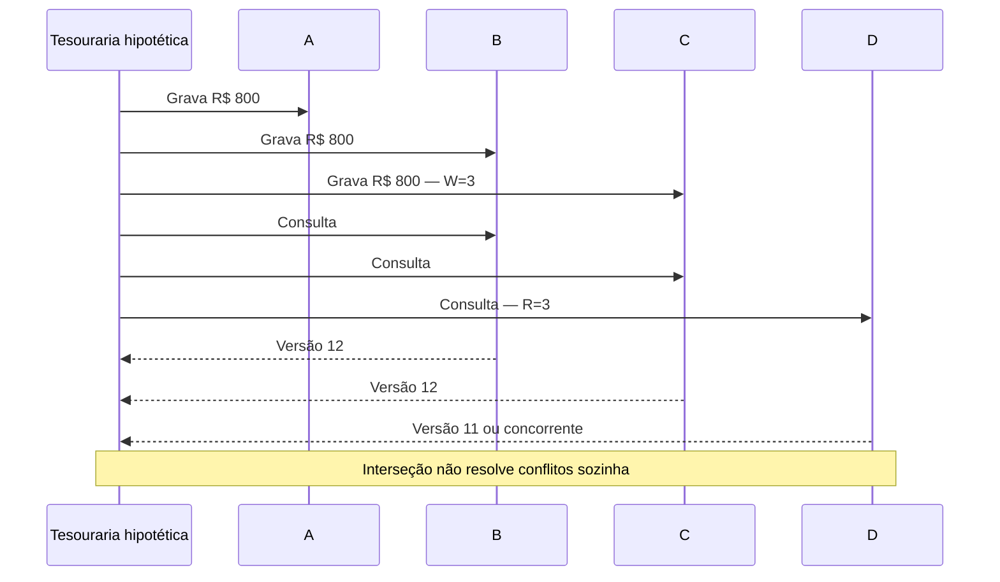
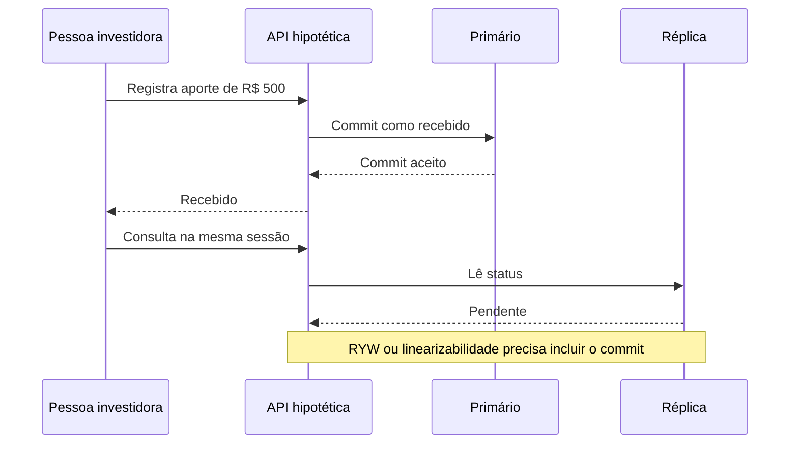
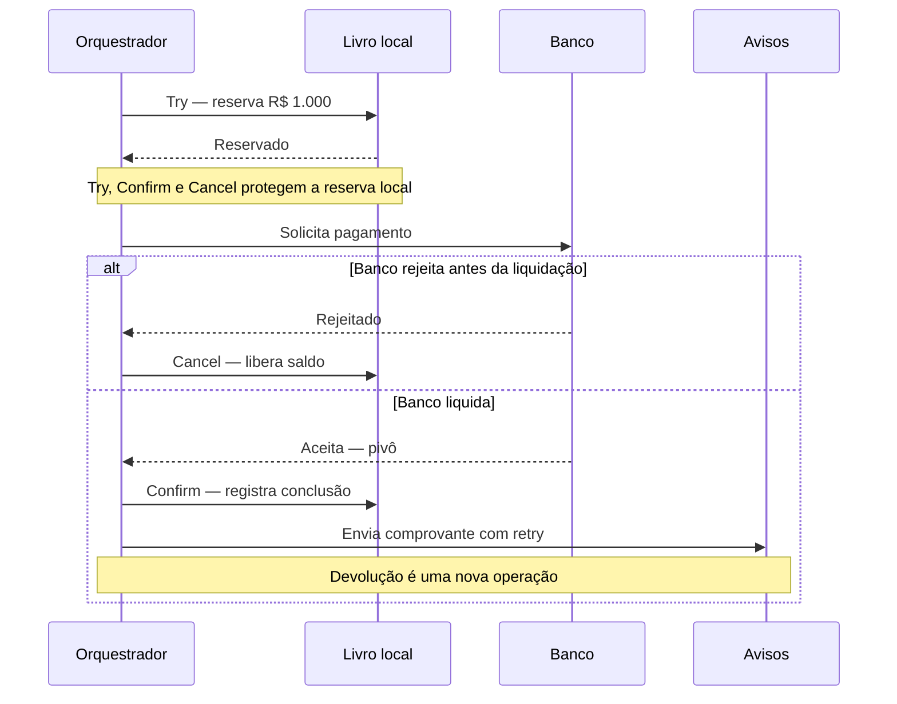

# L4C — distinções de protocolo para a redação

Esta nota fecha sete distinções para a futura aula. Ela reaproveita os pacotes S4 e S6 e não prova adoção de um padrão em XP, MakersHub ou qualquer serviço. Os três casos didáticos abaixo são hipotéticos.

## Reuso e colisões no corpus

S4 verificou no MakersHub, SHA `e233fb046ec333982cd1547171b0f0bd8d8d92ee`, às 16:08 UTC de 14/10/2026, idempotência local e uma atualização que grava a mudança de responsável com a intenção de sincronizar Salesforce. Isso não prova 2PC, TCC, Saga, Outbox, fencing externo ou leitura causal; S4 deixa esses padrões como não confirmados ([pacote S4](s4-consistency.md)).

S6 mediu entre 16:12 e 16:15 UTC de 14/10/2026 um etcd de três membros e um líder Raft: dois votos formam maioria se os sobreviventes ainda se comunicarem. Ele também registra que `client-go` não garante fencing. No PostgreSQL do Airflow, `synchronous_commit=on` e `ANY 1` significam esperar um standby elegível, não usar automaticamente o quórum `R+W>N` ([pacote S6](s6-platform.md)).

O corpus tem três afirmações a corrigir antes da aula. `docs/saga/README.md:190-191` classifica toda Saga como AP, embora Saga não escolha uma posição universal no CAP. `:134-142` chama estado intermediário confirmado de “dirty read”; isso não é leitura de valor ainda não confirmado, e cada transação local mantém o isolamento do banco. `:225-230` torna Outbox obrigatória; ela é uma opção para gravar estado e intenção de publicar na mesma transação. Reutilize a explicação de compensação e reserva com esses limites. Nada foi editado fora desta nota.

## Sete distinções

1. **`R + W > N` prova interseção, não frescor por si só.** Com o mesmo conjunto fixo de `N=5` réplicas, `W=3` e `R=3` compartilham ao menos uma. A conclusão falha se membership ou conjunto elegível mudar, se houver fallback fora do conjunto, se a leitura aceitar uma resposta isolada ou se houver versões concorrentes sem reconciliação. Dynamo chama isso de “quorum-like” e usa version vectors; a fórmula não prova linearizabilidade nem saldo atual ([Dynamo, §4.3](https://www.allthingsdistributed.com/files/amazon-dynamo-sosp2007.pdf)).

2. **“Strong”, eventual e garantias de sessão diferem.** Substitua “strong read” pela promessa precisa, como linearizabilidade: a leitura posterior a um commit vê essa escrita ou outra posterior na ordem real. Eventual promete convergência após pausa nas escritas e propagação bem-sucedida, sem frescor ou prazo máximo. Read-your-writes inclui escritas anteriores da sessão, embora uma alteração concorrente posterior possa ser o valor lido; monotonic reads impede perder mudanças já vistas. Nenhuma das duas implica serialização ([Terry et al.](https://www.cs.cornell.edu/courses/cs734/2000FA/cached%20papers/SessionGuaranteesPDIS_1.html)).

3. **Version vector, Lamport e HLC codificam ordem, não hora exata.** Version vectors guardam contadores por nó e ajudam a distinguir versões causais de versões concorrentes. Lamport garante `a aconteceu antes de b ⇒ L(a)<L(b)`, mas um valor maior também pode desempatar eventos concorrentes. HLC combina tempo físico aproximado e contador lógico para preservar causalidade recebida; não prova a hora legal exata ([artigo HLC](https://www.cse.buffalo.edu/tech-reports/2014-04.pdf); [Dynamo](https://www.allthingsdistributed.com/files/amazon-dynamo-sosp2007.pdf)).

4. **Eleição, Raft, Paxos e gossip não são sinônimos.** Eleição escolhe coordenador, mas não ordena gravações nem cerca um líder antigo. Raft combina eleição e log replicado para consenso; Paxos também alcança acordo, por outra construção. Gossip dissemina estado e membership, sem decidir sozinho um log único. Um sistema pode combinar essas peças. S6 mediu etcd/Raft e registra a limitação de fencing de `client-go` ([Raft](https://raft.github.io/raft.pdf); [S6](s6-platform.md)).

5. **2PC e 3PC dependem do modelo de falhas.** Em 2PC, participantes preparados podem bloquear se o coordenador cair antes de comunicar a decisão. 3PC acrescenta `pre-commit` e evita certos bloqueios no modelo síncrono e de falhas para o qual foi desenhado; não prometa progresso sob partição arbitrária ou atraso sem limite. Skeen formula condições para não bloqueio. S4 não verificou uma aplicação 2PC/3PC, então mantenha a lacuna explícita ([Skeen](https://doi.org/10.1145/582318.582339); [S4](s4-consistency.md)).

6. **TCC reserva; não desfaz um efeito irreversível.** `Try` valida e reserva, `Confirm` finaliza, e `Cancel` libera a reserva. As três chamadas precisam tolerar repetição. Se um banco liquidou o pagamento, devolvê-lo é uma nova operação. Em uma Saga, trate esse limite como pivô e defina retries posteriores ([TCC do Apache Seata](https://seata.apache.org/docs/user/mode/tcc/)).

7. **Saga não é categoria CAP nem remove isolamento local.** Cada passo ainda usa o isolamento do seu banco; commits separados podem expor estados de negócio intermediários, mas não fazem automaticamente dirty reads. Reserva, estado pendente ou escrita condicional podem proteger a regra. Outbox ajuda a gravar estado e intenção de mensagem numa transação; workflow durável e outros transportes também podem conduzir uma Saga.

## Três casos financeiros hipotéticos

**Caso 1 — carteira replicada.** Uma reserva hipotética de R$ 800 usa `N=5, W=3, R=3`; `W+R=6>5`, então existe interseção. O serviço ainda compara versões antes de permitir saque.

**Caso 2 — status de aporte.** Sem RYW, uma réplica atrasada pode dizer “pendente” após o registro de R$ 500. RYW inclui a escrita da sessão; monotonic reads impede retrocesso; uma leitura linearizável pode decidir se o dinheiro será liberado.

**Caso 3 — desembolso externo.** Para pagar R$ 1.000, `Try` reserva saldo. Rejeição antes da liquidação permite `Cancel`; depois do aceite bancário, devolução é nova operação. 2PC pode bloquear após falha do coordenador; 3PC depende do seu modelo de falhas.

## Bases, aplicações OSS e habilidades de apoio

As referências abaixo são material de estudo, não prova de implantação. O catálogo local lista etcd/Kubernetes, CockroachDB/TiKV, Loki/memberlist e Eventuate. O README clonado de Eventuate Tram aponta o exemplo Customers and Orders ([catálogo](../../../docs/referencias/catalogo-40-patterns-skills-frameworks.md), [índice](../../../docs/referencias/repositorios.md), [README Eventuate](../../../references/repos/eventuate-tram-sagas/README.adoc)).

| Família | Base e aplicação para estudar | Situação da referência de aplicação |
|---|---|---|
| Quórum e versões | [Dynamo](https://www.allthingsdistributed.com/files/amazon-dynamo-sosp2007.pdf), [CockroachDB](https://github.com/cockroachdb/cockroach) | Banco OSS candidato; nenhum app financeiro foi mapeado. |
| Leituras de sessão | [Terry et al.](https://www.cs.cornell.edu/courses/cs734/2000FA/cached%20papers/SessionGuaranteesPDIS_1.html) | Gap: nenhum app OSS mapeado para RYW/monotonic reads. |
| Relógios causais | [HLC](https://www.cse.buffalo.edu/tech-reports/2014-04.pdf), [CockroachDB](https://github.com/cockroachdb/cockroach) | Sistema de referência; código HLC não auditado nesta frente. |
| Eleição, consenso e gossip | [etcd](https://github.com/etcd-io/etcd), [client-go](https://github.com/kubernetes/client-go), [Kubernetes](https://github.com/kubernetes/kubernetes), [memberlist](https://github.com/hashicorp/memberlist), [Loki](https://github.com/grafana/loki) | S6 mede etcd no cluster; Loki/memberlist só constam no catálogo. |
| 2PC e 3PC | [Skeen, SIGMOD 1981](https://doi.org/10.1145/582318.582339) | Gap: nenhuma aplicação/implementação verificada em S4. |
| TCC | [Apache Seata TCC](https://seata.apache.org/docs/user/mode/tcc/) | Docs apontam `seata-samples/tcc`; é referência, não app implantado. |
| Saga | [Eventuate Tram](https://github.com/eventuate-tram/eventuate-tram-sagas), [Customers and Orders](https://github.com/eventuate-tram/eventuate-tram-sagas-examples-customers-and-orders), [Temporal](https://github.com/temporalio/temporal) | README confirma referência Eventuate; S4 não confirma Saga no fluxo MakersHub lido. |

As habilidades `backend-concurrency-mechanics`, `backend-distributed-locking`, `backend-idempotency`, `backend-transactional-outbox`, `backend-resilience-patterns`, `backend-cqrs-patterns` e `backend-event-sourcing` dão apoio adjacente. Nenhuma é específica de quórum, HLC, 2PC/3PC, TCC ou Saga.

## Fontes primárias consultadas

- [Dynamo](https://www.allthingsdistributed.com/files/amazon-dynamo-sosp2007.pdf) — quórum-like, versões e conflitos.
- [Terry et al.](https://www.cs.cornell.edu/courses/cs734/2000FA/cached%20papers/SessionGuaranteesPDIS_1.html) — RYW e monotonic reads.
- [HLC](https://www.cse.buffalo.edu/tech-reports/2014-04.pdf) — relógios físicos, lógicos e causalidade.
- [Raft](https://raft.github.io/raft.pdf) — eleição e log replicado.
- [Skeen](https://doi.org/10.1145/582318.582339) — condições para não bloqueio.
- [Apache Seata TCC](https://seata.apache.org/docs/user/mode/tcc/) — reserva, confirmação e cancelamento.
